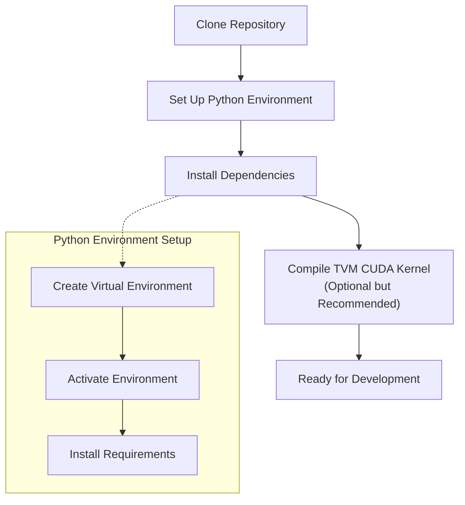
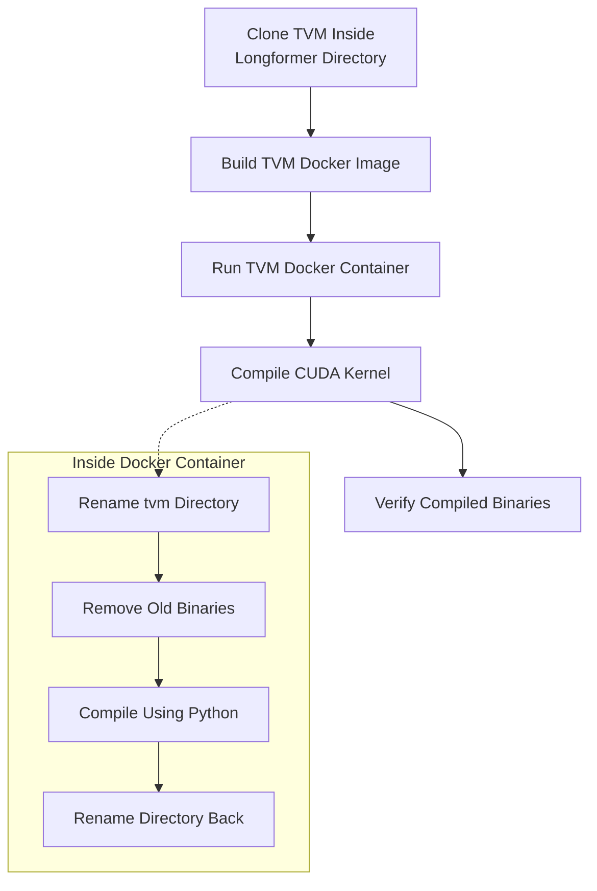
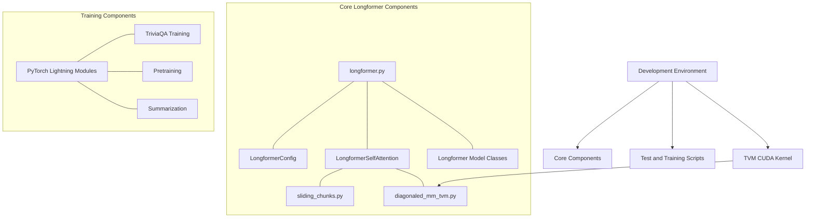
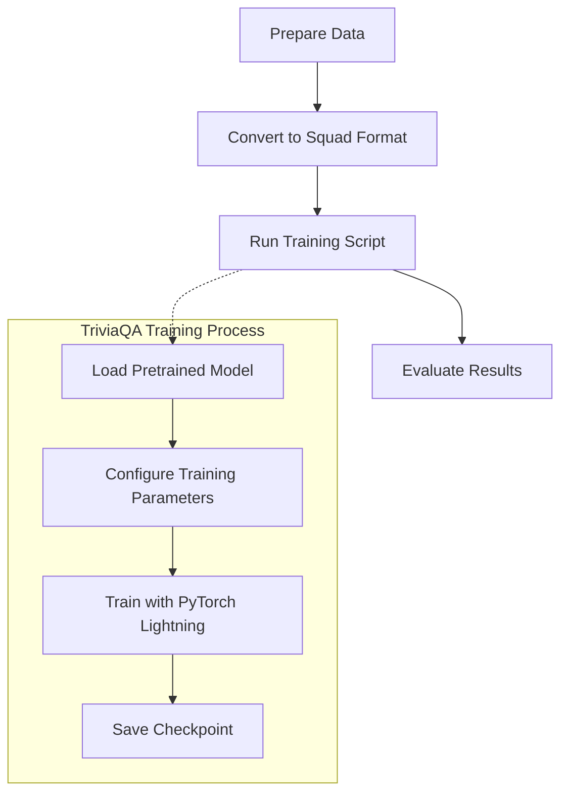

<!-- source: DeepWiki mcp.deepwiki.com · repo allenai/longformer · page 5.3 Development Setup · fetched 2026-10-26 -->

# Development Setup

<details>
<summary>Relevant source files</summary>

The following files were used as context for generating this wiki page:

- [LICENSE](LICENSE)
- [requirements.txt](requirements.txt)
- [scripts/cheatsheet.txt](scripts/cheatsheet.txt)

</details>


This document provides detailed instructions for setting up a development environment for contributing to the Longformer repository. It covers environment configuration, dependencies installation, and special setup procedures such as compiling the TVM CUDA kernel for optimized attention computation.

For installation instructions for end-users, see [Installation](#5.1). For examples of using Longformer in applications, see [Usage Examples](#5.2).

## Prerequisites

Before setting up your development environment, ensure you have the following prerequisites:

* Python 3.6 or newer
* Git
* CUDA-compatible GPU (highly recommended for development)
* Docker with GPU runtime (required only for TVM kernel compilation)

Sources: [requirements.txt:1-7]()

## Setting Up Your Development Environment

The Longformer development environment requires specific dependencies, including custom forks of the Transformers and PyTorch Lightning libraries.



### Step 1: Clone the Repository

```bash
git clone https://github.com/allenai/longformer.git
cd longformer
```

Sources: [scripts/cheatsheet.txt:6-8]()

### Step 2: Set Up Python Environment

It's recommended to use a virtual environment for development:

```bash
# Using venv
python -m venv longformer-env
source longformer-env/bin/activate  # On Windows: longformer-env\Scripts\activate

# Using conda
conda create -n longformer python=3.8
conda activate longformer
```

### Step 3: Install Dependencies

Install the required dependencies using pip:

```bash
pip install -r requirements.txt
```

This will install all dependencies, including specific versions of:
- A custom Transformers fork with Longformer-specific changes
- A custom PyTorch Lightning fork with fixes
- PyTorch 1.6.0 or newer
- Other required packages for training and evaluation

Sources: [requirements.txt:1-7]()

## Compiling the TVM CUDA Kernel

For optimal performance, Longformer uses a TVM-optimized CUDA kernel for its attention mechanism. Compiling this kernel requires Docker with GPU runtime and follows these steps:



### Step 1: Clone TVM Repository

Clone the TVM repository inside the Longformer directory:

```bash
# From within the longformer directory
git clone --single-branch --branch v0.6.0 https://github.com/apache/incubator-tvm.git
```

### Step 2: Build the TVM Docker Image

```bash
docker build -t my_tvm_image -f tvm_docker incubator-tvm/docker/
```

### Step 3: Run the Docker Container

```bash
docker run -it --gpus all --mount type=bind,source="$(pwd)",target=/code my_tvm_image
```

### Step 4: Compile the CUDA Kernel

Inside the Docker container, execute:

```bash
cd code
mv tvm tvm_runtime  # Avoid collision between our small runtime and the full TVM library
rm longformer/lib/*  # Remove old binaries
python3 -c "from longformer.diagonaled_mm_tvm import *; DiagonaledMM._get_function('float32', 'cuda')"  # Compile new binaries
ls longformer/lib/  # Check the `lib` directory for the new binaries
mv tvm_runtime tvm  # Restore the original name
```

Sources: [scripts/cheatsheet.txt:1-22]()

## Development Workflow Components

Longformer's development environment consists of several interconnected components that you should be familiar with:



### Key Code Components

When developing for Longformer, you'll primarily interact with these core components:

| Component | Description | Main Files |
|-----------|-------------|------------|
| Attention Mechanisms | Core attention implementations | `longformer/sliding_chunks.py`, `longformer/diagonaled_mm_tvm.py` |
| Model Classes | Longformer and LongformerEncoderDecoder implementations | `longformer/longformer.py`, `longformer/longformer_encoder_decoder.py` |
| Training Scripts | PyTorch Lightning modules for various tasks | `scripts/triviaqa.py`, `scripts/summarization.py` |
| TVM Integration | TVM CUDA kernel for optimized attention | `longformer/diagonaled_mm_tvm.py` |

Sources: [scripts/cheatsheet.txt:1-22]()

## Running Tests and Example Training

To verify your development setup, you can run example training scripts. The TriviaQA task is one of the main benchmarks for Longformer:



For a complete example of TriviaQA training and evaluation process, refer to the commands in the cheatsheet:

```bash
# Prepare data
python -m scripts.triviaqa_utils.convert_to_squad_format \
  --triviaqa_file path/to/qa/wikipedia-dev.json \
  --wikipedia_dir path/to/evidence/wikipedia/ \
  --web_dir path/to/evidence/web/ \
  --max_num_tokens 4096 \
  --squad_file path/to/output/squad-wikipedia-dev-4096.json

# Run training
python -m scripts.triviaqa \
    --train_dataset squad-wikipedia-train-4096.json \
    --dev_dataset squad-wikipedia-dev-4096.json \
    --gpus 0,1,2,3 --batch_size 8 --num_workers 4 \
    --lr 0.00003 --warmup 1000 --epochs 4 --max_seq_len 4096 --doc_stride -1 \
    --save_prefix output_dir \
    --model_path path/to/pretrained/longformer-base-4096 \
    --seed 4321
```

Sources: [scripts/cheatsheet.txt:24-72]()

## Performance Optimization Tips

When developing improvements to Longformer, keep these optimization techniques in mind:

1. **Gradient Checkpointing**: Crucial for handling long sequences with limited GPU memory
2. **Batch Size and Gradient Accumulation**: Adjust based on your available GPU memory
3. **Attention Implementations**: Choose between implementation variants based on your use case:
   - `sliding_chunks`: Pure PyTorch implementation
   - `sliding_chunks_no_overlap`: Optimized variant for windows without overlap
   - `tvm`: TVM-optimized CUDA kernel for maximum performance

Sources: [scripts/cheatsheet.txt:89-90]()

## Common Development Tasks

Here are some common development tasks and how to approach them:

### Modifying Attention Mechanisms

If you're modifying the attention mechanism implementations:

1. Make changes to `longformer/sliding_chunks.py` or `longformer/diagonaled_mm_tvm.py`
2. If changing the TVM implementation, recompile the CUDA kernel following the instructions above
3. Test with a small example before running full training

### Extending Model Architecture

When extending or modifying the model architecture:

1. Start with understanding the current model implementation in `longformer/longformer.py`
2. Make changes to the model configuration or class implementations
3. Test with gradual sequence length increases to identify potential memory issues

### Debugging Training Issues

When debugging training-related issues:

1. Use smaller batch sizes and sequence lengths initially
2. Enable gradient checkpointing if running out of memory
3. Use TPU debugging tools if developing for TPU support:
   ```bash
   import torch_xla.debug.metrics as met
   print(met.metrics_report())
   ```

Sources: [scripts/cheatsheet.txt:76-90]()

## Contributing

When you're ready to contribute changes back to Longformer:

1. Create a feature branch for your changes
2. Make your changes following the development guidelines
3. Run relevant tests and example training to verify functionality
4. Create a pull request with a detailed description of your changes

Note that Longformer is released under the Apache License 2.0, which governs all contributions to the project.

Sources: [LICENSE:1-202]()