# Page: Overview

# Overview

<details>
<summary>Relevant source files</summary>

The following files were used as context for generating this wiki page:

- [README.md](README.md)
- [requirements.txt](requirements.txt)

</details>


This document provides a comprehensive introduction to the Longformer repository, a set of transformer models specifically designed to handle long documents. Longformer addresses a fundamental limitation of standard transformer models - their quadratic computational complexity with respect to sequence length - by introducing innovative attention mechanisms that enable processing thousands of tokens efficiently.

## What is Longformer?

Longformer is a transformer architecture that extends the capability of standard transformers to process long documents. It comes in two main variants:

1. **Longformer**: An encoder-only model for tasks like document classification and question answering
2. **LongformerEncoderDecoder (LED)**: An encoder-decoder model for sequence-to-sequence tasks like summarization

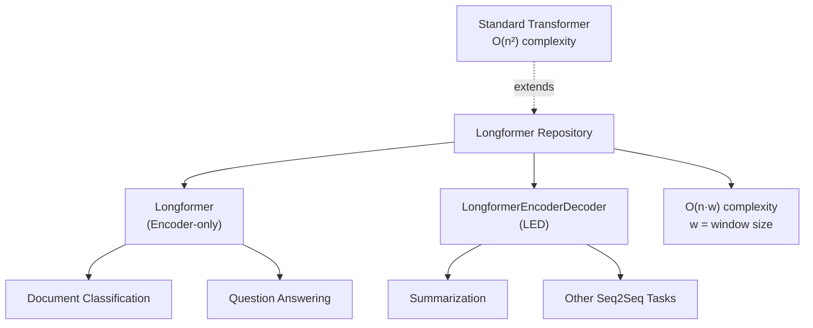

Sources: [README.md:1-10]()

## Key Innovations

Longformer introduces several technical innovations that make it possible to process documents with thousands of tokens:

| Innovation | Description | Implementation |
|------------|-------------|----------------|
| Sliding Window Attention | Limits attention to a fixed-size window, reducing complexity from O(n²) to O(n·w) | Multiple implementations (PyTorch, CUDA) |
| Global Attention | Allows specific tokens to attend to the entire sequence | Configurable per task |
| Memory Optimization | Gradient checkpointing reduces memory by ~5x | Enables processing 16K tokens on standard GPUs |

The most significant innovation is the combination of sliding window attention with global attention, allowing the model to capture both local context and document-level information efficiently.

Sources: [README.md:44-51](), [README.md:20-27]()

## Attention Mechanisms

Longformer implements multiple attention mechanisms that can be selected based on hardware and requirements:

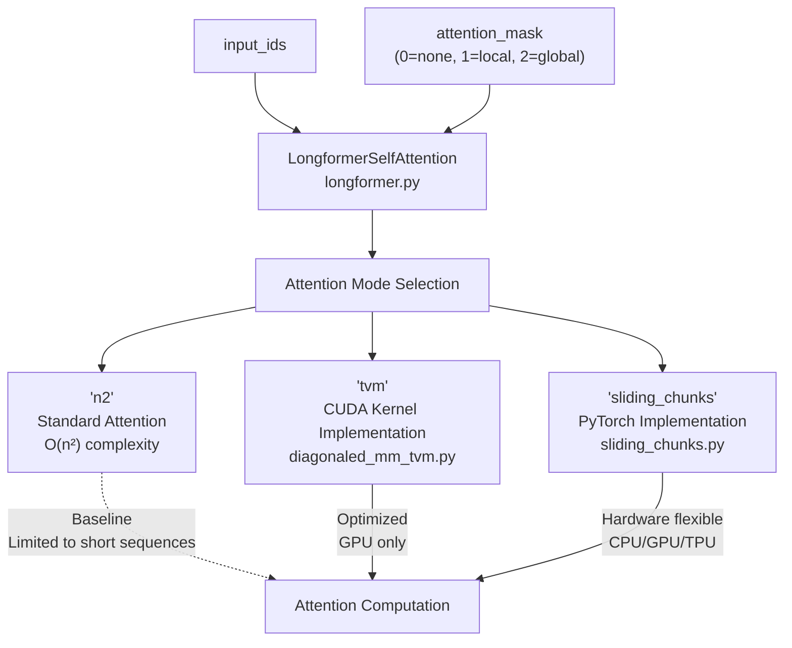

The sliding window attention is implemented in two ways:
- A custom CUDA kernel (TVM-based) for maximum performance on GPUs
- A PyTorch implementation that supports CPU, TPU, and FP16 but uses more memory

Sources: [README.md:79-83](), [README.md:43-51]()

## Code Structure

The Longformer codebase is organized around several key components:

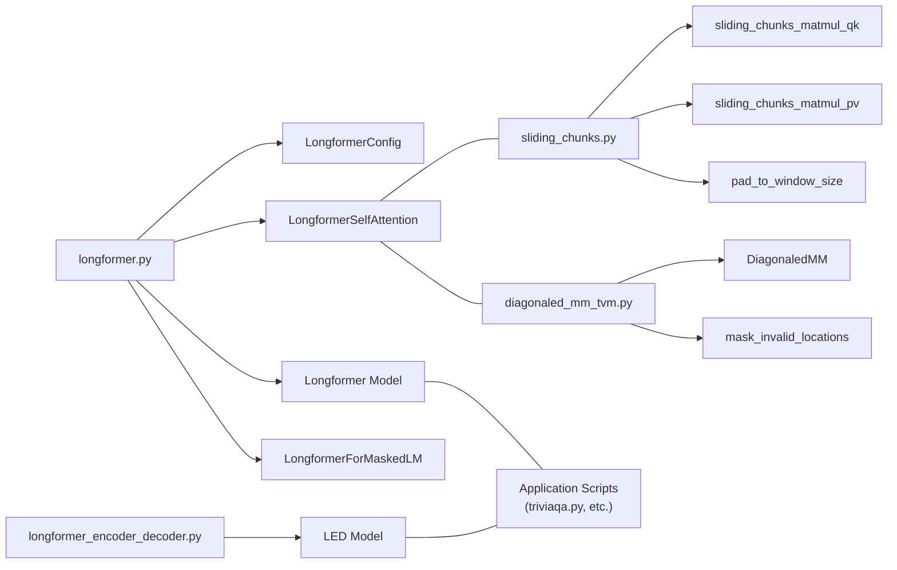

Sources: [README.md:57-107]()

## Usage Examples

Longformer can be used through Hugging Face's transformers library or directly:

```python
# Using Hugging Face
from transformers import LongformerModel
model = LongformerModel.from_pretrained('allenai/longformer-base-4096')

# Using with gradient checkpointing for memory efficiency
model = LongformerModel.from_pretrained('allenai/longformer-base-4096', 
                                        gradient_checkpointing=True)
```

The key to using Longformer effectively is setting the appropriate attention mask values:
- 0: No attention
- 1: Local attention (sliding window)
- 2: Global attention (attends to entire sequence)

Sources: [README.md:32-36](), [README.md:20-27](), [README.md:96-100]()

## Applications

Longformer has been successfully applied to several NLP tasks requiring long context:

| Task | Model | Description | Code |
|------|-------|-------------|------|
| Question Answering | LongformerForQuestionAnswering | State-of-the-art results on TriviaQA | scripts/triviaqa.py |
| Document Classification | Longformer | Used for hyperpartisan news detection | scripts/hp_preprocess.py |
| Summarization | LongformerEncoderDecoder | Supports inputs up to 16K tokens | scripts/summarization.py |

Sources: [README.md:114-117](), [README.md:4-12]()

## Related Wiki Pages

For more detailed information about specific components, see:
- Architecture details: [Architecture](#2)
- Attention mechanisms in depth: [Attention Mechanisms](#2.1)
- Implementation details: [Implementation Details](#3)
- Applications and training: [Training and Applications](#4)
- Getting started guide: [Getting Started](#5)

## Technical Requirements

Longformer requires:
- Python 3.7+
- PyTorch 1.6.0+
- A custom fork of transformers (for LED models and gradient checkpointing)
- CUDA 10.0+ (for TVM-based attention)

Sources: [requirements.txt:1-7](), [README.md:61-68]()

The Longformer repository represents a significant advancement in transformer model capabilities, extending their practical use to long-document processing while maintaining computational efficiency.

---

# Page: Architecture

# Architecture

<details>
<summary>Relevant source files</summary>

The following files were used as context for generating this wiki page:

- [README.md](README.md)
- [longformer/__init__.py](longformer/__init__.py)
- [longformer/longformer.py](longformer/longformer.py)

</details>


This document describes the high-level architecture of Longformer, explaining how it differs from standard transformers. For details about specific attention mechanisms, see [Attention Mechanisms](#2.1). For information about model implementations, see [Longformer Base Model](#2.2) and [LongformerEncoderDecoder (LED)](#2.3).

The Longformer architecture was designed to overcome the quadratic computational and memory complexity of standard transformer models, which limits them to processing sequences of only 512 tokens. Longformer enables efficient processing of documents with thousands of tokens (up to 4,096 or 16,384 tokens, depending on the model variant).

## Core Design Principles

Longformer is built on two key design principles that enable its efficient processing of long documents:

1. **Local windowed attention**: Most tokens only need to attend to neighboring tokens rather than the entire sequence
2. **Global attention**: Select tokens (like classification tokens or question tokens) attend to the full sequence to capture document-level context

By combining these two attention patterns, Longformer achieves linear scaling with sequence length while maintaining the ability to build global representations when needed.

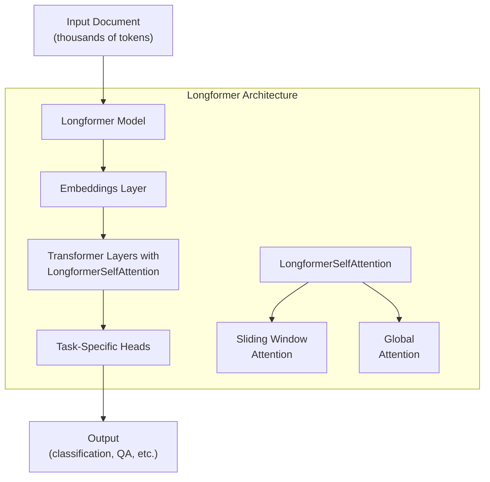

Sources: [longformer/longformer.py:12-20](), [README.md:1-13]()

## Model Architecture Components

The Longformer architecture builds upon the RoBERTa model, extending it with specialized attention mechanisms. The main components include:

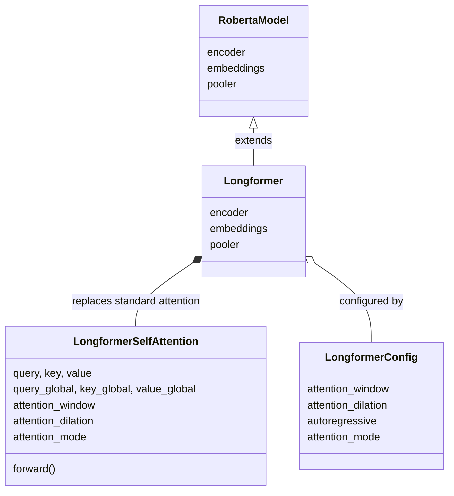

Sources: [longformer/longformer.py:12-52](), [longformer/__init__.py:1-3]()

### Configuration

The `LongformerConfig` class extends RoBERTa's configuration with additional parameters specific to Longformer's attention mechanisms:

- `attention_window`: List of window sizes for each layer, defining how many tokens each token can attend to on each side
- `attention_dilation`: List of dilation values for each layer, allowing for wider coverage with the same number of attention weights
- `autoregressive`: Boolean flag indicating whether to use autoregressive attention (only attending to previous tokens)
- `attention_mode`: The implementation to use for attention computation ('n2', 'tvm', 'sliding_chunks', or 'sliding_chunks_no_overlap')

Sources: [longformer/longformer.py:32-52]()

### Attention Mechanism

The core innovation of Longformer is its attention mechanism, implemented in the `LongformerSelfAttention` class. This replaces the standard self-attention in transformer layers with a combination of sliding window attention and global attention.

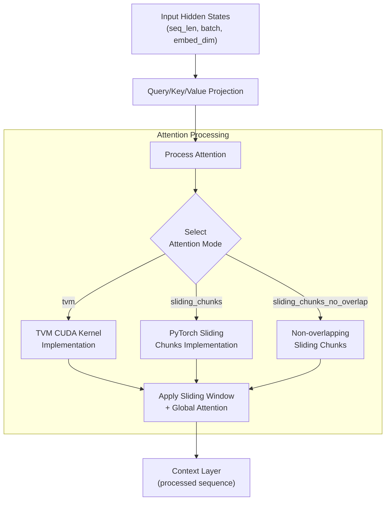

Sources: [longformer/longformer.py:55-269]()

The attention computation is highly efficient with a complexity of O(n × w) where n is the sequence length and w is the attention window size, compared to O(n²) in standard transformers.

### Attention Modes

Longformer supports several implementations of its attention mechanism:

1. **'n2'**: Standard full attention (quadratic complexity) - used for comparison or small sequences
2. **'tvm'**: A custom CUDA kernel implementation using TVM for maximum efficiency (GPU only)
3. **'sliding_chunks'**: A pure PyTorch implementation of sliding window attention (supports CPU, TPU, and fp16)
4. **'sliding_chunks_no_overlap'**: A variant of sliding chunks with non-overlapping windows

The 'tvm' mode provides the best performance but has hardware limitations. The 'sliding_chunks' implementations are more flexible but use more memory.

Sources: [longformer/longformer.py:146-173](), [README.md:43-51]()

## Data Flow

The following diagram illustrates how data flows through the Longformer architecture during forward processing:

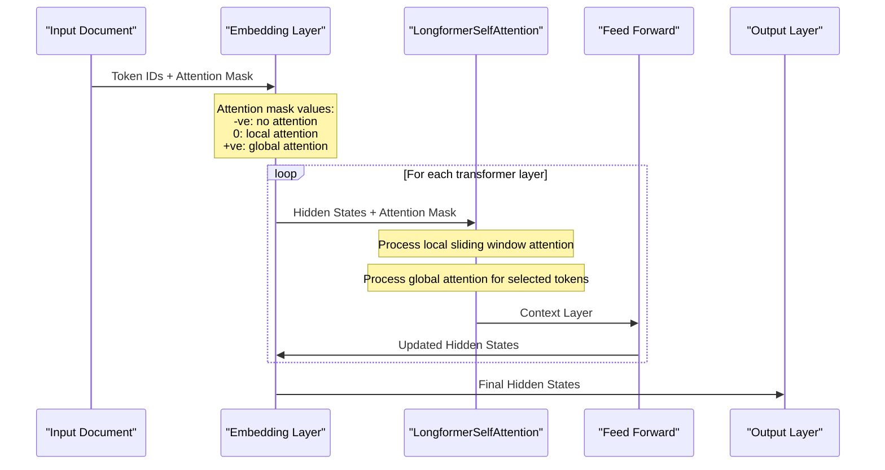

Sources: [longformer/longformer.py:88-269]()

## Integration with Pretrained Models

Longformer models are typically initialized from pretrained RoBERTa or BART models and then adapted to support long sequences. This allows Longformer to leverage existing pretrained language models while extending their capabilities to long documents.

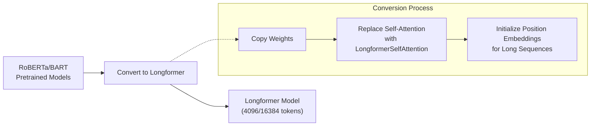

Sources: [README.md:38-108]()

## Memory Requirements and Optimizations

Longformer includes several optimizations to manage memory requirements when processing long sequences:

1. **Gradient checkpointing**: Reduces memory usage by approximately 5x by recomputing intermediate activations during the backward pass instead of storing them
2. **Attention implementation selection**: Different attention implementations offer different memory/speed tradeoffs
3. **Sliding window approach**: Significantly reduces memory requirements compared to full attention

These optimizations allow processing sequences of up to 4,096 tokens with the base model and up to 16,384 tokens with the LED model when using gradient checkpointing and mixed precision (fp16).

Sources: [README.md:4-12](), [README.md:20-26]()

## Model Variants

Two main model types are implemented in the Longformer architecture:

1. **Longformer**: An encoder-only model for tasks like document classification and question answering
2. **LongformerEncoderDecoder (LED)**: An encoder-decoder model for sequence-to-sequence tasks like summarization

Both variants use the same core attention mechanisms but are structured differently to accommodate different types of tasks.

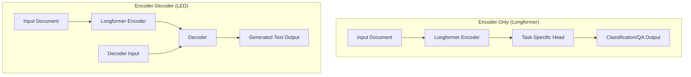

Sources: [longformer/__init__.py:1-3](), [README.md:4-12]()

## Applications and Downstream Tasks

Longformer's architecture is designed to accommodate various downstream tasks that benefit from processing long documents:

1. **Question Answering**: Using global attention on question tokens to locate answers in long contexts
2. **Document Classification**: Using global attention on classification tokens to make document-level predictions
3. **Summarization**: Using the LED variant to summarize long documents

Each application utilizes the architecture slightly differently, particularly in how global attention is applied.

Sources: [README.md:109-117]()

## Technical Implementation Details

The implementation balances flexibility, performance, and memory efficiency:

- **Python/PyTorch implementation**: Core model logic implemented in PyTorch for flexibility
- **Custom CUDA kernel**: TVM-based optimized implementation for maximum performance on GPUs
- **Multi-modal attention**: Ability to switch between attention implementations based on hardware availability and needs
- **Integration with Hugging Face Transformers**: Compatible with the broader ecosystem of transformer models

Sources: [README.md:120-124](), [longformer/longformer.py:1-9]()

Longformer's architecture successfully addresses the quadratic complexity problem of standard transformers while maintaining or improving performance on downstream tasks involving long documents.

---

# Page: Attention Mechanisms

# Attention Mechanisms

<details>
<summary>Relevant source files</summary>

The following files were used as context for generating this wiki page:

- [README.md](README.md)
- [longformer/diagonaled_mm_tvm.py](longformer/diagonaled_mm_tvm.py)
- [longformer/longformer.py](longformer/longformer.py)
- [longformer/sliding_chunks.py](longformer/sliding_chunks.py)
- [tests/test_sliding_chunks.py](tests/test_sliding_chunks.py)
- [tests/test_var_global_attn.py](tests/test_var_global_attn.py)

</details>


This document details the core innovations in the Longformer architecture that overcome the quadratic complexity problem of standard transformer attention. It explains the sliding window attention and global attention mechanisms that enable efficient processing of long documents. For implementation details of these mechanisms, see [Sliding Window Attention Implementation](#3.1) and [TVM Optimized Kernel](#3.2).

## Overview of Longformer Attention

Standard transformer models compute attention between all pairs of tokens in a sequence, resulting in O(n²) computational complexity that limits practical sequence length to around 512 tokens. Longformer introduces innovative attention mechanisms that reduce this complexity while maintaining model effectiveness.

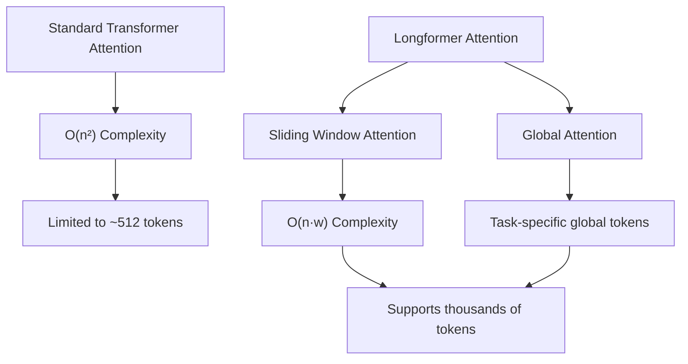

Longformer provides three implementation options for attention computation:
- `n2`: Standard full attention (for compatibility or small sequences)
- `sliding_chunks`: PyTorch implementation of sliding window attention
- `tvm`: CUDA-optimized implementation of sliding window attention

Sources: [longformer/longformer.py:32-52](). [README.md:79-83]()

## Sliding Window Attention

Sliding window attention restricts each token to attending only to a fixed-size window of surrounding tokens, rather than the entire sequence. This reduces computational complexity from O(n²) to O(n·w), where w is the window size.

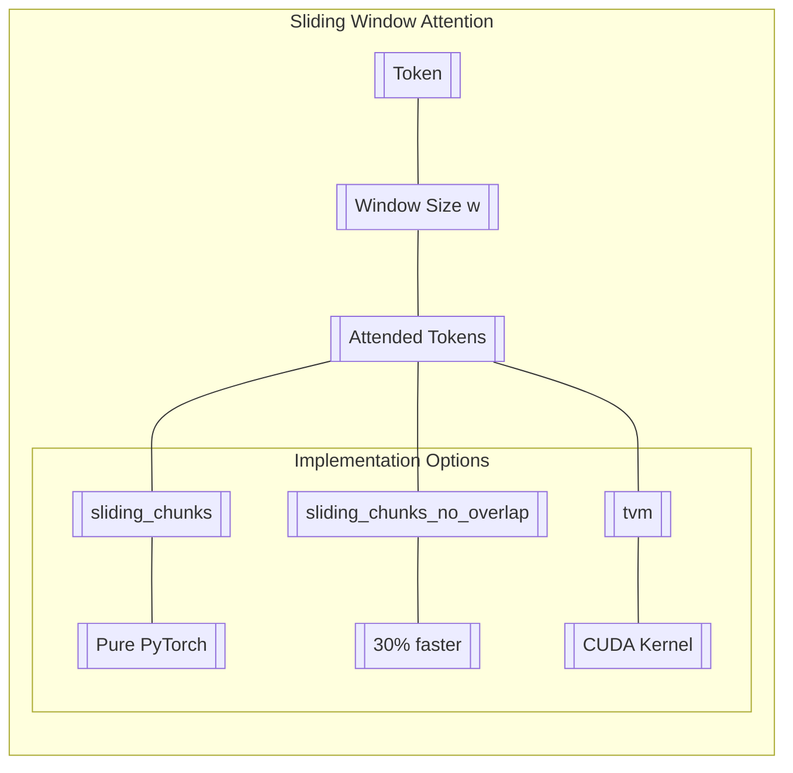

The window size is configurable per layer through the `attention_window` parameter, with typical values of 256-512 (meaning 256-512 tokens on each side). The sliding window implementation efficiently handles long sequences by only computing attention within this local context.

### Key Characteristics:

- **Local context**: Each token attends only to neighboring tokens within distance w
- **Dilation support**: Attention can be dilated to expand the receptive field (only in `tvm` mode)
- **Autoregressive option**: Can be configured for autoregressive (left-only context) attention (only in `tvm` mode)

Sources: [longformer/longformer.py:55-87](). [longformer/sliding_chunks.py:40-85]()

## Global Attention

While sliding window attention efficiently handles local context, some tokens might need global information. Longformer's global attention mechanism allows specific tokens to attend to the entire sequence while also being attended by all other tokens.

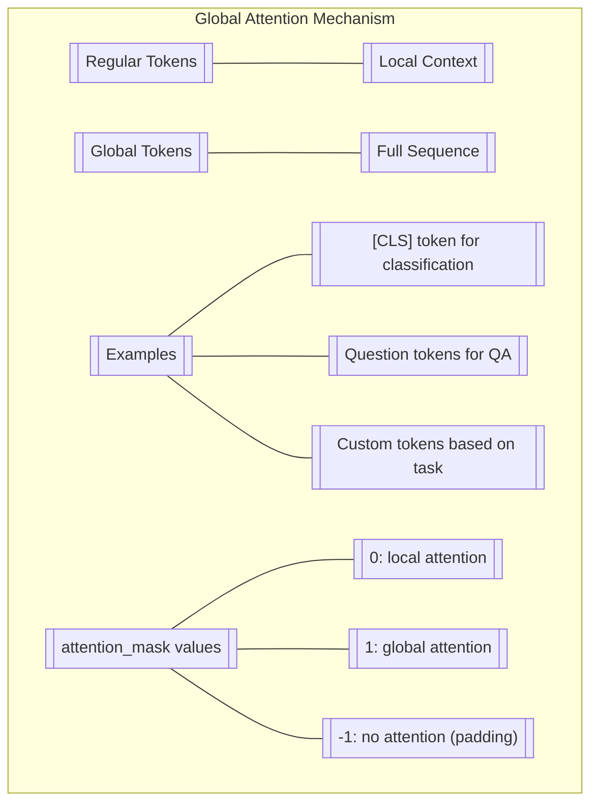

Global attention tokens are specified using a special attention mask:
- 0: Use sliding window (local) attention
- 1: Use global attention
- -1: No attention (padding)

This hybrid approach maintains the efficiency of sliding window attention while providing the flexibility needed for various downstream tasks.

Sources: [longformer/longformer.py:88-105](). [longformer/longformer.py:178-252]()

## Attention Implementation Details

The Longformer provides three attention modes to balance performance and hardware compatibility:

| Attention Mode | Description | Advantages | Limitations |
|----------------|-------------|------------|-------------|
| `n2` | Standard quadratic attention | Compatible with any hardware | O(n²) complexity limits sequence length |
| `sliding_chunks` | PyTorch implementation of sliding window attention | Works on CPU/GPU/TPU, supports fp16 | Uses more memory than TVM |
| `tvm` | Custom CUDA kernel | Best performance on GPU | GPU-only, requires Linux, no fp16 support |
| `sliding_chunks_no_overlap` | Non-overlapping chunks version | 30% faster than `sliding_chunks` | Slightly higher memory usage |

### Attention Mode Selection

Attention mode is specified in the model configuration:

```python
config = LongformerConfig.from_pretrained('longformer-base-4096/') 
config.attention_mode = 'sliding_chunks'  # Choose mode here
```

The mode should be selected based on hardware environment and task requirements:
- For training language models: Use `tvm` for best performance on GPU
- For finetuning downstream tasks: Use `sliding_chunks` for greater compatibility
- For CPU/TPU inference: Use `sliding_chunks`

Sources: [README.md:43-51](). [longformer/longformer.py:79-86]()

## Attention Matrix Computation

The sliding window attention computation involves several key steps:

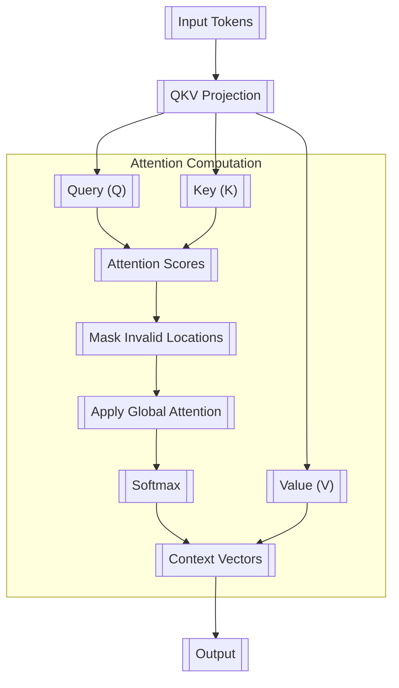

Different implementations of this process are available:

1. **sliding_chunks**: Divides the sequence into overlapping chunks and computes attention scores using PyTorch's `einsum` operation ([longformer/sliding_chunks.py:40-85]()).

2. **sliding_chunks_no_overlap**: Uses non-overlapping chunks for better performance ([longformer/sliding_chunks.py:150-176]()).

3. **tvm**: Uses a custom CUDA kernel to compute diagonaled matrix multiplication efficiently ([longformer/diagonaled_mm_tvm.py:156-262]()).

Sources: [longformer/longformer.py:146-214](). [longformer/sliding_chunks.py:40-85]()

## Handling Global Attention

When global attention tokens are present, the `LongformerSelfAttention` class processes them separately:

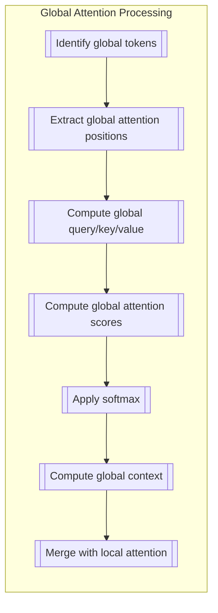

The implementation uses specialized query, key, and value projections for global tokens:

```python
query_global = nn.Linear(config.hidden_size, self.embed_dim)
key_global = nn.Linear(config.hidden_size, self.embed_dim)
value_global = nn.Linear(config.hidden_size, self.embed_dim)
```

This allows the model to learn different projection weights for global attention compared to local sliding window attention.

Sources: [longformer/longformer.py:70-72](). [longformer/longformer.py:178-252]()

## Combining Local and Global Attention

The power of Longformer's approach lies in effectively combining sliding window attention with selective global attention:

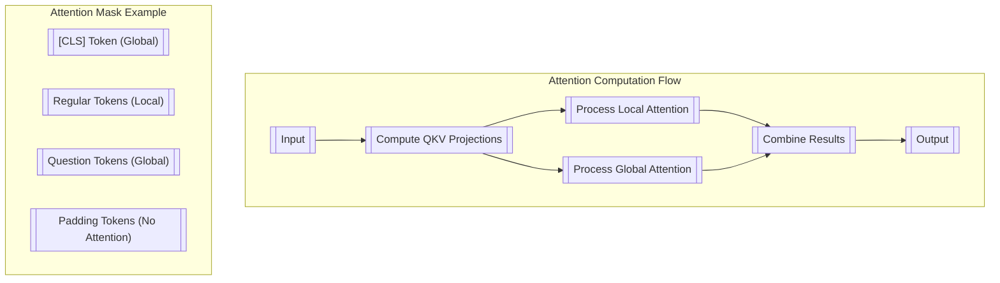

This hybrid approach provides the benefits of both worlds:
- Efficient processing with O(n·w) complexity for most tokens
- Full contextual information for task-specific tokens
- Flexibility to adapt to different downstream tasks

Sources: [longformer/longformer.py:195-203](). [longformer/longformer.py:219-252]()

## Performance Considerations

Attention mechanism selection has significant performance implications:

| Aspect | sliding_chunks | sliding_chunks_no_overlap | tvm |
|--------|----------------|---------------------------|-----|
| Speed | Baseline | ~30% faster | Fastest on GPU |
| Memory | 2x compared to TVM | 1.9x compared to TVM | Most efficient |
| Hardware | CPU/GPU/TPU | CPU/GPU/TPU | GPU only (Linux) |
| Precision | FP16/FP32 | FP16/FP32 | FP32 only |
| Features | Basic | Basic | Supports dilation and autoregressive |

For optimal performance:
- Use `tvm` when training on GPU
- Use `sliding_chunks` for greater compatibility and when working with fp16
- Use `sliding_chunks_no_overlap` for a speed boost when memory is not a concern

Sources: [README.md:43-51](). [longformer/sliding_chunks.py:137-147]()

## Practical Usage

When using the Longformer, attention mechanisms are specified through the configuration and attention mask:

1. **Configuring the attention mechanism**:
```python
config = LongformerConfig.from_pretrained('longformer-base-4096/')
config.attention_mode = 'sliding_chunks'  # or 'tvm' or 'sliding_chunks_no_overlap'
config.attention_window = [256] * num_layers  # Window size for each layer
```

2. **Setting the attention mask**:
```python
# Attention mask values:
# 0: local attention (default)
# 1: global attention
# -1: no attention (padding)
attention_mask = torch.ones(input_ids.shape, dtype=torch.long)
attention_mask[:, [1, 4, 21]] = 2  # Set global attention for specific tokens
```

3. **Padding to window size** (required for sliding_chunks):
```python
from longformer.sliding_chunks import pad_to_window_size
input_ids, attention_mask = pad_to_window_size(
    input_ids, attention_mask, config.attention_window[0], tokenizer.pad_token_id)
```

Sources: [README.md:72-106](). [longformer/sliding_chunks.py:117-133]()

## Summary

Longformer's attention mechanisms solve the quadratic complexity problem of standard transformers through an innovative combination of sliding window attention and global attention. This enables efficient processing of documents with thousands of tokens while maintaining the ability to capture both local and global context.

The multiple implementation options (`n2`, `sliding_chunks`, `sliding_chunks_no_overlap`, and `tvm`) provide flexibility to balance performance and hardware compatibility for different use cases.

---

# Page: Longformer Base Model

# Longformer Base Model

<details>
<summary>Relevant source files</summary>

The following files were used as context for generating this wiki page:

- [README.md](README.md)
- [longformer/longformer.py](longformer/longformer.py)

</details>


This document describes the base Longformer model architecture, its configuration options, and implementation details. For information about the specific attention mechanisms used in Longformer, see [Attention Mechanisms](#2.1). For the encoder-decoder variant, see [LongformerEncoderDecoder (LED)](#2.3).

## Overview

The Longformer base model is the core encoder-only implementation of the Longformer architecture, designed to efficiently process long documents with thousands of tokens. It extends the RoBERTa model with specialized attention mechanisms that reduce the computational complexity from O(n²) to O(n), allowing it to handle sequences of up to 4,096 tokens in its base configuration (compared to 512 tokens in standard transformer models).

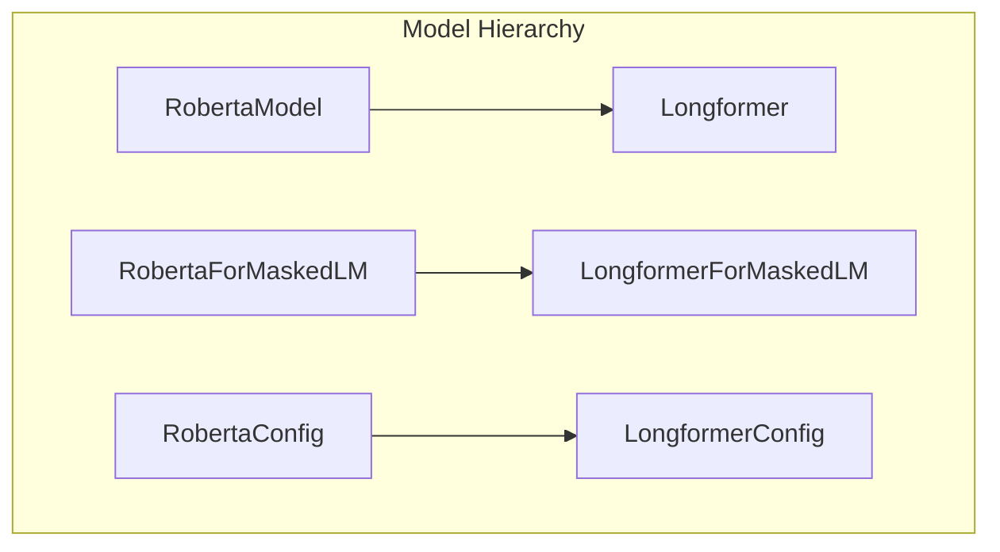
Sources: [longformer/longformer.py:12-32]()</file>

## Architecture

The Longformer base model inherits from RoBERTa while replacing the standard self-attention with a more efficient attention implementation. This architectural modification allows the model to process much longer sequences without the quadratic memory growth that limits traditional transformer models.

### Class Structure

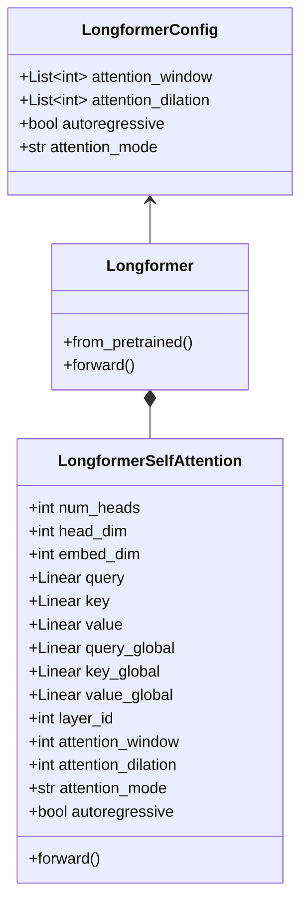
Sources: [longformer/longformer.py:12-32](), [longformer/longformer.py:55-269]()

### Base Model Components

The base Longformer model consists of:

1. **Input Embeddings**: Token, position, and segment embeddings (inherited from RoBERTa)
2. **Transformer Encoder**: Multiple transformer layers, each with:
   - LongformerSelfAttention mechanism
   - Feed-forward neural network
   - Layer normalization components
3. **Output Representations**: Contextualized embeddings for each token

During initialization, the model replaces the standard self-attention in each transformer layer with `LongformerSelfAttention` unless configured to use the standard attention mechanism (`n2` mode).

Sources: [longformer/longformer.py:12-19]()

## Configuration Options

The `LongformerConfig` class extends `RobertaConfig` with several important parameters specific to Longformer:

| Parameter | Type | Description |
|-----------|------|-------------|
| `attention_window` | List[int] | List of attention window sizes (one per layer). Each value represents the number of tokens on each side that a token can attend to. |
| `attention_dilation` | List[int] | List of attention dilation values (one per layer). A dilation of 1 means no dilation. |
| `autoregressive` | bool | Whether to use autoregressive attention or bidirectional attention. |
| `attention_mode` | str | Attention implementation to use: 'n2' (standard attention), 'tvm' (optimized CUDA kernel), 'sliding_chunks' (PyTorch implementation), or 'sliding_chunks_no_overlap'. |

Example configuration for a model with 12 layers and window size 256:
```python
config = LongformerConfig(
    attention_window=[256] * 12,
    attention_dilation=[1] * 12,
    autoregressive=False,
    attention_mode='sliding_chunks'
)
```

Sources: [longformer/longformer.py:32-52]()

## Attention Implementation

The core innovation in Longformer is its attention mechanism, implemented in the `LongformerSelfAttention` class. This mechanism combines:

1. **Sliding Window Attention**: Each token attends to a window of surrounding tokens
2. **Global Attention**: Selected tokens can attend to the entire sequence

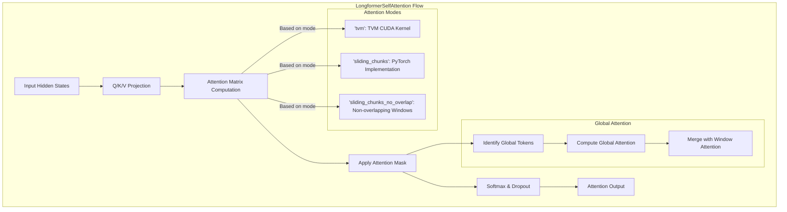
Sources: [longformer/longformer.py:55-269]()

### Attention Matrix Computation

The attention matrix is computed differently based on the configured `attention_mode`:

1. **'tvm'**: Uses a custom CUDA kernel for maximum efficiency on GPUs
2. **'sliding_chunks'**: A PyTorch implementation that supports CPU, TPU, and fp16 but uses more memory
3. **'sliding_chunks_no_overlap'**: Similar to 'sliding_chunks' but with non-overlapping attention windows
4. **'n2'**: Standard self-attention with quadratic complexity (for comparison or small inputs)

The 'sliding_chunks' and 'sliding_chunks_no_overlap' modes have some limitations:
- They don't support dilation (attention_dilation must be 1)
- They don't support autoregressive attention

Sources: [longformer/longformer.py:83-86](), [longformer/longformer.py:146-155]()

### Handling Global Attention

The Longformer base model uses an innovative approach to integrate global attention with sliding window attention:

1. Attention mask values indicate the attention type:
   - Negative values: no attention (padding)
   - 0: local attention (sliding window)
   - Positive values: global attention (token attends to entire sequence)

2. For tokens with global attention:
   - They attend to all other tokens
   - All tokens attend to them

This approach allows for task-specific adaptation of the attention pattern. For example:
- Question-answering: Set global attention on question tokens
- Classification: Set global attention on [CLS] token
- Entity extraction: Set global attention on entity tokens

Sources: [longformer/longformer.py:97-102](), [longformer/longformer.py:179-252]()

## Usage Example

Creating and using a Longformer base model:

```python
from longformer.longformer import Longformer, LongformerConfig
from longformer.sliding_chunks import pad_to_window_size
from transformers import RobertaTokenizer

# 1. Create configuration
config = LongformerConfig.from_pretrained('longformer-base-4096/') 
config.attention_mode = 'sliding_chunks'  # Choose attention implementation

# 2. Load model and tokenizer
model = Longformer.from_pretrained('longformer-base-4096/', config=config)
tokenizer = RobertaTokenizer.from_pretrained('roberta-base')
tokenizer.model_max_length = model.config.max_position_embeddings

# 3. Prepare input
text = "..." # Long document text
input_ids = torch.tensor(tokenizer.encode(text)).unsqueeze(0)  # batch of size 1

# 4. Create attention mask (0=local, 2=global)
attention_mask = torch.ones(input_ids.shape, dtype=torch.long)
attention_mask[:, [1, 4, 21]] = 2  # Set global attention on specific tokens

# 5. Pad sequence to window size if using sliding_chunks
input_ids, attention_mask = pad_to_window_size(
    input_ids, attention_mask, config.attention_window[0], tokenizer.pad_token_id)

# 6. Get model output
output = model(input_ids, attention_mask=attention_mask)[0]
```

Sources: [README.md:72-106]()

## Memory Efficiency

The Longformer base model achieves significant memory efficiency compared to standard transformers:

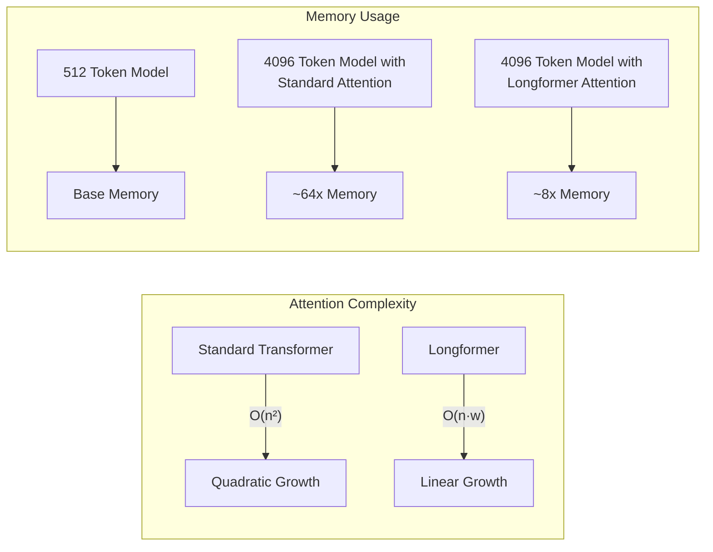

The sliding window attention reduces complexity from O(n²) to O(n·w), where:
- n = sequence length
- w = window size

This allows the Longformer base model to process documents up to 4,096 tokens in its standard configuration, with memory usage scaling linearly rather than quadratically with sequence length.

When combined with gradient checkpointing, the model can effectively handle even longer sequences (up to 16K tokens) on consumer-grade hardware.

Sources: [README.md:20-27]()

## Available Pretrained Models

Two versions of the pretrained Longformer base model are available:

| Model | Max Sequence Length | Parameters | Download Link |
|-------|---------------------|------------|--------------|
| longformer-base-4096 | 4,096 | ~125M | [download link mentioned in README] |
| longformer-large-4096 | 4,096 | ~355M | [download link mentioned in README] |

These models are pretrained by converting the corresponding RoBERTa checkpoints and extending their positional embeddings to support longer sequences.

Sources: [README.md:57-59]()

## Conversion from Existing Models

The Longformer base model can be created by converting other pretrained models like RoBERTa. The process involves:

1. Extending the positional embeddings to support longer sequences
2. Replacing the self-attention mechanism with LongformerSelfAttention
3. Initializing the new attention parameters appropriately

The repository includes a notebook that demonstrates this conversion process.

Sources: [README.md:38-40]()

---

# Page: LongformerEncoderDecoder (LED)

# LongformerEncoderDecoder (LED)

<details>
<summary>Relevant source files</summary>

The following files were used as context for generating this wiki page:

- [README.md](README.md)
- [longformer/longformer_encoder_decoder.py](longformer/longformer_encoder_decoder.py)
- [scripts/convert_bart_to_longformerencoderdecoder.py](scripts/convert_bart_to_longformerencoderdecoder.py)

</details>


## Purpose and Scope

This document details the LongformerEncoderDecoder (LED) model, which extends sequence-to-sequence transformer architectures to support very long input documents (up to 16K tokens). LED combines the Longformer's efficient attention mechanisms (described in [Attention Mechanisms](#2.1)) with an encoder-decoder architecture for tasks like summarization, translation, and other sequence generation tasks involving lengthy inputs. For information about the core Longformer model, see [Longformer Base Model](#2.2).

## Overview

LED adapts the BART encoder-decoder architecture by replacing the encoder's standard self-attention with Longformer's efficient attention mechanisms while keeping the decoder's architecture unchanged. This design enables LED to:

1. Process documents up to 16K tokens (with gradient checkpointing and fp16 precision)
2. Maintain the benefits of pretrained encoder-decoder models like BART
3. Achieve efficiency in both computation and memory usage for long-document sequence-to-sequence tasks

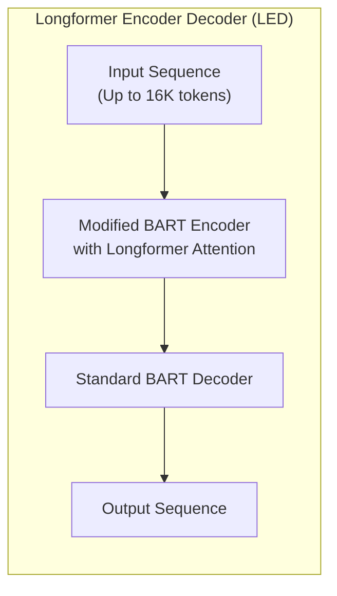

Sources: [README.md:1-12](), [longformer/longformer_encoder_decoder.py:1-10]()

## Architecture

LED is fundamentally built upon the BART architecture, with the critical modification of replacing the encoder's self-attention layers with Longformer's efficient attention. This architectural design decision enables LED to handle much longer input sequences than standard encoder-decoder transformers.

```mermaid
flowchart TD
    subgraph "LED Model"
        direction TB
        input["Input Document<br>(Long Sequence)"] --> embed["Embedding Layer"]
        embed --> encLayers["Encoder Layers"]
        
        subgraph "Encoder Layer"
            direction TB
            longAttn["LongformerSelfAttention"] --> attnOut["Attention Output Projection"]
            attnOut --> ffn["Feed-Forward Network"]
        end
        
        encLayers --> cross["Cross-Attention"]
        
        subgraph "Decoder Layer"
            direction TB
            selfAttn["Self-Attention<br>(Standard)"] --> crossAttn["Cross-Attention"]
            crossAttn --> decFfn["Feed-Forward Network"]
        end
        
        cross <--> decLayers["Decoder Layers"]
        decLayers --> outEmbed["Output Embedding"]
        outEmbed --> output["Generated Sequence"]
    end
```

Sources: [longformer/longformer_encoder_decoder.py:7-15](), [scripts/convert_bart_to_longformerencoderdecoder.py:17-87]()

### Key Components

LED consists of three main components:

1. **LongformerEncoderDecoderForConditionalGeneration**: The main model class that inherits from `BartForConditionalGeneration` and replaces the encoder's attention layers with Longformer attention.

2. **LongformerEncoderDecoderConfig**: Configuration class that extends `BartConfig` with Longformer-specific parameters.

3. **LongformerSelfAttentionForBart**: Adapter class that integrates `LongformerSelfAttention` into the BART encoder layers.

```mermaid
classDiagram
    class BartForConditionalGeneration {
        +forward()
        +generate()
    }
    
    class LongformerEncoderDecoderForConditionalGeneration {
        +forward()
        +generate()
    }
    
    class BartConfig {
        +d_model
        +encoder_attention_heads
        +decoder_attention_heads
        +encoder_layers
        +decoder_layers
    }
    
    class LongformerEncoderDecoderConfig {
        +attention_window
        +attention_dilation
        +autoregressive
        +attention_mode
        +gradient_checkpointing
    }
    
    class LongformerSelfAttentionForBart {
        +embed_dim
        +longformer_self_attn
        +output
        +forward()
    }
    
    BartForConditionalGeneration <|-- LongformerEncoderDecoderForConditionalGeneration
    BartConfig <|-- LongformerEncoderDecoderConfig
    LongformerEncoderDecoderForConditionalGeneration ..> LongformerSelfAttentionForBart : uses
```

Sources: [longformer/longformer_encoder_decoder.py:7-42]()

## Configuration

The `LongformerEncoderDecoderConfig` class extends `BartConfig` with parameters specific to Longformer's attention mechanism:

| Parameter | Description |
|-----------|-------------|
| `attention_window` | List of attention window sizes (one for each layer). Window size represents the number of attention locations on each side. For an effective window size of 512, use `[256] * num_layers` (256 on each side). |
| `attention_dilation` | List of attention dilation values (one for each layer). A dilation of `1` means no dilation. |
| `autoregressive` | Boolean flag to enable autoregressive attention or allow attention from both sides. |
| `attention_mode` | Attention implementation to use: 'n2' for regular n² self-attention, 'tvm' for TVM implementation, or 'sliding_chunks' for PyTorch implementation. |
| `gradient_checkpointing` | Boolean flag to enable gradient checkpointing for memory efficiency. |

Sources: [longformer/longformer_encoder_decoder.py:17-39]()

## Converting BART to LED

LED models are created by converting pretrained BART models. The conversion process involves:

1. Extending the position embeddings to support longer sequences
2. Replacing the encoder's self-attention layers with Longformer's attention
3. Configuring the attention window, dilation, and other Longformer-specific parameters

The repository provides a script `convert_bart_to_longformerencoderdecoder.py` to automate this conversion.

```mermaid
flowchart LR
    subgraph "Conversion Process"
        direction TB
        bart["BART Model"] --> loadModel["Load Pretrained BART"]
        loadModel --> extendPos["Extend Position Embeddings"]
        extendPos --> replaceAttn["Replace Self-Attention\nwith LongformerSelfAttention"]
        replaceAttn --> configAttn["Configure Attention\nWindows & Parameters"]
        configAttn --> save["Save LED Model"]
    end
```

Sources: [scripts/convert_bart_to_longformerencoderdecoder.py:17-87]()

### Key Steps in Conversion

1. **Loading the base model**:
   ```python
   model = BartForConditionalGeneration.from_pretrained(base_model)
   ```

2. **Extending position embeddings**:
   The conversion script extends position embeddings to support longer sequences by initializing new position embedding matrices with repeating patterns from the original embeddings.

3. **Replacing self-attention**:
   For each encoder layer, the standard self-attention is replaced with `LongformerSelfAttentionForBart`, transferring the weights from the original projection layers:
   
   ```python
   longformer_self_attn_for_bart = LongformerSelfAttentionForBart(config, layer_id=i)
   longformer_self_attn_for_bart.longformer_self_attn.query = layer.self_attn.q_proj
   longformer_self_attn_for_bart.longformer_self_attn.key = layer.self_attn.k_proj
   longformer_self_attn_for_bart.longformer_self_attn.value = layer.self_attn.v_proj
   ```

Sources: [scripts/convert_bart_to_longformerencoderdecoder.py:73-86]()

## LongformerSelfAttentionForBart

This adapter class integrates Longformer's self-attention into BART's encoder. It wraps `LongformerSelfAttention` and adapts it to match BART's attention interface:

```mermaid
flowchart TB
    subgraph "LongformerSelfAttentionForBart"
        direction TB
        input["Input\n(tgt_len, bsz, embed_dim)"] --> transpose1["Transpose to\n(bsz, tgt_len, embed_dim)"]
        transpose1 --> longAttn["LongformerSelfAttention"]
        longAttn --> transpose2["Transpose back to\n(tgt_len, bsz, embed_dim)"]
        transpose2 --> output["Output Projection"]
        output --> result["Output\n(attn_output, attention_weights?)"]
    end
```

The forward method of `LongformerSelfAttentionForBart`:
1. Takes query, key, and key_padding_mask inputs (BART format)
2. Transforms them to the format expected by `LongformerSelfAttention`
3. Runs the Longformer attention computation
4. Transforms the output back to BART's expected format

Sources: [longformer/longformer_encoder_decoder.py:42-76]()

## Memory Efficiency with Gradient Checkpointing

LED supports gradient checkpointing for memory-efficient training, which is crucial for handling very long sequences. With gradient checkpointing enabled, LED can process sequences up to 16K tokens on GPUs with 48GB of memory when combined with fp16 precision.

To enable gradient checkpointing when loading a model:

```python
model = LongformerEncoderDecoderForConditionalGeneration.from_pretrained("allenai/led-base-16384")
model.model.encoder.config.gradient_checkpointing = True
model.model.decoder.config.gradient_checkpointing = True
```

Sources: [README.md:6](), [scripts/convert_bart_to_longformerencoderdecoder.py:139-140]()

## Pretrained Models

The repository provides two pretrained LED models:

| Model | Description |
|-------|-------------|
| `led-base-16384` | Based on `bart-base` with support for up to 16K input tokens |
| `led-large-16384` | Based on `bart-large` with support for up to 16K input tokens |

Sources: [README.md:8]()

## Usage Example

Here's a simple example of using LED for a masked filling task:

```python
from transformers import BartTokenizer
from longformer.longformer_encoder_decoder import LongformerEncoderDecoderForConditionalGeneration
from transformers.modeling_bart import shift_tokens_right

# Load model and tokenizer
tokenizer = BartTokenizer.from_pretrained("allenai/led-base-16384")
model = LongformerEncoderDecoderForConditionalGeneration.from_pretrained("allenai/led-base-16384")

# Enable gradient checkpointing for memory efficiency
model.model.encoder.config.gradient_checkpointing = True
model.model.decoder.config.gradient_checkpointing = True

# Prepare input
text = "My friends are <mask> but they eat too many carbs."
data = tokenizer([text], return_tensors='pt', padding='max_length', max_length=2048)
input_ids = data['input_ids']
attention_mask = data['attention_mask']
decoder_input_ids = shift_tokens_right(input_ids[:, :5], tokenizer.pad_token_id)

# Generate output
logits = model(input_ids, attention_mask=attention_mask, 
               decoder_input_ids=decoder_input_ids, use_cache=False)[0]
               
# Get predictions for the masked token
masked_index = (input_ids[0] == tokenizer.mask_token_id).nonzero().item()
probs = logits[0, masked_index].softmax(dim=0)
values, predictions = probs.topk(5)
predicted_tokens = tokenizer.convert_ids_to_tokens(predictions)
```

Sources: [scripts/convert_bart_to_longformerencoderdecoder.py:136-149]()

## Relation to Other Components

LED is part of the Longformer ecosystem and relates to other components as follows:

```mermaid
graph TD
    longformer["Longformer Base Model"] --> led["LongformerEncoderDecoder (LED)"]
    bart["BART Model"] --> led
    
    subgraph "Attention Mechanism"
        attn["LongformerSelfAttention"] --> ledAttn["LongformerSelfAttentionForBart"]
        ledAttn --> led
    end
    
    subgraph "Applications"
        led --> summ["Summarization"]
        led --> qa["Question Answering"]
        led --> trans["Translation"]
    end
    
    subgraph "Memory Optimization"
        gc["Gradient Checkpointing"] --> led
        fp16["Mixed Precision (fp16)"] --> led
    end
```

Sources: [README.md:1-12](), [longformer/longformer_encoder_decoder.py:1-76]()

## Requirements and Dependencies

To use LED, you need:

1. Python 3.7+
2. PyTorch 1.2.0+
3. The Huggingface/transformers fork specified in `requirements.txt` (or install via `pip install git+https://github.com/allenai/longformer.git`)
4. Optional: CUDA 10.0+ for GPU acceleration

The specific transformers fork is required for gradient checkpointing and to allow different maximum sequence lengths for the input and output.

Sources: [README.md:10]()

---

# Page: Implementation Details

# Implementation Details

<details>
<summary>Relevant source files</summary>

The following files were used as context for generating this wiki page:

- [longformer/diagonaled_mm_tvm.py](longformer/diagonaled_mm_tvm.py)
- [longformer/longformer.py](longformer/longformer.py)
- [tests/test_sliding_chunks.py](tests/test_sliding_chunks.py)
- [tests/test_var_global_attn.py](tests/test_var_global_attn.py)

</details>


This document provides technical details about the implementation choices and optimizations in the Longformer architecture. It focuses on the core implementation strategies, attention mechanism variants, and performance optimizations that enable efficient processing of long documents.

For architectural concepts and theoretical background, see [Architecture](#2). For usage examples and applications, see [Training and Applications](#4).

## Core Implementation Structure

Longformer extends the RoBERTa transformer model by replacing the standard self-attention layers with specialized attention layers that implement sliding window attention with optional global attention.

```mermaid
classDiagram
    class "RobertaModel" {
        +encoder
        +embeddings
        +forward()
    }
    class "Longformer" {
        +replace_attention_layers()
    }
    class "LongformerForMaskedLM" {
        +replace_attention_layers()
    }
    class "LongformerConfig" {
        +attention_window: List[int]
        +attention_dilation: List[int]
        +autoregressive: bool
        +attention_mode: str
    }
    class "LongformerSelfAttention" {
        +query, key, value
        +query_global, key_global, value_global
        +attention_window
        +attention_dilation
        +attention_mode
        +forward()
    }
    
    "RobertaModel" <|-- "Longformer"
    "RobertaForMaskedLM" <|-- "LongformerForMaskedLM"
    "RobertaConfig" <|-- "LongformerConfig"
    "Longformer" --> "LongformerSelfAttention" : replaces self-attention with
    "LongformerForMaskedLM" --> "LongformerSelfAttention" : replaces self-attention with
```

Sources: [longformer/longformer.py:12-29]()

The core implementation pattern involves:

1. Inheriting from the RoBERTa model classes
2. Extending the configuration with Longformer-specific parameters
3. Replacing the standard attention mechanism with custom sliding window attention

The `LongformerConfig` class adds the following crucial parameters:

| Parameter | Type | Description |
|-----------|------|-------------|
| `attention_window` | List[int] | Window sizes for each layer, defining how many tokens to attend to on each side |
| `attention_dilation` | List[int] | Dilation factors for each layer, creating gaps between attended tokens |
| `autoregressive` | bool | Whether to use autoregressive attention or bidirectional attention |
| `attention_mode` | str | The implementation to use: 'tvm', 'sliding_chunks', 'sliding_chunks_no_overlap', or 'n2' |

Sources: [longformer/longformer.py:32-52]()

## Attention Mechanism Implementation

The `LongformerSelfAttention` class is the heart of the implementation, providing both sliding window attention and global attention capabilities.

```mermaid
flowchart TD
    A["Input Hidden States"] --> B["Project to Q/K/V"]
    A --> C["Identify Global Attention Tokens"]
    B --> D{"Select Attention Mode"}
    
    D -->|"tvm"| E["DiagonaledMM TVM Kernel"]
    D -->|"sliding_chunks"| F["sliding_chunks_matmul_qk"]
    D -->|"sliding_chunks_no_overlap"| G["sliding_chunks_no_overlap_matmul_qk"]
    
    E --> H["Mask Invalid Locations"]
    F --> H
    G --> H
    
    C --> I["Process Global Attention"]
    
    H --> J["Apply Softmax"]
    J --> K{"Has Global Attention?"}
    
    K -->|"Yes"| L["Combine Global + Local Attention"]
    K -->|"No"| M["Process Local Attention Only"]
    
    I --> L
    L --> N["Output Context Layer"]
    M --> N
```

Sources: [longformer/longformer.py:55-269]()

### Attention Mask Interpretation

The attention mask uses a specialized coding scheme:

| Mask Value | Meaning |
|------------|---------|
| Negative (-1) | No attention (padding) |
| Zero (0) | Local attention |
| Positive (1) | Global attention |

This allows a flexible combination of local and global attention. The implementation processes the mask to identify tokens requiring global attention and handles them separately.

Sources: [longformer/longformer.py:97-102]()

### Attention Modes

The model supports three primary attention implementation strategies:

1. **TVM Optimized (tvm)**: Uses an optimized CUDA kernel for diagonal matrix multiplication
2. **Sliding Chunks (sliding_chunks)**: Pure PyTorch implementation using tensor manipulation
3. **Sliding Chunks No Overlap (sliding_chunks_no_overlap)**: Alternative PyTorch implementation

The choice between these modes depends on hardware compatibility, precision requirements, and performance considerations.

Sources: [longformer/longformer.py:146-155](), [longformer/longformer.py:205-212]()

## TVM-Optimized Diagonal Matrix Multiplication

The TVM-optimized kernel provides significant performance gains for the sliding window attention computation.

```mermaid
flowchart TD
    A["DiagonaledMM.apply"] --> B["Input Preparation"]
    B --> C["Get/Compile TVM Function"]
    C --> D{"Exists in Cache?"}
    D -->|"No"| E["Load Compiled Function"]
    E --> F{"Exists on Disk?"}
    
    F -->|"No"| G["Compile TVM Function"]
    G --> H["Save to Disk"]
    H --> I["Store in Function Cache"]
    
    F -->|"Yes"| I
    D -->|"Yes"| J["Execute TVM Function"]
    I --> J
    
    J --> K["Return Result"]
```

Sources: [longformer/diagonaled_mm_tvm.py:8-203]()

### Compilation and Caching

The implementation uses an intelligent compilation and caching strategy:

1. First, tries to retrieve a previously compiled function from memory
2. If not found, attempts to load from disk
3. If not available, compiles the TVM function and saves it for future use

This approach minimizes compilation overhead while ensuring optimal performance.

Sources: [longformer/diagonaled_mm_tvm.py:137-153]()

### Memory Optimization

The implementation includes careful memory management techniques:

1. **Tensor Stride Fixing**: Addresses inconsistencies in PyTorch's stride information for improved TVM compatibility
2. **Contiguous Tensors**: Ensures all tensors are contiguous before passing to TVM
3. **Result Memory Allocation**: Pre-allocates result tensors to avoid unnecessary memory operations

Sources: [longformer/diagonaled_mm_tvm.py:206-228]()

## Performance Comparison

The implementation includes benchmarking that demonstrates the performance difference between the TVM-optimized and PyTorch sliding chunks implementations.

```mermaid
graph LR
    subgraph "Attention Implementation Performance"
        A["TVM Optimized"] -->|"Compile Once"| B["Fast Inference"]
        C["Sliding Chunks PyTorch"] -->|"No Compilation"| D["Moderate Speed"]
        E["Regular O(n²) Attention"] -->|"Standard Implementation"| F["Slow for Long Sequences"]
    end
    
    B -->|"Best for"| G["Production Deployment"]
    D -->|"Best for"| H["Development/Flexibility"]
    F -->|"Limited to"| I["Short Sequences Only"]
```

Sources: [tests/test_sliding_chunks.py:16-81]()

The test suite includes comprehensive comparisons that verify numerical equivalence between these implementations while measuring their relative performance.

## Global Attention Handling

The model efficiently processes variable global attention scenarios, where different sequences in a batch may have different numbers of tokens with global attention.

```mermaid
flowchart TD
    A["Input Attention Mask"] --> B["Extract Global Attention Mask"]
    B --> C["Count Global Tokens per Batch"]
    C --> D["Find Maximum Count"]
    D --> E["Create Selection Masks"]
    E --> F["Process Global Attention Separately"]
    F --> G["Process Local Attention"]
    G --> H["Combine Results"]
```

Sources: [longformer/longformer.py:107-133](), [tests/test_var_global_attn.py:10-69]()

The implementation handles cases where global attention is applied to:
- The same positions across all sequences
- Different positions in different sequences
- Variable numbers of positions across the batch

This flexibility is crucial for tasks like question answering where specific tokens (like the question) require global context.

## Implementation Constraints and Limitations

Several implementation constraints exist to be aware of:

1. **Minimum Sequence Length**: A minimum sequence length of 16 is required to avoid splitting errors
2. **Autoregressive Limitations**: The autoregressive setting is only supported with the TVM implementation, not with sliding_chunks
3. **Dilation Support**: The sliding_chunks implementations do not support dilation (must be set to 1)

Sources: [longformer/diagonaled_mm_tvm.py:230-252](), [longformer/longformer.py:84-86]()

The code includes appropriate assertions to validate these constraints at runtime.

## Summary of Implementation Features

| Feature | Implementation | Benefits | Limitations |
|---------|----------------|----------|------------|
| Sliding Window Attention | Multiple modes (tvm, sliding_chunks) | Reduces complexity from O(n²) to O(n·w) | Limited context integration |
| Global Attention | Special token handling | Provides full context where needed | Increases complexity for global tokens |
| TVM-Optimized Kernel | Custom CUDA kernel | 5-10x faster than pure PyTorch | Requires compilation, limited flexibility |
| Variable Global Attention | Masked selection | Supports different global attention patterns | Adds computational overhead |

The Longformer implementation successfully addresses the quadratic complexity problem of transformers through a careful combination of implementation strategies that balance performance and flexibility.

---

# Page: Sliding Window Attention Implementation

# Sliding Window Attention Implementation

<details>
<summary>Relevant source files</summary>

The following files were used as context for generating this wiki page:

- [longformer/longformer.py](longformer/longformer.py)
- [longformer/sliding_chunks.py](longformer/sliding_chunks.py)

</details>


This page documents the PyTorch implementations of sliding window attention in the Longformer architecture. Sliding window attention is a core innovation that enables Longformer to process long documents by reducing the quadratic complexity of standard transformer attention to linear complexity. For information about the TVM optimized attention implementation, see [TVM Optimized Kernel](#3.2).

## Overview

Sliding window attention restricts each token to attend only to a fixed window of surrounding tokens rather than the entire sequence. This reduces the computational complexity from O(n²) to O(n·w), where n is the sequence length and w is the window size.

The Longformer codebase provides two PyTorch implementations of sliding window attention:

1. **`sliding_chunks`**: Uses overlapping chunks with shared computation
2. **`sliding_chunks_no_overlap`**: Uses non-overlapping chunks for better efficiency

```mermaid
flowchart LR
    Input["Input Sequence"] --> SWA["Sliding Window Attention"]
    SWA --> |"O(n·w) complexity"| Output["Output Sequence"]
    
    subgraph "Implementation Options"
        SC["sliding_chunks"]
        SCNO["sliding_chunks_no_overlap"]
        TVM["tvm (CUDA kernel)"]
    end
    
    SWA --> SC
    SWA --> SCNO
    SWA --> TVM
```

Sources: [longformer/longformer.py:32-52](). [longformer/sliding_chunks.py:40-86](), [longformer/sliding_chunks.py:150-163]()

## Attention Pattern

Sliding window attention restricts the attention computation to a fixed-size window around each token. The diagram below shows the attention pattern for a single token (position 4) with a window size of 2:

```mermaid
graph TD
    subgraph "Input Sequence"
        T0["Token 0"]
        T1["Token 1"]
        T2["Token 2"]
        T3["Token 3"]
        T4["Token 4"]
        T5["Token 5"]
        T6["Token 6"]
        T7["Token 7"]
    end
    
    T4 --> T2
    T4 --> T3
    T4 --> T4
    T4 --> T5
    T4 --> T6
    
    classDef attended fill:#f9f,stroke:#333,stroke-width:1px;
    class T2,T3,T4,T5,T6 attended;
```

Sources: [longformer/longformer.py:75-87]()

## Sliding Chunks Implementation

The `sliding_chunks` implementation divides the input sequence into overlapping chunks and computes attention within these chunks. This approach enables efficient computation while maintaining the sliding window attention pattern.

### Key Functions

The implementation consists of several key functions:

1. **`_chunk`**: Converts the input tensor into overlapping chunks
2. **`_skew`**: Transforms diagonal elements in the attention matrix for proper computation
3. **`sliding_chunks_matmul_qk`**: Computes attention scores between query and key matrices
4. **`sliding_chunks_matmul_pv`**: Applies attention scores to value matrices

```mermaid
flowchart TD
    Q["Query Tensor"] --> QC["Chunked Q"]
    K["Key Tensor"] --> KC["Chunked K"]
    QC --> MM["Matrix Multiplication"]
    KC --> MM
    MM --> SKEW["Diagonal Skewing"]
    SKEW --> MASK["Mask Invalid Locations"]
    
    V["Value Tensor"] --> VC["Chunked V"]
    MASK --> PROB["Attention Probabilities"]
    PROB --> FINAL["Final Attention Output"]
    VC --> FINAL
    
    subgraph "sliding_chunks_matmul_qk"
        QC
        KC
        MM
        SKEW
        MASK
    end
    
    subgraph "sliding_chunks_matmul_pv"
        PROB
        VC
        FINAL
    end
```

Sources: [longformer/sliding_chunks.py:25-38](), [longformer/sliding_chunks.py:6-10](), [longformer/sliding_chunks.py:40-86](), [longformer/sliding_chunks.py:88-114]()

### Chunking Process

The chunking process is a key component that enables efficient computation:

1. The input is first divided into non-overlapping chunks of size 2w
2. Then, using `as_strided`, these chunks are made to overlap with an overlap size of w
3. This allows sharing computation across adjacent chunks

```mermaid
graph LR
    subgraph "Original Sequence"
        S["Tokens 0...n"]
    end
    
    subgraph "Non-overlapping Chunks (2w)"
        C1["Chunk 1"]
        C2["Chunk 2"]
        C3["Chunk 3"]
    end
    
    subgraph "Overlapping Chunks"
        O1["Chunk 1 (0 to 2w-1)"]
        O2["Chunk 2 (w to 3w-1)"]
        O3["Chunk 3 (2w to 4w-1)"]
    end
    
    S --> C1
    S --> C2
    S --> C3
    
    C1 --> O1
    C2 --> O2
    C3 --> O3
    
    style O1 stroke-dasharray: 5 5
    style O2 stroke-dasharray: 5 5
    style O3 stroke-dasharray: 5 5
```

Sources: [longformer/sliding_chunks.py:25-38]()

## Matrix Multiplication Algorithm

The core of the sliding window attention is the matrix multiplication between query and key tensors, followed by applying the resulting attention weights to the value tensor.

### Query-Key Matrix Multiplication

The `sliding_chunks_matmul_qk` function handles the multiplication between query and key tensors:

1. Reshape query and key tensors to group batch size and heads
2. Chunk the reshaped tensors
3. Perform batched matrix multiplication using `einsum`
4. Convert diagonal attention patterns to a format suitable for attention
5. Mask invalid attention positions

```mermaid
flowchart TD
    Input["Q, K tensors<br>bsz x seqlen x num_heads x head_dim"] --> Reshape["Reshape to<br>bsz*num_heads x seqlen x head_dim"]
    Reshape --> Chunk["Create overlapping chunks<br>with _chunk function"]
    Chunk --> Multiply["Matrix multiply using einsum<br>'bcxd,bcyd->bcxy'"]
    Multiply --> Skew["Convert diagonals to columns<br>with _skew function"]
    Skew --> Assemble["Assemble diagonal attention matrix"]
    Assemble --> MaskInvalid["Mask invalid locations"]
    MaskInvalid --> Output["Output attention weights<br>bsz x seqlen x num_heads x (2w+1)"]
```

Sources: [longformer/sliding_chunks.py:40-86]()

### Attention Application to Values

The `sliding_chunks_matmul_pv` function applies the attention weights to value tensors:

1. Reshape probability and value tensors
2. Pad the value tensor and create chunks
3. Skew the probability tensor
4. Apply attention weights to values using `einsum`

```mermaid
flowchart TD
    Input["Attention weights and Values"] --> ReshapeP["Reshape attention prob<br>bsz x seqlen x num_heads x (2w+1)<br>→ bsz*num_heads x seqlen/w x w x (2w+1)"]
    Input --> ReshapeV["Reshape values<br>bsz x seqlen x num_heads x head_dim<br>→ bsz*num_heads x seqlen x head_dim"]
    ReshapeV --> PadV["Pad values with w tokens<br>at beginning and end"]
    PadV --> ChunkV["Create chunks of size 3w<br>with w overlap"]
    ReshapeP --> SkewP["Skew probabilities<br>with _skew2 function"]
    SkewP --> Multiply["Matrix multiply with einsum<br>'bcwd,bcdh->bcwh'"]
    ChunkV --> Multiply
    Multiply --> Reshape["Reshape to original dimensions<br>bsz x seqlen x num_heads x head_dim"]
    Reshape --> Output["Output contextualized representations"]
```

Sources: [longformer/sliding_chunks.py:88-114]()

## No-Overlap Implementation

The `sliding_chunks_no_overlap` implementation offers a more efficient alternative by using non-overlapping chunks. This approach is approximately 30% faster and uses 5% less memory compared to the standard `sliding_chunks` implementation.

### Key Differences

1. Uses non-overlapping chunks of size `w` instead of overlapping chunks
2. Total attention window size is approximately 3w instead of 2w+1
3. The window is asymmetric, with attention on each side ranging from w to 2w tokens

```mermaid
flowchart TD
    Input["Q, K, V tensors"] --> Reshape["Reshape to chunks<br>bsz x seqlen/w x w x num_heads x head_dim"]
    Reshape --> Expand["Expand K and V with<br>previous and next chunks"]
    Expand --> Einsum["Matrix multiply with einsum"]
    Einsum --> Output["Context vectors"]
    
    subgraph "Chunk Expansion Pattern"
        C1["Previous Chunk (padded)"]
        C2["Current Chunk"]
        C3["Next Chunk (padded)"]
        C1 --- C2
        C2 --- C3
    end
    
    Expand --> C1
    Expand --> C2
    Expand --> C3
```

Sources: [longformer/sliding_chunks.py:150-176]()

The `sliding_chunks_no_overlap` implementation accomplishes this by:

1. Dividing input into non-overlapping chunks of size `w`
2. Expanding each chunk to include the previous and next chunks
3. Computing attention across these expanded chunks
4. Assembling the final output efficiently

## Integration with Longformer

The sliding window attention implementations are integrated into the Longformer architecture through the `LongformerSelfAttention` class. This class selects the appropriate implementation based on the `attention_mode` configuration parameter.

### Attention Mode Selection

In the `forward` method of `LongformerSelfAttention`, the code selects the appropriate sliding window implementation:

```mermaid
flowchart TD
    Config["attention_mode configuration"] --> Decision{"Which mode?"}
    Decision -->|"'tvm'"| TVMImpl["diagonaled_mm_tvm"]
    Decision -->|"'sliding_chunks'"| SCImpl["sliding_chunks_matmul_qk/pv"]
    Decision -->|"'sliding_chunks_no_overlap'"| SCNOImpl["sliding_chunks_no_overlap_matmul_qk/pv"]
    
    TVMImpl --> Mask["mask_invalid_locations"]
    SCImpl --> Mask
    SCNOImpl --> Mask
    
    Mask --> CombineGlobal{"Global attention needed?"}
    CombineGlobal -->|"Yes"| GlobalAttention["Add global attention"]
    CombineGlobal -->|"No"| Output["Output contextualized representations"]
    GlobalAttention --> Output
```

Sources: [longformer/longformer.py:88-269]()

### Usage in the Forward Pass

The sliding window attention is used in the model's forward pass as follows:

1. Project the hidden states to query, key, and value representations
2. Reshape them to the appropriate format
3. Apply the selected sliding window attention implementation
4. If global attention is needed, compute and combine it with the local attention
5. Return the contextualized representations

## Padding Utility Function

To ensure that sequences work correctly with the sliding window implementation, Longformer provides a utility function `pad_to_window_size`:

```mermaid
flowchart LR
    Input["Input Sequence<br>bsz x seqlen"] --> Check{"Is length divisible<br>by 2*window_size?"}
    Check -->|"Yes"| Output["Return input unchanged"]
    Check -->|"No"| Pad["Pad sequence to make<br>length divisible by 2*window_size"]
    Pad --> Output
```

Sources: [longformer/sliding_chunks.py:117-133]()

This function:
1. Calculates the padding length needed to make the sequence length divisible by 2 times the window size
2. Pads the input ids with the pad token id
3. Updates the attention mask accordingly to ignore the padding tokens

## Performance Considerations

When choosing between sliding window implementations, consider the following:

| Implementation | Speed | Memory Usage | Window Pattern | Best For |
|----------------|-------|--------------|----------------|----------|
| `sliding_chunks` | Base | Base | Symmetric (w tokens on each side) | Most use cases |
| `sliding_chunks_no_overlap` | 30% faster | 5% less | Asymmetric (w to 2w tokens on each side) | Performance-critical applications |
| `tvm` | Fastest | Lowest | Same as `sliding_chunks` | GPUs with TVM support |

Sources: [longformer/sliding_chunks.py:136-147]()

## Related Implementation Requirements

To use the sliding window attention:

1. Sequence length must be divisible by 2 times the window size for `sliding_chunks`
2. Sequence length must be divisible by the window size for `sliding_chunks_no_overlap`
3. The attention window size must be specified for each layer
4. Dilation is only supported in the `tvm` implementation

For details on the TVM optimized kernel implementation, which is more efficient on GPU hardware, see [TVM Optimized Kernel](#3.2).

---

# Page: TVM Optimized Kernel

# TVM Optimized Kernel

<details>
<summary>Relevant source files</summary>

The following files were used as context for generating this wiki page:

- [longformer/diagonaled_mm_tvm.py](longformer/diagonaled_mm_tvm.py)
- [longformer/lib/lib_diagonaled_mm_float32_cuda.so](longformer/lib/lib_diagonaled_mm_float32_cuda.so)
- [scripts/cheatsheet.txt](scripts/cheatsheet.txt)
- [tests/test_sliding_chunks.py](tests/test_sliding_chunks.py)
- [tests/test_var_global_attn.py](tests/test_var_global_attn.py)

</details>


This page details the TVM (Tensor Virtual Machine) optimized CUDA kernel used in Longformer for efficient diagonaled matrix multiplication operations. The kernel is a critical performance optimization that enables Longformer to process long sequences efficiently. For information about the sliding window attention implementation that uses this kernel, see [Sliding Window Attention Implementation](#3.1).

## Overview

The TVM optimized kernel provides a highly efficient implementation of diagonaled matrix multiplication, which is a core operation in Longformer's sliding window attention mechanism. It leverages TVM—a compiler framework for deep learning systems—to generate optimized CUDA code that significantly accelerates attention computation for long sequences.

```mermaid
graph TD
    subgraph "Longformer Attention Implementations"
        A["Attention Computation"] --> B["Diagonaled Matrix Multiplication"]
        B --> C1["PyTorch Implementation<br/>(sliding_chunks.py)"]
        B --> C2["TVM Optimized CUDA Kernel<br/>(diagonaled_mm_tvm.py)"]
        
        C2 --> D1["DiagonaledMM Class"]
        D1 --> D2["Python Interface"]
        D1 --> D3["Compiled CUDA Kernel"]
    end
    
    subgraph "Usage Modes"
        E1["Query × Key = Attention Scores<br/>(Neither input diagonaled)"]
        E2["Attention Scores × Value = Context<br/>(First input diagonaled)"]
        E3["Backward Pass Calculations<br/>(First input diagonaled & transposed)"]
        
        D2 --> E1
        D2 --> E2
        D2 --> E3
    end
```

Sources: [longformer/diagonaled_mm_tvm.py:156-203]()

## DiagonaledMM Architecture

The DiagonaledMM class is the core component that provides the interface between PyTorch and the TVM-compiled CUDA kernel. It's implemented as a custom PyTorch autograd Function, enabling automatic differentiation for the diagonaled matrix multiplication operation.

```mermaid
classDiagram
    class DiagonaledMM {
        +function_dict: dict
        +min_seq_len: int
        +_compile_function(dtype, device, b0, b1, b2)
        +_get_lib_filename(dtype, device)
        +_save_compiled_function(f, dtype, device)
        +_load_compiled_function(dtype, device)
        +_get_function(dtype, device)
        +_diagonaled_mm(t1, t2, w, d, is_t1_diagonaled, transpose_t1, padding, autoregressive)
        +_prepare_tensors(t)
        +forward(ctx, t1, t2, w, d, is_t1_diagonaled, padding, autoregressive)
        +backward(ctx, grad_output)
    }
    
    class PytorchAutograd {
        +Function
    }
    
    PytorchAutograd <|-- DiagonaledMM
```

Sources: [longformer/diagonaled_mm_tvm.py:8-286]()

### Key Components

1. **DiagonaledMM Class**: A PyTorch autograd Function that implements efficient diagonaled matrix multiplication for both forward and backward passes.

2. **Function Dictionary**: Caches compiled TVM functions to avoid recompilation.

3. **Compilation Interface**: Methods to compile, save, load, and manage TVM functions.

4. **Operation Modes**: Supports different modes of operation based on whether inputs or outputs are diagonaled.

## Compilation Process

The TVM kernel is compiled from Python to optimized CUDA code. This compilation process happens once, and the compiled kernel is then saved for future use.

```mermaid
flowchart TD
    A["Longformer Code"] --> B["DiagonaledMM._get_function()"]
    B --> C{Function\nCached?}
    C -->|"Yes"| D["Use Cached TVM Function"]
    C -->|"No"| E["Load from Disk"]
    E --> F{Found?}
    F -->|"Yes"| H["Load Compiled Kernel"]
    F -->|"No"| G["Compile TVM Function"]
    G --> I["Save to Disk"]
    I --> H
    H --> J["Convert to PyTorch Function"]
    J --> K["Cache Function"]
    D --> L["Return Function"]
    K --> L
    
    G --> G1["Generate TVM IR"]
    G1 --> G2["Optimize Schedule"]
    G2 --> G3["Compile to CUDA"]
    G3 --> I
```

Sources: [longformer/diagonaled_mm_tvm.py:114-153](), [scripts/cheatsheet.txt:1-21]()

### Compilation Instructions

To compile the TVM CUDA kernel:

1. Clone the Longformer repository
2. Clone TVM v0.6.0 inside the Longformer directory
3. Build Docker image for TVM
4. Run Docker container with GPU access
5. Compile the kernel using the provided Python command

```
python3 -c "from longformer.diagonaled_mm_tvm import *; DiagonaledMM._get_function('float32', 'cuda')"
```

Sources: [scripts/cheatsheet.txt:1-21]()

## Implementation Details

### Diagonaled Matrix Multiplication Algorithm

The core function implements a specialized matrix multiplication that operates on diagonals of input tensors. This is crucial for implementing sliding window attention efficiently.

```mermaid
graph TD
    subgraph "DiagonaledMM Algorithm"
        A["Input Tensors (t1, t2)"] --> B["Check Configuration"]
        B --> C["Choose Operation Mode"]
        C --> D1["Mode 1: Neither input diagonaled"]
        C --> D2["Mode 2: First input diagonaled"]
        C --> D3["Mode 3: First input diagonaled & transposed"]
        D1 --> E["Call TVM Kernel"]
        D2 --> E
        D3 --> E
        E --> F["Output Tensor"]
    end
    
    subgraph "TVM Kernel"
        G["GPU Thread Allocation"] --> H["Parallel Computation"]
        H --> I["Diagonal Access Pattern"]
        I --> J["Result Aggregation"]
    end
```

Sources: [longformer/diagonaled_mm_tvm.py:156-203]()

The diagonaled matrix multiplication operation is used in three main scenarios:

1. **Query × Key → Attention Scores**: Neither input is diagonaled, but result is
2. **Attention Scores × Value → Context**: First input is diagonaled, second and result are not
3. **Backward Pass Calculations**: First input is diagonaled and transposed

### Integration with PyTorch

The implementation integrates with PyTorch's autograd system through:

1. **Forward method**: Performs the diagonaled matrix multiplication and saves inputs for backward pass
2. **Backward method**: Computes gradients for the inputs by using the diagonaled_mm function itself

```mermaid
flowchart TD
    A["PyTorch Model"] --> B["diagonaled_mm() Function"]
    B --> C["DiagonaledMM.apply()"]
    C --> D["DiagonaledMM.forward()"]
    D --> E["_prepare_tensors()"]
    E --> F["_diagonaled_mm()"]
    F --> G["_get_function()"]
    G --> H["TVM Compiled Kernel"]
    H --> I["Return Result to PyTorch"]
    
    J["Backward Pass"] --> K["DiagonaledMM.backward()"]
    K --> L["Calculate Gradients"]
    L --> M["_diagonaled_mm() for gradients"]
    M --> H
```

Sources: [longformer/diagonaled_mm_tvm.py:232-286]()

## CUDA Kernel Structure

The compiled CUDA kernel (stored in `lib_diagonaled_mm_float32_cuda.so`) implements efficient parallel computation of diagonaled matrix multiplication on the GPU. The kernel is optimized for memory access patterns and GPU thread utilization.

### Input Parameters

The kernel accepts the following parameters:

| Parameter | Description |
|-----------|-------------|
| `t1` | First tensor (batch_size, seq_len, num_heads, hidden_size or num_diagonals) |
| `t2` | Second tensor (batch_size, seq_len, num_heads, hidden_size) |
| `w` | Window size (attention span on each side) |
| `d` | Dilation per attention head |
| `is_t1_diagonaled` | Whether t1 is a diagonaled tensor |
| `padding` | Value for invalid locations |
| `autoregressive` | Whether to use only the lower triangle |

Sources: [longformer/diagonaled_mm_tvm.py:156-203]()

## Performance Comparison

The TVM optimized kernel significantly outperforms the pure PyTorch implementation (`sliding_chunks.py`). The test code in `test_sliding_chunks.py` includes performance benchmarks comparing the two implementations.

Key performance advantages:

1. **GPU Optimized**: Directly compiled to efficient CUDA code
2. **Memory Access**: Optimized access patterns for diagonal elements
3. **Parallel Execution**: Efficiently utilizes GPU threads and blocks
4. **Memory Footprint**: Reduced intermediate memory requirements

Sources: [tests/test_sliding_chunks.py:77-80]()

## Usage Examples

The diagonaled matrix multiplication function can be used directly in PyTorch code:

```python
# Example usage
output = diagonaled_mm(t1, t2, w, d, is_t1_diagonaled=False, padding=0, autoregressive=False)
```

In Longformer, it's primarily used in the LongformerSelfAttention module to compute attention scores and context vectors.

### Function Signature

```python
diagonaled_mm(t1, t2, w, d, is_t1_diagonaled=False, padding=0, autoregressive=False)
```

| Argument | Description |
|----------|-------------|
| `t1` | First tensor (batch_size, seq_len, num_heads, hidden_size or num_diagonals) |
| `t2` | Second tensor (batch_size, seq_len, num_heads, hidden_size) |
| `w` | Window size (number of attention heads on each side) |
| `d` | Dilation factor (can be an integer or a tensor with per-head dilation) |
| `is_t1_diagonaled` | Whether t1 is already in diagonal format |
| `padding` | Value to use for invalid locations (important for softmax) |
| `autoregressive` | Whether to use only the lower triangle (for causal attention) |

Sources: [longformer/diagonaled_mm_tvm.py:232-250]()

## Helper Functions

The module also includes helper functions for working with diagonaled matrices:

1. **mask_invalid_locations**: Applies masking to ensure attention only considers valid positions based on window size and dilation.

2. **_get_invalid_locations_mask**: Creates a mask tensor identifying which locations in a diagonaled tensor should be considered invalid.

Sources: [longformer/diagonaled_mm_tvm.py:288-327]()

## Conclusion

The TVM optimized kernel for diagonaled matrix multiplication is a critical component of the Longformer architecture. By efficiently implementing the core operations needed for sliding window attention, it enables processing documents with thousands of tokens at reasonable computational cost. The integration with PyTorch's autograd system ensures that this optimization is transparent to the end user while providing significant performance benefits.

---

# Page: Memory Optimization

# Memory Optimization

<details>
<summary>Relevant source files</summary>

The following files were used as context for generating this wiki page:

- [README.md](README.md)
- [scripts/mem_profiler.py](scripts/mem_profiler.py)

</details>


## Purpose and Scope

This document details the memory optimization techniques implemented in the Longformer architecture to efficiently process long documents with thousands of tokens. Transformer models typically have high memory requirements that grow quadratically with sequence length, making them impractical for long documents. The techniques described here allow Longformer to handle sequences up to 16K tokens on standard GPU hardware. For information about the sliding window attention mechanism that reduces computational complexity, see [Attention Mechanisms](#2.1).

## Memory Challenges in Transformer Models

Processing long documents with transformer models presents significant memory challenges:

```mermaid
flowchart TD
    subgraph "Memory Bottlenecks in Transformers"
        A["Attention Matrix O(n²)"] --> |"Grows quadratically with sequence length"| D["Memory Limit"]
        B["Activation Storage"] --> |"Needed for backward pass"| D
        C["Model Parameters"] --> |"Fixed memory cost"| D
    end
```

Key memory bottlenecks include:

1. **Attention matrices**: Standard transformers compute full attention, requiring O(n²) memory
2. **Activation storage**: Intermediate activations must be stored for the backward pass
3. **Model parameters and optimizer states**: Large models require significant memory even without inputs

Sources: [README.md:1-54]()

## Gradient Checkpointing

Gradient checkpointing is the primary memory optimization technique in Longformer, reducing memory usage by approximately 5x.

### How Gradient Checkpointing Works

```mermaid
flowchart TD
    subgraph "Standard Backpropagation"
        A1["Forward Pass"] --> B1["Store All Activations"]
        B1 --> C1["Backward Pass"]
    end
    
    subgraph "Gradient Checkpointing"
        A2["Forward Pass"] --> B2["Store Strategic Checkpoints"]
        B2 --> C2["Backward Pass"]
        C2 --> D2["Recompute Activations\nAs Needed"]
    end
    
    B1 -->|"5x Memory"| E["Memory Consumption"]
    D2 -->|"1x Memory"| E
```

Gradient checkpointing trades computation for memory by:

1. Storing only a subset of activations during the forward pass
2. Recomputing intermediate activations during the backward pass when needed
3. Resulting in significant memory savings at the cost of additional computation time

### Implementation and Usage

Gradient checkpointing is integrated into the Huggingface Transformers library and can be enabled when loading a Longformer model:

```python
from transformers import LongformerModel
model = LongformerModel.from_pretrained('allenai/longformer-base-4096', 
                                        gradient_checkpointing=True)
```

In model configuration:

```python
config = LongformerConfig.from_pretrained('roberta-large')
config.gradient_checkpointing = True
```

Sources: [README.md:20-27](), [scripts/mem_profiler.py:36-37]()

## Mixed Precision Training

Mixed precision training (FP16) complements gradient checkpointing to further reduce memory usage.

```mermaid
flowchart LR
    subgraph "Memory Optimization Stack"
        A["Full Precision (FP32)"] -->|"2x Memory"| D["Memory Consumption"]
        B["Mixed Precision (FP16)"] -->|"1x Memory"| D
        
        C["Standard Backprop"] -->|"5x Memory"| E["Total Memory"]
        F["Gradient Checkpointing"] -->|"1x Memory"| E
        
        B & F -->|"Combined"| G["Optimal Memory Usage\n(~10x reduction)"]
    end
```

### Benefits and Implementation

- **Precision**: Most operations use FP16, with selective FP32 for numeric stability
- **Memory**: Reduces memory footprint by ~2x
- **Speed**: Often provides computation speedups on modern GPUs with tensor cores

Implementation in PyTorch Lightning:

```python
trainer = Trainer(gpus=[0], amp_level='O2', use_amp=True)
```

Sources: [scripts/mem_profiler.py:68-69]()

## Memory Usage in Different Attention Implementations

Longformer provides multiple attention implementations with different memory characteristics:

```mermaid
flowchart TD
    subgraph "Attention Implementations"
        A["Standard n² Attention"] -->|"O(n²) Memory"| D["Memory Usage"]
        B["TVM CUDA Kernel"] -->|"O(n·w) Memory"| D
        C["PyTorch sliding_chunks"] -->|"O(n·w) Memory\n(2x more than TVM)"| D
    end
    
    subgraph "Implementation Trade-offs"
        E["n²"] -->|"+ Simple\n- Highest Memory"| H["Choice"]
        F["TVM"] -->|"+ Lowest Memory\n- GPU/Linux Only"| H
        G["sliding_chunks"] -->|"+ Works on CPU/TPU\n- Higher Memory"| H
    end
```

| Attention Mode | Memory Efficiency | Hardware Support | Use Case |
|----------------|-------------------|------------------|----------|
| `n2` | Low | All | Short sequences |
| `tvm` | Highest | GPU, Linux | Long sequences, training |
| `sliding_chunks` | Medium | All (CPU, GPU, TPU) | Fine-tuning, inference |

Selecting the appropriate attention mode:

```python
config.attention_mode = 'sliding_chunks'  # PyTorch implementation
# or
config.attention_mode = 'tvm'  # CUDA kernel implementation
# or
config.attention_mode = 'n2'  # Standard attention
```

Sources: [README.md:43-51]()

## Memory Profiling and Optimization

The repository includes a memory profiling utility to analyze memory usage with different configurations:

```mermaid
flowchart TD
    subgraph "Memory Profiling System"
        A["MemoryProfiler"] --> B["LongformerEncoderDecoder"]
        A --> C["DataLoader"]
        
        B --> D["forward"]
        D --> E["torch.cuda.max_memory_allocated()"]
        
        F["Configuration Parameters"] --> |"Impacts Memory"| B
        F1["Sequence Length"] --> F
        F2["Attention Window"] --> F
        F3["Global Attention Tokens"] --> F
        F4["Gradient Checkpointing"] --> F
        
        G["Trainer"] --> A
        G1["AMP Setting"] --> G
        G2["Batch Size"] --> G
    end
```

### Key Parameters Affecting Memory Usage

1. **Sequence length**: Linear impact with sliding window attention
2. **Attention window size**: Affects memory proportionally
3. **Number of global attention tokens**: Each adds memory overhead
4. **Batch size**: Linear impact on memory
5. **Gradient checkpointing**: ~5x memory reduction
6. **Mixed precision**: ~2x memory reduction

Sources: [scripts/mem_profiler.py:1-69]()

## Practical Guidelines

### Maximum Sequence Length by Configuration

| Configuration | Max Sequence Length |
|---------------|---------------------|
| Base model, no optimizations | ~2K tokens |
| Base model + gradient checkpointing | ~10K tokens |
| Base model + gradient checkpointing + fp16 | ~16K tokens |
| Large model + gradient checkpointing + fp16 | ~16K tokens |

### Memory Optimization Workflow

```mermaid
flowchart TD
    A["Start"] --> B["Enable Gradient Checkpointing"]
    B --> C["Enable Mixed Precision (FP16)"]
    C --> D["Choose Appropriate Attention Mode"]
    D --> E["Adjust Batch Size"]
    E --> F["Monitor Memory Usage"]
    F -->|"Still OOM"| G["Reduce Sequence Length"]
    F -->|"Success"| H["Optimize Other Parameters"]
```

The combination of gradient checkpointing and mixed precision training allows Longformer to process documents with up to 16K tokens on 48GB GPUs, a significant improvement over the 512 token limit of standard transformer models.

Sources: [README.md:6-7]()

---

# Page: Training and Applications

# Training and Applications

<details>
<summary>Relevant source files</summary>

The following files were used as context for generating this wiki page:

- [README.md](README.md)
- [scripts/triviaqa.py](scripts/triviaqa.py)

</details>


This document provides a comprehensive overview of how to train Longformer models and the key applications they're designed for. It covers training strategies, optimization techniques, and implementation details for various downstream tasks like question answering, document classification, and summarization. For information about the architecture and implementation details of Longformer's attention mechanisms, see [Architecture](#2) and [Implementation Details](#3).

## Training Longformer Models

Longformer models can be created either by loading pretrained checkpoints or by converting existing transformer models to support longer sequences.

### Pretrained Models

Longformer provides several pretrained models that can be used directly:

- Base Longformer: `longformer-base-4096` (base model with 4096 sequence length)
- Large Longformer: `longformer-large-4096` (large model with 4096 sequence length)
- LED Base: `led-base-16384` (encoder-decoder model with 16384 input length)
- LED Large: `led-large-16384` (encoder-decoder model with 16384 input length)

These can be loaded using the Hugging Face Transformers library:

```python
from transformers import LongformerModel
model = LongformerModel.from_pretrained("allenai/longformer-base-4096")
```

Sources: [README.md:1-59]()

### Converting Existing Models

You can also convert standard transformer models (RoBERTa, BERT, etc.) to Longformer models to handle longer sequences. This involves:

1. Replacing the standard self-attention with sliding window attention
2. Extending position embeddings to support longer sequences
3. Initializing new position embeddings using interpolation

The team provides a conversion notebook to automate this process. The conversion allows you to leverage existing pretrained weights while gaining the ability to process much longer documents.

```mermaid
flowchart TD
    A["Pretrained Model (RoBERTa/BART)"] --> B["Extend Position Embeddings"]
    B --> C["Replace Self-Attention"]
    C --> D["Initialize Additional Weights"]
    D --> E["Longformer Model"]
    
    subgraph "Attention Conversion"
        F["Standard n²\nAttention"] --> G["Sliding Window\n+ Global Attention"]
    end
```

Sources: [README.md:31-42](), [README.md:108-112]()

### Memory Optimization Techniques

Training transformer models on long sequences requires significant memory. Longformer implements several techniques to reduce memory usage:

#### Gradient Checkpointing

Gradient checkpointing is a key technique that reduces memory usage by about 5x, allowing the processing of longer sequences at the cost of some computational overhead.

```python
# Enable gradient checkpointing when loading a model
from transformers import LongformerModel
model = LongformerModel.from_pretrained('allenai/longformer-base-4096', gradient_checkpointing=True)
```

#### Mixed Precision Training

Longformer supports FP16 (half-precision) training, which reduces memory usage and speeds up training, especially on newer GPU hardware.

```mermaid
graph LR
    A["Standard FP32 Training"] --> B["5GB Memory Per 4K Tokens"]
    C["With Optimizations"] --> D["1GB Memory Per 4K Tokens"]
    
    subgraph "Optimization Effects"
        E["Gradient Checkpointing"] --> F["5x Memory Reduction"]
        G["FP16 Mixed Precision"] --> H["2x Memory Reduction"]
    end
```

Sources: [README.md:20-27](), [README.md:39-41]()

## Applications

Longformer was designed to excel at tasks that require processing long documents. The main applications include:

### Question Answering

Question answering systems find answers to questions within documents. Longformer is particularly effective for QA tasks involving long documents, with TriviaQA being a key benchmark.

#### TriviaQA Implementation

The repository includes a complete implementation for fine-tuning Longformer on TriviaQA:

```mermaid
flowchart TD
    A["Input: Question + Document"] --> B["Tokenization"]
    B --> C["Set Global Attention on Question Tokens"]
    C --> D["Forward Pass Through Longformer"]
    D --> E["Span Prediction (Start/End)"]
    E --> F["Extract Answer Text"]
    
    subgraph "TriviaQA Data Processing"
        G["Document Chunking"] --> H["Handle Answer Spans"]
        H --> I["Prepare Training Examples"]
    end
    
    subgraph "Model Architecture"
        J["Longformer Encoder"] --> K["QA Task Head"]
    end
```

The TriviaQA implementation uses PyTorch Lightning for training and includes several key components:

1. **Data processing** with document chunking and sliding windows to handle long contexts
2. **Global attention** applied to question tokens, allowing them to attend to the entire document
3. **Custom loss function** that handles multiple possible answers
4. **Evaluation metrics** including F1 and Exact Match scores

Key classes and components:
- `TriviaQADataset`: Handles data loading and preprocessing
- `TriviaQA`: Lightning module implementing the model and training loop

Sources: [scripts/triviaqa.py:24-279](), [scripts/triviaqa.py:282-441](), [README.md:114-117]()

#### Model Configuration for QA

For question answering, the attention mask is configured to use global attention for question tokens and local window attention for document tokens:

```python
# Attention mask values: 0=no attention, 1=local attention, 2=global attention
attention_mask = torch.ones(input_ids.shape, dtype=torch.long)  # local attention
attention_mask[:, :question_end_index] = 2  # global attention for question
```

This hybrid attention mechanism allows the model to create effective representations of both the question and relevant document parts.

Sources: [scripts/triviaqa.py:335-349]()

### Document Classification

Longformer can be used for document classification tasks on long texts, such as the Hyperpartisan News Detection task, which involves identifying extremely partisan news articles.

For document classification tasks, the typical approach is:

1. Use the first token (`<s>`) representation for classification
2. Apply global attention to the first token, allowing it to attend to the entire document
3. Fine-tune the model with a classification head

```mermaid
flowchart LR
    A["Long Document"] --> B["Longformer"]
    B --> C["First Token [CLS] Representation"]
    C --> D["Classification Head"]
    D --> E["Class Probabilities"]
    
    subgraph "Attention Pattern"
        F["[CLS] Token"] -- "Global Attention" --> G["All Tokens"]
        H["Standard Tokens"] -- "Sliding Window\nAttention" --> I["Local Context"]
    end
```

For document classification, it's often beneficial to include some domain adaptation through continued pretraining on domain-specific data before fine-tuning on the target task.

Sources: [README.md:96-101]()

### Summarization and Sequence-to-Sequence Tasks

The LongformerEncoderDecoder (LED) model is designed for sequence-to-sequence tasks, particularly summarization of long documents.

#### LED Architecture

LED combines a Longformer encoder with a standard transformer decoder. This allows it to process long input documents while generating concise summaries or other outputs.

```mermaid
flowchart TD
    A["Long Input Document"] --> B["Longformer Encoder"]
    B --> C["Cross-Attention"]
    D["Decoder Inputs"] --> E["Standard Transformer Decoder"]
    E --> C
    C --> F["Output Tokens"]
    
    subgraph "Encoder Details"
        G["Sliding Window Attention"] --> H["Local Context Modeling"]
        I["Global Attention Tokens"] --> J["Document Structure Awareness"]
    end
    
    subgraph "Memory Optimization"
        K["Gradient Checkpointing"] --> L["5x Memory Reduction"]
        M["FP16 Training"] --> N["2x Memory Reduction"]
    end
```

With gradient checkpointing, FP16, and sufficient GPU memory (48GB), LED can process inputs of up to 16K tokens, making it suitable for summarizing very long documents.

Sources: [README.md:4-12]()

#### Training for Summarization

To train LED for summarization:

1. Load the pretrained LED model
2. Prepare the dataset with long documents and their summaries
3. Enable memory optimizations (gradient checkpointing, FP16)
4. Fine-tune the model using teacher forcing with summary tokens as targets

The repository includes a summarization script to demonstrate how to use LED for this purpose.

```python
# Example of using LED for summarization
from transformers import LEDForConditionalGeneration
model = LEDForConditionalGeneration.from_pretrained("allenai/led-base-16384")
# Enable gradient checkpointing
model.config.gradient_checkpointing = True
```

For summarization tasks, it's often beneficial to set global attention on key tokens such as sentence beginnings or special tokens to help the model identify important document sections.

Sources: [README.md:4-12]()

## Training Infrastructure and Optimization

### Training Setup

Training Longformer models requires careful consideration of hardware and software optimizations:

#### Hardware Requirements

- GPUs with sufficient memory (at least 16GB, 32GB+ recommended for large models)
- For LED with 16K tokens, 48GB GPUs are recommended

#### Software Stack

- PyTorch with CUDA support
- Transformers library (specific fork or version as indicated in requirements)
- PyTorch Lightning for training organization

```mermaid
flowchart TD
    A["Training Setup"] --> B["Hardware Configuration"]
    A --> C["Software Stack"]
    A --> D["Optimization Techniques"]
    
    subgraph "Hardware Configuration"
        B1["Multi-GPU Training"] --> B2["Distributed Data Parallel"]
        B3["GPU Memory"] --> B4["32-48GB for Long Sequences"]
    end
    
    subgraph "Software Stack"
        C1["PyTorch + CUDA"] --> C2["Transformers Library"]
        C2 --> C3["PyTorch Lightning"]
    end
    
    subgraph "Optimization Techniques"
        D1["Gradient Checkpointing"] --> D2["Memory Efficiency"]
        D3["Mixed Precision (FP16)"] --> D4["Training Speed"]
        D5["Gradient Accumulation"] --> D6["Effective Batch Size"]
    end
```

The TriviaQA implementation serves as a good example of how to structure an efficient training pipeline for Longformer models, using PyTorch Lightning to organize the training code and handle distributed training.

Sources: [scripts/triviaqa.py:748-797](), [README.md:61-68]()

### Performance Considerations

When training Longformer models, consider these performance factors:

1. **Batch size**: Due to memory constraints, small batch sizes with gradient accumulation are often necessary
2. **Sequence length**: Longer sequences require more memory but allow processing of longer documents
3. **Attention implementation**: Choose between TVM (faster but less compatible) or PyTorch (more compatible but slower)
4. **Learning rate scheduling**: Typically uses linear warmup followed by linear decay

The training script for TriviaQA demonstrates these considerations:

```python
# Learning rate schedule for Longformer training
def lr_lambda(current_step):
    if current_step < args.warmup:
        return float(current_step) / float(max(1, args.warmup))
    return max(0.0, float(args.steps - current_step) / 
               float(max(1, args.steps - args.warmup)))
```

Sources: [scripts/triviaqa.py:632-639]()

## Summary

Longformer provides a flexible and efficient architecture for processing long documents. The training procedures leverage modern optimization techniques like gradient checkpointing and mixed precision to enable working with long sequences. The model has been successfully applied to various NLP tasks including question answering, document classification, and summarization, demonstrating its effectiveness across different applications that require long context understanding.

---

# Page: Question Answering with TriviaQA

# Question Answering with TriviaQA

<details>
<summary>Relevant source files</summary>

The following files were used as context for generating this wiki page:

- [scripts/cheatsheet.txt](scripts/cheatsheet.txt)
- [scripts/triviaqa.py](scripts/triviaqa.py)
- [scripts/triviaqa_utils/convert_to_squad_format.py](scripts/triviaqa_utils/convert_to_squad_format.py)
- [scripts/triviaqa_utils/evaluation_utils.py](scripts/triviaqa_utils/evaluation_utils.py)

</details>


## Purpose and Scope

This document details the implementation and usage of the Longformer model for question answering using the TriviaQA dataset. It covers the data processing pipeline, model architecture, training procedure, and evaluation methodology. The implementation leverages Longformer's ability to process long documents efficiently to achieve state-of-the-art performance on TriviaQA.

For general information about the Longformer architecture, see [Architecture](#2). For details about other applications like document classification, see [Document Classification](#4.2).

## System Overview

The TriviaQA implementation consists of several components that work together to train and evaluate a Longformer-based question answering system.

```mermaid
flowchart TD
    subgraph "TriviaQA System"
        A["TriviaQA Raw Data"] --> B["convert_to_squad_format.py"]
        B --> C["SQuAD-format Data"]
        C --> D["TriviaQADataset"]
        D --> E["PyTorch DataLoader"]
        E --> F["TriviaQA Lightning Module"]
        
        G["Pretrained Longformer"] --> F
        F --> H["Training Loop"]
        H --> I["Model Checkpoint"]
        I --> J["Evaluation"]
        J --> K["Predictions.json"]
        K --> L["Official Evaluation"]
    end
    
    classDef component fill:#f9f9f9,stroke:#333,stroke-width:1px;
    class A,B,C,D,E,F,G,H,I,J,K,L component;
```

Sources: [scripts/triviaqa.py](), [scripts/cheatsheet.txt:24-72]()

## Data Processing

### TriviaQA Dataset Structure

The TriviaQA dataset provides question-answer pairs with supporting evidence documents. The implementation first converts this data to a SQuAD-like format for easier processing.

```mermaid
flowchart LR
    subgraph "TriviaQA Data Processing"
        A["Raw TriviaQA JSON"] --> B["convert_to_squad_format.py"]
        B --> C["SQuAD-format JSON"]
        C --> D["TriviaQADataset"]
        
        D --> E["__getitem__()"]
        E --> F["one_example_to_tensors()"]
        F --> G["Tokenized Tensors"]
        
        subgraph "Tensor Structure"
            H["input_ids"]
            I["input_mask"]
            J["segment_ids"]
            K["start_positions"]
            L["end_positions"]
            M["answer_token_ids"]
        end
        
        G --> H
        G --> I
        G --> J
        G --> K
        G --> L
        G --> M
    end
```

Sources: [scripts/triviaqa.py:24-279](), [scripts/triviaqa_utils/convert_to_squad_format.py]()

### Dataset Processing Details

The `TriviaQADataset` class handles the loading and preprocessing of data:

1. **Data Loading**: Reads the SQuAD-format JSON files
2. **Tokenization**: Uses RoBERTa tokenizer for both questions and documents
3. **Document Handling**: Processes long documents with optional sliding window
4. **Answer Annotation**: Converts answer spans to token indices for training
5. **Batching**: Special collation function to handle variable-length inputs

Key parameters for dataset processing include:

| Parameter | Description | Default Value |
|-----------|-------------|---------------|
| `max_seq_len` | Maximum sequence length for model input | 4096 |
| `max_doc_len` | Maximum document length in tokens | 4096 |
| `doc_stride` | Overlap between document chunks | -1 (no sliding window) |
| `max_num_answers` | Maximum number of answer spans per document | 64 |
| `max_question_len` | Maximum question length in tokens | 55 |

Sources: [scripts/triviaqa.py:24-279]()

## Model Architecture

The TriviaQA implementation uses a Longformer model with a question answering head.

```mermaid
flowchart TD
    subgraph "TriviaQA Model Architecture"
        A["Input Document + Question"] --> B["RoBERTa Tokenizer"]
        B --> C["Tokenized Input"]
        
        C --> D["Longformer Encoder"]
        
        subgraph "Attention Configuration"
            E["Global Attention on Question Tokens"]
            F["Sliding Window Attention on Document"]
        end
        
        D --> E
        D --> F
        
        D --> G["Final Representations"]
        G --> H["QA Linear Layer"]
        H --> I["Start Logits"]
        H --> J["End Logits"]
        
        I --> K["Answer Span Prediction"]
        J --> K
    end
```

Sources: [scripts/triviaqa.py:282-333](), [scripts/triviaqa.py:335-410]()

### Attention Mechanism Configuration

A key aspect of the implementation is how attention is configured in the Longformer model:

1. **Global Attention for Questions**: The model applies global attention to question tokens, allowing them to attend to the entire context
2. **Sliding Window Attention for Document**: Document tokens use sliding window attention, which is efficient for long documents

The attention mask is configured programmatically:

```mermaid
flowchart LR
    subgraph "Attention Mask Configuration"
        A["Identify Question End Index"] --> B["Create Base Attention Mask"]
        B --> C["Set Global Attention for Question Tokens"]
        C --> D["Pad to Window Size"]
        D --> E["Final Attention Mask"]
    end
```

Sources: [scripts/triviaqa.py:335-359](), [scripts/triviaqa.py:509-514]()

## Training Process

The training process is implemented using PyTorch Lightning, which provides a clean structure for training and evaluation.

```mermaid
flowchart TD
    subgraph "TriviaQA Training Flow"
        A["Instantiate TriviaQA Module"] --> B["Configure Optimizers"]
        B --> C["Build Data Loaders"]
        
        C --> D["training_step()"]
        D --> E["Forward Pass"]
        E --> F["Loss Calculation"]
        
        F --> G["Backward Pass"]
        G --> H["Parameter Updates"]
        
        subgraph "Validation"
            I["validation_step()"]
            J["validation_end()"]
            K["Evaluation Metrics"]
        end
        
        H --> I
        I --> J
        J --> K
        
        K --> L["Model Checkpointing"]
        L --> D
    end
```

Sources: [scripts/triviaqa.py:447-455](), [scripts/triviaqa.py:457-507](), [scripts/triviaqa.py:560-597](), [scripts/triviaqa.py:632-639]()

### Model Initialization

The model is initialized with a pretrained Longformer model:

```mermaid
flowchart LR
    subgraph "Model Initialization"
        A["Pretrained Model Path"] --> B["load_model()"]
        B --> C["Longformer.from_pretrained()"]
        C --> D["Set Attention Mode"]
        D --> E["Add QA Output Layer"]
        E --> F["Initialized TriviaQA Model"]
    end
```

Sources: [scripts/triviaqa.py:297-333]()

### Loss Function

The implementation offers two loss function options:

1. **Regular Softmax Loss**: Standard cross-entropy loss
2. **OR-Softmax Loss**: A special loss function for multiple valid answer spans, as described in [this paper](https://arxiv.org/pdf/1710.10723.pdf)

The OR-Softmax loss handles multiple valid answers by calculating:
- Numerator: sum of exponentials of logits at valid answer positions
- Denominator: sum of exponentials of all logits

Sources: [scripts/triviaqa.py:394-407](), [scripts/triviaqa.py:412-445]()

## Answer Decoding

During inference, the model decodes answers from the predicted start and end logits:

```mermaid
flowchart TD
    subgraph "Answer Decoding Process"
        A["Start/End Logits"] --> B["Top-k Start/End Positions"]
        B --> C["Generate Valid Spans"]
        
        subgraph "Filtering"
            D["Remove Invalid Spans"]
            E["Enforce Max Length"]
            F["Ensure start ≤ end"]
            G["Ensure answer is in document"]
        end
        
        C --> D
        D --> E
        E --> F
        F --> G
        
        G --> H["Sort by Score"]
        H --> I["Best Answer Span"]
        I --> J["Convert to Text"]
    end
```

Sources: [scripts/triviaqa.py:516-552]()

## Evaluation

The implementation uses the official TriviaQA evaluation metrics:

1. **Exact Match (EM)**: Percentage of predictions that exactly match any of the reference answers
2. **F1 Score**: Token overlap between prediction and reference answers

```mermaid
flowchart LR
    subgraph "Evaluation Process"
        A["Model Predictions"] --> B["Answer Text Extraction"]
        B --> C["Answer Normalization"]
        
        D["Ground Truth Answers"] --> E["Answer Normalization"]
        
        C --> F["Compare Predictions with Ground Truth"]
        E --> F
        
        F --> G["Exact Match"]
        F --> H["F1 Score"]
        
        G --> I["Final EM Score"]
        H --> J["Final F1 Score"]
    end
```

Sources: [scripts/triviaqa.py:457-507](), [scripts/triviaqa_utils/evaluation_utils.py]()

### Handling Multiple Documents

The TriviaQA dataset can have multiple documents per question. The implementation handles this by:

1. Predicting answers for each document independently
2. Selecting the answer with the highest confidence score across all documents for each question

```mermaid
flowchart TD
    subgraph "Multi-Document Handling"
        A["Predicted Answers from Multiple Documents"] --> B["Group by Question ID"]
        B --> C["Sort Answers by Score"]
        C --> D["Select Top Answer per Question"]
        D --> E["Final Predictions"]
    end
```

Sources: [scripts/triviaqa.py:581-591]()

## Usage and Training

### Example Training Command

```
python -m scripts.triviaqa \
    --train_dataset squad-wikipedia-train-4096.json \
    --dev_dataset squad-wikipedia-dev-4096.json \
    --gpus 0,1,2,3,4,5,6,7 --batch_size 8 --num_workers 4 \
    --lr 0.00003 --warmup 1000 --epochs 4 --max_seq_len 4096 --doc_stride -1 \
    --save_prefix output_dir \
    --model_path path/to/pretrained/longformer-base-4096 \
    --seed 4321
```

Sources: [scripts/cheatsheet.txt:40-52]()

### Important Parameters

| Parameter | Description |
|-----------|-------------|
| `max_seq_len` | Maximum sequence length (4096) |
| `doc_stride` | Document stride (-1 = no sliding window) |
| `lr` | Learning rate (3e-5) |
| `warmup` | Warmup steps (1000) |
| `epochs` | Number of epochs (4) |
| `attention_mode` | Attention implementation ("sliding_chunks" or "tvm") |
| `model_path` | Path to pretrained Longformer model |

Sources: [scripts/triviaqa.py:701-742](), [scripts/cheatsheet.txt:40-52]()

## Performance Results

Using the Longformer-large-4096 model, the implementation achieves:

| Metric | Score |
|--------|-------|
| Exact Match | 73.08% |
| F1 Score | 77.79% |

This result is achieved on the TriviaQA Wikipedia development set.

Sources: [scripts/cheatsheet.txt:68-72]()

## Conclusion

The TriviaQA implementation in the Longformer repository demonstrates how the model's ability to process long documents can be leveraged for complex question answering tasks. The combination of global attention on question tokens and sliding window attention on document tokens allows the model to effectively capture relevant information across long contexts, while still maintaining computational efficiency.

The system architecture provides a complete pipeline from data preparation to evaluation, with a focus on handling the challenges specific to TriviaQA, such as long documents and multiple valid answers.

---

# Page: Document Classification

# Document Classification

<details>
<summary>Relevant source files</summary>

The following files were used as context for generating this wiki page:

- [scripts/hp-splits.json](scripts/hp-splits.json)
- [scripts/hp_preprocess.py](scripts/hp_preprocess.py)

</details>


## Purpose and Scope

This document details the implementation of document classification tasks within the Longformer architecture, specifically focusing on the hyperpartisan news classification task. The page covers dataset preprocessing, data organization, and the overall classification pipeline. For information about sequence-to-sequence tasks like summarization, see [Summarization and Sequence-to-Sequence Tasks](#4.3).

## Overview of Hyperpartisan News Classification

Longformer is well-suited for document classification tasks that involve long texts, such as detecting hyperpartisan news articles. Hyperpartisan news classification involves identifying news articles that display an extreme bias toward one side of the political spectrum.

```mermaid
flowchart TD
    A["Input News Article"] --> B["Longformer Tokenization"]
    B --> C["Longformer Model Processing"]
    
    subgraph "Model Processing"
        C1["Embedding Layer"] --> C2["Transformer Layers\nwith Sliding Window\nand Global Attention"]
        C2 --> C3["Document Classification Head"]
    end
    
    C -.-> C1
    C3 --> D["Classification Output\n(Hyperpartisan or Not)"]
```

Sources: [scripts/hp_preprocess.py:1-96]()

## Dataset Preparation

The hyperpartisan news classification implementation uses the dataset from PAN at SemEval 2019 Task 4. This dataset contains news articles labeled as hyperpartisan or not hyperpartisan.

### Preprocessing Pipeline

The repository includes a preprocessing script that handles the raw dataset and prepares it for training with Longformer models.

```mermaid
flowchart LR
    A["Raw XML Data"] --> B["hp_preprocess.py"]
    B --> C["Clean Text"]
    C --> D["Create JSON Objects"]
    D --> E["Split into Train/Dev/Test"]
    E --> F["Output JSONL Files"]
    
    subgraph "Text Cleaning"
        G1["Remove URLs"] --> G2["Normalize Whitespace"]
        G2 --> G3["Remove Repetitions"]
    end
    
    C -.-> G1
```

Sources: [scripts/hp_preprocess.py:34-51](), [scripts/hp_preprocess.py:69-92]()

### Data Organization

The data is organized into train, development, and test sets according to predefined splits specified in the `hp-splits.json` file. The preprocessing script loads these splits and organizes the processed articles accordingly.

| Split | Number of Examples | Purpose |
|-------|-------------------|---------|
| Train | 516 articles | Model training |
| Dev | 62 articles | Hyperparameter tuning |
| Test | 63 articles | Final evaluation |

Sources: [scripts/hp_preprocess.py:83-92](), [scripts/hp-splits.json:1]()

## Data Processing Implementation

The preprocessing pipeline is implemented in `hp_preprocess.py` and includes several key components:

### Text Cleaning Functions

The script contains functions for cleaning and normalizing the text data, removing irrelevant elements like URLs, and handling special characters.

```mermaid
flowchart TD
    A["clean_txt()"] --> B["Remove URLs"]
    B --> C["Normalize Whitespace"]
    C --> D["Remove Repetitions"]
    
    E["re_sub()"] --> F["Custom Regex\nReplacement Helper"]
    A -.-> |"uses"| E
```

Sources: [scripts/hp_preprocess.py:27-51]()

### Data Loading and Processing

The main processing workflow involves:

1. Loading XML files containing articles and their labels
2. Extracting and cleaning the text content
3. Matching articles with their labels based on IDs
4. Organizing data according to predefined splits
5. Writing processed data to JSONL files

```mermaid
flowchart TD
    A["main()"] --> B["Load Articles XML"]
    A --> C["Load Labels XML"]
    B --> D["Extract Articles"]
    C --> E["Extract Labels"]
    D --> F["Clean Article Text"]
    E --> G["Match Labels with Articles"]
    F --> G
    G --> H["Create Data Dictionary"]
    H --> I["Load Splits from JSON"]
    I --> J["Organize by Split"]
    J --> K["Write JSONL Files"]
```

Sources: [scripts/hp_preprocess.py:59-96]()

## Data Structure

Each processed article is represented as a JSON object with the following structure:

| Field | Type | Description |
|-------|------|-------------|
| `text` | string | The cleaned article text |
| `label` | string | "true" or "false" indicating whether the article is hyperpartisan |
| `id` | integer | Unique identifier for the article |

Sources: [scripts/hp_preprocess.py:77-81]()

## Integration with Longformer

The processed data is structured to be easily consumed by a Longformer model for training and evaluation. While the specific model implementation code is not provided, the typical approach would involve:

1. Loading the preprocessed JSONL files
2. Converting texts to Longformer input format (tokenization)
3. Fine-tuning the Longformer model with document classification head
4. Evaluating the model on development and test sets

```mermaid
flowchart LR
    A["Preprocessed JSONL Files"] --> B["Data Loader"]
    B --> C["Tokenization"]
    C --> D["Longformer Model"]
    
    subgraph "Longformer Fine-tuning"
        D1["Pre-trained Longformer"] --> D2["Add Classification Head"]
        D2 --> D3["Fine-tune on Hyperpartisan Data"]
    end
    
    D -.-> D1
    D3 --> E["Hyperpartisan Classification Model"]
```

Sources: [scripts/hp_preprocess.py:1-9]()

## Expected Usage

To use the hyperpartisan news classification implementation:

1. Download the original dataset from PAN at SemEval 2019 Task 4
2. Run the preprocessing script:
   ```
   python scripts/hp_preprocess.py --train-file articles-training-byarticle-20181122.xml --labels-file ground-truth-training-byarticle-20181122.xml --splits-file scripts/hp-splits.json --output-dir data/hyperpartisan/
   ```
3. Fine-tune a Longformer model using the preprocessed data
4. Evaluate the model on the test set

The Longformer's ability to process long documents makes it particularly suitable for this task, as news articles can be lengthy and require understanding of context across the entire document.

Sources: [scripts/hp_preprocess.py:1-9](), [scripts/hp_preprocess.py:59-67]()

## Performance Considerations

When using Longformer for document classification tasks like hyperpartisan news detection, several factors should be considered:

1. **Sequence Length**: News articles can vary greatly in length. Longformer's ability to handle up to 4,096 tokens (or more with gradient checkpointing) is beneficial for capturing the full context.

2. **Attention Configuration**: For document classification, a combination of sliding window attention and strategic global attention (e.g., on [CLS] token) typically works well.

3. **Memory Usage**: Longer documents require more memory. Using the TVM-optimized attention implementation or gradient checkpointing can help manage memory requirements during training.

The hyperpartisan classification task provides a practical application demonstrating Longformer's advantages over traditional transformers when dealing with long documents.

---

# Page: Summarization and Sequence-to-Sequence Tasks

# Summarization and Sequence-to-Sequence Tasks

<details>
<summary>Relevant source files</summary>

The following files were used as context for generating this wiki page:

- [README.md](README.md)
- [longformer/longformer_encoder_decoder.py](longformer/longformer_encoder_decoder.py)
- [scripts/convert_bart_to_longformerencoderdecoder.py](scripts/convert_bart_to_longformerencoderdecoder.py)

</details>


This document explains how to use the LongformerEncoderDecoder (LED) model for text summarization and other sequence-to-sequence tasks within the Longformer codebase. LED is specifically designed to handle long documents by combining Longformer's efficient attention mechanisms with an encoder-decoder architecture based on BART. For information about the core attention mechanisms, see [Attention Mechanisms](#2.1).

## Overview of LongformerEncoderDecoder

The LongformerEncoderDecoder (LED) model extends BART with Longformer's sliding window attention, enabling efficient processing of documents with up to 16K tokens (with gradient checkpointing and fp16).

```mermaid
graph TD
    LED["LongformerEncoderDecoderForConditionalGeneration"] -->|"extends"| BART["BartForConditionalGeneration"]
    LED -->|"uses"| LSA["LongformerSelfAttentionForBart"]
    LSA -->|"wraps"| LSACore["LongformerSelfAttention"]
    
    LEDConfig["LongformerEncoderDecoderConfig"] -->|"extends"| BARTConfig["BartConfig"]
    LEDConfig -->|"configures"| Window["attention_window"]
    LEDConfig -->|"configures"| Dilation["attention_dilation"]
    LEDConfig -->|"configures"| Mode["attention_mode"]
    LEDConfig -->|"configures"| GradCheck["gradient_checkpointing"]
```

Sources: [longformer/longformer_encoder_decoder.py:7-15](), [longformer/longformer_encoder_decoder.py:17-39](), [README.md:4-12]()

LED implements two primary classes:

1. `LongformerEncoderDecoderForConditionalGeneration`: Extends the BART conditional generation model but replaces the encoder's self-attention with Longformer's sliding window attention.

2. `LongformerEncoderDecoderConfig`: Extends BART's configuration with Longformer-specific parameters:
   - `attention_window`: Controls the window size for sliding window attention
   - `attention_dilation`: Specifies dilation factors for increased receptive field
   - `attention_mode`: Selects implementation ('n2', 'tvm', or 'sliding_chunks')
   - `gradient_checkpointing`: Enables memory-efficient training

Sources: [longformer/longformer_encoder_decoder.py:7-76]()

## Creating LED Models

LED models can be created by converting BART models using the utility script provided in the repository.

```mermaid
flowchart TD
    BART["BART Model"] -->|"convert_bart_to_longformerencoderdecoder.py"| LED["LED Model"]
    
    subgraph "ConversionProcess"
        LoadModel["Load BART model and tokenizer"]
        CreateConfig["Create LongformerEncoderDecoderConfig"]
        ExtendEmbeddings["Extend position embeddings"]
        ReplaceAttention["Replace self-attention with LongformerSelfAttention"]
        SaveModel["Save converted model"]
    end
    
    BART --> LoadModel --> CreateConfig --> ExtendEmbeddings --> ReplaceAttention --> SaveModel --> LED
```

Sources: [scripts/convert_bart_to_longformerencoderdecoder.py:17-87]()

The conversion process involves:

1. Loading a pretrained BART model
2. Creating a `LongformerEncoderDecoderConfig` from the BART config
3. Extending position embeddings to support longer sequences
4. Replacing the encoder's self-attention layers with `LongformerSelfAttentionForBart`
5. Saving the converted model

Example command to convert a BART model to LED:

```bash
python convert_bart_to_longformerencoderdecoder.py \
  --base_model facebook/bart-large \
  --save_model_to ./led-large-16384 \
  --attention_window 512 \
  --max_pos 16384
```

Sources: [scripts/convert_bart_to_longformerencoderdecoder.py:90-134]()

## Memory Optimization for Long Sequences

Processing documents up to 16K tokens requires memory optimization techniques. LED implements gradient checkpointing to reduce memory usage.

```mermaid
graph TD
    LED["LongformerEncoderDecoderForConditionalGeneration"] -->|"enables"| LongSeq["Processing up to 16K tokens"]
    
    subgraph "MemoryOptimization"
        GradCheck["gradient_checkpointing=True"]
        RecompActivations["Recompute activations during backprop"]
        ReducedMemory["5x reduction in memory usage"]
    end
    
    GradCheck -->|"enables"| RecompActivations -->|"provides"| ReducedMemory -->|"allows"| LongSeq
```

Sources: [README.md:4-12](), [scripts/convert_bart_to_longformerencoderdecoder.py:139-140]()

To enable gradient checkpointing:

```python
model = LongformerEncoderDecoderForConditionalGeneration.from_pretrained("allenai/led-base-16384")
model.model.encoder.config.gradient_checkpointing = True
model.model.decoder.config.gradient_checkpointing = True
```

This reduces memory usage by approximately 5x by recomputing intermediate activations during the backward pass rather than storing them in memory.

Sources: [scripts/convert_bart_to_longformerencoderdecoder.py:139-140]()

## Using LED for Summarization Tasks

The summarization process involves tokenizing a long document, encoding it with sliding window attention, and generating a summary.

```mermaid
flowchart LR
    Input["Long Document Input"] -->|"Tokenize"| TokenizedInput["input_ids + attention_mask"]
    TokenizedInput -->|"Process with LED"| EncodedDoc["Encoded Document"]
    EncodedDoc -->|"Generate"| Summary["Generated Summary"]
    
    subgraph "LongformerEncoderDecoderProcessing"
        EncodeDoc["Encoder (LongformerSelfAttention)"]
        DecodeSum["Decoder (Standard Attention)"]
        BeamSearch["Beam Search Generation"]
    end
    
    TokenizedInput --> EncodeDoc --> DecodeSum --> BeamSearch --> Summary
```

Sources: [README.md:12](), [scripts/convert_bart_to_longformerencoderdecoder.py:136-149]()

Basic example of using LED for summarization:

```python
from transformers import LongformerEncoderDecoderForConditionalGeneration, BartTokenizer

# Load model and tokenizer
model = LongformerEncoderDecoderForConditionalGeneration.from_pretrained("allenai/led-base-16384")
tokenizer = BartTokenizer.from_pretrained("allenai/led-base-16384")

# Enable gradient checkpointing
model.model.encoder.config.gradient_checkpointing = True
model.model.decoder.config.gradient_checkpointing = True

# Tokenize input document
inputs = tokenizer(long_document, return_tensors="pt", padding="max_length", max_length=16384)

# Generate summary
output_ids = model.generate(
    inputs["input_ids"],
    attention_mask=inputs["attention_mask"],
    max_length=512,
    num_beams=4,
    early_stopping=True
)

# Decode summary
summary = tokenizer.decode(output_ids[0], skip_special_tokens=True)
```

The repository includes a script `scripts/summarization.py` that provides more detailed examples of using LED for summarization tasks.

Sources: [README.md:12]()

## Available Pretrained Models

The repository provides two pretrained LED models:

| Model Name | Size | Max Input Length | Download Link |
|------------|------|------------------|--------------|
| led-base-16384 | Base | 16,384 tokens | Available in README |
| led-large-16384 | Large | 16,384 tokens | Available in README |

These models can be loaded directly using the Hugging Face Transformers library:

```python
from transformers import AutoModel, AutoTokenizer

model = AutoModel.from_pretrained("allenai/led-base-16384")
tokenizer = AutoTokenizer.from_pretrained("allenai/led-base-16384")
```

Sources: [README.md:8]()

## Using Global Attention for Important Tokens

Unlike standard encoder-only Longformer models, LED operates in two distinct phases:

1. **Encoding phase**: Uses Longformer's sliding window attention with optional global attention on important tokens
2. **Decoding phase**: Uses standard transformer attention

You can designate important tokens (like headers or key sentences) to receive global attention during encoding:

```mermaid
graph TD
    Doc["Long Document"] -->|"Tokenize"| Tokens["Tokenized Input"]
    Tokens -->|"Add attention masks"| MaskedInput["Input with attention_mask"]
    
    subgraph "LongformerSelfAttentionForBart"
        Local["Local sliding window attention (most tokens)"]
        Global["Global attention (important tokens)"]
    end
    
    MaskedInput -->|"Process with"| LEDEncoder["LED Encoder"]
    Local -->|"Applied to"| MaskedInput
    Global -->|"Applied to selected tokens"| MaskedInput
    LEDEncoder -->|"Feed to"| LEDDecoder["LED Decoder"]
    LEDDecoder -->|"Generate"| Summary["Summary"]
```

Sources: [longformer/longformer_encoder_decoder.py:42-76]()

To implement global attention, you would modify the standard attention mask for specific tokens:

```python
# Standard mask (1 = attend, 0 = don't attend)
attention_mask = torch.ones_like(input_ids)

# To add global attention: 
# 2 = global attention (token attends to all other tokens and all tokens attend to it)
attention_mask[:, 0] = 2  # Set global attention on first token (e.g., [CLS])
```

This approach is particularly useful for summarization tasks where certain tokens carry greater semantic importance.

Sources: [longformer/longformer_encoder_decoder.py:49-72]()

## Internal Implementation Details

The `LongformerSelfAttentionForBart` class adapts `LongformerSelfAttention` to work within BART's architecture:

```mermaid
flowchart TD
    Input["Query, Key, Attention Mask"] -->|"Forward pass"| LSAForBart["LongformerSelfAttentionForBart"]
    LSAForBart -->|"Delegates to"| LSA["longformer_self_attn (LongformerSelfAttention)"]
    LSA -->|"Returns"| Outputs["Attention output + attentions"]
    Outputs -->|"Process through"| OutputProj["output (Linear layer)"]
    OutputProj -->|"Returns"| FinalOutput["Final attention output"]
```

Sources: [longformer/longformer_encoder_decoder.py:42-76]()

The implementation handles the necessary adaptation between BART's expected tensor shapes and Longformer's implementation:

1. It transposes the input from `[tgt_len, bsz, embed_dim]` to `[bsz, seqlen, embd_dim]`
2. Converts BART's key_padding_mask to Longformer's attention_mask format
3. Processes through the Longformer self-attention mechanism
4. Transposes the output back to BART's expected format

This adaptation allows LED to leverage Longformer's efficient attention implementation within BART's encoder-decoder architecture.

Sources: [longformer/longformer_encoder_decoder.py:49-76]()

---

# Page: Getting Started

# Getting Started

<details>
<summary>Relevant source files</summary>

The following files were used as context for generating this wiki page:

- [README.md](README.md)
- [requirements.txt](requirements.txt)

</details>


This page provides a practical guide for getting started with Longformer, a transformer model for long documents. We'll cover installation, basic usage, and development setup - everything you need to begin working with Longformer models.

For detailed information about the Longformer architecture and its attention mechanisms, see [Architecture](#2) and [Attention Mechanisms](#2.1). For specific applications like question answering or document classification, see [Training and Applications](#4).

## Installation

Longformer can be installed in multiple ways depending on your needs.

### Prerequisites

- Python 3.7 or later
- PyTorch 1.6.0 or later
- CUDA 10.0 or later (for GPU acceleration)

### Quick Installation

For most users, the simplest way to install Longformer is directly from GitHub:

```bash
pip install git+https://github.com/allenai/longformer.git
```

### Conda Environment Setup

For a more controlled environment:

```bash
conda create --name longformer python=3.7
conda activate longformer
conda install cudatoolkit=10.0
pip install git+https://github.com/allenai/longformer.git
```

### Dependencies

Longformer relies on specific versions of certain packages for full functionality:

| Dependency | Version/Source | Purpose |
|------------|----------------|---------|
| transformers | Custom fork | Enables LongformerEncoderDecoder and gradient checkpointing |
| pytorch-lightning | Custom fork | For training infrastructure |
| torch | >=1.6.0 | Core deep learning framework |
| tensorboardX | Latest | Visualization during training |
| test-tube | ==0.7.5 | Experiment logging |
| nlp | Latest | Data processing |
| rouge_score | Latest | Evaluation for summarization tasks |

Sources: [requirements.txt:1-8](), [README.md:64-68]()

## Loading Pretrained Models

Longformer provides several pretrained models that you can use immediately.

### Available Pretrained Models

| Model | Description | Max Sequence Length |
|-------|-------------|---------------------|
| longformer-base-4096 | Base Longformer model | 4,096 tokens |
| longformer-large-4096 | Large Longformer model | 4,096 tokens |
| led-base-16384 | Base LED model (encoder-decoder) | 16,384 tokens |
| led-large-16384 | Large LED model (encoder-decoder) | 16,384 tokens |

Sources: [README.md:58-59](), [README.md:8]()

### Model Loading Workflow

```mermaid
flowchart TD
    A["Download Pretrained Model"] --> B["Configure Model"]
    B --> C["Load Model"]
    C --> D["Setup Tokenizer"]
    D --> E["Process Input"] 
    E --> F["Run Inference"]
    
    subgraph "Configuration Options"
        G["Attention Mode:
        - 'n2' (standard)
        - 'tvm' (CUDA kernel)
        - 'sliding_chunks' (PyTorch)"]
        
        H["Gradient Checkpointing:
        - Enable for memory efficiency
        - 5x memory reduction"]
    end
    
    B -.- G
    B -.- H
```

Sources: [README.md:78-87](), [README.md:22-27]()

## Basic Usage

### Using with HuggingFace Transformers

The simplest way to use Longformer is through the HuggingFace Transformers library:

```python
from transformers import LongformerModel
model = LongformerModel.from_pretrained("allenai/longformer-base-4096")
```

To enable gradient checkpointing for processing longer sequences with less memory:

```python
model = LongformerModel.from_pretrained('allenai/longformer-base-4096', gradient_checkpointing=True)
```

Sources: [README.md:33-35](), [README.md:26]()

### Using the Core Implementation

For more control over the model configuration:

```python
import torch
from longformer.longformer import Longformer, LongformerConfig
from longformer.sliding_chunks import pad_to_window_size
from transformers import RobertaTokenizer

config = LongformerConfig.from_pretrained('longformer-base-4096/') 
config.attention_mode = 'sliding_chunks'  # Choose attention implementation

model = Longformer.from_pretrained('longformer-base-4096/', config=config)
tokenizer = RobertaTokenizer.from_pretrained('roberta-base')
tokenizer.model_max_length = model.config.max_position_embeddings
```

Sources: [README.md:73-87]()

### Longformer Code Structure

```mermaid
graph TD
    subgraph "User Interface"
        A["LongformerModel"] --> B["LongformerConfig"]
        A --> C["LongformerForQA/Classification/etc."]
    end
    
    subgraph "Core Components"
        D["Longformer"] --> E["LongformerSelfAttention"]
        E --> F1["sliding_chunks.py\n(PyTorch implementation)"]
        E --> F2["diagonaled_mm_tvm.py\n(CUDA kernel)"]
    end
    
    subgraph "Utility Functions"
        G["pad_to_window_size()"] --> H["Prepares input for sliding_chunks"]
    end
    
    A -.-> D
    C -.-> D
    D --> G
```

Sources: [README.md:73-104]()

## Working with Attention Masks

One of Longformer's key features is its flexible attention mechanism, which requires proper configuration of attention masks.

### Attention Mask Configuration

```mermaid
flowchart LR
    A["Input Document"] --> B["Tokenizer\n(RobertaTokenizer)"]
    B --> C["TokenIDs"]
    C --> D["Create Attention Mask"]
    D --> E["Configure Global Attention"]
    E --> F["Pad to Window Size"]
    F --> G["Model Input"]
    
    subgraph "Attention Mask Values"
        H["0: No attention"]
        I["1: Local attention (sliding window)"]
        J["2: Global attention (attends to all tokens)"]
    end
    
    E -.- H
    E -.- I
    E -.- J
```

The attention mask determines how attention is applied:

```python
# Initialize with local attention (sliding window)
attention_mask = torch.ones(input_ids.shape, dtype=torch.long, device=input_ids.device)

# Set global attention for specific tokens
attention_mask[:, [1, 4, 21,]] = 2  # Example: tokens 1, 4, and 21 get global attention

# For classification tasks: typically set global attention on the <s> token
# For QA tasks: set global attention on question tokens
```

For the `sliding_chunks` attention implementation, inputs need padding:

```python
input_ids, attention_mask = pad_to_window_size(
        input_ids, attention_mask, config.attention_window[0], tokenizer.pad_token_id)
```

Sources: [README.md:96-104]()

## Complete Usage Example

Here's a complete example showing how to process a long document with Longformer:

```python
import torch
from longformer.longformer import Longformer, LongformerConfig
from longformer.sliding_chunks import pad_to_window_size
from transformers import RobertaTokenizer

# 1. Load model and tokenizer
config = LongformerConfig.from_pretrained('longformer-base-4096/') 
config.attention_mode = 'sliding_chunks'
model = Longformer.from_pretrained('longformer-base-4096/', config=config)
tokenizer = RobertaTokenizer.from_pretrained('roberta-base')
tokenizer.model_max_length = model.config.max_position_embeddings

# 2. Prepare input document
SAMPLE_TEXT = ' '.join(['Hello world! '] * 1000)  # long input document
input_ids = torch.tensor(tokenizer.encode(SAMPLE_TEXT)).unsqueeze(0)  # batch of size 1

# 3. Configure attention mask
# 0: no attention, 1: local attention, 2: global attention
attention_mask = torch.ones(input_ids.shape, dtype=torch.long, device=input_ids.device)
attention_mask[:, [1, 4, 21,]] = 2  # Set global attention on specific tokens

# 4. Pad for sliding chunks attention
input_ids, attention_mask = pad_to_window_size(
        input_ids, attention_mask, config.attention_window[0], tokenizer.pad_token_id)

# 5. Run the model
output = model(input_ids, attention_mask=attention_mask)[0]
```

Sources: [README.md:73-106]()

## Attention Modes

Longformer offers three different attention implementations, each with its own advantages:

| Attention Mode | Description | Advantages | Limitations |
|----------------|-------------|------------|-------------|
| `n2` | Standard transformer attention | - Complete attention implementation<br>- Familiar behavior | - O(n²) complexity<br>- Limited sequence length |
| `tvm` | Custom CUDA kernel implementation | - Highly optimized<br>- Supports all Longformer features | - GPU and Linux only<br>- Requires CUDA 10+ |
| `sliding_chunks` | PyTorch implementation | - Works on CPU, GPU, TPU<br>- Supports fp16<br>- More portable | - Uses 2x more memory<br>- No dilation or autoregressive attention |

The `sliding_chunks` implementation is recommended for most finetuning tasks, while `tvm` is better for language modeling or if you need maximum performance.

Sources: [README.md:46-51](), [README.md:79-83]()

## Development Setup

### Environment Setup for Development

For those who want to contribute to Longformer development:

1. Clone the repository:
   ```bash
   git clone https://github.com/allenai/longformer.git
   cd longformer
   ```

2. Install dependencies with specific versions:
   ```bash
   pip install -r requirements.txt
   ```

### CUDA Kernel Information

The custom CUDA kernel (used for the `tvm` attention mode) is implemented in TVM:

- It works only on Linux with GPUs
- Tested on: Ubuntu, Python 3.7, CUDA 10, PyTorch >= 1.2.0
- Compiled binaries are included in the repository

If you need to recompile the kernel, instructions can be found in `scripts/cheatsheet.txt`.

Sources: [README.md:120-124]()

## Converting Existing Models to Longformer

Longformer provides a notebook that demonstrates how to convert an existing pretrained transformer model (like RoBERTa) into a Longformer model:

```mermaid
flowchart LR
    A["Existing Pretrained Model\n(RoBERTa/BART)"] --> B["Conversion Process"]
    B --> C["Longformer Model"]
    
    subgraph "Conversion Steps"
        D["1. Extend position embeddings"]
        E["2. Initialize sliding window attention"]
        F["3. Adapt model architecture"]
    end
    
    B -.- D
    B -.- E
    B -.- F
```

The conversion notebook is available at `scripts/convert_model_to_long.ipynb` in the repository.

Sources: [README.md:38](), [README.md:109-111]()

## Task-Specific Models

Longformer provides specialized model classes for specific downstream tasks:

```mermaid
graph TD
    A["Longformer Base Model"] --> B["LongformerForMaskedLM"]
    A --> C["LongformerForQuestionAnswering"]
    A --> D["LongformerForSequenceClassification"]
    A --> E["LongformerEncoderDecoder\n(LED)"]
    
    C -.-> F["TriviaQA\n(scripts/triviaqa.py)"]
    D -.-> G["Document Classification\n(Hyperpartisan News)"]
    E -.-> H["Summarization\n(scripts/summarization.py)"]
```

These specialized models handle task-specific requirements like automatically setting global attention for relevant tokens.

Sources: [README.md:36](), [README.md:12](), [README.md:115-116]()

## Next Steps

After getting comfortable with basic Longformer usage, you may want to explore:

- [Attention Mechanisms](#2.1) - Learn more about sliding window and global attention
- [Longformer Base Model](#2.2) - Understand the base model architecture in detail
- [LongformerEncoderDecoder (LED)](#2.3) - Explore the encoder-decoder variant for seq2seq tasks
- [Training and Applications](#4) - See how to train models for specific tasks

---

# Page: Installation

# Installation

<details>
<summary>Relevant source files</summary>

The following files were used as context for generating this wiki page:

- [README.md](README.md)
- [requirements.txt](requirements.txt)

</details>


This guide provides instructions for installing the Longformer library and its dependencies. It covers different installation methods, hardware and software requirements, and post-installation verification steps. For usage examples after installation, see [Usage Examples](#5.2).

## Installation Overview

Longformer requires specific dependencies and can be installed in multiple ways depending on your needs. The installation process involves setting up the Python environment, installing dependencies, and verifying the installation.

```mermaid
flowchart TD
    A["Prerequisites Check"] --> B["Environment Setup"]
    B --> C["Installation Method"]
    C --> D1["Pip Installation"]
    C --> D2["Conda Installation"]
    C --> D3["Development Installation"]
    D1 --> E["Verify Installation"]
    D2 --> E
    D3 --> E
    E --> F["Configure Attention Mode"]
    
    classDef default font-size:14px;
```

Sources: [README.md:61-68](). [requirements.txt:1-7]()

## Prerequisites

Before installing Longformer, ensure your system meets the following requirements:

| Component | Requirement | Notes |
|-----------|-------------|-------|
| Operating System | Linux (recommended) | The TVM CUDA kernel only works on Linux |
| Python | 3.7 | Tested with Python 3.7 |
| CUDA | 10.0 | Required for GPU acceleration |
| GPU | NVIDIA GPU with CUDA support | Required for TVM kernel |
| PyTorch | ≥1.6.0 | Required for base functionality |

Sources: [README.md:120-122](). [requirements.txt:3]()

## Installation Methods

### Method 1: Direct Pip Installation (Recommended)

The simplest way to install Longformer is directly from the GitHub repository:

```bash
pip install git+https://github.com/allenai/longformer.git
```

This method installs all necessary dependencies, including the required fork of Hugging Face Transformers.

Sources: [README.md:10](). [README.md:67]()

### Method 2: Conda Environment Setup

For a more controlled environment:

```bash
conda create --name longformer python=3.7
conda activate longformer
conda install cudatoolkit=10.0
pip install git+https://github.com/allenai/longformer.git
```

This creates an isolated environment specifically for Longformer.

Sources: [README.md:61-68]()

### Method 3: Manual Installation (For Development)

If you're planning to modify the code or need specific version control:

1. Clone the repository:
   ```bash
   git clone https://github.com/allenai/longformer.git
   cd longformer
   ```

2. Install dependencies from requirements.txt:
   ```bash
   pip install -r requirements.txt
   ```

Sources: [requirements.txt:1-7]()

## Dependencies

Longformer has several key dependencies that are automatically installed:

```mermaid
graph TD
    subgraph "Longformer Dependencies"
        A["Longformer"] --> B["transformers fork"]
        A --> C["PyTorch ≥1.6.0"]
        A --> D["pytorch-lightning fork"]
        A --> E["Other Dependencies"]
        
        B --> B1["Custom branch: longformer_encoder_decoder"]
        D --> D1["Custom branch: v0.8.5_fixes"]
        E --> E1["tensorboardX"]
        E --> E2["test-tube==0.7.5"]
        E --> E3["nlp"]
        E --> E4["rouge_score"]
    end
    
    classDef default font-size:14px;
```

### Important Note on Transformers Version

Longformer requires a specific fork of the Hugging Face Transformers library. This fork adds support for:
- Gradient checkpointing (for memory efficiency)
- Different maximum sequence lengths for input and output
- Various Longformer-specific modifications

The required fork is automatically installed when using the pip installation command.

Sources: [requirements.txt:1-2](). [README.md:10]()

## Post-Installation Configuration

### Verifying Installation

After installation, you can verify that everything is working with a simple test:

```python
import torch
from longformer.longformer import Longformer, LongformerConfig
from transformers import RobertaTokenizer

# Should succeed if installation is correct
config = LongformerConfig.from_pretrained('allenai/longformer-base-4096')
tokenizer = RobertaTokenizer.from_pretrained('roberta-base')
```

### Selecting an Attention Mode

Longformer provides three attention modes, each with different hardware requirements:

| Attention Mode | Description | Hardware Support | Use Case |
|----------------|-------------|------------------|----------|
| `'n2'` | Regular N² attention | CPU, GPU | Baseline comparison |
| `'tvm'` | Custom CUDA kernel implementation | GPU only, Linux only | Best performance for training |
| `'sliding_chunks'` | PyTorch implementation | CPU, GPU, TPU | Finetuning, inference, non-Linux |

Configure the attention mode when loading the model:

```python
config = LongformerConfig.from_pretrained('allenai/longformer-base-4096/')
config.attention_mode = 'sliding_chunks'  # Choose appropriate mode
model = Longformer.from_pretrained('allenai/longformer-base-4096/', config=config)
```

Sources: [README.md:72-85](). [README.md:43-51]()

## Downloading Pretrained Models

Longformer provides several pretrained models:

### Encoder-only Models:
- [`longformer-base-4096`](https://ai2-s2-research.s3-us-west-2.amazonaws.com/longformer/longformer-base-4096.tar.gz)
- [`longformer-large-4096`](https://ai2-s2-research.s3-us-west-2.amazonaws.com/longformer/longformer-large-4096.tar.gz)

### Encoder-Decoder Models (LED):
- [`led-base-16384`](https://ai2-s2-research.s3-us-west-2.amazonaws.com/longformer/longformer-encdec-base-16384.tar.gz)
- [`led-large-16384`](https://ai2-s2-research.s3-us-west-2.amazonaws.com/longformer/longformer-encdec-large-16384.tar.gz)

Sources: [README.md:57-59](). [README.md:8]()

## CUDA Kernel Information

The custom TVM CUDA kernel provides optimized performance for the sliding window attention mechanism. Precompiled binaries are included in the repository, so most users won't need to compile it themselves.

### CUDA Kernel Compatibility:
- Operating System: Linux only
- Python: Tested with Python 3.7
- CUDA: Version 10.0
- PyTorch: Version ≥ 1.2.0

If you need to compile the kernel yourself, refer to the instructions in `scripts/cheatsheet.txt`.

Sources: [README.md:120-124]()

## Troubleshooting

### Common Issues

1. **Speed Degradation**: A speed degradation issue was identified in Hugging Face Transformers. Either use release v2.11.0 (without gradient checkpointing) or the master branch. This should be fixed in newer releases.

2. **Memory Issues**: For processing long sequences, enable gradient checkpointing:
   ```python
   from transformers import LongformerModel
   model = LongformerModel.from_pretrained('allenai/longformer-base-4096', gradient_checkpointing=True)
   ```
   This reduces memory usage by approximately 5x.

3. **CUDA Errors**: If you encounter CUDA errors with the TVM kernel, try switching to the `'sliding_chunks'` attention mode which is more broadly compatible.

Sources: [README.md:15-17](). [README.md:20-27]()

## Next Steps

After successful installation, you can:
- Use pretrained models for inference
- Finetune models on downstream tasks
- Convert existing models to "long" versions

For detailed usage examples, refer to [Usage Examples](#5.2).

Sources: [README.md:55-107]()

---

# Page: Usage Examples

# Usage Examples

<details>
<summary>Relevant source files</summary>

The following files were used as context for generating this wiki page:

- [README.md](README.md)
- [experiment.yml](experiment.yml)
- [longformer_on_beaker.sh](longformer_on_beaker.sh)

</details>


## Purpose
This page provides practical examples of how to use Longformer models in different scenarios. It demonstrates basic usage patterns, attention mechanism configurations, and task-specific implementations. For installation instructions, see [Installation](#5.1), and for development setup, see [Development Setup](#5.3).

## Basic Usage

### Loading and Running the Base Model

The following example demonstrates how to initialize a Longformer model from a pretrained checkpoint and run inference on a long document:

```python
import torch
from longformer.longformer import Longformer, LongformerConfig
from longformer.sliding_chunks import pad_to_window_size
from transformers import RobertaTokenizer

# Load configuration and set attention mode
config = LongformerConfig.from_pretrained('longformer-base-4096/') 
config.attention_mode = 'sliding_chunks'  # Choose from: 'n2', 'tvm', 'sliding_chunks'

# Initialize model and tokenizer
model = Longformer.from_pretrained('longformer-base-4096/', config=config)
tokenizer = RobertaTokenizer.from_pretrained('roberta-base')
tokenizer.model_max_length = model.config.max_position_embeddings

# Prepare input (a long document)
SAMPLE_TEXT = ' '.join(['Hello world! '] * 1000)
input_ids = torch.tensor(tokenizer.encode(SAMPLE_TEXT)).unsqueeze(0)

# Set attention mask (0: no attention, 1: local attention, 2: global attention)
attention_mask = torch.ones(input_ids.shape, dtype=torch.long, device=input_ids.device)
attention_mask[:, [1, 4, 21,]] = 2  # Set global attention on specific tokens

# Pad sequence length to window size (required for sliding_chunks attention)
input_ids, attention_mask = pad_to_window_size(
        input_ids, attention_mask, config.attention_window[0], tokenizer.pad_token_id)

# Run inference
output = model(input_ids, attention_mask=attention_mask)[0]
```

Sources: [README.md:72-107]()

### Basic Usage Flow

This diagram illustrates the standard flow for using Longformer:

```mermaid
flowchart LR
    A["Input Text"] --> B["Tokenizer"]
    B --> C["input_ids"]
    B --> D["attention_mask"]
    C --> E["pad_to_window_size()"]
    D --> E
    E --> F["Longformer Model"]
    F --> G["Model Output"]
    
    subgraph "Attention Configuration"
        H1["config.attention_mode='n2'"]
        H2["config.attention_mode='tvm'"]
        H3["config.attention_mode='sliding_chunks'"]
    end
    
    H1 -.-> F
    H2 -.-> F
    H3 -.-> F
    
    I["Set Global Attention"] --> D
```

Sources: [README.md:72-107](), [longformer/longformer.py](), [longformer/sliding_chunks.py]()

## Attention Mechanisms

### Attention Modes

Longformer provides three attention modes which can be configured through `LongformerConfig`:

1. **'n2'**: Standard full attention with O(n²) complexity - useful for short sequences
2. **'tvm'**: Custom CUDA kernel implementation of sliding window attention - fastest on GPU
3. **'sliding_chunks'**: PyTorch implementation of sliding window attention - supports CPU, TPU, and fp16

```python
# Choose attention mode when loading configuration
config = LongformerConfig.from_pretrained('longformer-base-4096/')
config.attention_mode = 'sliding_chunks'  # Choose from 'n2', 'tvm', or 'sliding_chunks'
```

Sources: [README.md:79-83]()

### Global vs. Local Attention

Longformer uses a mix of global and local attention to efficiently process long documents:

```mermaid
graph TD
    subgraph "Document Tokens"
        A1["Token 1"] 
        A2["Token 2"]
        A3["..."]
        A4["Token n"]
    end
    
    subgraph "Attention Mask Values"
        B1["0: No Attention (Padding)"]
        B2["1: Local Attention (Window)"]
        B3["2: Global Attention"]
    end
    
    subgraph "Local Attention Pattern"
        C1["Current Token"] --> C2["Previous w Tokens"]
        C1 --> C3["Next w Tokens"]
    end
    
    subgraph "Global Attention Pattern"
        D1["Global Token"] --> D2["All Document Tokens"]
        D3["All Document Tokens"] --> D1
    end
```

To set global attention on specific tokens:

```python
# Initialize with local attention (1) for all tokens
attention_mask = torch.ones(input_ids.shape, dtype=torch.long)

# Set global attention (2) based on the task
# For classification: the <s> token (first token)
attention_mask[:, 0] = 2

# For QA: all question tokens (example assumes first 10 tokens are question)
attention_mask[:, :10] = 2
```

Sources: [README.md:96-100]()

## Using Huggingface Integration

### Simplified Usage with Transformers Library

Since Longformer is integrated with Huggingface transformers, you can use it with a simplified API:

```python
from transformers import LongformerModel, LongformerTokenizer

# Load pretrained model and tokenizer
model = LongformerModel.from_pretrained("allenai/longformer-base-4096")
tokenizer = LongformerTokenizer.from_pretrained("allenai/longformer-base-4096")

# For task-specific models:
from transformers import LongformerForQuestionAnswering
qa_model = LongformerForQuestionAnswering.from_pretrained("allenai/longformer-base-4096")
```

Sources: [README.md:30-36]()

### Available Task-Specific Models

```mermaid
graph TD
    A["LongformerModel"] --> B["Task-Specific Models"]
    
    B --> C1["LongformerForQuestionAnswering"]
    B --> C2["LongformerForSequenceClassification"]
    B --> C3["LongformerForMaskedLM"]
    B --> C4["LongformerForTokenClassification"]
    B --> C5["LongformerForMultipleChoice"]
    
    C1 --> D1["Question Answering (TriviaQA)"]
    C2 --> D2["Document Classification (Hyperpartisan)"]
    C3 --> D3["Masked Language Modeling"]
    C4 --> D4["Named Entity Recognition"]
    C5 --> D5["Multiple Choice Tasks"]
```

Sources: [README.md:36]()

## Memory Optimization with Gradient Checkpointing

### Reducing Memory Usage

Gradient checkpointing reduces memory usage by approximately 5x, enabling the processing of longer sequences on smaller GPUs:

```python
# Enable gradient checkpointing when loading model
from transformers import LongformerModel
model = LongformerModel.from_pretrained("allenai/longformer-base-4096", gradient_checkpointing=True)
```

Sources: [README.md:21-27]()

### Memory-Sequence Length Tradeoff

```mermaid
flowchart TD
    A["Long Document (16K tokens)"] --> B["Standard Processing"]
    A --> C["With Gradient Checkpointing"]
    
    B --> D["High Memory Usage (~20GB)"]
    C --> E["Reduced Memory Usage (~4GB)"]
    
    D --> F["Limited to High-End GPUs"]
    E --> G["Works on Consumer GPUs"]
    
    H["gradient_checkpointing=True"] --> C
    I["Slight Computation Overhead"] --> C
```

Sources: [README.md:21-23]()

## LongformerEncoderDecoder (LED) for Sequence-to-Sequence Tasks

### Using LED for Summarization

LED extends Longformer for sequence-to-sequence tasks like summarization:

```python
from transformers import LEDForConditionalGeneration, LEDTokenizer

# Load pretrained model and tokenizer
model = LEDForConditionalGeneration.from_pretrained("allenai/led-base-16384")
tokenizer = LEDTokenizer.from_pretrained("allenai/led-base-16384")

# Enable gradient checkpointing for memory efficiency
model = LEDForConditionalGeneration.from_pretrained(
    "allenai/led-base-16384", 
    gradient_checkpointing=True,
    use_cache=False  # Required with gradient_checkpointing=True
)

# Example for summarization
text = "your long document here..." * 100
inputs = tokenizer(text, return_tensors="pt", max_length=16384, truncation=True)

# Generate summary
summary_ids = model.generate(
    inputs["input_ids"],
    attention_mask=inputs["attention_mask"],
    max_length=512,
    num_beams=4,
    length_penalty=2.0,
)
summary = tokenizer.decode(summary_ids[0], skip_special_tokens=True)
```

Sources: [README.md:4-12](), [scripts/summarization.py]()

### LED Architecture

```mermaid
graph TD
    A["Input Document"] --> B["LED Encoder"]
    B --> C["LED Decoder"]
    C --> D["Generated Output"]
    
    subgraph "LED Encoder"
        E1["Sliding Window Attention"]
        E2["Global Attention Tokens"]
    end
    
    subgraph "LED Decoder"
        F1["Causal Self-Attention"]
        F2["Cross-Attention to Encoder"]
    end
    
    E1 --> B
    E2 --> B
    F1 --> C
    F2 --> C
    
    G["Gradient Checkpointing"] -.-> B
    G -.-> C
```

Sources: [README.md:6-8]()

## Converting Models to Long Versions

You can convert existing pretrained models (like BERT or RoBERTa) to their "long" versions:

```python
# This is a simplified example - see the conversion notebook for details
from transformers import RobertaModel
from longformer.longformer import LongformerSelfAttention, LongformerConfig

# Load the original model
roberta = RobertaModel.from_pretrained("roberta-base")

# Create Longformer configuration
config = LongformerConfig.from_pretrained("roberta-base")
config.attention_window = [512] * 12  # 12 layers with window size 512

# Initialize Longformer with the original model's weights
# (See conversion notebook for implementation details)
```

Sources: [README.md:38-39]()

## Task-Specific Examples

### Question Answering with TriviaQA

```python
from transformers import LongformerForQuestionAnswering, LongformerTokenizer
import torch

# Load pretrained model and tokenizer
model = LongformerForQuestionAnswering.from_pretrained("allenai/longformer-large-4096-finetuned-triviaqa")
tokenizer = LongformerTokenizer.from_pretrained("allenai/longformer-large-4096-finetuned-triviaqa")

# Example input
question = "Who won the 2020 US Presidential election?"
context = "After a contentious election process and the January 6th events, Joe Biden was certified as the winner of the 2020 US Presidential election."

# Tokenize input
encoding = tokenizer(question, context, return_tensors="pt")
input_ids = encoding["input_ids"]
attention_mask = encoding["attention_mask"]

# Set global attention on question tokens
# Find question tokens based on special token
sep_positions = (input_ids == tokenizer.sep_token_id).nonzero()
question_end_position = sep_positions[0, 1].item()
attention_mask[0, :question_end_position] = 2  # Set global attention on question tokens

# Get predictions
outputs = model(input_ids, attention_mask=attention_mask)
start_logits = outputs.start_logits
end_logits = outputs.end_logits

# Get answer span
start_idx = torch.argmax(start_logits)
end_idx = torch.argmax(end_logits) + 1
answer = tokenizer.decode(input_ids[0][start_idx:end_idx])
```

Sources: [README.md:114-117](), [scripts/triviaqa.py]()

### QA Data Flow

```mermaid
flowchart TD
    A1["Question"] --> B["Tokenizer"]
    A2["Context Document"] --> B
    
    B --> C1["input_ids"]
    B --> C2["attention_mask"]
    
    C1 --> D["Set Global Attention\non Question Tokens"]
    C2 --> D
    
    D --> E["LongformerForQuestionAnswering"]
    
    E --> F1["start_logits"]
    E --> F2["end_logits"]
    
    F1 --> G["Extract Answer Span"]
    F2 --> G
    
    G --> H["Final Answer"]
```

Sources: [scripts/triviaqa.py]()

### Document Classification

```python
from transformers import LongformerForSequenceClassification, LongformerTokenizer
import torch

# Load model and tokenizer
model = LongformerForSequenceClassification.from_pretrained(
    "allenai/longformer-base-4096", 
    num_labels=2  # Binary classification
)
tokenizer = LongformerTokenizer.from_pretrained("allenai/longformer-base-4096")

# Example document
document = "Long document text for classification..." * 100

# Tokenize with truncation
inputs = tokenizer(
    document, 
    max_length=4096, 
    truncation=True, 
    return_tensors="pt"
)

# Set global attention on the CLS token (first token)
inputs["attention_mask"][:, 0] = 2

# Get classification prediction
outputs = model(**inputs)
logits = outputs.logits
predicted_class = torch.argmax(logits, dim=1).item()
```

Sources: [README.md:98-99]()

## Code to Model Relationship

This diagram maps the high-level concepts to specific code entities:

```mermaid
graph LR
    subgraph "Usage Concepts"
        A1["Long Document Processing"]
        A2["Sliding Window Attention"]
        A3["Global+Local Attention"]
        A4["Memory Optimization"]
        A5["Task-Specific Models"]
    end
    
    subgraph "Code Entities"
        B1["Longformer / LongformerConfig"]
        B2["LongformerSelfAttention"]
        B3["attention_mask Parameter"]
        B4["gradient_checkpointing=True"]
        B5["LongformerForTaskName"]
    end
    
    A1 --> B1
    A2 --> B2
    A3 --> B3
    A4 --> B4
    A5 --> B5
```

Sources: [longformer/longformer.py](), [README.md:21-27](), [README.md:96-100]()

## Data Flow in Longformer Processing

```mermaid
flowchart TD
    subgraph "Input Processing"
        A1["Raw Text Document"]
        A2["Tokenizer.encode()"]
        A3["input_ids"]
        A4["attention_mask"]
    end
    
    subgraph "Model Configuration"
        B1["attention_mode='sliding_chunks'|'tvm'|'n2'"]
        B2["attention_window=[512, 512, ...]"]
        B3["max_position_embeddings=4096|16384"]
    end
    
    subgraph "Model Components"
        C1["LongformerEmbeddings"]
        C2["LongformerEncoder"]
        C3["LongformerSelfAttention"]
        C4["LongformerPooler"]
    end
    
    subgraph "Output Processing"
        D1["Task-Specific Heads"]
        D2["Final Predictions"]
    end
    
    A1 --> A2 --> A3 --> C1
    A2 --> A4
    
    B1 --> C3
    B2 --> C3
    B3 --> C1
    
    C1 --> C2 --> C4 --> D1 --> D2
    C3 --> C2
    A4 --> C3
```

Sources: [longformer/longformer.py](), [longformer/sliding_chunks.py](), [README.md:72-107]()

---

# Page: Development Setup

# Development Setup

<details>
<summary>Relevant source files</summary>

The following files were used as context for generating this wiki page:

- [LICENSE](LICENSE)
- [requirements.txt](requirements.txt)
- [scripts/cheatsheet.txt](scripts/cheatsheet.txt)

</details>


This document provides detailed instructions for setting up a development environment for contributing to the Longformer repository. It covers environment configuration, dependencies installation, and special setup procedures such as compiling the TVM CUDA kernel for optimized attention computation.

For installation instructions for end-users, see [Installation](#5.1). For examples of using Longformer in applications, see [Usage Examples](#5.2).

## Prerequisites

Before setting up your development environment, ensure you have the following prerequisites:

* Python 3.6 or newer
* Git
* CUDA-compatible GPU (highly recommended for development)
* Docker with GPU runtime (required only for TVM kernel compilation)

Sources: [requirements.txt:1-7]()

## Setting Up Your Development Environment

The Longformer development environment requires specific dependencies, including custom forks of the Transformers and PyTorch Lightning libraries.

```mermaid
flowchart TD
    A["Clone Repository"] --> B["Set Up Python Environment"]
    B --> C["Install Dependencies"]
    C --> D["Compile TVM CUDA Kernel\n(Optional but Recommended)"]
    D --> E["Ready for Development"]
    
    subgraph "Python Environment Setup"
        F["Create Virtual Environment"] --> G["Activate Environment"]
        G --> H["Install Requirements"]
    end
    
    C -.-> F
```

### Step 1: Clone the Repository

```bash
git clone https://github.com/allenai/longformer.git
cd longformer
```

Sources: [scripts/cheatsheet.txt:6-8]()

### Step 2: Set Up Python Environment

It's recommended to use a virtual environment for development:

```bash
# Using venv
python -m venv longformer-env
source longformer-env/bin/activate  # On Windows: longformer-env\Scripts\activate

# Using conda
conda create -n longformer python=3.8
conda activate longformer
```

### Step 3: Install Dependencies

Install the required dependencies using pip:

```bash
pip install -r requirements.txt
```

This will install all dependencies, including specific versions of:
- A custom Transformers fork with Longformer-specific changes
- A custom PyTorch Lightning fork with fixes
- PyTorch 1.6.0 or newer
- Other required packages for training and evaluation

Sources: [requirements.txt:1-7]()

## Compiling the TVM CUDA Kernel

For optimal performance, Longformer uses a TVM-optimized CUDA kernel for its attention mechanism. Compiling this kernel requires Docker with GPU runtime and follows these steps:

```mermaid
flowchart TD
    A["Clone TVM Inside\nLongformer Directory"] --> B["Build TVM Docker Image"]
    B --> C["Run TVM Docker Container"]
    C --> D["Compile CUDA Kernel"]
    D --> E["Verify Compiled Binaries"]
    
    subgraph "Inside Docker Container"
        D1["Rename tvm Directory"] --> D2["Remove Old Binaries"]
        D2 --> D3["Compile Using Python"]
        D3 --> D4["Rename Directory Back"]
    end
    
    D -.-> D1
```

### Step 1: Clone TVM Repository

Clone the TVM repository inside the Longformer directory:

```bash
# From within the longformer directory
git clone --single-branch --branch v0.6.0 https://github.com/apache/incubator-tvm.git
```

### Step 2: Build the TVM Docker Image

```bash
docker build -t my_tvm_image -f tvm_docker incubator-tvm/docker/
```

### Step 3: Run the Docker Container

```bash
docker run -it --gpus all --mount type=bind,source="$(pwd)",target=/code my_tvm_image
```

### Step 4: Compile the CUDA Kernel

Inside the Docker container, execute:

```bash
cd code
mv tvm tvm_runtime  # Avoid collision between our small runtime and the full TVM library
rm longformer/lib/*  # Remove old binaries
python3 -c "from longformer.diagonaled_mm_tvm import *; DiagonaledMM._get_function('float32', 'cuda')"  # Compile new binaries
ls longformer/lib/  # Check the `lib` directory for the new binaries
mv tvm_runtime tvm  # Restore the original name
```

Sources: [scripts/cheatsheet.txt:1-22]()

## Development Workflow Components

Longformer's development environment consists of several interconnected components that you should be familiar with:

```mermaid
graph TD
    A["Development Environment"] --> B["Core Components"]
    A --> C["Test and Training Scripts"]
    A --> D["TVM CUDA Kernel"]
    
    subgraph "Core Longformer Components"
        B1["longformer.py"] --- B2["LongformerConfig"]
        B1 --- B3["LongformerSelfAttention"]
        B1 --- B4["Longformer Model Classes"]
        B3 --- B5["sliding_chunks.py"]
        B3 --- B6["diagonaled_mm_tvm.py"]
    end
    
    subgraph "Training Components"
        C1["PyTorch Lightning Modules"] --- C2["TriviaQA Training"]
        C1 --- C3["Pretraining"]
        C1 --- C4["Summarization"]
    end
    
    D --> B6
```

### Key Code Components

When developing for Longformer, you'll primarily interact with these core components:

| Component | Description | Main Files |
|-----------|-------------|------------|
| Attention Mechanisms | Core attention implementations | `longformer/sliding_chunks.py`, `longformer/diagonaled_mm_tvm.py` |
| Model Classes | Longformer and LongformerEncoderDecoder implementations | `longformer/longformer.py`, `longformer/longformer_encoder_decoder.py` |
| Training Scripts | PyTorch Lightning modules for various tasks | `scripts/triviaqa.py`, `scripts/summarization.py` |
| TVM Integration | TVM CUDA kernel for optimized attention | `longformer/diagonaled_mm_tvm.py` |

Sources: [scripts/cheatsheet.txt:1-22]()

## Running Tests and Example Training

To verify your development setup, you can run example training scripts. The TriviaQA task is one of the main benchmarks for Longformer:

```mermaid
flowchart TD
    A["Prepare Data"] --> B["Convert to Squad Format"]
    B --> C["Run Training Script"]
    C --> D["Evaluate Results"]
    
    subgraph "TriviaQA Training Process"
        C1["Load Pretrained Model"] --> C2["Configure Training Parameters"]
        C2 --> C3["Train with PyTorch Lightning"]
        C3 --> C4["Save Checkpoint"]
    end
    
    C -.-> C1
```

For a complete example of TriviaQA training and evaluation process, refer to the commands in the cheatsheet:

```bash
# Prepare data
python -m scripts.triviaqa_utils.convert_to_squad_format \
  --triviaqa_file path/to/qa/wikipedia-dev.json \
  --wikipedia_dir path/to/evidence/wikipedia/ \
  --web_dir path/to/evidence/web/ \
  --max_num_tokens 4096 \
  --squad_file path/to/output/squad-wikipedia-dev-4096.json

# Run training
python -m scripts.triviaqa \
    --train_dataset squad-wikipedia-train-4096.json \
    --dev_dataset squad-wikipedia-dev-4096.json \
    --gpus 0,1,2,3 --batch_size 8 --num_workers 4 \
    --lr 0.00003 --warmup 1000 --epochs 4 --max_seq_len 4096 --doc_stride -1 \
    --save_prefix output_dir \
    --model_path path/to/pretrained/longformer-base-4096 \
    --seed 4321
```

Sources: [scripts/cheatsheet.txt:24-72]()

## Performance Optimization Tips

When developing improvements to Longformer, keep these optimization techniques in mind:

1. **Gradient Checkpointing**: Crucial for handling long sequences with limited GPU memory
2. **Batch Size and Gradient Accumulation**: Adjust based on your available GPU memory
3. **Attention Implementations**: Choose between implementation variants based on your use case:
   - `sliding_chunks`: Pure PyTorch implementation
   - `sliding_chunks_no_overlap`: Optimized variant for windows without overlap
   - `tvm`: TVM-optimized CUDA kernel for maximum performance

Sources: [scripts/cheatsheet.txt:89-90]()

## Common Development Tasks

Here are some common development tasks and how to approach them:

### Modifying Attention Mechanisms

If you're modifying the attention mechanism implementations:

1. Make changes to `longformer/sliding_chunks.py` or `longformer/diagonaled_mm_tvm.py`
2. If changing the TVM implementation, recompile the CUDA kernel following the instructions above
3. Test with a small example before running full training

### Extending Model Architecture

When extending or modifying the model architecture:

1. Start with understanding the current model implementation in `longformer/longformer.py`
2. Make changes to the model configuration or class implementations
3. Test with gradual sequence length increases to identify potential memory issues

### Debugging Training Issues

When debugging training-related issues:

1. Use smaller batch sizes and sequence lengths initially
2. Enable gradient checkpointing if running out of memory
3. Use TPU debugging tools if developing for TPU support:
   ```bash
   import torch_xla.debug.metrics as met
   print(met.metrics_report())
   ```

Sources: [scripts/cheatsheet.txt:76-90]()

## Contributing

When you're ready to contribute changes back to Longformer:

1. Create a feature branch for your changes
2. Make your changes following the development guidelines
3. Run relevant tests and example training to verify functionality
4. Create a pull request with a detailed description of your changes

Note that Longformer is released under the Apache License 2.0, which governs all contributions to the project.

Sources: [LICENSE:1-202]()