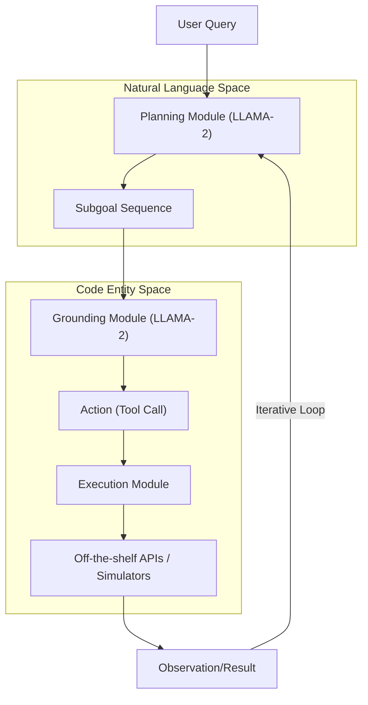
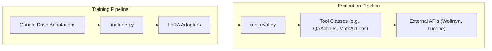

<!-- source: DeepWiki mcp.deepwiki.com · repo allenai/lumos · page 1 Lumos: Overview and Architecture · fetched 2026-10-26 -->

# Lumos: Overview and Architecture

Relevant source files

The following files were used as context for generating this wiki page:

- [.gitignore](.gitignore)
- [LICENSE](LICENSE)
- [README.md](README.md)
- [assets/lumos.png](assets/lumos.png)
- [docs/index.html](docs/index.html)
- [docs/static/images/lumos_architecture.png](docs/static/images/lumos_architecture.png)

**Lumos** is a framework for training and deploying open-source language agents using a **modular design** and **unified data formats**. It is designed to bridge the gap between proprietary models like GPT-4 and open-source Large Language Models (LLMs) by decomposing complex interactive tasks into manageable steps across three core modules: Planning, Grounding, and Execution [README.md:22-27]().

The framework supports a wide range of domains, including complex question answering (QA), mathematical reasoning, and web navigation, by standardizing how agents interact with diverse environments [README.md:28-30]().

## Modular Architecture

Lumos departs from monolithic agent designs by splitting the reasoning process into three distinct stages. This modularity allows for specialized fine-tuning of each component and makes the system more interpretable.

### Core Pipeline
1.  **Planning Module**: Decomposes a high-level user query into a sequence of natural language subgoals.
2.  **Grounding Module**: Translates these subgoals into specific, executable actions (tool calls) based on the current environment state.
3.  **Execution Module**: Dispatches the actions to off-the-shelf APIs or environment simulators and returns the results to the agent.

The interaction between these modules can follow an **Iterative (Lumos-I)** flow, where the agent perceives environment feedback at each step, or a **Onetime (Lumos-O)** flow for tasks that do not require intermediate feedback [README.md:88-92]().

For a deep dive into these modules and their formulations, see [Core Concepts: Planning, Grounding, and Execution Modules](#1.1).

### System Data Flow
The following diagram illustrates how a user request traverses the Lumos architecture, transitioning from natural language subgoals to concrete code entities and tool executions.

**Lumos High-Level Architecture**

Sources: [README.md:25-27](), [README.md:58-61](), [assets/lumos.png:1-34]()

---

## Unified Data and Task Domains

Lumos utilizes a **Unified Data Format** that allows it to support multiple benchmarks under a single training and evaluation schema [README.md:27](). By converting diverse datasets into a standardized "Subgoal-Action" pair format, Lumos can be trained on a mixture of tasks to improve generalization.

### Supported Task Domains
*   **Complex QA**: Benchmarks like HotpotQA and StrategyQA.
*   **Mathematical Reasoning**: GSM8K and SVAMP.
*   **Web Navigation & Shopping**: Mind2Web and WebShop.
*   **Multimodal & Others**: ScienceQA and InterCode_SQL.

For details on the schema and benchmark integration, see [Unified Data Format and Supported Benchmarks](#1.2).

---

## Implementation Overview

Lumos is implemented using the `open-instruct` framework for fine-tuning Llama-2 (7B and 13B) models [README.md:96-103](). The training process involves high-quality annotations generated via GPT-4 to bootstrap the open-source modules [README.md:29-30]().

**Entity Mapping: Training to Execution**

Sources: [README.md:69-75](), [README.md:88-95](), [docs/index.html:122-175]()

To set up the environment and begin training or evaluation, see [Getting Started: Installation and Environment Setup](#1.3).

---

## Documentation Links

*   [Core Concepts: Planning, Grounding, and Execution Modules](#1.1): Detailed logic of the reasoning loops and module roles.
*   [Unified Data Format and Supported Benchmarks](#1.2): Explanation of the `subgoal` and `action` fields across different domains.
*   [Getting Started: Installation and Environment Setup](#1.3): Prerequisites, environment variables, and external tool setup.

Sources: [README.md:1-36](), [docs/index.html:86-186]()

---

