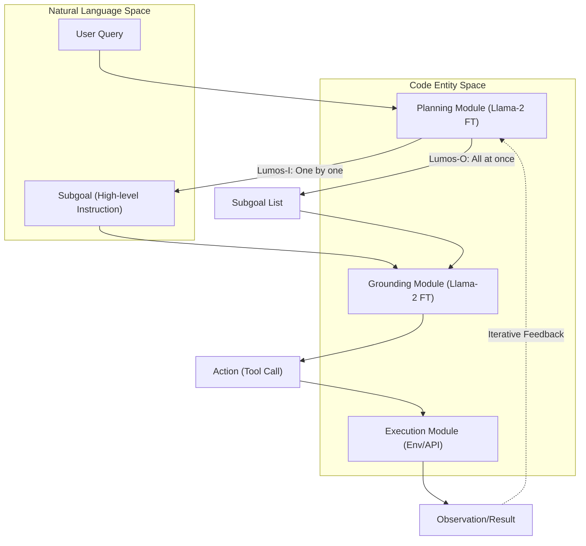
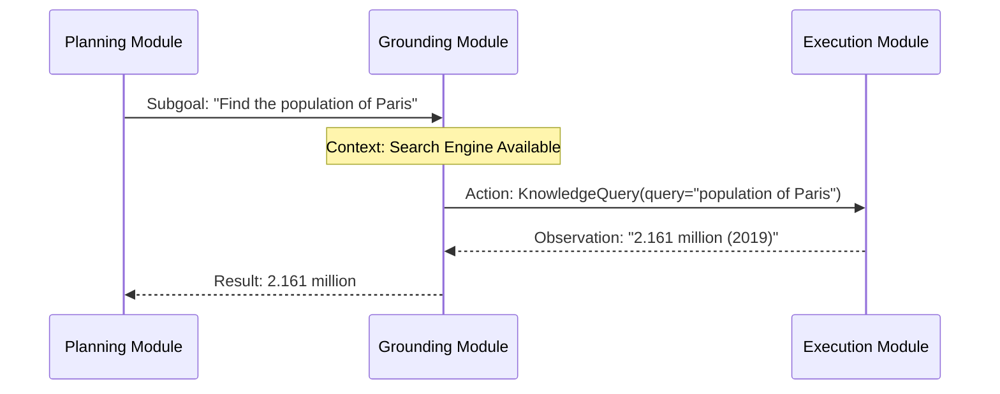

<!-- source: DeepWiki mcp.deepwiki.com · repo allenai/lumos · page 1.1 Core Concepts: Planning, Grounding, and Execution Modules · fetched 2026-10-26 -->

# Core Concepts: Planning, Grounding, and Execution Modules

Relevant source files

The following files were used as context for generating this wiki page:

- [.gitignore](.gitignore)
- [LICENSE](LICENSE)
- [README.md](README.md)
- [docs/index.html](docs/index.html)
- [docs/static/images/lumos_formulation.png](docs/static/images/lumos_formulation.png)

Lumos operates as a modular framework for language agents, decomposing complex interactive tasks into a three-stage pipeline. This architecture unifies diverse task domains—ranging from web navigation to complex mathematical reasoning—into a standardized workflow. The system supports two primary operational modes: **Lumos-Iterative (Lumos-I)**, which performs step-by-step reasoning with environment feedback, and **Lumos-Onetime (Lumos-O)**, which generates a complete plan before execution.

### Architectural Overview

The Lumos pipeline transitions from high-level natural language goals to concrete tool invocations through three distinct modules:

1.  **Planning Module**: Decomposes a high-level user query into a sequence of high-level subgoals.
2.  **Grounding Module**: Translates a specific subgoal into a low-level, executable action (tool call) based on the current state.
3.  **Execution Module**: Dispatches the action to an external environment or API and retrieves the result.

**Sources:** [README.md:25-27](), [README.md:58-61](), [docs/index.html:91-91]()

---

### 1. Planning Module

The Planning Module is responsible for high-level task decomposition. It takes the user's initial request and determines the logical steps required to solve it.

*   **Lumos-Iterative (Lumos-I)**: The planner generates a single subgoal at a time. After the execution of that subgoal, the resulting observation is fed back into the planner to generate the next subgoal. This is used for dynamic environments like web navigation (`Mind2Web`, `WebShop`) [README.md:82-86]().
*   **Lumos-Onetime (Lumos-O)**: The planner generates the entire sequence of subgoals in a single pass. This is typically used for static reasoning tasks like complex QA or math where the environment doesn't change significantly between steps [README.md:81-85]().

#### Implementation Details
The module is a fine-tuned Llama-2 model. During evaluation, it is invoked within a loop in benchmark-specific scripts (e.g., `run_eval.py`).

**Sources:** [README.md:25-26](), [README.md:92-94](), [docs/index.html:186-186]()

---

### 2. Grounding Module

The Grounding Module bridges the gap between high-level intent (subgoal) and specific tool syntax. It acts as a translator that maps a natural language subgoal into a structured action format defined for a specific domain.

*   **Input**: The current subgoal and the relevant environment context (e.g., HTML for web tasks, previous calculation results for math).
*   **Output**: A formatted action string, such as `KnowledgeQuery(query="...")` or `click(element="button_1")`.

#### Action Mapping Logic
The grounding process ensures that the agent's output conforms to the `Unified Data Format`. This allows the same grounding logic to be applied across different benchmarks by simply swapping the action vocabulary.

**Sources:** [README.md:26-27](), [README.md:29-30](), [docs/index.html:186-186]()

---

### 3. Execution Module

The Execution Module is a non-learnable component consisting of environment wrappers and API connectors. It receives the action produced by the Grounding Module, executes it, and returns the observation.

#### Key Tool Classes and APIs
Different benchmarks utilize specific tool classes to handle the "Code Entity Space" interactions:

| Domain | Tool Class / API | Key Functions |
| :--- | :--- | :--- |
| **Complex QA** | `QAActions` | `KnowledgeQuery`, `ParagraphRetrieve`, `QA` |
| **Math** | `MathActions` | `Calculator`, `SolveEquation`, `WolframAlpha API` |
| **Web Shop** | `ShopActions` | `Search`, `Click`, `Pick` |
| **Web Nav** | `MindAct` / Browser | `click`, `type`, `select` |

#### Data Flow in Execution
1.  **Parsing**: The module parses the action string (e.g., using regex or JSON parsing).
2.  **Dispatch**: It calls the corresponding Python function or external API.
3.  **Formatting**: The raw output (HTML, JSON, or text) is cleaned and formatted into a concise observation for the next iteration of the planner or for final answer extraction.

**Sources:** [README.md:26-26](), [README.md:63-67](), [docs/index.html:186-186]()

---

### Formulation Comparison: Lumos-I vs. Lumos-O

Lumos supports two distinct formulations to balance efficiency and adaptability.

| Feature | Lumos-Iterative (Lumos-I) | Lumos-Onetime (Lumos-O) |
| :--- | :--- | :--- |
| **Subgoal Generation** | One by one, conditioned on history | Full sequence generated at start |
| **Grounding** | Occurs after every subgoal | Occurs for each subgoal in sequence |
| **Best For** | Interactive/Web tasks (`Mind2Web`, `WebShop`) | Static reasoning (`HotpotQA`, `GSM8K`) |
| **Training Data** | `lumos_unified_iterative` | `lumos_complex_qa_onetime` |

**Sources:** [README.md:80-86](), [README.md:92-92](), [docs/static/images/lumos_formulation.png]()

---

