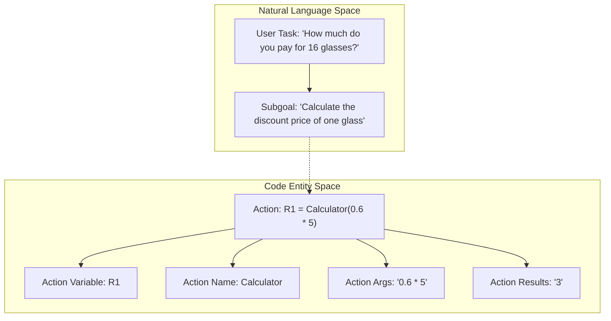
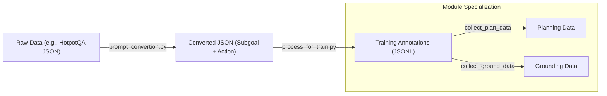

<!-- source: DeepWiki mcp.deepwiki.com · repo allenai/lumos · page 1.2 Unified Data Format and Supported Benchmarks · fetched 2026-10-26 -->

# Unified Data Format and Supported Benchmarks

Relevant source files

The following files were used as context for generating this wiki page:

- [.gitignore](.gitignore)
- [LICENSE](LICENSE)
- [README.md](README.md)
- [data/__init__.py](data/__init__.py)
- [data/eval/gsm/test.jsonl](data/eval/gsm/test.jsonl)
- [data/eval/hotpotqa/test.json](data/eval/hotpotqa/test.json)
- [data/eval/strategyqa/strategy_qa.json](data/eval/strategyqa/strategy_qa.json)
- [data/eval/strategyqa/test.json](data/eval/strategyqa/test.json)
- [data/eval/svamp/test.json](data/eval/svamp/test.json)
- [data/fast_prompt.py](data/fast_prompt.py)
- [data/incontext.py](data/incontext.py)
- [data/process_for_train.py](data/process_for_train.py)
- [data/prompt_convertion.py](data/prompt_convertion.py)
- [docs/static/images/lumos_annotation.png](docs/static/images/lumos_annotation.png)
- [docs/static/images/lumos_annotation_example.png](docs/static/images/lumos_annotation_example.png)

Lumos employs a **Unified Data Format** that standardizes complex tasks into a modular sequence of subgoals and actions. This design allows a single model architecture to generalize across diverse domains including complex question answering, mathematical reasoning, and web navigation.

## Unified Data Format

Lumos represents task solutions as a series of **Subgoal-Action pairs**. This format bridges the gap between high-level reasoning (Planning) and low-level execution (Grounding).

### Subgoal/Action Schema
The format follows a strict hierarchical structure:
1.  **Subgoal**: A natural language description of a reasoning step (e.g., "Calculate the total cost").
2.  **Action**: A structured function call mapped to the subgoal (e.g., `R1 = Calculator(76 - 25)`).

The codebase uses a standardized parsing logic to extract these components from generated text in `data/process_for_train.py` [data/process_for_train.py:7-14]().

### Action Variable and Result Mapping
Actions utilize intermediate result variables (e.g., `R1`, `R2`) to maintain state across steps. The parser in `data/process_for_train.py` identifies four key components for every action:
*   **Action Variable**: The variable storing the output (e.g., `R1`).
*   **Action Name**: The tool or function being called (e.g., `Calculator`).
*   **Action Args**: The parameters passed to the function.
*   **Action Results**: The ground-truth or execution result of the action.

Sources: [data/process_for_train.py:16-52](), [data/incontext.py:10-20]()

---

## Supported Benchmarks

Lumos targets seven major benchmarks across three primary domains. These benchmarks are converted from their raw formats into the Lumos unified subgoal/action format using GPT-4-based prompt conversion [data/prompt_convertion.py:12-15]().

| Domain | Benchmarks | Primary Tools/Actions |
| :--- | :--- | :--- |
| **Complex QA** | HotpotQA, StrategyQA | `KnowledgeQuery`, `ParagraphRetrieve`, `QA` |
| **Maths** | GSM8K, SVAMP | `Calculator`, `SolveEquation`, `Count`, `Define` |
| **Web Agent** | Mind2Web, WebShop | `Search`, `Click`, `Type`, `Select` |

### Data Flow: Raw to Unified
The conversion process uses `prompt_convertion.py` to transform raw datasets (like `musique_full_v1.0_train.jsonl` or `strategyqa_train.json`) into the unified format [data/process_for_train.py:144-148]().

Sources: [data/process_for_train.py:171-172](), [data/prompt_convertion.py:139-151]()

---

## Domain-Specific Action Vocabularies

While the data format is unified, the available **Action Vocabulary** is defined by the domain. These are enforced during the data generation phase using `incontext.py` instructions to ensure the model learns to call valid tools.

### 1. Mathematical Reasoning (`maths`)
The vocabulary includes operations for algebraic and arithmetic manipulation.
*   **Actions**: `Calculator`, `SetEquation`, `SolveEquation`, `Count`, `SolveInequality`, `Code`, `Define` [data/incontext.py:5-5]().
*   **Implementation**: Results are typically numerical or symbolic expressions.

### 2. Complex Question Answering (`complex_qa`)
Focused on multi-hop retrieval and synthesis.
*   **Actions**: `KnowledgeQuery` (search), `ParagraphRetrieve` (lookup), `QA` (synthesis) [data/prompt_convertion.py:89-136]().
*   **Logic**: Often involves decomposing a "bridge" or "comparison" question into simpler queries [data/eval/hotpotqa/test.json:1-10]().

### 3. Web Navigation (`web_agent`)
Actions are mapped to DOM interactions.
*   **Actions**: `Search`, `Click`, `Type`, `Select`, `Hover`, `Enter` [README.md:32-35]().
*   **Constraint**: Unlike other domains, `web_agent` actions often do not return a specific "Action Result" variable in the training data, as the result is the new state of the environment [data/process_for_train.py:48-50]().

Sources: [data/incontext.py:1-40](), [data/process_for_train.py:22-52](), [README.md:25-35]()

---

