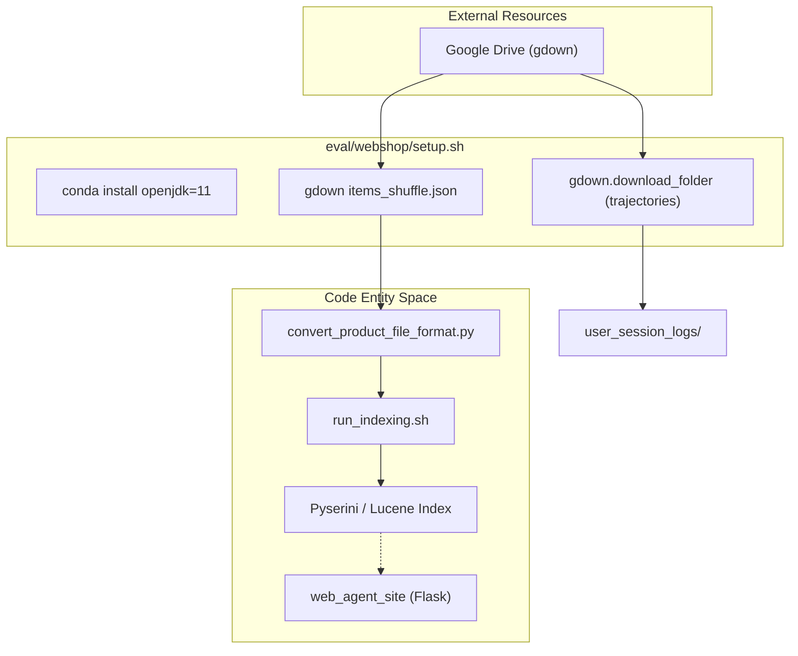
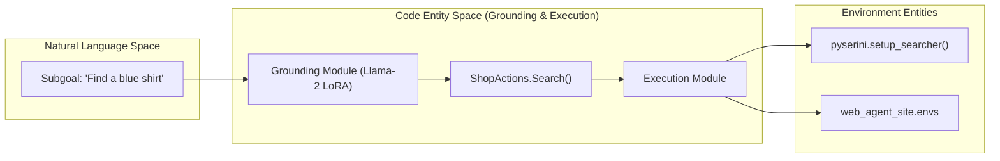

<!-- source: DeepWiki mcp.deepwiki.com · repo allenai/lumos · page 1.3 Getting Started: Installation and Environment Setup · fetched 2026-10-26 -->

# Getting Started: Installation and Environment Setup

<details>
<summary>Relevant source files</summary>

The following files were used as context for generating this wiki page:

- [eval/webshop/requirements.txt](eval/webshop/requirements.txt)
- [eval/webshop/setup.sh](eval/webshop/setup.sh)
- [requirements.txt](requirements.txt)
- [setup.sh](setup.sh)

</details>


This page provides a comprehensive technical guide for establishing the Lumos development and execution environment. Setting up Lumos requires synchronizing CUDA-enabled deep learning frameworks, specialized tool-use libraries, and external benchmark environments such as WebShop.

## 1. Core Environment Installation

The Lumos environment is built upon a specific combination of `torch`, `transformers`, and `peft` to support LoRA-based fine-tuning and inference. The installation process is orchestrated primarily through `setup.sh` and `requirements.txt`.

### 1.1 CUDA and PyTorch Alignment
Lumos requires `torch==2.0.0` aligned with `cuda 11.7`. This specific versioning is critical for compatibility with `flash_attn==2.0.4`, which is used during the fine-tuning of Llama-2 models.

The initial setup is performed via:
```bash
# From setup.sh
conda install pytorch==2.0.0 torchvision==0.15.0 torchaudio==2.0.0 pytorch-cuda=11.7 -c pytorch -c nvidia
pip install packaging
pip install -r requirements.txt
```
Sources: [setup.sh:1-3](), [requirements.txt:9-9](), [requirements.txt:29-29]()

### 1.2 Dependency Management
The `requirements.txt` file defines the full stack needed for Planning, Grounding, and Execution modules.

| Category | Key Packages | Purpose |
| :--- | :--- | :--- |
| **Model Training** | `accelerate`, `peft`, `transformers` | Distributed LoRA fine-tuning and model loading. |
| **Web Agent** | `playwright`, `selenium`, `beautifulsoup4` | Browser interaction and DOM parsing for Mind2Web. |
| **Math/Logic** | `wolframalpha`, `numpy` | Symbolic execution and numerical verification. |
| **Retrieval** | `pyserini`, `rank_bm25`, `faiss-cpu` | Document indexing and BM25/Semantic search. |

Sources: [requirements.txt:1-33]()

## 2. WebShop Environment Setup

The WebShop benchmark requires a local Flask-based web server and a Lucene search index to simulate an e-commerce environment. This is handled by a specialized setup script in `eval/webshop/setup.sh`.

### 2.1 Data Acquisition and Indexing
The setup script uses `gdown` to retrieve product metadata and human trajectories. It supports two modes: `small` (1,000 products) and `all` (full dataset).

**Installation Flow:**
1. **Dependencies:** Installs `openjdk=11` (for Lucene/Pyserini) and `mkl=2021`.
2. **Product Data:** Downloads `items_shuffle` and `items_ins_v2` via `gdown`.
3. **Search Indexing:** Executes `convert_product_file_format.py` to prepare documents for the Lucene engine.
4. **Human Trajectories:** Downloads example trajectories to `user_session_logs/` for reference.

### 2.2 WebShop Architecture Diagram
The following diagram illustrates how the setup script prepares the "Code Entity Space" for the WebShop environment.

**WebShop Setup Data Flow**

Sources: [eval/webshop/setup.sh:24-73](), [eval/webshop/requirements.txt:1-8]()

## 3. External Service Configuration

Lumos utilizes external APIs and local drivers to fulfill subgoals generated by the Planning Module.

### 3.1 WolframAlpha API
For math-heavy benchmarks like GSM8K and SVAMP, the `MathActions` tool class relies on the `wolframalpha` library. 
* **Requirement:** An AppID from the WolframAlpha Developer Portal.
* **Implementation:** The library is installed via `requirements.txt` [line 32]().

### 3.2 Playwright and Browser Drivers
For web navigation tasks (Mind2Web), Lumos uses `playwright`. After installing the pip package, the browser binaries must be initialized:
```bash
playwright install
```
Sources: [requirements.txt:18-18]()

## 4. Environment Verification

To verify the installation, ensure the "Natural Language Space" can be successfully mapped to the "Code Entity Space" through the following module components.

**Lumos Component Mapping**


### Verification Checklist
1. **CUDA:** Run `python -c "import torch; print(torch.cuda.is_available())"` to confirm GPU access.
2. **Flash Attention:** Ensure `flash_attn` is successfully imported to enable high-speed training [requirements.txt:9]().
3. **WebShop Server:** Navigate to `eval/webshop/` and ensure `search_engine/indexes` contains the Lucene files generated by `run_indexing.sh` [eval/webshop/setup.sh:54-55]().
4. **Spacy Models:** Confirm `en_core_web_lg` is downloaded, as it is used for entity extraction in web tasks [eval/webshop/setup.sh:48]().

Sources: [setup.sh:1-3](), [eval/webshop/setup.sh:48-56](), [requirements.txt:1-33]()

---

