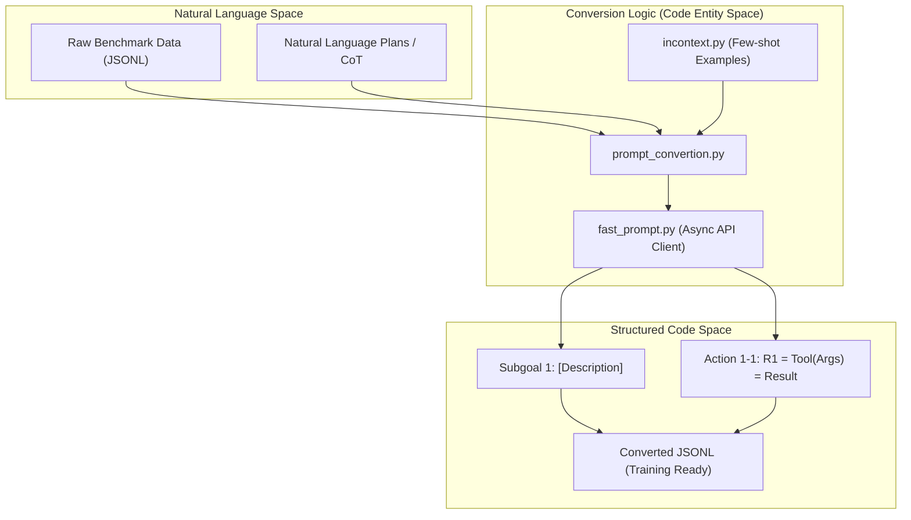
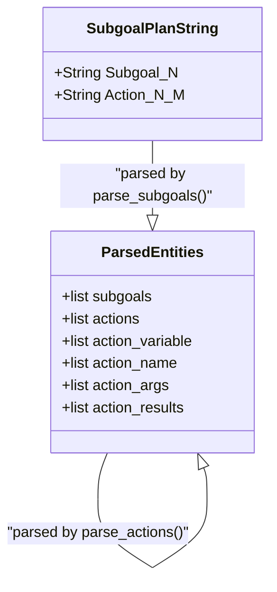

<!-- source: DeepWiki mcp.deepwiki.com · repo allenai/lumos · page 2.1 Prompt Conversion: Raw Data to Subgoal Annotations · fetched 2026-10-26 -->

# Prompt Conversion: Raw Data to Subgoal Annotations

Relevant source files

The following files were used as context for generating this wiki page:

- [data/__init__.py](data/__init__.py)
- [data/fast_prompt.py](data/fast_prompt.py)
- [data/incontext.py](data/incontext.py)
- [data/process_for_train.py](data/process_for_train.py)
- [data/prompt_convertion.py](data/prompt_convertion.py)

The prompt conversion stage is the first step in the Lumos data pipeline. It transforms raw benchmark solutions (e.g., Chain-of-Thought reasoning or natural language steps) into a structured **subgoal-based plan** format. This process utilizes GPT-4 as a teacher model, guided by domain-specific in-context examples, to generate the standardized annotations required for training the Planning and Grounding modules.

### Architectural Overview

The conversion process is orchestrated by `data/prompt_convertion.py`, which leverages an asynchronous, rate-limited interface to the OpenAI API defined in `data/fast_prompt.py`.

**Data Flow: Natural Language to Structured Subgoals**

**Sources:** `data/prompt_convertion.py:1-10`(), `data/incontext.py:1-5`()

---

### Domain-Specific Conversion Functions

The conversion logic is partitioned into domain-specific functions that handle the unique requirements of Maths, Complex QA, and Web Agent tasks.

#### 1. Mathematics Conversion
The `maths_convertion` function processes datasets like GSM8K, PRM800K, and ASDIV. It maps natural language solutions to a specific action vocabulary: `Calculator`, `SetEquation`, `SolveEquation`, `Count`, `SolveInequality`, `Code`, and `Define` `[data/incontext.py:5]()`.

*   **Implementation:** `maths_convertion(args)` `[data/prompt_convertion.py:12-87]()`.
*   **Key Logic:** It constructs a `final_prompt` by combining a domain instruction (e.g., `instruction_maths_prm`) with the raw task and the existing natural language plan `[data/prompt_convertion.py:40-48]()`.

#### 2. Complex QA Conversion
The `complex_qa_convertion` function handles HotpotQA, StrategyQA, and MuSiQue. It focuses on decomposing multi-hop questions into sub-questions and retrieval actions.

*   **Implementation:** `complex_qa_convertion(args)` `[data/prompt_convertion.py:139-224]()`.
*   **Intermediate Step:** `convert_qa_to_human_solution` is used to flatten raw evidence and question decompositions into a readable "human solution" string before sending it to GPT-4 `[data/prompt_convertion.py:89-136]()`.
*   **Action Vocabulary:** `KnowledgeQuery`, `ParagraphRetrieve`, and `QA` `[data/incontext.py:127-130]()`.

#### 3. Web Agent Conversion
The `web_agent_convertion` function processes Mind2Web and WebShop data. Unlike the other domains, web tasks often involve converting structural action lists (click, type, search) into subgoals that explain the *intent* behind the actions.

*   **Implementation:** `web_agent_convertion(args)` `[data/prompt_convertion.py:227-302]()`.
*   **Action Vocabulary:** `Search`, `Click`, `Type`, `Select`, `FeatureRetrieve`, `Pick` `[data/incontext.py:273-276]()`.

**Sources:** `data/prompt_convertion.py:12-302`(), `data/incontext.py:1-276`()

---

### Asynchronous API Interface (`fast_prompt.py`)

To handle the high volume of conversion requests, Lumos uses an asynchronous wrapper around the OpenAI SDK. This ensures high throughput while respecting API rate limits.

| Function | Role | Key Components |
| :--- | :--- | :--- |
| `generate_from_openai_chat_completion` | Entry point for chat-based models (GPT-4). | `aiolimiter.AsyncLimiter`, `tqdm_asyncio.gather` `[data/fast_prompt.py:164-192]()` |
| `_throttled_openai_chat_completion_acreate` | Handles individual API calls with retry logic. | `openai.ChatCompletion.acreate`, `RateLimitError` handling `[data/fast_prompt.py:114-161]()` |
| `generate_from_openai_completion` | Entry point for legacy completion models. | `openai.Completion.acreate` `[data/fast_prompt.py:65-111]()` |

**Sources:** `data/fast_prompt.py:19-192`()

---

### Structured Output Format

The output of `prompt_convertion.py` is a JSONL file where each entry contains the original task and a `subgoal_plan` string. This string follows a strict schema that the later `process_for_train.py` script parses using `parse_subgoals` and `parse_actions`.

**Schema Mapping: Prompt Output to Code Entities**

| Code Entity | Regex / String Pattern | Example from `incontext.py` |
| :--- | :--- | :--- |
| **Subgoal** | `Subgoal [number]: [Text]` | `Subgoal 1: Calculate the difference...` `[data/incontext.py:11]()` |
| **Action Variable** | `R[number]` or `Output` | `R1`, `R5, R6`, `Output` `[data/incontext.py:12-20]()` |
| **Action Name** | Function identifier | `Calculator`, `SolveEquation` `[data/incontext.py:12-18]()` |
| **Action Results** | Value after the second `=` | `-2y`, `123/40` `[data/incontext.py:12-20]()` |

**Sources:** `data/process_for_train.py:7-52`(), `data/incontext.py:11-20`()

---

