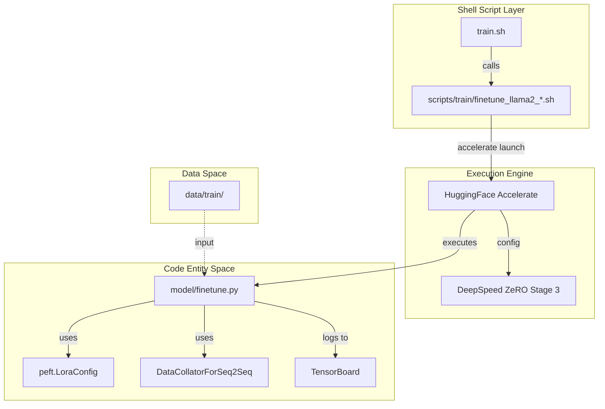
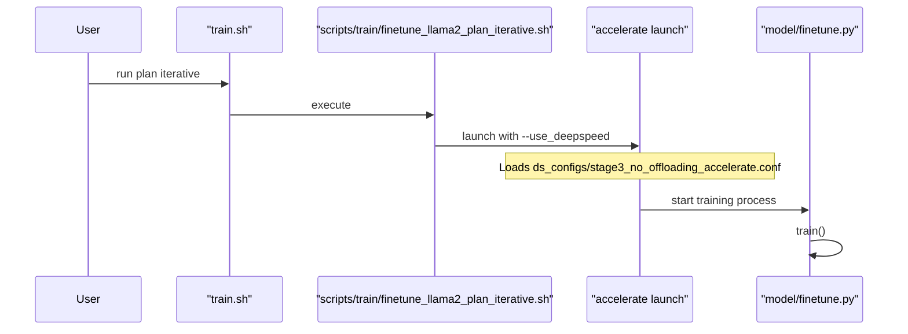

<!-- source: DeepWiki mcp.deepwiki.com · repo allenai/lumos · page 3 Model Training · fetched 2026-10-26 -->

# Model Training

Relevant source files

The following files were used as context for generating this wiki page:

- [model/finetune.py](model/finetune.py)
- [scripts/train/finetune_llama2_ground_iterative.sh](scripts/train/finetune_llama2_ground_iterative.sh)
- [scripts/train/finetune_llama2_plan_iterative.sh](scripts/train/finetune_llama2_plan_iterative.sh)
- [train.sh](train.sh)

This section provides a high-level overview of the training pipeline used to develop Lumos models. The training process involves fine-tuning Llama-2 base models into specialized **Planning** and **Grounding** modules. This is achieved using the `open-instruct` framework, optimized with DeepSpeed and Flash Attention for efficient distributed training.

## Training Pipeline Overview

The Lumos training pipeline transforms base language models into goal-oriented agents by training them on structured subgoal and action sequences. The pipeline is designed to support both **Iterative** (step-by-step) and **Onetime** (all-at-once) reasoning formulations across multiple domains including Complex QA, Maths, and Web Navigation.

### Core Components

The following diagram illustrates the relationship between the training scripts, the core fine-tuning logic, and the distributed execution environment.

**Training System Architecture**

**Sources:** [train.sh:1-1](), [scripts/train/finetune_llama2_ground_iterative.sh:11-17](), [model/finetune.py:1-36]()

## Fine-Tuning Logic

The heart of the training process is `model/finetune.py`. This script is responsible for loading the Llama-2 base model, configuring the tokenizer, and setting up the training loop. It supports advanced features like Parameter-Efficient Fine-Tuning (PEFT) via LoRA and memory-efficient attention mechanisms.

Key responsibilities of the fine-tuning script include:
*   **Model Loading**: Initializing `AutoModelForCausalLM` with optional Flash Attention and 8-bit/4-bit quantization [model/finetune.py:18-35]().
*   **Optimization**: Implementing gradient accumulation and learning rate scheduling (e.g., linear warmup) [model/finetune.py:120-148]().
*   **Data Handling**: Utilizing `DataCollatorForSeq2Seq` to handle variable-length sequences within the `DataLoader` [model/finetune.py:27-27]().

For a deep dive into the implementation details of the fine-tuning logic, LoRA parameters, and adapter merging, see **[Fine-Tuning Script: model/finetune.py](#3.1)**.

**Sources:** [model/finetune.py:39-215]()

## Distributed Training and Configuration

Lumos utilizes `accelerate` and `DeepSpeed` to scale training across multiple GPUs. The training is orchestrated through a hierarchy of shell scripts that define hyperparameters and environment variables.

**Training Workflow: Script to Execution**

**Sources:** [train.sh:1-1](), [scripts/train/finetune_llama2_plan_iterative.sh:11-17]()

### Training Variants
The repository provides specific scripts for different module types and formulations:
*   **Planning vs. Grounding**: Separate training runs for the `plan` and `ground` modules [scripts/train/finetune_llama2_plan_iterative.sh:3-3](), [scripts/train/finetune_llama2_ground_iterative.sh:3-3]().
*   **Iterative vs. Onetime**: Scripts are tailored for the specific data format of each formulation [scripts/train/finetune_llama2_ground_iterative.sh:22-22]().

For details on the DeepSpeed configuration files, hardware requirements, and specific hyperparameter settings (like `TOTAL_BATCH_SIZE=128`), see **[Training Scripts and DeepSpeed Configuration](#3.2)**.

**Sources:** [scripts/train/finetune_llama2_ground_iterative.sh:1-35](), [scripts/train/finetune_llama2_plan_iterative.sh:1-35]()

---

