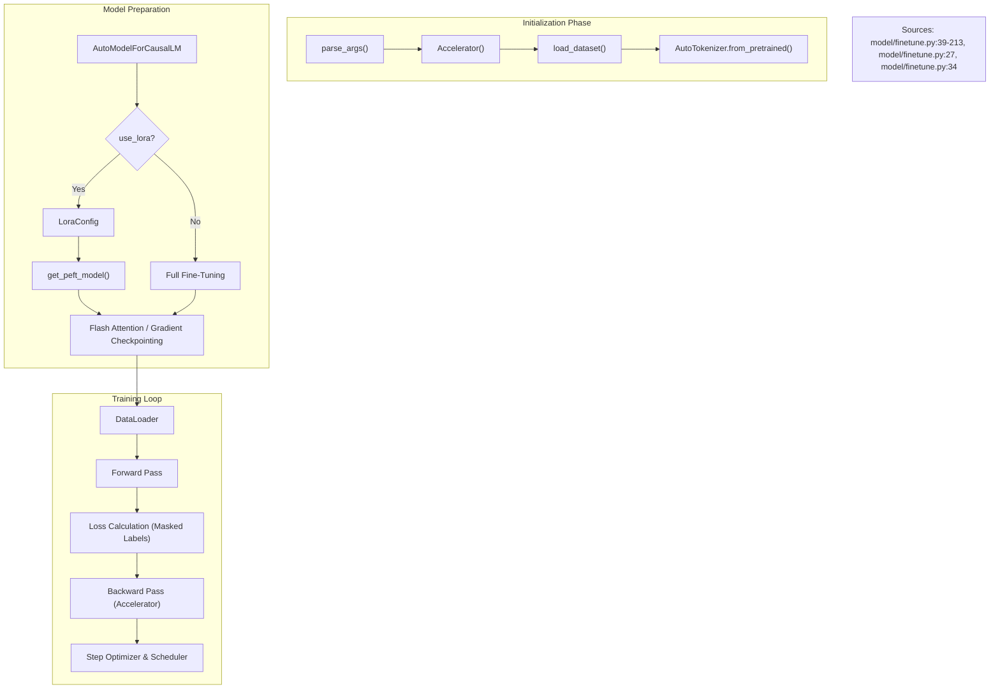
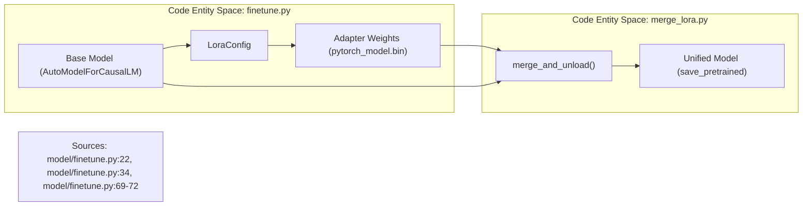

<!-- source: DeepWiki mcp.deepwiki.com · repo allenai/lumos · page 3.1 Fine-Tuning Script: model/finetune.py · fetched 2026-10-26 -->

# Fine-Tuning Script: model/finetune.py

Relevant source files

The following files were used as context for generating this wiki page:

- [model/finetune.py](model/finetune.py)

The `model/finetune.py` script is the core training component of the Lumos framework, adapted from the `open-instruct` project. It provides a robust interface for fine-tuning Large Language Models (specifically Llama-2) on the structured subgoal and action annotations generated in the data pipeline. It supports Parameter-Efficient Fine-Tuning (PEFT) via LoRA/qLoRA, memory-efficient training with Flash Attention, and distributed execution using Hugging Face `accelerate`.

## 1. Core Implementation and Training Logic

The script follows a standard Hugging Face training loop but is heavily customized for Seq2Seq-style causal language modeling. It manages the lifecycle of model loading, dataset preprocessing, and the optimization loop.

### Key Components:
- **Argument Parsing**: Uses `argparse` to configure model paths, LoRA parameters, hardware optimizations (Flash Attention, Gradient Checkpointing), and experiment tracking [model/finetune.py:39-213]().
- **Model Initialization**: Loads causal language models (e.g., Llama-2) with optional 4-bit/8-bit quantization via `BitsAndBytesConfig` if `use_qlora` is enabled [model/finetune.py:32, 209-213]().
- **Data Collator**: Employs `DataCollatorForSeq2Seq` to handle dynamic padding of sequences within a batch, ensuring that only the completion (and not the prompt) contributes to the loss calculation through label masking [model/finetune.py:27]().

### Data Flow Diagram: Training Pipeline
This diagram illustrates the flow from raw configuration to the execution of the training loop.

Sources: [model/finetune.py:27-34](), [model/finetune.py:39-213]()

## 2. LoRA and Optimization Configurations

Lumos utilizes Low-Rank Adaptation (LoRA) to efficiently train the Planning and Grounding modules. This allows for high-performance tuning of 7B and 13B models on consumer or mid-tier enterprise hardware.

### LoRA Configuration
The script defines the rank ($r$), alpha, and dropout for the LoRA adapters:
- **Rank (`--lora_rank`)**: Defaults to 64 [model/finetune.py:74-78]().
- **Alpha (`--lora_alpha`)**: Scaling factor, defaults to 16 [model/finetune.py:80-84]().
- **Dropout (`--lora_dropout`)**: Defaults to 0.1 [model/finetune.py:86-90]().

### Memory Optimizations
To handle the sequence lengths required for complex reasoning (up to 2048 or more tokens), the script integrates:
- **Flash Attention**: Enabled via `--use_flash_attn` to reduce memory footprint and increase speed during the attention mechanism [model/finetune.py:92-95]().
- **Gradient Checkpointing**: Enabled via `--gradient_checkpointing` to trade compute for memory by not storing all intermediate activations [model/finetune.py:202-207]().
- **Gradient Accumulation**: Managed by `accelerate` to simulate larger batch sizes [model/finetune.py:134-138]().

Sources: [model/finetune.py:74-95](), [model/finetune.py:134-138](), [model/finetune.py:202-207]()

## 3. Training Execution and Tracking

The script uses the `accelerate` library to handle distributed training across multiple GPUs.

| Feature | Implementation Detail |
| :--- | :--- |
| **Scheduler** | Supports `linear`, `cosine`, and `polynomial` via `get_scheduler` [model/finetune.py:140-145]() |
| **Logging** | Integration with TensorBoard and WandB via `--report_to` [model/finetune.py:184-192]() |
| **Checkpointing** | Periodic saving of model states and optimizer states via `accelerator.save_state` [model/finetune.py:161-165]() |
| **Seed** | Reproducibility ensured via `set_seed(args.seed)` [model/finetune.py:14, 150]() |

Sources: [model/finetune.py:14](), [model/finetune.py:140-145](), [model/finetune.py:150](), [model/finetune.py:161-165](), [model/finetune.py:184-192]()

## 4. Adapter Merging: merge_lora.py

After training with LoRA, the weights exist as separate adapter layers. The `merge_lora.py` script (conceptually paired with `finetune.py`) is used to fuse these weights back into the base Llama-2 model for easier deployment and faster inference during evaluation.

### Merging Process Logic
The merge script typically performs the following steps:
1. Load the base model (e.g., `Llama-2-7b-hf`).
2. Load the trained LoRA adapter from the `output_dir`.
3. Use `model.merge_and_unload()` from the `peft` library to integrate weights.
4. Save the resulting standalone model.

### Code Entity Mapping: Training to Merging
This diagram bridges the entities involved in the transition from a PEFT-trained state to a unified model.

Sources: [model/finetune.py:22](), [model/finetune.py:34](), [model/finetune.py:69-72]()

---

