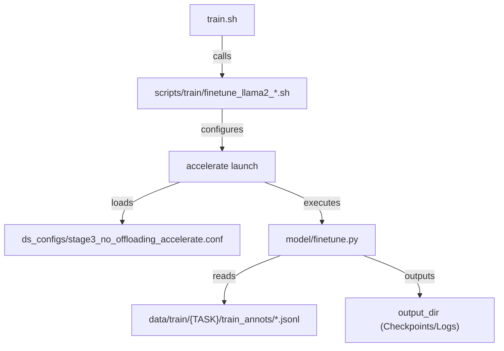
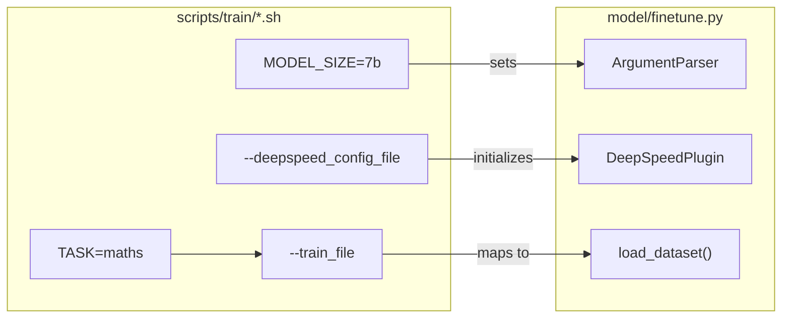

<!-- source: DeepWiki mcp.deepwiki.com · repo allenai/lumos · page 3.2 Training Scripts and DeepSpeed Configuration · fetched 2026-10-26 -->

# Training Scripts and DeepSpeed Configuration

Relevant source files

The following files were used as context for generating this wiki page:

- [ds_configs/stage3_no_offloading.conf](ds_configs/stage3_no_offloading.conf)
- [ds_configs/stage3_no_offloading_accelerate.conf](ds_configs/stage3_no_offloading_accelerate.conf)
- [scripts/train/finetune_llama2_cot.sh](scripts/train/finetune_llama2_cot.sh)
- [scripts/train/finetune_llama2_direct.sh](scripts/train/finetune_llama2_direct.sh)
- [scripts/train/finetune_llama2_ground_iterative.sh](scripts/train/finetune_llama2_ground_iterative.sh)
- [scripts/train/finetune_llama2_ground_onetime.sh](scripts/train/finetune_llama2_ground_onetime.sh)
- [scripts/train/finetune_llama2_plan_iterative.sh](scripts/train/finetune_llama2_plan_iterative.sh)
- [scripts/train/finetune_llama2_plan_onetime.sh](scripts/train/finetune_llama2_plan_onetime.sh)
- [train.sh](train.sh)

This page details the orchestration layer used to train Lumos models. The framework utilizes shell scripts to wrap `accelerate launch` commands, integrating DeepSpeed ZeRO Stage 3 for efficient distributed training of Llama-2 base models.

## Orchestration Architecture

Training in Lumos is triggered via a top-level entry point `train.sh`, which dispatches to specialized scripts for different model roles (Planning vs. Grounding) and formulations (Iterative vs. Onetime).

### Training Flow Diagram
The following diagram illustrates how the shell scripts interface with the `accelerate` environment and the core training logic.

**Training Script Execution Flow**

**Sources:** [train.sh:1-1](), [scripts/train/finetune_llama2_plan_onetime.sh:11-17]()

## Training Script Variants

Lumos provides scripts for four primary training configurations, along with baseline scripts for Chain-of-Thought (CoT) and Direct training.

| Script Name | Module | Formulation | Purpose |
|:---|:---|:---|:---|
| `finetune_llama2_plan_iterative.sh` | Planning | Iterative | Trains model to generate single subgoals based on current state. |
| `finetune_llama2_plan_onetime.sh` | Planning | Onetime | Trains model to generate a complete sequence of subgoals upfront. |
| `finetune_llama2_ground_iterative.sh` | Grounding | Iterative | Trains model to map a single subgoal to a tool call. |
| `finetune_llama2_ground_onetime.sh` | Grounding | Onetime | Trains model to map a sequence of subgoals to a sequence of actions. |
| `finetune_llama2_cot.sh` | N/A | CoT | Baseline: Fine-tunes Llama-2 for standard Chain-of-Thought. |
| `finetune_llama2_direct.sh` | N/A | Direct | Baseline: Fine-tunes Llama-2 for direct answer prediction. |

**Sources:** [scripts/train/finetune_llama2_plan_iterative.sh:1-35](), [scripts/train/finetune_llama2_plan_onetime.sh:1-35](), [scripts/train/finetune_llama2_ground_iterative.sh:1-35](), [scripts/train/finetune_llama2_ground_onetime.sh:1-35](), [scripts/train/finetune_llama2_cot.sh:1-35](), [scripts/train/finetune_llama2_direct.sh:1-35]()

## Hyperparameters and Configuration

All scripts share a standardized set of hyperparameters optimized for Llama-2 7B and 13B models.

### Key Hyperparameters
*   **Learning Rate:** `2e-5` with a `linear` scheduler [scripts/train/finetune_llama2_plan_iterative.sh:27-28]().
*   **Warmup Ratio:** `0.03` [scripts/train/finetune_llama2_plan_iterative.sh:29]().
*   **Epochs:** `2` [scripts/train/finetune_llama2_plan_iterative.sh:31]().
*   **Batch Size:** Typically configured for a total batch size of `128` [scripts/train/finetune_llama2_plan_iterative.sh:7]().
*   **Max Sequence Length:** `1024` tokens [scripts/train/finetune_llama2_plan_iterative.sh:23]().

### Gradient Accumulation Calculation
The scripts dynamically calculate `GRADIENT_ACC_STEPS` based on the number of GPUs and the desired total batch size:
`GRADIENT_ACC_STEPS=$(($TOTAL_BATCH_SIZE/$NUM_GPUS/$BATCH_SIZE_PER_GPU))` [scripts/train/finetune_llama2_plan_iterative.sh:8]().

## DeepSpeed Configuration

Lumos utilizes DeepSpeed ZeRO Stage 3 to handle model states (optimizer states, gradients, and parameters) across multiple GPUs.

### Configuration Files
1.  **`ds_configs/stage3_no_offloading_accelerate.conf`**: Used when launching via the `accelerate` CLI. It delegates optimizer and scheduler management to `accelerate` while retaining ZeRO-3 parameter partitioning [ds_configs/stage3_no_offloading_accelerate.conf:1-23]().
2.  **`ds_configs/stage3_no_offloading.conf`**: A standalone DeepSpeed configuration that includes internal `AdamW` and `WarmupDecayLR` settings [ds_configs/stage3_no_offloading.conf:5-22]().

### ZeRO Stage 3 Settings
The configurations use the following technical parameters to optimize memory:
*   **`overlap_comm`**: `true` to overlap communication with computation [ds_configs/stage3_no_offloading_accelerate.conf:7]().
*   **`contiguous_gradients`**: `true` to reduce memory fragmentation [ds_configs/stage3_no_offloading_accelerate.conf:8]().
*   **`stage3_max_live_parameters`**: Set to `1e9` to limit the number of parameters held in GPU memory at once [ds_configs/stage3_no_offloading_accelerate.conf:13]().
*   **`stage3_gather_16bit_weights_on_model_save`**: `true` to ensure full model weights are saved in a single file after training [ds_configs/stage3_no_offloading_accelerate.conf:15]().

**Sources:** [ds_configs/stage3_no_offloading_accelerate.conf:1-23](), [ds_configs/stage3_no_offloading.conf:1-41]()

## Implementation Mapping

The following diagram bridges the shell script variables to the Python implementation in `model/finetune.py`.

**Script to Code Entity Mapping**

**Sources:** [scripts/train/finetune_llama2_plan_onetime.sh:3-22](), [model/finetune.py:1-100]() (Implicitly via argument passing)

## Data Flow in Training

The training scripts target specific JSONL files generated by the data pipeline.

1.  **Planning Module Data:**
    *   Iterative: `data/train/${TASK}/train_annots/lumos_${TASK}_plan_iterative.jsonl` [scripts/train/finetune_llama2_plan_iterative.sh:22]().
    *   Onetime: `data/train/${TASK}/train_annots/lumos_${TASK}_plan_onetime.jsonl` [scripts/train/finetune_llama2_plan_onetime.sh:22]().
2.  **Grounding Module Data:**
    *   Iterative: `data/train/${TASK}/train_annots/lumos_${TASK}_ground_iterative.jsonl` [scripts/train/finetune_llama2_ground_iterative.sh:22]().
    *   Onetime: `data/train/${TASK}/train_annots/lumos_${TASK}_ground_onetime.jsonl` [scripts/train/finetune_llama2_ground_onetime.sh:22]().

The training process uses `bf16` mixed precision and `flash_attn` for high-throughput training on modern GPU architectures (e.g., A100) [scripts/train/finetune_llama2_plan_iterative.sh:12-19]().

**Sources:** [scripts/train/finetune_llama2_plan_iterative.sh:12-22](), [scripts/train/finetune_llama2_ground_iterative.sh:22]()

---

