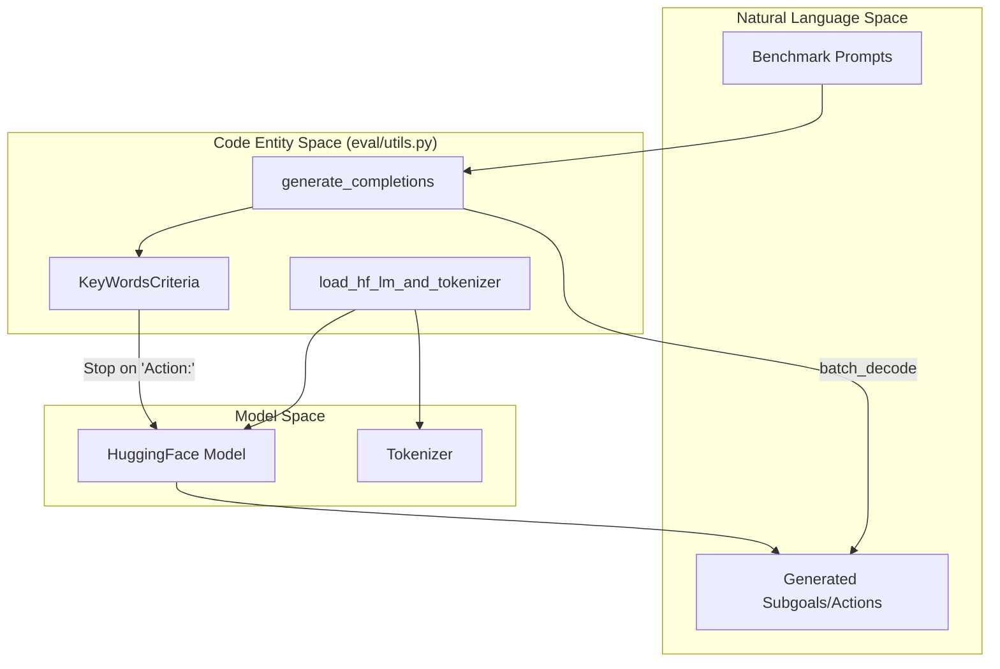
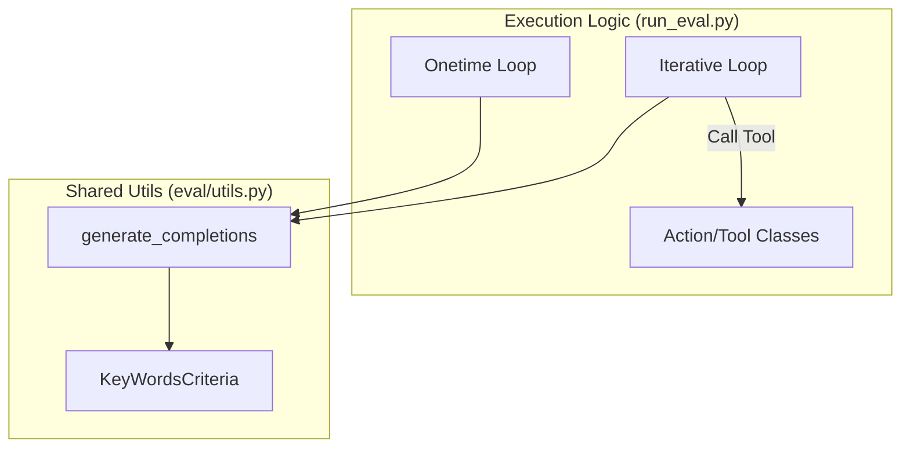

<!-- source: DeepWiki mcp.deepwiki.com · repo allenai/lumos · page 4 Evaluation Framework · fetched 2026-10-26 -->

# Evaluation Framework

Relevant source files

The following files were used as context for generating this wiki page:

- [.gitignore](.gitignore)
- [LICENSE](LICENSE)
- [README.md](README.md)
- [eval/utils.py](eval/utils.py)

The Lumos evaluation framework is designed to assess the performance of modular language agents across a diverse set of interactive benchmarks. It provides a standardized infrastructure for loading models, generating multi-step completions, and executing domain-specific actions. The framework supports four distinct agent formulations: `lumos_iterative`, `lumos_onetime`, `cot` (Chain-of-Thought), and `direct`.

### Shared Evaluation Utilities

The core of the evaluation infrastructure resides in `eval/utils.py`. These utilities are adapted from the `open-instruct` framework to support the specific needs of agentic workflows, such as handling stop sequences for iterative reasoning and batch processing of prompts.

*   **`load_hf_lm_and_tokenizer`**: A standard utility for loading HuggingFace models and tokenizers, ensuring consistent configuration across different evaluation scripts.
*   **`generate_completions`**: The primary function for generating model outputs [eval/utils.py:30-94](). It supports:
    *   **Batch Generation**: Efficiently processing multiple prompts simultaneously [eval/utils.py:36-37]().
    *   **Custom Stopping Criteria**: Using the `KeyWordsCriteria` class to stop generation when specific tokens (like `Subgoal:` or `Action:`) are produced [eval/utils.py:12-26]().
    *   **Post-processing**: Automatically removing prompts and handling stop-sequence artifacts from the generated text [eval/utils.py:56-73]().
*   **`KeyWordsCriteria`**: A custom `StoppingCriteria` implementation that monitors the generation for a list of specific token sequences [eval/utils.py:12-26](). This is critical for the iterative formulation where the model should stop after generating a single subgoal or action.

**Sources:** [eval/utils.py:1-133]()

### Evaluation Formulations

Lumos evaluates four different ways of solving tasks, allowing for a comparison between modular reasoning and standard LLM baselines.

| Formulation | Description |
| :--- | :--- |
| `lumos_iterative` | The agent alternates between the Planning Module (subgoal) and Grounding Module (action) in a loop until the task is complete. |
| `lumos_onetime` | The Planning Module generates all subgoals at once, and the Grounding Module subsequently generates all corresponding actions. |
| `cot` | A standard Chain-of-Thought baseline where the model generates a reasoning trace before the final answer. |
| `direct` | The model is prompted to provide the final answer directly without intermediate reasoning steps. |

**Sources:** [README.md:25-35](), [README.md:108-112]()

### Infrastructure Architecture

The following diagram illustrates how the shared utilities in `eval/utils.py` bridge the gap between high-level evaluation scripts and the underlying model execution.

**Evaluation Utility Flow**

**Sources:** [eval/utils.py:12-26](), [eval/utils.py:30-52](), [eval/utils.py:67-73]()

### Evaluation Entry-Points

Evaluation is typically triggered via shell scripts located in `scripts/eval/`. These scripts invoke domain-specific `run_eval.py` files using a consistent pattern:
`python run_eval.py --model_name_or_path <PATH> --formulation <TYPE> --task <TASK_NAME>`

**Common Evaluation Logic**

**Sources:** [README.md:108-112](), [eval/utils.py:12-30]()

---

### Benchmark-Specific Modules

The framework is specialized for different domains through dedicated evaluation scripts and toolsets.

#### [4.1 Complex QA Evaluation: HotpotQA and StrategyQA](#)
Focuses on multi-hop reasoning and paragraph retrieval. It utilizes the `QAActions` tool class to interact with knowledge sources. For details, see [Complex QA Evaluation: HotpotQA and StrategyQA](#4.1).

#### [4.2 Math Evaluation: GSM8K and SVAMP](#)
Handles mathematical reasoning using the `MathActions` tool class, which includes integrations for `WolframAlpha` and a local `Calculator`. For details, see [Math Evaluation: GSM8K and SVAMP](#4.2).

#### [4.3 Web Navigation Evaluation: Mind2Web](#)
Evaluates the agent's ability to navigate real-world websites. It includes a `MindAct` model for element ranking and a grounding loop for HTML interactions. For details, see [Web Navigation Evaluation: Mind2Web](#4.3).

#### [4.4 Web Shopping Evaluation: WebShop](#)
Tests agents in a simulated e-commerce environment. It features a Flask-based environment (`web_agent_site`) and a `ShopActions` toolset for searching and purchasing. For details, see [Web Shopping Evaluation: WebShop](#4.4).

---

