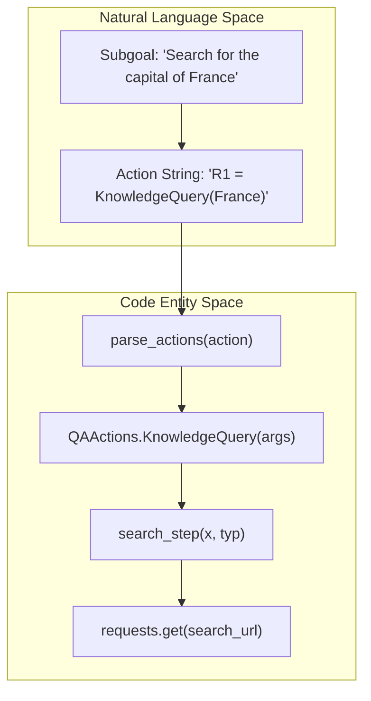
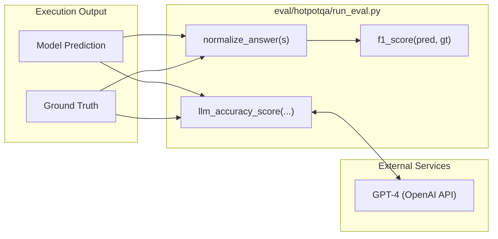

<!-- source: DeepWiki mcp.deepwiki.com · repo allenai/lumos · page 4.1 Complex QA Evaluation: HotpotQA and StrategyQA · fetched 2026-10-26 -->

# Complex QA Evaluation: HotpotQA and StrategyQA

Relevant source files

The following files were used as context for generating this wiki page:

- [eval/hotpotqa/qa_tool.py](eval/hotpotqa/qa_tool.py)
- [eval/hotpotqa/run_eval.py](eval/hotpotqa/run_eval.py)
- [eval/hotpotqa/utils.py](eval/hotpotqa/utils.py)
- [eval/strategyqa/qa_tool.py](eval/strategyqa/qa_tool.py)
- [eval/strategyqa/run_eval.py](eval/strategyqa/run_eval.py)
- [eval/strategyqa/utils.py](eval/strategyqa/utils.py)
- [scripts/eval/hotpotqa.sh](scripts/eval/hotpotqa.sh)
- [scripts/eval/strategyqa.sh](scripts/eval/strategyqa.sh)

This page describes the evaluation framework for complex question answering (QA) tasks in Lumos, specifically targeting the **HotpotQA** and **StrategyQA** benchmarks. It details the implementation of reasoning loops, the toolset used for external knowledge retrieval, and the scoring mechanisms employed to validate model performance.

## Overview and Execution Entry Points

Evaluation is orchestrated via `run_eval.py` scripts located in benchmark-specific directories. These scripts support multiple formulations, including `lumos_iterative` and `lumos_onetime`, and utilize a specialized `QAActions` class to interface with external tools.

| Benchmark | Script Path | Purpose |
| :--- | :--- | :--- |
| **HotpotQA** | `eval/hotpotqa/run_eval.py` | Multi-hop reasoning evaluation [eval/hotpotqa/run_eval.py:1-13]() |
| **StrategyQA** | `eval/strategyqa/run_eval.py` | Implicit reasoning and strategy evaluation [eval/strategyqa/run_eval.py:1-12]() |

### Shell Scripts
Evaluation is typically launched using shell scripts that configure model paths, batch sizes, and the desired formulation.

*   **HotpotQA**: `scripts/eval/hotpotqa.sh` [scripts/eval/hotpotqa.sh:1-9]()
*   **StrategyQA**: `scripts/eval/strategyqa.sh` [scripts/eval/strategyqa.sh:1-9]()

---

## Tooling: The QAActions Class

The `QAActions` class provides the core execution logic for grounding subgoals into tangible results. It handles web searching, paragraph ranking, and final answer generation.

### Tool Definitions and Implementation
The class is defined in `qa_tool.py` for both benchmarks and includes the following key methods:

*   **`KnowledgeQuery`**: Acts as a wrapper for `search_step`, which performs Wikipedia searches or Google queries to retrieve raw text [eval/hotpotqa/qa_tool.py:23-24]().
*   **`ParagraphRetrieve`**: Uses a `DPRReader` (Dense Passage Retrieval) model to rank retrieved paragraphs based on relevance to the current question [eval/hotpotqa/qa_tool.py:46-67](). It returns the top 5 most relevant "Evidence" snippets [eval/hotpotqa/qa_tool.py:62-65]().
*   **`QA`**: An LLM-based tool that takes a context and a question to produce a brief entity answer. It uses `generate_from_openai_chat_completion` to interface with models like GPT-4 [eval/hotpotqa/qa_tool.py:69-80]().

### Data Flow: Natural Language to Code Entity
The following diagram illustrates how a natural language subgoal is transformed into a code-level tool execution.

**Reasoning to Tool Execution Flow**

**Sources:** [eval/hotpotqa/utils.py:114-132](), [eval/hotpotqa/qa_tool.py:22-44](), [eval/hotpotqa/utils.py:17-65]()

---

## Evaluation Loops

Lumos supports two primary reasoning formulations: Iterative and Onetime.

### Iterative Reasoning Loop
In `lumos_iterative`, the model generates a subgoal and an action, executes the action, and then uses the result to generate the next step.
1.  **Parse Action**: The `execute` function uses `parse_actions` to extract the variable name (e.g., `R1`), the tool name (`KnowledgeQuery`), and arguments [eval/hotpotqa/run_eval.py:82]().
2.  **Variable Substitution**: Before execution, placeholders in the arguments are replaced with previous results from the `inter_results` dictionary [eval/hotpotqa/run_eval.py:90-91]().
3.  **Final Decision**: Once the loop concludes, `decide_final_ans` aggregates all intermediate results containing "Question:" markers into a final context for the final `QA` call [eval/hotpotqa/run_eval.py:70-78]().

### Onetime Reasoning Loop
In `lumos_onetime`, the model generates the entire plan (all subgoals and actions) at once. The execution engine then iterates through the pre-generated steps sequentially, updating the `inter_results` state after each tool call.

---

## Scoring and Judgment

QA performance is measured using three distinct metrics: Answer Normalization, F1 Scoring, and LLM-based Accuracy.

### Answer Normalization and F1
To ensure fair comparison, answers are normalized by removing articles (a, an, the), fixing whitespace, removing punctuation, and lowercasing [eval/hotpotqa/run_eval.py:16-30](). The `f1_score` function then calculates the overlap between prediction and ground truth tokens [eval/hotpotqa/run_eval.py:33-51]().

### LLM-based Judgment
For complex answers where exact match or F1 might fail, `llm_accuracy_score` uses GPT-4 to judge if a prediction is semantically correct given the question and ground truth [eval/hotpotqa/run_eval.py:54-67]().

**Scoring Pipeline Architecture**

**Sources:** [eval/hotpotqa/run_eval.py:16-68](), [eval/hotpotqa/run_eval.py:33-51]()

---

## Key Functions Reference

| Function | File | Description |
| :--- | :--- | :--- |
| `execute` | `eval/hotpotqa/run_eval.py` | Dispatches action strings to `QAActions` methods and handles variable substitution [eval/hotpotqa/run_eval.py:81-145](). |
| `parse_actions` | `eval/hotpotqa/utils.py` | Regex-based parser to extract `action_variable`, `action_name`, and `action_args` [eval/hotpotqa/utils.py:114-132](). |
| `search_step` | `eval/hotpotqa/utils.py` | Implements the logic for Wikipedia scraping using `BeautifulSoup` [eval/hotpotqa/utils.py:17-65](). |
| `findvariables` | `eval/hotpotqa/utils.py` | Identifies variable references (e.g., `R1`, `R2`) in action arguments [eval/hotpotqa/utils.py:99-103](). |

**Sources:** [eval/hotpotqa/run_eval.py:1-145](), [eval/strategyqa/run_eval.py:1-120](), [eval/hotpotqa/qa_tool.py:1-110](), [eval/hotpotqa/utils.py:1-138]().

---

