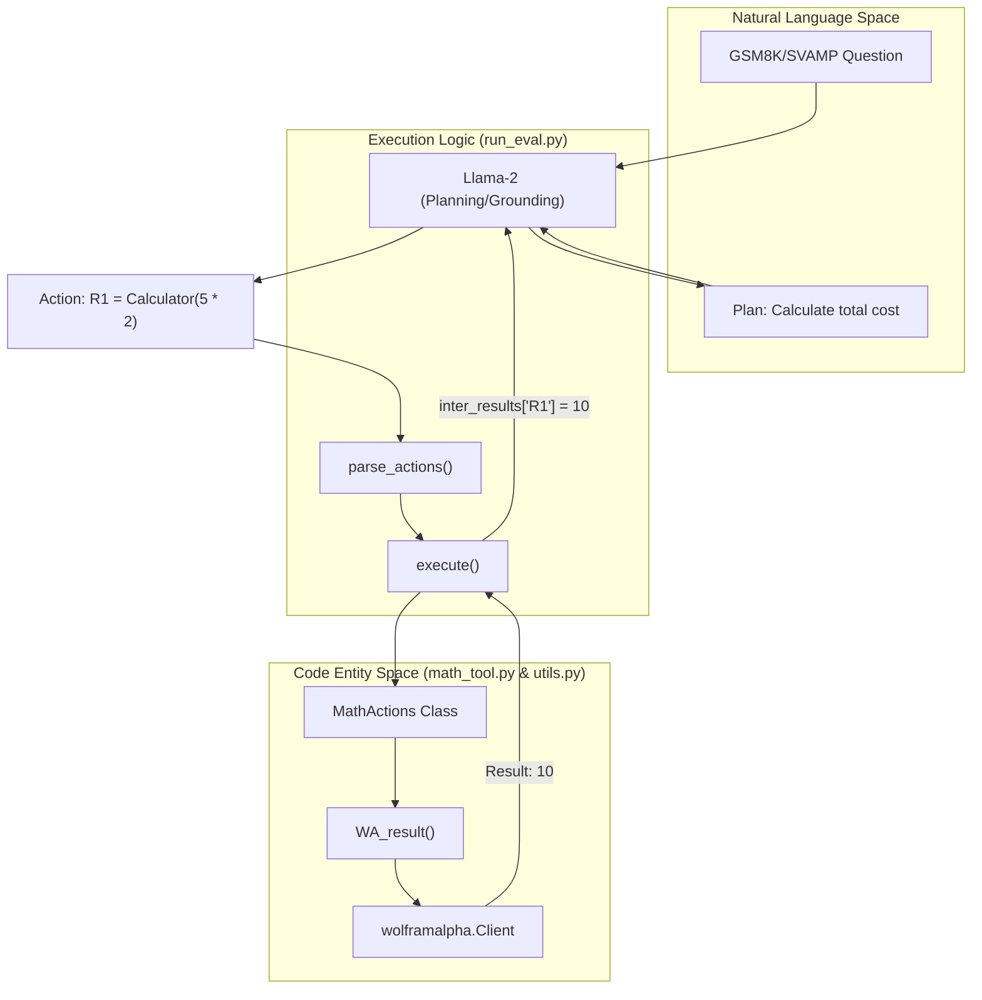

<!-- source: DeepWiki mcp.deepwiki.com · repo allenai/lumos · page 4.2 Math Evaluation: GSM8K and SVAMP · fetched 2026-10-26 -->

# Math Evaluation: GSM8K and SVAMP

<details>
<summary>Relevant source files</summary>

The following files were used as context for generating this wiki page:

- [eval/gsm/math_tool.py](eval/gsm/math_tool.py)
- [eval/gsm/run_eval.py](eval/gsm/run_eval.py)
- [eval/gsm/utils.py](eval/gsm/utils.py)
- [eval/svamp/math_tool.py](eval/svamp/math_tool.py)
- [eval/svamp/run_eval.py](eval/svamp/run_eval.py)
- [eval/svamp/utils.py](eval/svamp/utils.py)
- [scripts/eval/gsm.sh](scripts/eval/gsm.sh)
- [scripts/eval/svamp.sh](scripts/eval/svamp.sh)

</details>


This page describes the evaluation framework for mathematical reasoning tasks in Lumos, specifically targeting the **GSM8K** and **SVAMP** benchmarks. The evaluation utilizes a specialized toolset for symbolic and numeric computation, integrated with external solvers to ensure precision.

## Evaluation Architecture

The math evaluation is orchestrated by `run_eval.py` scripts located in `eval/gsm/` and `eval/svamp/`. These scripts implement the Lumos iterative and onetime formulations, delegating mathematical operations to the `MathActions` class.

### Logic Flow and Data Transformation

The evaluation pipeline bridges the gap between natural language problem statements and executable mathematical operations.

**Natural Language to Code Entity Mapping**

| Natural Language Concept | Code Entity | File Reference |
| :--- | :--- | :--- |
| **Reasoning Step** | `subgoal` (String) | [eval/gsm/run_eval.py:64]() |
| **Tool Invocation** | `action` (String) | [eval/gsm/run_eval.py:64]() |
| **Intermediate Variable** | `action_variable` (e.g., `R1`) | [eval/gsm/utils.py:112]() |
| **Calculation Engine** | `MathActions` | [eval/gsm/math_tool.py:9]() |
| **External Solver** | `wolframalpha.Client` | [eval/gsm/utils.py:11]() |

**System Data Flow Diagram**

Title: Math Action Execution Flow

Sources: [eval/gsm/run_eval.py:14-57](), [eval/gsm/math_tool.py:9-55](), [eval/gsm/utils.py:13-19](), [eval/gsm/utils.py:109-137]()

## The MathActions Tool Class

The `MathActions` class provides the core computational capabilities. It acts as a wrapper around the WolframAlpha API and local Python logic to handle various mathematical requirements.

### Key Methods

*   **`Calculator(x, isfunc)`**: Handles basic arithmetic, functional substitutions, and expression expansion. It uses `WA_result` to evaluate strings [eval/gsm/math_tool.py:10-31]().
*   **`SetEquation(x)`**: Formats strings to define equations for subsequent solving [eval/gsm/math_tool.py:33-37]().
*   **`SolveEquation(x)`**: Sends a "Solve" command to WolframAlpha to find roots or variable values [eval/gsm/math_tool.py:39-40]().
*   **`Count(x)`**: Counts elements in a list. It includes logic for arithmetic sequences (e.g., "1, 2, ..., 10") by calculating the difference and range via WolframAlpha [eval/gsm/math_tool.py:48-54]().
*   **`Define(x)`**: Simply returns the input, used for constant assignment in the reasoning chain [eval/gsm/math_tool.py:45-46]().

Sources: [eval/gsm/math_tool.py:9-55](), [eval/svamp/math_tool.py:9-55]()

## Implementation Details

### Action Parsing and Variable Substitution
Before execution, the system must resolve variable references (e.g., `R1`, `R2`) in the action arguments.
1.  **`parse_actions`**: Extracts the variable name, tool name, and raw arguments from the LLM's grounding output [eval/gsm/utils.py:109-137]().
2.  **`findvariables`**: Uses regex `R[0-9]+` to identify placeholders in the arguments [eval/gsm/utils.py:78-82]().
3.  **`execute`**: Replaces placeholders with actual values stored in `inter_results`. If a variable represents an equation, it wraps it in special markers `:():` for the `combine_eqs` logic [eval/gsm/run_eval.py:15-36]().

### WolframAlpha Integration
The framework requires a `WOLFRAM_API_KEY` environment variable [eval/gsm/utils.py:10](). The `WA_result` function queries the WolframAlpha API and extracts the `plaintext` result from the returned `subpod` [eval/gsm/utils.py:13-19]().

### Scoring and Evaluation
The evaluation uses exact-match scoring for the final answer.
*   **GSM8K**: Answers are extracted from the raw data using the `####` delimiter [eval/gsm/run_eval.py:70]().
*   **SVAMP**: Answers are converted to integers/floats for comparison [eval/svamp/run_eval.py:71]().
*   **Normalization**: Commas in numbers (e.g., `1,000`) are removed via regex before comparison [eval/gsm/run_eval.py:75]().

Sources: [eval/gsm/run_eval.py:14-57](), [eval/gsm/utils.py:10-19](), [eval/gsm/utils.py:78-82](), [eval/gsm/utils.py:109-137]()

## Execution Scripts

The evaluation is triggered via shell scripts that specify the formulation (`lumos_iterative` or `lumos_onetime`) and model paths.

**GSM8K Evaluation Script (`scripts/eval/gsm.sh`)**
```bash
python -m eval.gsm.run_eval \
    --data_dir data/eval/gsm/ \
    --max_num_examples 10 \
    --save_dir results/gsm/ \
    --model_name_or_path /path/to/models \
    --eval_batch_size 8 \
    --formulation lumos_onetime
```
Sources: [scripts/eval/gsm.sh:1-9]()

**SVAMP Evaluation Script (`scripts/eval/svamp.sh`)**
```bash
python -m eval.svamp.run_eval \
    --data_dir data/eval/svamp/ \
    --max_num_examples 10 \
    --save_dir results/svamp/ \
    --model_name_or_path /path/to/models \
    --eval_batch_size 32 \
    --formulation lumos_onetime
```
Sources: [scripts/eval/svamp.sh:1-9]()

---

