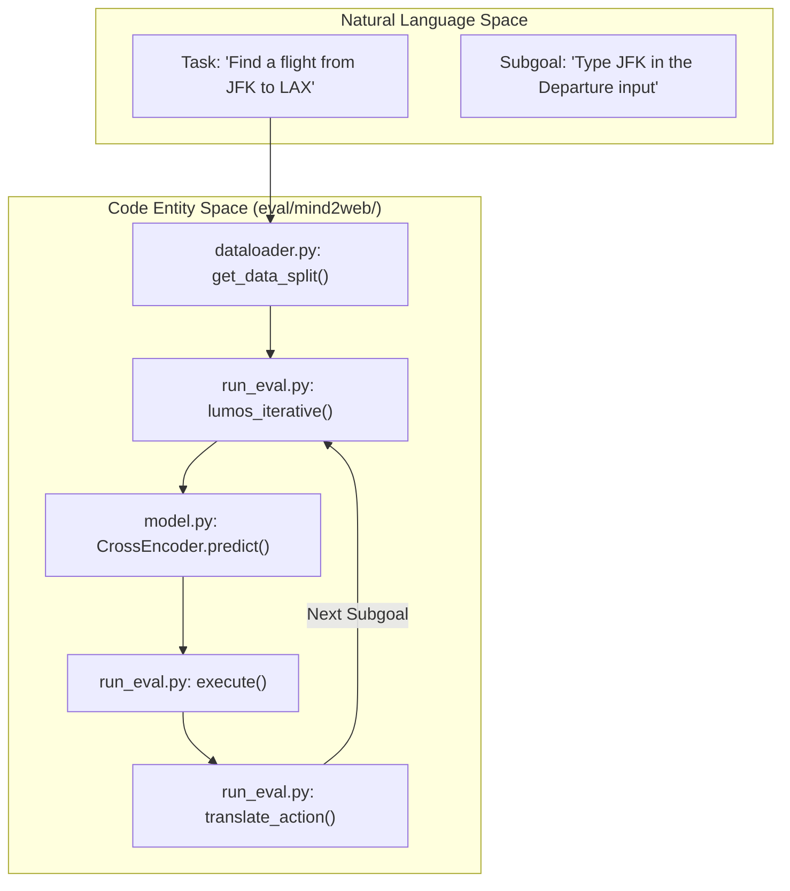

<!-- source: DeepWiki mcp.deepwiki.com · repo allenai/lumos · page 4.3 Web Navigation Evaluation: Mind2Web · fetched 2026-10-26 -->

# Web Navigation Evaluation: Mind2Web

<details>
<summary>Relevant source files</summary>

The following files were used as context for generating this wiki page:

- [eval/mind2web/action_dataloader.py](eval/mind2web/action_dataloader.py)
- [eval/mind2web/data_utils/__init__.py](eval/mind2web/data_utils/__init__.py)
- [eval/mind2web/data_utils/dom_utils.py](eval/mind2web/data_utils/dom_utils.py)
- [eval/mind2web/data_utils/process_trace.py](eval/mind2web/data_utils/process_trace.py)
- [eval/mind2web/dataloader.py](eval/mind2web/dataloader.py)
- [eval/mind2web/model.py](eval/mind2web/model.py)
- [eval/mind2web/run_eval.py](eval/mind2web/run_eval.py)
- [eval/mind2web/utils.py](eval/mind2web/utils.py)
- [scripts/eval/mind2web.sh](scripts/eval/mind2web.sh)

</details>


The Mind2Web evaluation pipeline assesses the Lumos model's ability to navigate complex web environments. This process involves decomposing high-level tasks into subgoals, ranking HTML elements to identify interaction targets, and grounding subgoals into executable browser actions like `CLICK`, `TYPE`, and `SELECT`.

## Evaluation Pipeline Overview

The evaluation follows an iterative "Plan-Ground" loop managed by `run_eval.py`. Unlike simpler QA tasks, web navigation requires interacting with a dynamic Document Object Model (DOM). Lumos utilizes a specialized CrossEncoder (MindAct model) to rank HTML elements, ensuring the grounding module receives the most relevant context from potentially massive web pages.

### System Architecture: Natural Language to Code Entities

The following diagram illustrates the flow from a natural language task to the specific code entities responsible for processing web navigation steps.

**Mind2Web Evaluation Data Flow**

**Sources:** `[eval/mind2web/run_eval.py:105-160]()`, `[eval/mind2web/dataloader.py:76-107]()`, `[eval/mind2web/model.py:19-40]()`

---

## Data Loading and Preprocessing

The Mind2Web dataset contains raw HTML and action traces. Lumos uses `dataloader.py` and `action_dataloader.py` to prepare this data for evaluation.

### HTML Pruning and Formatting
Because raw HTML is often too large for LLM context windows, `dataloader.py` implements pruning logic.
- **`format_candidate`**: Extracts a node's ancestors and the target subtree, limiting the representation to relevant context [eval/mind2web/dataloader.py:20-43]().
- **`get_data_split`**: Maps over the dataset to format positive and negative interaction candidates using `lxml` for DOM parsing [eval/mind2web/dataloader.py:76-107]().

### Dataset Classes
- **`CandidateRankDataset`**: Used for training or evaluating the element ranker, providing pairs of (Query, Candidate) with binary labels [eval/mind2web/dataloader.py:46-73]().
- **`MultiChoiceDataset`**: Formats the web navigation task as a multiple-choice problem where the model selects the correct element ID [eval/mind2web/action_dataloader.py:128-148]().

**Sources:** `[eval/mind2web/dataloader.py:20-107]()`, `[eval/mind2web/action_dataloader.py:128-190]()`

---

## Element Ranking (MindAct Model)

A critical component of the pipeline is the `CrossEncoder` (derived from the MindAct architecture), which ranks HTML elements based on their relevance to the current task and previous actions.

### Ranking Logic in `run_eval.py`
The function `extract_key_info` performs the ranking:
1. **Query Reformulation**: Combines the task description with a history of previous actions [eval/mind2web/run_eval.py:27-30]().
2. **De-duplication**: Collects unique tags from the environment to reduce redundant model calls [eval/mind2web/run_eval.py:32-40]().
3. **Cross-Encoding**: Scores pairs of `[query_reformulate, tag]` using `query_model.predict()` [eval/mind2web/run_eval.py:41-50]().
4. **Selection**: Returns the top-ranked element (or top 50 depending on the `rank` parameter) for the grounding module to use [eval/mind2web/run_eval.py:52-70]().

**Sources:** `[eval/mind2web/run_eval.py:26-71]()`, `[eval/mind2web/model.py:19-40]()`

---

## The Iterative Evaluation Loop

The core execution logic resides in `lumos_iterative` within `run_eval.py`. This function manages the state machine of the web agent.

### Subgoal Translation
Lumos uses `translate_action` to convert internal action representations (e.g., `[button] Login -> CLICK`) back into natural language subgoals. This maintains the "Natural Language Space" consistency across iterations.

| Action Type | Translation Logic | Example Output |
| :--- | :--- | :--- |
| **CLICK** | Randomly picks "Visit", "Click", "Find and go into", or "Enter" [eval/mind2web/run_eval.py:90-91]() | "Click button Login" |
| **TYPE** | Randomly picks "Type", "Input", or "Put text" [eval/mind2web/run_eval.py:93-95]() | "Type john_doe in the input username" |
| **SELECT** | Randomly picks "Select", "Choose", or "Pick up" [eval/mind2web/run_eval.py:97-99]() | "Select California in the dropdown state" |

### Execution Flow
The loop continues for a maximum of 15 steps per task [eval/mind2web/run_eval.py:122]().

1. **Planning**: The model generates a subgoal based on the task and current environment state [eval/mind2web/run_eval.py:137-143]().
2. **Grounding**: The subgoal is grounded into a specific action (`CLICK`, `TYPE`, `SELECT`) [eval/mind2web/run_eval.py:126-127]().
3. **Execution**: The `execute` function calls `extract_key_info` to find the target HTML element and returns the resulting state [eval/mind2web/run_eval.py:73-82]().
4. **Termination**: The loop checks if the task is completed or if the model emits a stop signal [eval/mind2web/run_eval.py:143]().

**Sources:** `[eval/mind2web/run_eval.py:73-103]()`, `[eval/mind2web/run_eval.py:105-157]()`

---

## Execution Script

The evaluation is launched via a shell script that configures the model paths, data directories, and the specific formulation (`lumos_iterative`).

**File: `scripts/eval/mind2web.sh`**
```bash
python -m eval.mind2web.run_eval \
    --data_dir data/eval/mind2web/ \
    --max_num_examples 10 \
    --save_dir results/mind2web \
    --model_name_or_path /path/to/models \
    --eval_batch_size 16 \
    --formulation lumos_iterative
```
**Sources:** `[scripts/eval/mind2web.sh:1-9]()`

## Metrics
The primary metric tracked is the **Step Success Rate**, which measures if the model correctly identified the target element and action at each individual step compared to the gold trace. In `run_eval.py`, this is calculated by comparing the predicted element index and action name against the ground truth `op["op"]` and `op["value"]` [eval/mind2web/run_eval.py:57-60]().

**Sources:** `[eval/mind2web/run_eval.py:55-62]()`

---

