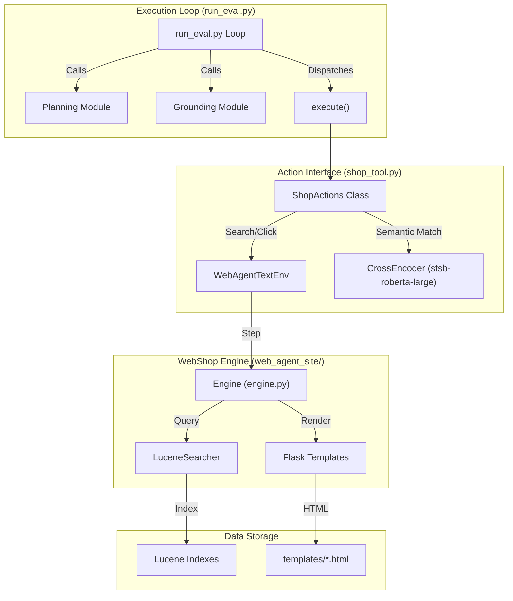
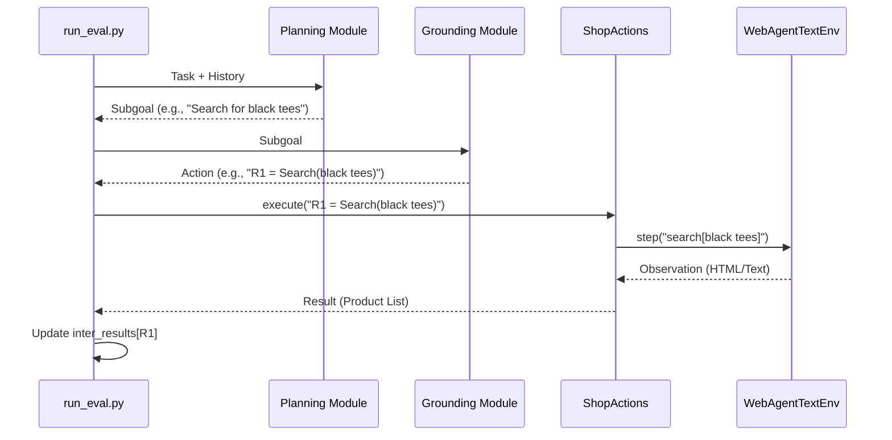

<!-- source: DeepWiki mcp.deepwiki.com · repo allenai/lumos · page 4.4 Web Shopping Evaluation: WebShop · fetched 2026-10-26 -->

# Web Shopping Evaluation: WebShop

Relevant source files

The following files were used as context for generating this wiki page:

- [eval/webshop/README.md](eval/webshop/README.md)
- [eval/webshop/examplars.py](eval/webshop/examplars.py)
- [eval/webshop/requirements.txt](eval/webshop/requirements.txt)
- [eval/webshop/run_eval.py](eval/webshop/run_eval.py)
- [eval/webshop/search_engine/convert_product_file_format.py](eval/webshop/search_engine/convert_product_file_format.py)
- [eval/webshop/search_engine/lucene_searcher.py](eval/webshop/search_engine/lucene_searcher.py)
- [eval/webshop/search_engine/run_indexing.sh](eval/webshop/search_engine/run_indexing.sh)
- [eval/webshop/setup.sh](eval/webshop/setup.sh)
- [eval/webshop/shop_tool.py](eval/webshop/shop_tool.py)
- [eval/webshop/utils.py](eval/webshop/utils.py)
- [eval/webshop/web_agent_site/engine/engine.py](eval/webshop/web_agent_site/engine/engine.py)
- [eval/webshop/web_agent_site/engine/goal.py](eval/webshop/web_agent_site/engine/goal.py)
- [eval/webshop/web_agent_site/engine/normalize.py](eval/webshop/web_agent_site/engine/normalize.py)
- [eval/webshop/web_agent_site/envs/web_agent_site_env.py](eval/webshop/web_agent_site/envs/web_agent_site_env.py)
- [eval/webshop/web_agent_site/envs/web_agent_text_env.py](eval/webshop/web_agent_site/envs/web_agent_text_env.py)
- [scripts/eval/webshop.sh](scripts/eval/webshop.sh)

The WebShop evaluation module in Lumos provides a simulated e-commerce environment for testing agentic shopping behavior. It utilizes a Flask-based engine to simulate a product website, a Lucene-based search engine for product discovery, and a specialized toolset (`ShopActions`) for interacting with the site. The evaluation follows the Lumos-Iterative formulation, where a Planning Module generates subgoals and a Grounding Module maps them to specific site interactions.

## Architecture Overview

The WebShop environment is composed of a backend simulation engine and a front-end action interface. The `WebAgentTextEnv` class serves as the primary gymnasium-style environment for the agent.

### System Components Diagram

The following diagram illustrates the flow from the iterative evaluation loop to the underlying WebShop engine.

**WebShop System Architecture**

Sources: [eval/webshop/run_eval.py:23-69](), [eval/webshop/shop_tool.py:23-80](), [eval/webshop/web_agent_site/engine/engine.py:44-108](), [eval/webshop/web_agent_site/engine/engine.py:195-207]()

## The WebShop Engine

The core of the simulation is found in `eval/webshop/web_agent_site/engine/engine.py`. It manages the state of the shopping session and renders different "pages" based on agent actions.

### Key Engine Functions
- **`map_action_to_html`**: This function is the primary router for the simulation. It takes an action string (e.g., `click[Buy Now]`) and returns a rendered HTML string using Flask's `render_template_string` [eval/webshop/web_agent_site/engine/engine.py:44-108]().
- **`init_search_engine`**: Initializes a `LuceneSearcher` pointing to pre-built indexes (e.g., `indexes_1k`, `indexes_100k`) [eval/webshop/web_agent_site/engine/engine.py:195-207]().
- **`get_top_n_product_from_keywords`**: Interfaces with the Lucene search engine to retrieve product ASINs based on user queries [eval/webshop/web_agent_site/engine/engine.py:148-173]().

### Search and Indexing
WebShop uses **Pyserini** and **Lucene** for its search functionality.
1. **Conversion**: `convert_product_file_format.py` transforms raw product JSON data into a `.jsonl` format suitable for indexing [eval/webshop/search_engine/convert_product_file_format.py:14-32]().
2. **Indexing**: The `run_indexing.sh` script invokes `pyserini.index.lucene` to build the searchable indexes [eval/webshop/search_engine/run_indexing.sh:1-32]().

Sources: [eval/webshop/web_agent_site/engine/engine.py:1-215](), [eval/webshop/search_engine/run_indexing.sh:1-32](), [eval/webshop/search_engine/convert_product_file_format.py:1-50]()

## ShopActions Tool Class

The `ShopActions` class in `shop_tool.py` defines the atomic operations available to the Lumos Grounding module.

| Tool | Purpose | Implementation Detail |
| :--- | :--- | :--- |
| `Search` | Performs a search in the environment. | Calls `env.step(f"search[{query}]")` and parses the observation for product titles [eval/webshop/shop_tool.py:24-35](). |
| `Click` | Simulates a button/link click. | Calls `env.step(curr_action)` and returns available clickables or the final reward [eval/webshop/shop_tool.py:37-44](). |
| `FeatureRetrieve` | Filters product attributes. | Uses a `CrossEncoder` to match a query against a list of features (e.g., color, size) [eval/webshop/shop_tool.py:46-66](). |
| `Pick` | Selects the best product. | Uses a `CrossEncoder` to rank product descriptions against the task query [eval/webshop/shop_tool.py:68-79](). |

### Semantic Matching
For `FeatureRetrieve` and `Pick`, Lumos uses the `stsb-roberta-large` Cross-Encoder model. This bridges the "Natural Language Space" (the goal) with the "Code Entity Space" (specific product ASINs and feature strings) by calculating similarity scores between the user instruction and the available environment options [eval/webshop/shop_tool.py:12-21]().

Sources: [eval/webshop/shop_tool.py:12-80]()

## Evaluation Loop (`run_eval.py`)

The evaluation uses `lumos_iterative`, which cycles between planning, grounding, and execution.

### Execution Logic
The `execute` function in `run_eval.py` acts as the dispatcher. It parses action strings like `R1 = Search(query)` using `parse_actions` and routes them to the corresponding `ShopActions` method [eval/webshop/run_eval.py:23-69]().

**Iterative Data Flow**

Sources: [eval/webshop/run_eval.py:23-69](), [eval/webshop/run_eval.py:70-127](), [eval/webshop/utils.py:20-38]()

## Setup and Configuration

The environment requires specific local data and search indexes to function.

### Environment Setup
The `setup.sh` script automates the installation of dependencies and data downloading:
- **Dependencies**: Installs `faiss-cpu`, `openjdk=11` (for Lucene), and `spacy` [eval/webshop/setup.sh:24-29]().
- **Data**: Downloads product info (`items_shuffle`) and attribute data via `gdown` [eval/webshop/setup.sh:31-45]().
- **Indexing**: Executes the indexing pipeline to create `indexes/` [eval/webshop/setup.sh:50-56]().

### Evaluation Command
Evaluation is typically launched via `scripts/eval/webshop.sh`, which sets the batch size and points to the fine-tuned Lumos model [scripts/eval/webshop.sh:1-9]().

Sources: [eval/webshop/setup.sh:1-73](), [scripts/eval/webshop.sh:1-9](), [eval/webshop/README.md:1-7]()

---

