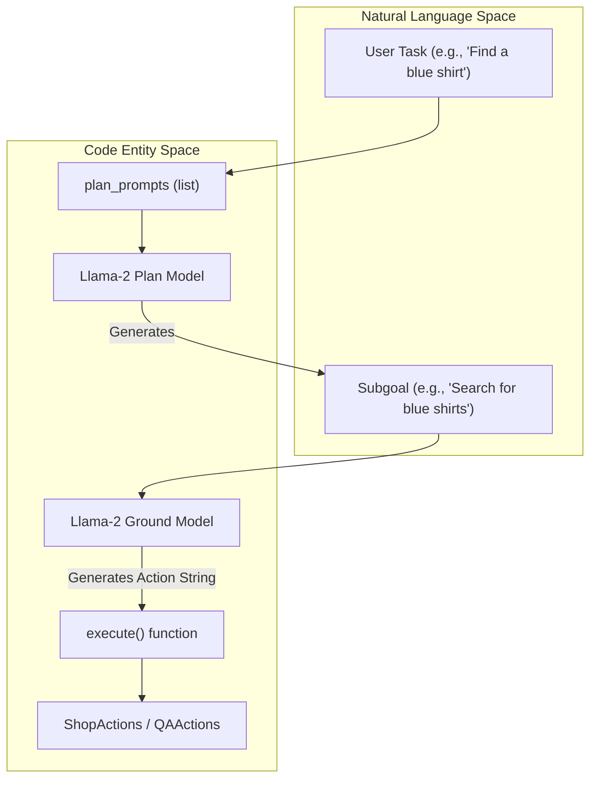
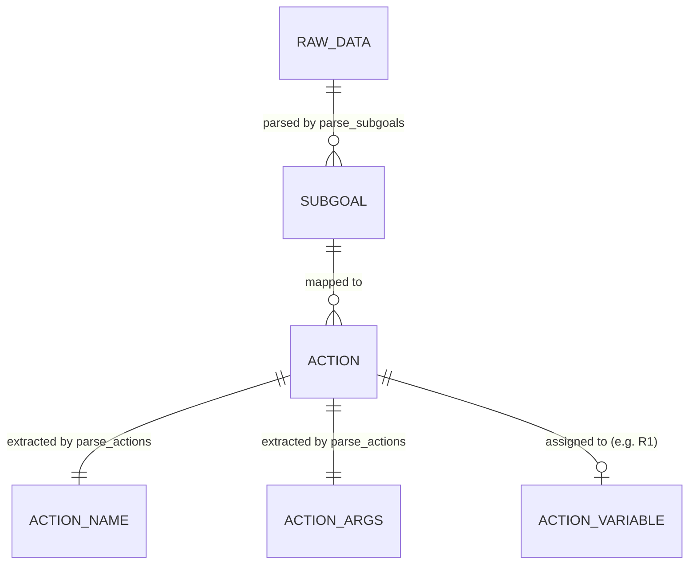

<!-- source: DeepWiki mcp.deepwiki.com · repo allenai/lumos · page 6 Glossary · fetched 2026-10-26 -->

# Glossary

Relevant source files

The following files were used as context for generating this wiki page:

- [.gitignore](.gitignore)
- [LICENSE](LICENSE)
- [README.md](README.md)
- [data/__init__.py](data/__init__.py)
- [data/fast_prompt.py](data/fast_prompt.py)
- [data/incontext.py](data/incontext.py)
- [data/process_for_train.py](data/process_for_train.py)
- [data/prompt_convertion.py](data/prompt_convertion.py)
- [docs/index.html](docs/index.html)
- [eval/hotpotqa/run_eval.py](eval/hotpotqa/run_eval.py)
- [eval/mind2web/run_eval.py](eval/mind2web/run_eval.py)
- [eval/webshop/run_eval.py](eval/webshop/run_eval.py)
- [model/finetune.py](model/finetune.py)
- [requirements.txt](requirements.txt)
- [scripts/train/finetune_llama2_ground_iterative.sh](scripts/train/finetune_llama2_ground_iterative.sh)
- [scripts/train/finetune_llama2_plan_iterative.sh](scripts/train/finetune_llama2_plan_iterative.sh)

This page provides definitions for the domain-specific terminology, architectural components, and data structures used in the Lumos codebase. It serves as a technical reference for engineers to map conceptual agent behaviors to specific code entities.

## Core Architectural Concepts

### Planning Module
The **Planning Module** is responsible for high-level task decomposition. It takes a natural language task and the current environment state to produce a "Subgoal". In the iterative formulation, it generates one subgoal at a time, conditioned on previous execution results.
*   **Implementation**: Fine-tuned Llama-2 models (7B/13B).
*   **Code Pointers**: 
    *   Training script: [scripts/train/finetune_llama2_plan_iterative.sh:1-36]()
    *   Iterative logic in evaluation: [eval/mind2web/run_eval.py:137-143]()
    *   Prompt prefixing: [eval/webshop/run_eval.py:85-97]()

### Grounding Module
The **Grounding Module** maps a high-level "Subgoal" into one or more executable "Actions" using a domain-specific toolset. It bridges the gap between abstract planning and low-level API/tool calls.
*   **Implementation**: Fine-tuned Llama-2 models (7B/13B).
*   **Code Pointers**:
    *   Training script: [scripts/train/finetune_llama2_ground_iterative.sh:1-36]()
    *   Prompt prefixing for available actions: [eval/webshop/run_eval.py:99-112]()

### Execution Module
The **Execution Module** refers to the collection of tools and environment wrappers that process the grounded actions and return observations or results back to the planner.
*   **Implementation**: Classes like `QAActions` or `ShopActions`.
*   **Code Pointers**:
    *   Math/QA tools: [eval/hotpotqa/run_eval.py:81-115]()
    *   WebShop tools: [eval/webshop/run_eval.py:23-68]()

**Data Flow: Natural Language to Execution**

**Sources:** [eval/webshop/run_eval.py:70-125](), [eval/hotpotqa/run_eval.py:81-140]()

---

## Data Formats and Structures

### Subgoal
A natural language description of an intermediate step required to solve a task. In the Lumos unified format, subgoals are extracted from raw reasoning chains.
*   **Parsing Logic**: [data/process_for_train.py:7-14]()

### Action
A structured string representing a tool call, typically following the format `ActionName(Args)`.
*   **Parsing Logic**: `parse_actions` function extracts the `action_variable`, `action_name`, and `action_args`.
*   **Code Pointers**: [data/process_for_train.py:16-52]()

### Inter-results
A dictionary or object that stores the outputs of previous actions, often keyed by a variable name (e.g., `R1`, `R2`). These results are used for variable substitution in subsequent grounding steps.
*   **Usage**: [eval/hotpotqa/run_eval.py:91-92]()

**Entity Relationship: Data Processing**

**Sources:** [data/process_for_train.py:7-52]()

---

## Task-Specific Terminology

| Term | Context | Definition | Code Pointer |
| :--- | :--- | :--- | :--- |
| **Iterative Formulation** | Architecture | The agent generates one subgoal, grounds it, executes it, and then re-plans. | [eval/mind2web/run_eval.py:105-160]() |
| **Onetime Formulation** | Architecture | The agent generates the entire plan (all subgoals) at once before grounding. | [data/process_for_train.py:171-180]() |
| **CrossEncoder** | Web Navigation | A model used to rank HTML elements for element selection in Mind2Web. | [eval/mind2web/run_eval.py:12-54]() |
| **FeatureRetrieve** | Web Shopping | A tool used to select relevant product features from a list based on a query. | [eval/webshop/run_eval.py:42-49]() |
| **KnowledgeQuery** | Complex QA | A tool that performs a search or lookup to retrieve raw evidence paragraphs. | [eval/hotpotqa/run_eval.py:88-115]() |
| **Unified Data** | Data Pipeline | A standardized schema for training data across all domains (Math, QA, Web). | [data/process_for_train.py:55-60]() |

---

## Evaluation Metrics

### F1 Score
Used in Complex QA (HotpotQA/StrategyQA) to measure the overlap between the predicted answer and the ground truth.
*   **Code Pointers**: [eval/hotpotqa/run_eval.py:33-51]()

### LLM Accuracy Score
A judge-based metric where GPT-4 is used to determine if a model's prediction is semantically correct despite formatting differences.
*   **Code Pointers**: [eval/hotpotqa/run_eval.py:54-67]()

### Step Success Rate (SSR)
Used in Mind2Web to measure if the agent correctly identifies the target HTML element and the correct operation at each step.
*   **Code Pointers**: [eval/mind2web/run_eval.py:55-60]()

**Sources:** [eval/hotpotqa/run_eval.py:16-67](), [eval/mind2web/run_eval.py:17-60]()