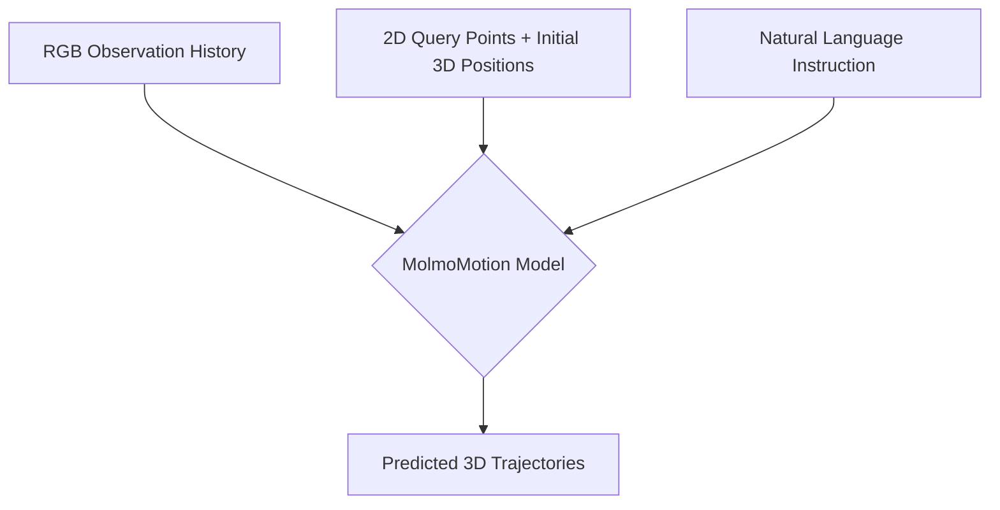
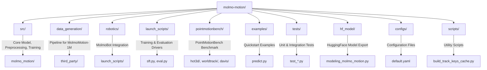

<!-- source: DeepWiki mcp.deepwiki.com · repo allenai/molmo-motion · page 1 MolmoMotion Overview · fetched 2026-10-26 -->

# MolmoMotion Overview

Relevant source files

The following files were used as context for generating this wiki page:

- [LICENSE](LICENSE)
- [README.md](README.md)
- [THIRD-PARTY-NOTICES](THIRD-PARTY-NOTICES)
- [assets/architecture.png](assets/architecture.png)
- [assets/qualitative_examples.png](assets/qualitative_examples.png)
- [assets/teaser.png](assets/teaser.png)

MolmoMotion is a 4B vision-language model designed to forecast 3D point trajectories based on natural-language instructions [README.md:33-35](). Given a short RGB observation history, a set of user-specified 2D query points with their initial 3D positions, and a language description of the intended action, the model predicts each query point's 3D trajectory for up to approximately 2 seconds in the camera-frame-at-t₀ coordinate system [README.md:35-40](). This repository focuses on the autoregressive (AR) variant of MolmoMotion [README.md:42-43]().

The learned motion prior from MolmoMotion has demonstrated transferability to robotics planning and motion-guided video generation [README.md:40-41](). This page provides a high-level overview of MolmoMotion, its two-stage training strategy, key datasets, and the repository's organization. For detailed information on each topic, please refer to the linked child pages.

## Core Functionality

MolmoMotion takes multimodal inputs—visual observations, 2D query points with initial 3D positions, and a language instruction—to predict future 3D trajectories for those points. This capability allows for fine-grained control over motion forecasting, enabling applications in various domains.

### MolmoMotion's Prediction Process

Sources: [README.md:35-40]()

## Two-Stage Training Strategy

MolmoMotion employs a two-stage supervised fine-tuning (SFT) training pipeline [README.md:57-59](). This approach allows the model to first learn general motion patterns and then specialize for longer-horizon predictions.

1.  **Stage 1 — Pretrain (P=8, H=3, F=8, 40K steps)**: This initial stage focuses on pre-training the model with a specific configuration for history (H) and future (F) frames, and a batch size (P) [README.md:58]().
2.  **Stage 2 — Long-horizon finetune (10K steps)**: The second stage fine-tunes the model for longer-horizon predictions, typically with an increased number of future frames (F=30/32) [README.md:59]().

For more in-depth information on the training process and recipes, see [Training](#4).

## Key Datasets

MolmoMotion leverages two primary corpora hosted on HuggingFace:

*   **MolmoMotion-1M**: This is the main training corpus [README.md:109](). It comprises several sub-datasets, including `egodex`, `ytvis`, `hdepic`, `xperience`, `stereo4d`, `droid`, and `molmospaces` [README.md:139-147](). The public training recipe primarily uses the first five datasets [README.md:155-156]().
*   **PointMotionBench**: This serves as the evaluation benchmark for MolmoMotion [README.md:110](). It includes `hot3d`, `worldtrack`, and `davis` sub-datasets [README.md:149-151]().

These datasets are downloaded and managed via environment variables `MOLMO_MOTION_1M_ROOT` and `POINTMOTIONBENCH_ROOT` [README.md:120-121]().

For detailed information on data handling and preprocessing, see [Data Pipeline & Preprocessing](#3). For specifics on the evaluation benchmark, see [Evaluation & PointMotionBench](#5).

## Repository Organization

The MolmoMotion repository is structured to separate different aspects of the project, including source code, data generation tools, robotics integration, launch scripts, and evaluation benchmarks.

### Top-Level Directory Structure

Sources: [README.md:115-117](), [src/molmo_motion/models/molmo2/](src/molmo_motion/models/molmo2/)

*   `src/`: Contains the core MolmoMotion model implementation, data preprocessing logic, and training components [src/](src/).
*   `data_generation/`: Houses the automated annotation pipeline used to create the MolmoMotion-1M dataset [data_generation/](data_generation/).
*   `robotics/`: Provides code and scripts for integrating MolmoMotion with robotics platforms, specifically MolmoBot [robotics/](robotics/).
*   `launch_scripts/`: Contains scripts for launching training and evaluation jobs [launch_scripts/](launch_scripts/).
*   `pointmotionbench/`: Defines the PointMotionBench evaluation benchmark structure and related utilities [pointmotionbench/](pointmotionbench/).
*   `examples/`: Includes quickstart examples to demonstrate model usage [examples/](examples/).
*   `tests/`: Holds the test suite for the codebase [tests/](tests/).
*   `hf_model/`: Contains the HuggingFace model export utilities and related files [hf_model/](hf_model/).
*   `configs/`: Stores YAML configuration files for various pipeline stages and training recipes [configs/](configs/).
*   `scripts/`: Contains miscellaneous utility scripts [scripts/](scripts/).

For a detailed breakdown of the repository layout and project configuration, see [Repository Layout & Project Configuration](#1.2).

## Getting Started

To begin using MolmoMotion, you can follow the installation instructions and run the quickstart example. This involves cloning the repository, setting up a Conda environment, installing dependencies, and downloading the necessary datasets and models.

For a step-by-step guide on installation, running examples, and understanding output visualizations, see [Getting Started & Quickstart](#1.1).

## Further Reading

*   **Core Model Architecture**: For an in-depth look at the model's internal components, including the vision encoder, LLM decoder, and trajectory tokenization, see [Core Model Architecture](#2).
*   **Data Pipeline & Preprocessing**: To understand how training data is processed and loaded, refer to [Data Pipeline & Preprocessing](#3).
*   **Training**: For details on the training setup, FSDP, optimizers, and checkpointing, see [Training](#4).
*   **Evaluation & PointMotionBench**: Learn about the evaluation infrastructure and metrics used to assess model performance in [Evaluation & PointMotionBench](#5).
*   **Data Generation Pipeline (MolmoMotion-1M)**: Explore the automated annotation pipeline that created the MolmoMotion-1M dataset in [Data Generation Pipeline (MolmoMotion-1M)](#6).
*   **Robotics Integration (MolmoBot)**: Discover how MolmoMotion integrates with robotics for tasks like pick-and-place in [Robotics Integration (MolmoBot)](#7).
*   **Testing & Development Utilities**: For information on the test suite and development tools, see [Testing & Development Utilities](#8).
*   **Glossary**: For definitions of key terms, refer to the [Glossary](#9).

Sources: [README.md:49-66]()

---

