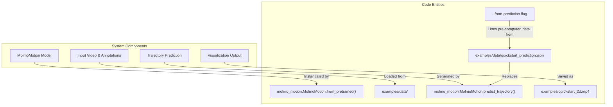

<!-- source: DeepWiki mcp.deepwiki.com · repo allenai/molmo-motion · page 1.1 Getting Started & Quickstart · fetched 2026-10-26 -->

# Getting Started & Quickstart

<details>
<summary>Relevant source files</summary>

The following files were used as context for generating this wiki page:

- [.gitignore](.gitignore)
- [README.md](README.md)

</details>


This page provides a step-by-step guide to installing the MolmoMotion codebase, running a quickstart example, and understanding the resulting visualization. It covers the installation process, the use of the `examples/` directory, `pip install` options, and how to run the model without a GPU using the `--from-prediction` flag.

## Installation

To begin, clone the MolmoMotion repository and set up your Python environment.

```bash
git clone https://github.com/allenai/molmo-motion.git
cd molmo-motion
conda create -n molmo-motion python=3.11 -y
conda activate molmo-motion
pip install -e .[viz]
```
[README.md:70-77]()

The `pip install -e .[viz]` command installs the project in editable mode and includes the `viz` extra, which pulls in dependencies required for visualization.

**GPU / Driver Note:** The default PyTorch wheels installed by `pip` might target a newer CUDA runtime than your system's driver. If `torch.cuda.is_available()` returns `False`, you'll need to install a PyTorch build that matches your CUDA driver. For example, for CUDA 12.8:

```bash
pip install "torch==2.9.1" torchvision "torchcodec==0.9.*" \
    --index-url https://download.pytorch.org/whl/cu128
```
[README.md:81-84]()

Ensure that `torchcodec` matches the PyTorch minor version (e.g., `0.9.x` for `torch 2.9`). Additionally, the video decoder requires FFmpeg shared libraries, which can be installed via `conda install -c conda-forge ffmpeg`. While the bundled training/evaluation recipes use OpenCV for decoding and don't strictly require FFmpeg, the `torchcodec_exact` path does [README.md:86-93]().

After installation, three console scripts become available:
*   `molmo-motion-train`: A `torchrun`-compatible YAML-config training driver.
*   `molmo-motion-eval`: A `torchrun`-compatible YAML-config evaluation driver.
*   `molmo-motion-convert-hf`: A utility for converting OLMo-native checkpoints to HuggingFace format.
[README.md:96-101]()

Sources:
*   [README.md:70-102]()

## Downloading Datasets and Models

MolmoMotion relies on two main HuggingFace corpora: `allenai/molmo-motion-1m` for training and `allenai/PointMotionBench` for evaluation [README.md:107-110](). Before running any examples or training, you must download these datasets.

First, set environment variables for the root directories where these datasets will be stored. These directories **must be outside the MolmoMotion repository** [README.md:112-117]().

```bash
export MOLMO_MOTION_1M_ROOT=/your/path/to/molmo-motion-1m
export POINTMOTIONBENCH_ROOT=/your/path/to/PointMotionBench
```
[README.md:120-121]()

Then, download the datasets using `hf download`:

```bash
# Training corpus.
hf download allenai/molmo-motion-1m \
    --repo-type dataset --local-dir $MOLMO_MOTION_1M_ROOT

# Evaluation benchmark — only needed for `launch_scripts/eval_pointmotionbench.py`.
hf download allenai/PointMotionBench \
    --repo-type dataset --local-dir $POINTMOTIONBENCH_ROOT
```
[README.md:126-134]()

The expected directory structure after download is:

```
$MOLMO_MOTION_1M_ROOT/
├── egodex/         annotations/  tracks/  camera/
├── ytvis/          annotations/  tracks/  camera/
├── hdepic/         annotations/  tracks/  camera/
├── xperience/      annotations/  tracks/
├── stereo4d/       annotations/  track_index/
├── droid/          annotations/  tracks/  camera/    # robot teleop, NOT used by the default recipe
└── molmospaces/    annotations/  tracks/  camera/  videos/    # sim, NOT used by the default recipe

$POINTMOTIONBENCH_ROOT/
├── hot3d/
├── worldtrack/
└── davis/
```
[README.md:138-152]()

The `egodex`, `ytvis`, `hdepic`, `xperience`, and `stereo4d` datasets are used by the public training recipe. `droid` and `molmospaces` are included for extension but not used by default [README.md:154-156](). Raw videos are reconstructed locally from their original sources, and each dataset directory on HuggingFace includes a `README.md` and reconstruction script [README.md:158-163]().

Finally, download a released model checkpoint. All released checkpoints are the autoregressive (AR) variant of MolmoMotion [README.md:166-167](). For the quickstart, we'll use `allenai/MolmoMotion-4B-H3-F30`.

```bash
hf download allenai/MolmoMotion-4B-H3-F30 \
    --repo-type model --local-dir molmomotion-4b-h3-f30
```
[README.md:174-176]()

Sources:
*   [README.md:107-176]()

## Quickstart Example

The `examples/` directory contains a quickstart script, `examples/quickstart.py`, which demonstrates how to use a pretrained MolmoMotion model to predict 3D trajectories.

### Quickstart Workflow
```mermaid
graph TD
    A[Start] --> B{Run examples/quickstart.py};
    B --> C{Load MolmoMotion-4B-H3-F30 model};
    C --> D{Load example video and annotations};
    D --> E{Preprocess input for model};
    E --> F{Call model.predict_trajectory()};
    F --> G{Visualize predicted trajectories};
    G --> H[Output MP4 video];
    H --> I[End];

    style A fill:#ace,stroke:#333,stroke-width:2px;
    style I fill:#ace,stroke:#333,stroke-width:2px;
```
**Diagram 1: Quickstart Workflow**

The `quickstart.py` script performs the following steps:
1.  **Load Model**: It loads the `MolmoMotion-4B-H3-F30` model from the specified path [examples/quickstart.py:100-101]().
2.  **Load Data**: It loads an example video and its corresponding annotations from the `examples/data` directory [examples/quickstart.py:104-107]().
3.  **Prepare Input**: It preprocesses the video frames, 2D query points, and language instruction into the format expected by the model [examples/quickstart.py:110-120]().
4.  **Predict Trajectories**: It calls `model.predict_trajectory()` to get the 3D trajectory predictions [examples/quickstart.py:123]().
5.  **Visualize**: It then visualizes these predictions, overlaying them on the input video, and saves the output as an MP4 file [examples/quickstart.py:126-130]().

### Running the Quickstart

Navigate to the `molmo-motion` directory and run the quickstart script:

```bash
python examples/quickstart.py \
    --model-path molmomotion-4b-h3-f30 \
    --molmo-motion-1m-root $MOLMO_MOTION_1M_ROOT
```
[README.md:180-182]()

This command will:
*   Load the `MolmoMotion-4B-H3-F30` model from the `molmomotion-4b-h3-f30` directory.
*   Use the `$MOLMO_MOTION_1M_ROOT` environment variable to locate necessary dataset components (e.g., camera intrinsics).
*   Process the example data.
*   Generate an MP4 video in the `examples/` directory, typically named `examples/quickstart_2d.mp4`.

### Running without a GPU

If you don't have a GPU, you can still run the quickstart by providing a pre-computed prediction file using the `--from-prediction` flag:

```bash
python examples/quickstart.py \
    --model-path molmomotion-4b-h3-f30 \
    --molmo-motion-1m-root $MOLMO_MOTION_1M_ROOT \
    --from-prediction examples/data/quickstart_prediction.json
```
[README.md:186-189]()

This flag tells the script to load trajectory predictions from `examples/data/quickstart_prediction.json` instead of running the model's inference on a GPU [examples/quickstart.py:102](). This allows you to visualize the output without needing a GPU.

### Understanding the Output MP4

The generated MP4 video (`examples/quickstart_2d.mp4`) visualizes the predicted 3D trajectories projected back onto the 2D image plane.

**Video Content:**
*   The video shows the input RGB frames.
*   Overlaid on these frames are the 2D projections of the predicted 3D trajectories.
*   Each trajectory corresponds to an initial 2D query point provided to the model.
*   The visualization helps in understanding how the model forecasts the future movement of these points in 3D space, as seen from the camera's perspective.

The `_2d.mp4` suffix in the output filename is automatically added by the visualization utility [README.md:40]().

Sources:
*   [README.md:40]()
*   [README.md:180-189]()
*   [examples/quickstart.py:100-130]()

## Code Entity to System Name Mapping

This section provides a mapping between the high-level system components mentioned in the quickstart and their corresponding code entities.


**Diagram 2: System Components to Code Entities**

*   **MolmoMotion Model**: This refers to the `MolmoMotion` class, specifically instantiated using `MolmoMotion.from_pretrained()` [examples/quickstart.py:100]().
*   **Input Video & Annotations**: These are sourced from the `examples/data/` directory [examples/quickstart.py:104-107]().
*   **Trajectory Prediction**: This is the core functionality provided by `molmo_motion.MolmoMotion.predict_trajectory()` [examples/quickstart.py:123]().
*   **Visualization Output**: The final result is an MP4 video, typically `examples/quickstart_2d.mp4` [examples/quickstart.py:130]().
*   **GPU-free execution**: Achieved by the `--from-prediction` flag, which loads predictions from `examples/data/quickstart_prediction.json` [examples/quickstart.py:102]().

Sources:
*   [examples/quickstart.py:100-130]()
*   [README.md:186-189]()

---

