<!-- source: DeepWiki mcp.deepwiki.com · repo allenai/molmo-motion · page 1.2 Repository Layout & Project Configuration · fetched 2026-10-26 -->

# Repository Layout & Project Configuration

Relevant source files

The following files were used as context for generating this wiki page:

- [.gitignore](.gitignore)
- [README.md](README.md)
- [data_generation/.gitignore](data_generation/.gitignore)

This page details the top-level directory structure of the MolmoMotion repository, explaining the purpose of each major component. It also covers important configuration aspects such as `.gitignore` conventions, credential management, and the integration with Weights & Biases (W&B) and cloud services.

## Top-Level Directory Structure

The MolmoMotion repository is organized into several top-level directories, each serving a specific function in the development, training, and evaluation of the model.

```mermaid
graph TD
    A[MolmoMotion Repository] --> B[src/];
    A --> C[data_generation/];
    A --> D[robotics/];
    A --> E[launch_scripts/];
    A --> F[pointmotionbench/];
    A --> G[examples/];
    A --> H[tests/];
    A --> I[configs/];
    A --> J[dataset_recipes/];
    A --> K[hf_model/];
    A --> L[scripts/];
    A --> M[assets/];

    B --> B1[molmo_motion/];
    C --> C1[third_party/];
    E --> E1[sft.py];
    E --> E2[train.py];
    E --> E3[eval_pointmotionbench.py];
    F --> F1[hot3d/];
    F --> F2[worldtrack/];
    F --> F3[davis/];
    G --> G1[quickstart.py];
    H --> H1[test_import_surface.py];
    H --> H2[test_numerical_equivalence_model.py];
    H --> H3[test_numerical_equivalence_preproc.py];
    I --> I1[default.yaml];
    J --> J1[README.md];
    K --> K1[modeling_molmo_motion.py];
    L --> L1[build_track_keys_cache.py];
```

**Diagram: MolmoMotion Repository Top-Level Structure**

Sources: [README.md:73-74](), [README.md:115-116](), [README.md:139-152]()

*   `src/`: Contains the core MolmoMotion codebase, including model definitions, training utilities, data preprocessing, and evaluation logic. This is where the main Python packages reside.
    *   `src/molmo_motion/`: The primary Python package for MolmoMotion.
Sources: [README.md:73-74]()
*   `data_generation/`: Houses the scripts and configurations for the MolmoMotion-1M dataset generation pipeline. This includes components for semantic grounding, SLAM, 2D tracking, 3D lifting, and filtering.
    *   `data_generation/third_party/`: Contains vendored third-party models like AllTracker, SAM3, and ViPE used in the data generation pipeline.
Sources: [README.md:56](), [6.3. Third-Party Tools: AllTracker, SAM3 & ViPE]()
*   `robotics/`: Contains code related to integrating MolmoMotion with robotics platforms, including MolmoBot finetuning recipes and MolmoSpaces data preparation.
Sources: [README.md:64](), [7. Robotics Integration (MolmoBot)]()
*   `launch_scripts/`: Provides entry points for training and evaluation. These scripts are typically used with `torchrun` and define the overall training and evaluation workflows.
    *   `launch_scripts/sft.py`: Script for supervised fine-tuning.
    *   `launch_scripts/train.py`: General training driver.
    *   `launch_scripts/eval_pointmotionbench.py`: Script for evaluating on the PointMotionBench benchmark.
Sources: [README.md:99](), [README.md:132]()
*   `pointmotionbench/`: Contains the PointMotionBench evaluation suite, including documentation and scripts related to its three sub-datasets.
    *   `pointmotionbench/hot3d/`
    *   `pointmotionbench/worldtrack/`
    *   `pointmotionbench/davis/`
Sources: [README.md:56](), [README.md:116](), [README.md:149-151]()
*   `examples/`: Provides example usage of the MolmoMotion model, including quickstart scripts.
    *   `examples/quickstart.py`: A quickstart example demonstrating basic model usage.
Sources: [1.1. Getting Started & Quickstart]()
*   `tests/`: Contains the test suite for the MolmoMotion codebase.
    *   `tests/test_import_surface.py`: Tests the import surface of the API.
    *   `tests/test_numerical_equivalence_model.py`: Tests numerical equivalence for the model's forward pass.
    *   `tests/test_numerical_equivalence_preproc.py`: Tests numerical equivalence for the preprocessor.
Sources: [8.1. Test Suite]()
*   `configs/`: Stores YAML configuration files for various training and data generation tasks.
    *   `configs/default.yaml`: Default configuration.
Sources: [6.4. Pipeline Configuration & Running the Pipeline]()
*   `dataset_recipes/`: Contains documentation and recipes for dataset construction, but not the dataset payloads themselves.
Sources: [README.md:115-116]()
*   `hf_model/`: Contains files necessary for HuggingFace model export, including model and processor definitions compatible with the HuggingFace `AutoModel` ecosystem.
    *   `hf_model/modeling_molmo_motion.py`: HuggingFace-compatible model definition.
Sources: [2.5. HuggingFace Model Export]()
*   `scripts/`: Miscellaneous utility scripts.
    *   `scripts/build_track_keys_cache.py`: Utility for building track key caches.
Sources: [8. Testing & Development Utilities]()
*   `assets/`: Contains static assets like images used in documentation.
Sources: [README.md:28]()

## .gitignore Conventions

The `.gitignore` file [README.md:1-41]() specifies files and directories that should not be committed to the Git repository. This ensures that temporary files, build artifacts, sensitive credentials, and large dataset payloads are excluded.

Key categories of ignored files include:

*   **Python artifacts**: `__pycache__/`, `*.py[cod]`, `*.egg-info/`, `.eggs/`, `build/`, `dist/`, `.pytest_cache/`, `.ruff_cache/`, `.venv/` [README.md:1-10]().
*   **Credentials**: `gcp_credentials.json`, `credentials.json`, `aws_credentials`, `*.pem` [README.md:12-15](). These are critical for security and should never be committed.
*   **Logs / scratch**: `*.log`, `runs/`, `outputs/`, `eval_out/`, `checkpoints/`, `wandb/`. These directories often contain large or frequently changing files generated during execution [README.md:18-23]().
*   **Internal release-engineering docs**: `AUDIT.md`, `API_SURFACE.md`. These are not intended for public release [README.md:26-27]().
*   **Dataset payloads**: `dataset_recipes/*` (excluding `dataset_recipes/README.md`). Actual dataset files are hosted on HuggingFace and not stored directly in the repository [README.md:30-32]().
*   **Misc**: `.DS_Store`, `*.tmp`, `.idea/`, `.vscode/` [README.md:35-38]().
*   **Examples output**: `*_2d.mp4` generated by example scripts [README.md:40-41]().

The `data_generation/.gitignore` [data_generation/.gitignore:1-7]() file specifically ignores `__pycache__/`, `*.pyc`, `runs/`, `outputs/`, `*.egg-info/`, and `.tmp/` within the `data_generation` directory.

Sources: [.gitignore:1-41](), [data_generation/.gitignore:1-7]()

## Credential Management

Sensitive credentials, such as cloud provider keys (`gcp_credentials.json`, `aws_credentials`) and generic `credentials.json` files, are explicitly listed in `.gitignore` [README.md:12-15]() to prevent accidental commitment. Users are expected to manage these credentials securely outside the repository, typically through environment variables or cloud-specific authentication mechanisms.

Sources: [.gitignore:12-15]()

## W&B / Cloud Integration Surface

MolmoMotion integrates with Weights & Biases (W&B) for experiment tracking and logging. The `wandb/` directory, which stores W&B run data, is ignored by Git [README.md:23]().

Cloud integration is primarily handled through:

*   **HuggingFace**: Datasets like MolmoMotion-1M and PointMotionBench are hosted on HuggingFace [README.md:109-111](). Released models are also available on HuggingFace [README.md:170-172](). The `hf download` command is used to retrieve these assets [README.md:128-133]().
*   **Cloud Storage (Implicit)**: While specific cloud providers are not hardcoded into the core logic, the mention of `gcp_credentials.json` and `aws_credentials` in `.gitignore` [README.md:13-15]() suggests that the codebase is designed to interact with Google Cloud Platform (GCP) and Amazon Web Services (AWS) for data storage or compute, likely through libraries like `cached_path` [8.2. Utility Modules & Infrastructure]() or similar abstractions that handle cloud storage access using provided credentials.

Sources: [.gitignore:13-15](), [.gitignore:23](), [README.md:109-111](), [README.md:128-133](), [README.md:170-172](), [8.2. Utility Modules & Infrastructure]()

---

