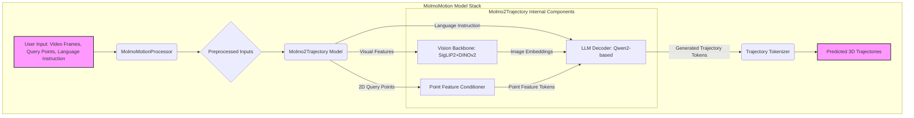
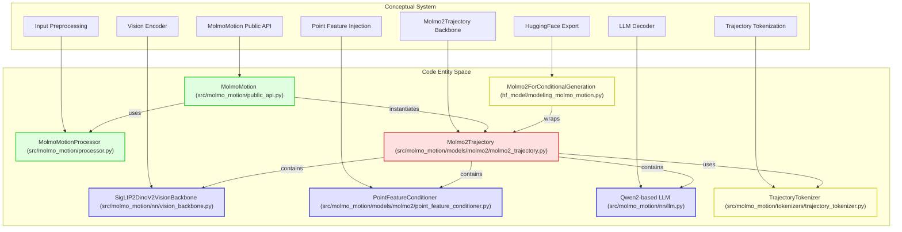

<!-- source: DeepWiki mcp.deepwiki.com · repo allenai/molmo-motion · page 2 Core Model Architecture · fetched 2026-10-26 -->

# Core Model Architecture

Relevant source files

The following files were used as context for generating this wiki page:

- [README.md](README.md)
- [assets/architecture.png](assets/architecture.png)

The MolmoMotion model is designed to forecast 3D point trajectories based on visual history, initial 3D point positions, and natural language instructions. This page provides a high-level overview of the model's architecture, its main components, and how they interact. Detailed explanations of each subsystem are provided in linked child pages.

The core of MolmoMotion is built around a vision-language model (VLM) architecture, integrating a vision encoder for processing visual input and an LLM decoder for generating trajectory tokens. A key aspect is the injection of 2D point features into the LLM's forward pass, enabling precise conditioning on user-specified points.

## MolmoMotion: The Public API

The primary user-facing interface for interacting with the MolmoMotion model is the `MolmoMotion` class [src/molmo_motion/public_api.py:100-100](). This class provides methods for loading pretrained models and predicting trajectories. It acts as an orchestrator, coordinating the `MolmoMotionProcessor` [src/molmo_motion/public_api.py:101-101]() for input preprocessing and the internal `Molmo2Trajectory` model for inference.

For details on how to use the public API, including `MolmoMotion.from_pretrained()` [src/molmo_motion/public_api.py:114-114](), `predict_trajectory()` [src/molmo_motion/public_api.py:139-139](), and the `MolmoMotionProcessor` [src/molmo_motion/processor.py:10-10](), see [Public API: MolmoMotion & MolmoMotionProcessor](#2.1).

## Molmo2Trajectory: The Internal Backbone

The `Molmo2Trajectory` [src/molmo_motion/models/molmo2/molmo2_trajectory.py:16-16]() class serves as the internal backbone of the MolmoMotion model. It encapsulates the entire model stack, including the vision encoder, the LLM decoder, and the mechanism for injecting point features. This class is responsible for the end-to-end forward pass, from multimodal inputs to generated trajectory tokens.

A crucial aspect of `Molmo2Trajectory` is its ability to incorporate 2D point features as conditioning information for the LLM. These features, derived from user-specified query points, are injected into the LLM's processing stream via special tokens.

For a deep dive into the `Molmo2Trajectory` architecture and the point feature injection mechanism, refer to [Molmo2Trajectory: Backbone & Point Feature Injection](#2.2).

## Vision Backbone: Processing Visual Input

The MolmoMotion model utilizes a robust vision backbone to extract meaningful features from input video frames. This backbone is composed of a SigLIP2+DINOv2 architecture [src/molmo_motion/nn/vision_backbone.py:16-16], which processes a history of RGB frames. The extracted visual features are then pooled and passed through an MLP connector to align them with the LLM's embedding space.

The vision backbone handles the preprocessing of video inputs, including frame sampling and resizing, to prepare them for feature extraction. Different image pooling strategies can be employed to condense the visual information.

For detailed information on the vision backbone, including the `SigLIP2DinoV2VisionBackbone` [src/molmo_motion/nn/vision_backbone.py:16-16], image pooling types (`ImagePooling2DType`) [src/molmo_motion/nn/vision_backbone.py:10-10], and the MLP connector, see [Vision Backbone: ViT, Pooling & Connector](#2.3).

## LLM Decoder & Trajectory Tokenization

The generative core of MolmoMotion is an LLM decoder based on the Qwen2 architecture [src/molmo_motion/nn/llm.py:16-16]. This decoder is responsible for generating a sequence of tokens that represent the predicted 3D trajectories. The model employs a specialized trajectory tokenization scheme, where 3D coordinates are encoded into discrete tokens.

The trajectory tokenization uses a `<tracks coords='...'>` [src/molmo_motion/tokenizers/trajectory_tokenizer.py:10-10]() format, with coordinates quantized using a delta-from-anchor integer encoding. Special tokens, such as `POINT_FEATURE_TOKEN` [src/molmo_motion/tokenizers/trajectory_tokenizer.py:13-13]() and `FRAME_START_TOKEN` [src/molmo_motion/tokenizers/trajectory_tokenizer.py:14-14](), are used to structure the input and output sequences. The LLM also leverages beam search and other generation utilities for robust trajectory prediction.

For a comprehensive explanation of the LLM decoder, the trajectory tokenization scheme, and special tokens, refer to [LLM Decoder & Trajectory Tokenization](#2.4).

## HuggingFace Model Export

To facilitate broader adoption and integration, MolmoMotion models are designed to be compatible with the HuggingFace Transformers library. This involves a dedicated sub-package (`hf_model/`) that provides the necessary classes and utilities for exporting and loading MolmoMotion checkpoints in the HuggingFace `AutoModel` format.

The `hf_model` package includes `modeling_molmo_motion.py` [hf_model/modeling_molmo_motion.py:10-10]() (defining `Molmo2ForConditionalGeneration` [hf_model/modeling_molmo_motion.py:10-10]()), `configuration_molmo_motion.py` [hf_model/configuration_molmo_motion.py:10-10](), and `processing_molmo_motion.py` [hf_model/processing_molmo_motion.py:10-10](). A command-line interface (`molmo-motion-convert-hf`) is provided to convert OLMo-native checkpoints to the HuggingFace format.

For details on the HuggingFace export process and the structure of the `hf_model` package, see [HuggingFace Model Export](#2.5).

## Architecture Diagram

The following diagram illustrates the high-level architecture of the MolmoMotion model, showing the flow of information from input to output.

Sources: [assets/architecture.png](), [README.md:31-38]()

## Code Entity to System Mapping

This diagram maps the conceptual components of the MolmoMotion architecture to their corresponding Python classes and modules within the codebase.

Sources: [src/molmo_motion/public_api.py:100-101](), [src/molmo_motion/processor.py:10-10](), [src/molmo_motion/models/molmo2/molmo2_trajectory.py:16-16](), [src/molmo_motion/nn/vision_backbone.py:16-16](), [src/molmo_motion/models/molmo2/point_feature_conditioner.py:10-10](), [src/molmo_motion/nn/llm.py:16-16](), [src/molmo_motion/tokenizers/trajectory_tokenizer.py:10-10](), [hf_model/modeling_molmo_motion.py:10-10]()

---

