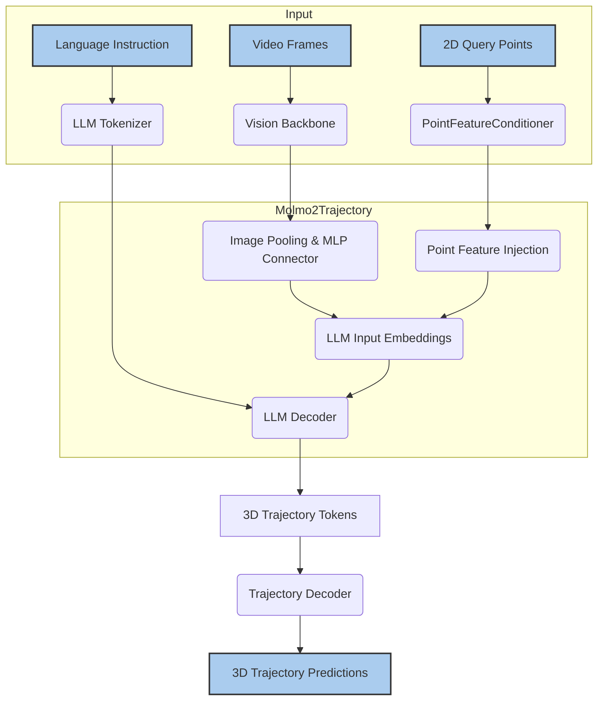
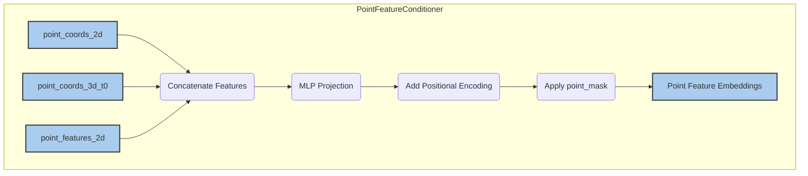

<!-- source: DeepWiki mcp.deepwiki.com · repo allenai/molmo-motion · page 2.2 Molmo2Trajectory: Backbone & Point Feature Injection · fetched 2026-10-26 -->

# Molmo2Trajectory: Backbone & Point Feature Injection

<details>
<summary>Relevant source files</summary>

The following files were used as context for generating this wiki page:

- [README.md](README.md)
- [assets/architecture.png](assets/architecture.png)

</details>


This page provides a detailed technical overview of the `Molmo2Trajectory` model, which serves as the core backbone for MolmoMotion. We will explore its architecture, focusing on how 2D point features are conditioned and injected into the Language Model (LLM) during the forward pass. This includes a deep dive into the `PointFeatureConditioner` and the role of `<|point_feat|>` tokens.

## Molmo2Trajectory Model Architecture

The `Molmo2Trajectory` model [src/molmo_motion/models/molmo2/molmo2_trajectory.py:30-30]() is the central component responsible for processing multimodal inputs (video frames, language instructions, and 2D query points) and generating 3D trajectory predictions. It integrates a vision backbone, an LLM decoder, and a mechanism for injecting point features.

The overall architecture can be visualized as follows:


**Diagram: Molmo2Trajectory High-Level Architecture**

Sources:
- [src/molmo_motion/models/molmo2/molmo2_trajectory.py:30-30]()
- [assets/architecture.png]()

The `Molmo2Trajectory` class [src/molmo_motion/models/molmo2/molmo2_trajectory.py:100-100]() inherits from `Molmo2ForConditionalGeneration` [src/molmo_motion/models/molmo2/molmo2_for_conditional_generation.py:10-10](), which itself is a wrapper around a Qwen2-based LLM [src/molmo_motion/nn/llm.py:10-10]().

### `Molmo2Trajectory` Class Structure

The `Molmo2Trajectory` class [src/molmo_motion/models/molmo2/molmo2_trajectory.py:100-100]() is initialized with a `Molmo2TrajectoryConfig` [src/molmo_motion/models/molmo2/molmo2_trajectory.py:30-30](), which defines various parameters for the vision backbone, LLM, and point feature conditioning.

Key components within `Molmo2Trajectory` include:
*   `vision_backbone`: An instance of `ImageViT` [src/molmo_motion/nn/vision_backbone.py:10-10]() responsible for extracting features from input video frames.
*   `image_pooling_connector`: An `ImagePoolingConnector` [src/molmo_motion/nn/image_pooling_connector.py:10-10]() that processes the vision backbone's output and projects it to the LLM's embedding space.
*   `point_feature_conditioner`: An instance of `PointFeatureConditioner` [src/molmo_motion/models/molmo2/point_feature_conditioner.py:10-10]() which handles the 2D query point features.
*   `llm`: The underlying Qwen2-based language model [src/molmo_motion/nn/llm.py:10-10]().

The `forward` method [src/molmo_motion/models/molmo2/molmo2_trajectory.py:200-200]() orchestrates the entire process, from vision feature extraction to LLM inference and trajectory token generation.

Sources:
- [src/molmo_motion/models/molmo2/molmo2_trajectory.py:30-30]()
- [src/molmo_motion/models/molmo2/molmo2_trajectory.py:100-100]()
- [src/molmo_motion/models/molmo2/molmo2_trajectory.py:200-200]()
- [src/molmo_motion/models/molmo2/molmo2_for_conditional_generation.py:10-10]()
- [src/molmo_motion/nn/llm.py:10-10]()
- [src/molmo_motion/nn/vision_backbone.py:10-10]()
- [src/molmo_motion/nn/image_pooling_connector.py:10-10]()
- [src/molmo_motion/models/molmo2/point_feature_conditioner.py:10-10]()

## 2D Point Feature Conditioning Pipeline

The 2D point feature conditioning pipeline is crucial for providing the LLM with information about the initial positions of the query points. This pipeline involves several steps, primarily managed by the `PointFeatureConditioner` [src/molmo_motion/models/molmo2/point_feature_conditioner.py:10-10]().

### `PointFeatureConditioner`

The `PointFeatureConditioner` [src/molmo_motion/models/molmo2/point_feature_conditioner.py:10-10]() is a `nn.Module` that takes 2D point coordinates and other related features as input and produces embeddings suitable for injection into the LLM.

Its `forward` method [src/molmo_motion/models/molmo2/point_feature_conditioner.py:100-100]() accepts the following inputs:
*   `point_coords_2d`: The 2D coordinates of the query points.
*   `point_coords_3d_t0`: The 3D coordinates of the query points at time `t=0`.
*   `point_features_2d`: Additional 2D features for the query points (e.g., from a vision model).
*   `point_mask`: A mask indicating valid query points.

The conditioning process involves:
1.  **Feature Concatenation**: The 2D coordinates, 3D coordinates at `t=0`, and `point_features_2d` are concatenated [src/molmo_motion/models/molmo2/point_feature_conditioner.py:119-121]() to form a rich feature vector for each point.
2.  **MLP Projection**: This concatenated feature vector is then passed through a Multi-Layer Perceptron (MLP) [src/molmo_motion/models/molmo2/point_feature_conditioner.py:123-123]() (`self.mlp`) to project it into the LLM's embedding dimension.
3.  **Positional Encoding**: If configured, 2D positional encodings are added to the projected features [src/molmo_motion/models/molmo2/point_feature_conditioner.py:125-125]().
4.  **Masking**: The `point_mask` is applied to zero out features for invalid points [src/molmo_motion/models/molmo2/point_feature_conditioner.py:127-127]().

The output of the `PointFeatureConditioner` is a tensor of shape `(batch_size, num_points, hidden_size)`, representing the embedded features for each query point.


**Diagram: PointFeatureConditioner Data Flow**

Sources:
- [src/molmo_motion/models/molmo2/point_feature_conditioner.py:10-10]()
- [src/molmo_motion/models/molmo2/point_feature_conditioner.py:100-100]()
- [src/molmo_motion/models/molmo2/point_feature_conditioner.py:119-121]()
- [src/molmo_motion/models/molmo2/point_feature_conditioner.py:123-123]()
- [src/molmo_motion/models/molmo2/point_feature_conditioner.py:125-125]()
- [src/molmo_motion/models/molmo2/point_feature_conditioner.py:127-127]()

## Injection of `<|point_feat|>` Tokens into the LLM

The embedded point features are injected into the LLM's input sequence using special `<|point_feat|>` tokens. This allows the LLM to attend to and integrate the point-specific information alongside the language and visual features.

The injection process occurs within the `Molmo2Trajectory.forward` method [src/molmo_motion/models/molmo2/molmo2_trajectory.py:200-200]():

1.  **Identify `<|point_feat|>` token positions**: The `input_ids` (tokenized language instruction) are scanned to find all occurrences of the `POINT_FEATURE_TOKEN` [src/molmo_motion/tokenizers/trajectory_tokenizer.py:10-10]() (which corresponds to `<|point_feat|>`).
2.  **Prepare LLM input embeddings**:
    *   The `input_ids` are converted into initial token embeddings using the LLM's embedding layer [src/molmo_motion/models/molmo2/molmo2_trajectory.py:260-260]().
    *   The vision features (from `image_pooling_connector`) are injected at the `IMAGE_TOKEN` positions [src/molmo_motion/models/molmo2/molmo2_trajectory.py:262-262]().
3.  **Inject point feature embeddings**: For each `POINT_FEATURE_TOKEN` found in the `input_ids`, the corresponding point feature embedding (from `point_feature_conditioner`) is inserted into the LLM's input embeddings [src/molmo_motion/models/molmo2/molmo2_trajectory.py:264-270]().
    *   The `point_feature_conditioner` returns `(batch_size, num_points, hidden_size)` embeddings.
    *   These are reshaped to `(batch_size, num_points * num_point_tokens, hidden_size)` if `num_point_tokens` > 1, effectively replacing a single `<|point_feat|>` token with a sequence of point feature embeddings.
    *   The `attention_mask` is also updated to reflect the new length of the input sequence due to the injected point features [src/molmo_motion/models/molmo2/molmo2_trajectory.py:272-272]().

This dynamic injection ensures that the LLM receives a multimodal input sequence where visual context, language instruction, and specific 2D query point information are all present in its embedding space, allowing for rich cross-modal attention.

```mermaid
graph TD
    subgraph "Molmo2Trajectory.forward"
        A[input_ids (LLM tokens)] --> B{Find <|point_feat|> positions}
        C[vision_features] --> D(LLM Input Embeddings)
        E[point_feature_embeddings] --> F(Reshape if needed)
        B --> G(Update attention_mask)
        D --> H(Inject F at B's positions)
        F --> H
        G --> I(LLM Decoder)
        H --> I
        I --> J[LLM Output]
    end

    style A fill:#ace,stroke:#333,stroke-width:2px
    style C fill:#ace,stroke:#333,stroke-width:2px
    style E fill:#ace,stroke:#333,stroke-width:2px
    style J fill:#ace,stroke:#333,stroke-width:2px
```
**Diagram: Point Feature Injection into LLM Input**

Sources:
- [src/molmo_motion/models/molmo2/molmo2_trajectory.py:200-200]()
- [src/molmo_motion/models/molmo2/molmo2_trajectory.py:260-260]()
- [src/molmo_motion/models/molmo2/molmo2_trajectory.py:262-262]()
- [src/molmo_motion/models/molmo2/molmo2_trajectory.py:264-270]()
- [src/molmo_motion/models/molmo2/molmo2_trajectory.py:272-272]()
- [src/molmo_motion/tokenizers/trajectory_tokenizer.py:10-10]()

---

