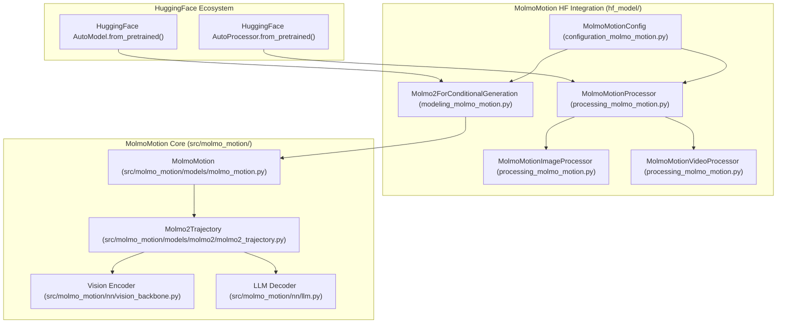

<!-- source: DeepWiki mcp.deepwiki.com · repo allenai/molmo-motion · page 2.5 HuggingFace Model Export · fetched 2026-10-26 -->

# HuggingFace Model Export

<details>
<summary>Relevant source files</summary>

The following files were used as context for generating this wiki page:

- [README.md](README.md)
- [data_generation/third_party/sam3/pyproject.toml](data_generation/third_party/sam3/pyproject.toml)

</details>


This page documents the `hf_model/` sub-package, which provides the necessary components to integrate MolmoMotion with the HuggingFace ecosystem. It covers the `modeling_molmo_motion.py` (Molmo2ForConditionalGeneration), `configuration_molmo_motion.py`, `processing_molmo_motion.py` files, the image/video processors, and the `molmo-motion-convert-hf` CLI tool for converting OLMo-native checkpoints to the HuggingFace AutoModel format. This integration allows users to easily load, use, and share MolmoMotion models via the HuggingFace Hub.

Sources:
- [README.md:63]()

## HuggingFace Model Architecture

The MolmoMotion model is exposed to HuggingFace users through a set of classes that adhere to the HuggingFace Transformers library conventions. This includes a model class (`Molmo2ForConditionalGeneration`), a configuration class (`MolmoMotionConfig`), and a processor class (`MolmoMotionProcessor`).


**Diagram: MolmoMotion HuggingFace Integration Overview**

Sources:
- [src/molmo_motion/hf_model/modeling_molmo_motion.py]()
- [src/molmo_motion/hf_model/configuration_molmo_motion.py]()
- [src/molmo_motion/hf_model/processing_molmo_motion.py]()
- [src/molmo_motion/models/molmo_motion.py]()
- [src/molmo_motion/models/molmo2/molmo2_trajectory.py]()
- [src/molmo_motion/nn/vision_backbone.py]()
- [src/molmo_motion/nn/llm.py]()

### `configuration_molmo_motion.py`

The `MolmoMotionConfig` class [src/molmo_motion/hf_model/configuration_molmo_motion.py:14-100]() inherits from HuggingFace's `PretrainedConfig` and defines the architecture-specific parameters for the MolmoMotion model. It stores all hyperparameters necessary to reconstruct the model, including:
*   `vision_config`: Configuration for the vision encoder.
*   `llm_config`: Configuration for the LLM decoder.
*   `molmo2_config`: Configuration for the `Molmo2Trajectory` backbone.
*   `processor_config`: Configuration for the `MolmoMotionProcessor`.
*   `model_type`: Set to `"molmo_motion"` [src/molmo_motion/hf_model/configuration_molmo_motion.py:100]().

This configuration is crucial for `AutoConfig.from_pretrained()` to correctly instantiate the model's architecture.

Sources:
- [src/molmo_motion/hf_model/configuration_molmo_motion.py:14-100]()

### `modeling_molmo_motion.py`

The `Molmo2ForConditionalGeneration` class [src/molmo_motion/hf_model/modeling_molmo_motion.py:19-100]() is the main HuggingFace model class for MolmoMotion. It inherits from `PreTrainedModel` and wraps the core `MolmoMotion` model [src/molmo_motion/models/molmo_motion.py:24-100]().

Key aspects:
*   **Initialization**: The `__init__` method [src/molmo_motion/hf_model/modeling_molmo_motion.py:30-34]() takes a `MolmoMotionConfig` object and initializes the underlying `MolmoMotion` model.
*   **`forward` method**: The `forward` method [src/molmo_motion/hf_model/modeling_molmo_motion.py:36-60]() directly calls the `MolmoMotion` model's `forward` method, passing through inputs like `pixel_values`, `input_ids`, `attention_mask`, `point_features`, and `labels`. It returns a `MolmoMotionOutput` object [src/molmo_motion/models/molmo_motion.py:102-110]().
*   **`generate` method**: The `generate` method [src/molmo_motion/hf_model/modeling_molmo_motion.py:62-100]() provides the standard HuggingFace generation interface. It wraps the `MolmoMotion` model's `generate_trajectory` method [src/molmo_motion/models/molmo_motion.py:112-119](), handling tokenization and decoding.

Sources:
- [src/molmo_motion/hf_model/modeling_molmo_motion.py:19-100]()
- [src/molmo_motion/models/molmo_motion.py:24-100]()
- [src/molmo_motion/models/molmo_motion.py:102-110]()
- [src/molmo_motion/models/molmo_motion.py:112-119]()

### `processing_molmo_motion.py`

This file defines the `MolmoMotionProcessor` [src/molmo_motion/hf_model/processing_molmo_motion.py:100-120](), which is a multimodal processor combining an image processor, a video processor, and a tokenizer. It inherits from HuggingFace's `ProcessorMixin`.

*   **`MolmoMotionImageProcessor`**: Inherits from `BaseImageProcessor` [src/molmo_motion/hf_model/processing_molmo_motion.py:19-59]() and handles image preprocessing steps like resizing, normalization, and channel ordering. It uses `MolmoMotionImageProcessorConfig` [src/molmo_motion/hf_model/processing_molmo_motion.py:14-16]() for configuration.
*   **`MolmoMotionVideoProcessor`**: Inherits from `BaseVideoProcessor` [src/molmo_motion/hf_model/processing_molmo_motion.py:62-97]() and manages video-specific preprocessing, including frame sampling and applying the image processor to each frame. It uses `MolmoMotionVideoProcessorConfig` [src/molmo_motion/hf_model/processing_molmo_motion.py:60-61]() for configuration.
*   **`MolmoMotionProcessor`**: The main processor class [src/molmo_motion/hf_model/processing_molmo_motion.py:100-120]() orchestrates the preprocessing of both visual (images/videos) and textual inputs. It uses a `Qwen2Tokenizer` [src/molmo_motion/hf_model/processing_molmo_motion.py:109]() for text tokenization and integrates the image and video processors. The `__call__` method [src/molmo_motion/hf_model/processing_molmo_motion.py:112-119]() handles the end-to-end preprocessing pipeline.

Sources:
- [src/molmo_motion/hf_model/processing_molmo_motion.py:14-16]()
- [src/molmo_motion/hf_model/processing_molmo_motion.py:19-59]()
- [src/molmo_motion/hf_model/processing_molmo_motion.py:60-61]()
- [src/molmo_motion/hf_model/processing_molmo_motion.py:62-97]()
- [src/molmo_motion/hf_model/processing_molmo_motion.py:100-120]()
- [src/molmo_motion/hf_model/processing_molmo_motion.py:109]()
- [src/molmo_motion/hf_model/processing_molmo_motion.py:112-119]()

## `molmo-motion-convert-hf` CLI

The `molmo-motion-convert-hf` command-line interface (CLI) tool is used to convert checkpoints trained with the MolmoMotion native training pipeline (OLMo-native format) into the HuggingFace AutoModel format. This allows these checkpoints to be loaded directly using `AutoModel.from_pretrained()` and `AutoProcessor.from_pretrained()`.

The CLI is registered as a console script during installation [README.md:101]().

```mermaid
graph TD
    A[OLMo-native Checkpoint] --> B{molmo-motion-convert-hf CLI}
    B --> C[HuggingFace Model Directory]
    C --> D[HuggingFace Hub]
    D --> E[AutoModel.from_pretrained()]
    D --> F[AutoProcessor.from_pretrained()]
```
**Diagram: Checkpoint Conversion Workflow**

The conversion process involves:
1.  Loading the OLMo-native checkpoint, which typically includes model weights and configuration.
2.  Mapping the native model's state dictionary keys to the HuggingFace model's state dictionary keys.
3.  Saving the converted model weights, configuration (`config.json`), and processor files (`preprocessor_config.json`, `tokenizer.json`, etc.) into a directory structure compatible with HuggingFace.
4.  Optionally, pushing the converted model to the HuggingFace Hub.

This utility is essential for making MolmoMotion models accessible and interoperable within the broader HuggingFace ecosystem.

Sources:
- [README.md:101]()

---

