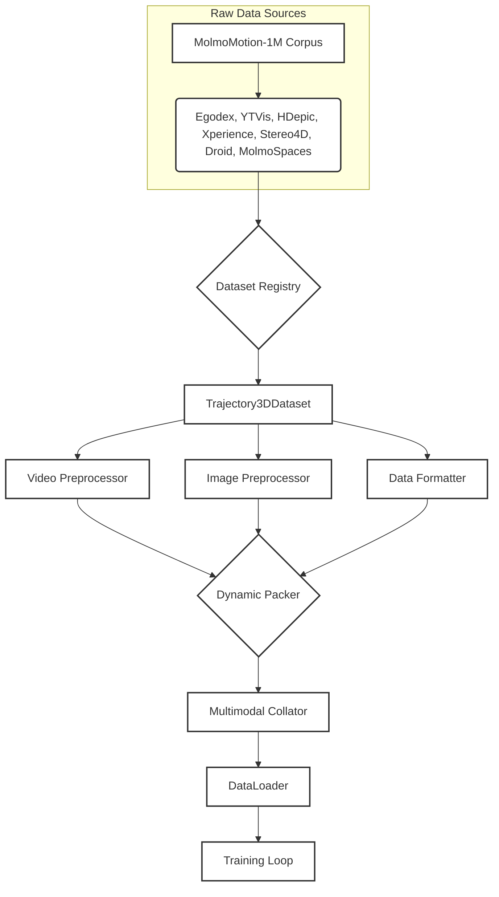

<!-- source: DeepWiki mcp.deepwiki.com · repo allenai/molmo-motion · page 3 Data Pipeline & Preprocessing · fetched 2026-10-26 -->

# 3. Data Pipeline & Preprocessing

Relevant source files

The following files were used as context for generating this wiki page:

- [README.md](README.md)
- [data_generation/configs/default.yaml](data_generation/configs/default.yaml)

The MolmoMotion training pipeline processes raw video clips and associated annotations into a structured format suitable for model training. This page provides a high-level overview of this data flow, from the initial dataset registry and `Trajectory3DDataset` to the multimodal preprocessing steps, dynamic sequence packing, and finally, the data loading mechanisms that feed into the training loop.

The MolmoMotion-1M corpus, comprising various human-video datasets (Egodex, YTVis, HDepic, Xperience, Stereo4D) and simulated/robot data (Droid, MolmoSpaces), is central to this pipeline. The system is designed to efficiently handle diverse data sources and prepare them for multimodal learning.

For detailed information on specific components, please refer to the linked child pages.

## Data Flow Overview

The data pipeline can be conceptualized as a series of transformations:

1.  **Dataset Registry & `Trajectory3DDataset`**: Raw data sources are registered and accessed through a standardized interface. `Trajectory3DDataset` is responsible for sampling video clips and their associated 3D point trajectories.
2.  **Multimodal Preprocessing**: This stage involves preparing various modalities (video frames, language prompts, 3D trajectories) into a consistent format. This includes frame sampling, image transformations, and prompt templating.
3.  **Dynamic Sequence Packing**: To optimize GPU utilization, sequences of varying lengths are packed together into batches.
4.  **Multimodal Collation**: The preprocessed and packed data from different modalities are combined into a single batch structure for the model.
5.  **Data Loader & Dataset Mixture**: The collated batches are then fed into the training loop, with mechanisms for mixing multiple datasets, especially for balancing diverse human-video sources during Stage-1 pretraining.

The following diagram illustrates the high-level data flow:

### Diagram: MolmoMotion Data Pipeline Overview

Sources: [README.md:139-152]()

## Dataset Registry & `Trajectory3DDataset`

The MolmoMotion-1M corpus is organized into several sub-datasets, each with its own structure for annotations, tracks, and camera parameters [README.md:139-152](). The `get_dataset.py` module acts as a registry, allowing datasets to be identified and loaded using a standardized naming grammar, such as `trajectory_3d[_test][_<tokens>]_p{P}_h{H}_f{F}`. The `Trajectory3DDataset` class is the primary interface for sampling video clips and their corresponding 3D point trajectories from these registered datasets. It handles the logic for selecting clips based on parameters like `P` (number of query points), `H` (history frames), and `F` (future frames). A `track-keys` cache is used to optimize access to trajectory data.

For details on dataset naming conventions, the `get_dataset.py` registry, `Trajectory3DDataset`'s sampling logic, the MolmoMotion-1M corpus layout, and the `track-keys` cache, see [Dataset Registry & Trajectory3DDataset](#3.1).

Sources: [README.md:139-152]()

## Multimodal Preprocessing & Collation

Once data clips are sampled by `Trajectory3DDataset`, they undergo multimodal preprocessing. This stage involves several specialized modules within `src/molmo_motion/preprocessing/`. The `data_formatter.py` module is responsible for generating language prompts using predefined templates, such as "point to {obj} gripped and picked up by the {agent}" [data_generation/configs/default.yaml:11](). The `video_preprocessor.py` handles video frame sampling and decoding, leveraging `torchcodec`. The `image_preprocessor.py` applies image transformations, including multicrop strategies. Finally, the `multimodal_collator.py` combines these diverse modalities into a single batch. A key component for efficient GPU utilization is the `dynamic_packer.py`, which dynamically packs sequences of varying lengths into batches.

For a comprehensive look at `data_formatter.py`, `video_preprocessor.py`, `image_preprocessor.py`, `multimodal_collator.py`, and the `dynamic_packer.py`, see [Multimodal Preprocessing & Collation](#3.2).

Sources: [data_generation/configs/default.yaml:11]()

## Data Loader & Dataset Mixture

The final stage of the data pipeline involves loading the preprocessed and collated data into the training loop. This is managed by components like `WeightedDataset`, `KwargsMixture`, `DataLoaderConfig`, and `IterableDatasetMixture`. These utilities enable the creation of a mixed dataset from multiple sources, which is crucial for balancing the contributions of different datasets during training. For instance, a square-root frequency mixing strategy is employed to balance the five human-video datasets during Stage-1 pretraining, ensuring that the model learns from a diverse range of human interactions.

For an in-depth explanation of `WeightedDataset`, `KwargsMixture`, `DataLoaderConfig`, `IterableDatasetMixture`, and the `sqrt-frequency` mixing strategy, see [Data Loader & Dataset Mixture](#3.3).

---

