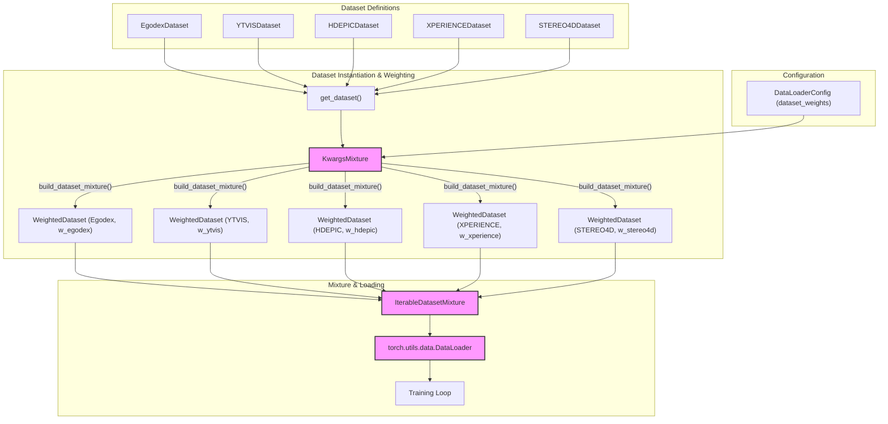

<!-- source: DeepWiki mcp.deepwiki.com · repo allenai/molmo-motion · page 3.3 Data Loader & Dataset Mixture · fetched 2026-10-26 -->

# Data Loader & Dataset Mixture

<details>
<summary>Relevant source files</summary>

The following files were used as context for generating this wiki page:

- [README.md](README.md)
- [data_generation/configs/default.yaml](data_generation/configs/default.yaml)

</details>


This page details the data loading mechanisms used in MolmoMotion, focusing on how multiple datasets are combined and sampled during training. It covers the `WeightedDataset` and `KwargsMixture` classes, the `DataLoaderConfig` for configuration, and the `IterableDatasetMixture` for creating a unified iterable dataset. A key aspect is the square-root frequency mixing strategy employed to balance the five human-video datasets during Stage-1 pretraining.

## Dataset Mixing Strategy

During Stage-1 pretraining, MolmoMotion utilizes a dataset mixing strategy to balance contributions from five human-video datasets: Egodex, YTVIS, HDEPIC, XPERIENCE, and STEREO4D. This strategy is implemented using a square-root frequency weighting, which helps to prevent smaller datasets from being overwhelmed by larger ones while still giving larger datasets a proportionally greater chance of being sampled.

The mixing is configured via the `DataLoaderConfig` [src/molmo_motion/config.py:100-100]() which specifies the `dataset_weights` [src/molmo_motion/config.py:110-110]() for each dataset. These weights are then used by `KwargsMixture` [src/molmo_motion/data/dataset_mixture.py:100-100]() to determine the sampling probability for each dataset.

### Square-Root Frequency Mixing

The square-root frequency mixing strategy is applied to the five human-video datasets. This approach involves calculating the square root of the number of samples (or a proxy for dataset size) for each dataset, and then normalizing these square-rooted values to obtain the sampling probabilities. This ensures that datasets with more samples are sampled more frequently, but not strictly proportionally to their size, thus mitigating the dominance of very large datasets.

For example, if dataset A has 100 samples and dataset B has 25 samples, a simple proportional sampling would sample A four times more often than B. With square-root mixing, the weights would be $\sqrt{100}=10$ and $\sqrt{25}=5$, meaning A is sampled twice as often as B. This provides a more balanced training signal.

Sources:
* [src/molmo_motion/config.py:100-110]()
* [src/molmo_motion/data/dataset_mixture.py:100-100]()

## Core Components

### DataLoaderConfig

The `DataLoaderConfig` [src/molmo_motion/config.py:100-110]() class defines the configuration for the data loader. It is a Pydantic `BaseModel` that includes parameters such as:
* `num_workers`: Number of worker processes for data loading.
* `pin_memory`: Whether to pin CPU tensors into CUDA pinned memory.
* `prefetch_factor`: Number of batches loaded in advance by each worker.
* `persistent_workers`: Whether to keep worker processes alive after the dataset is iterated.
* `dataset_weights`: A dictionary mapping dataset names to their sampling weights. This is crucial for the dataset mixing strategy.
* `batch_size`: The batch size for the data loader.

```python
# src/molmo_motion/config.py
class DataLoaderConfig(BaseModel):
    num_workers: int = 8
    pin_memory: bool = True
    prefetch_factor: int = 2
    persistent_workers: bool = True
    dataset_weights: dict[str, float] = Field(default_factory=dict)
    batch_size: int = 1
```

Sources:
* [src/molmo_motion/config.py:100-110]()

### WeightedDataset

The `WeightedDataset` [src/molmo_motion/data/dataset_mixture.py:16-40]() class is a wrapper around a standard PyTorch `Dataset` that assigns a weight to it. This weight is used by `IterableDatasetMixture` to determine the sampling probability of this dataset within a mixture.

```python
# src/molmo_motion/data/dataset_mixture.py
class WeightedDataset(Dataset):
    """A dataset with an associated weight."""

    def __init__(self, dataset: Dataset, weight: float):
        self.dataset = dataset
        self.weight = weight

    def __len__(self) -> int:
        return len(self.dataset)

    def __getitem__(self, index: int) -> Any:
        return self.dataset[index]
```

Sources:
* [src/molmo_motion/data/dataset_mixture.py:16-40]()

### KwargsMixture

`KwargsMixture` [src/molmo_motion/data/dataset_mixture.py:100-130]() is a utility class designed to create a mixture of datasets where each dataset is initialized with potentially different keyword arguments. It takes a dictionary of dataset names to their respective keyword arguments and a `DataLoaderConfig`.

The `build_dataset_mixture` method [src/molmo_motion/data/dataset_mixture.py:116-130]() iterates through the provided dataset configurations, instantiates each dataset using `get_dataset` [src/molmo_motion/data/get_dataset.py:10-10]() (which retrieves datasets from the global registry), and wraps them in `WeightedDataset` objects using the weights specified in `DataLoaderConfig.dataset_weights`. Finally, it constructs an `IterableDatasetMixture` from these weighted datasets.

```python
# src/molmo_motion/data/dataset_mixture.py
class KwargsMixture:
    """A mixture of datasets, each initialized with different kwargs."""

    def __init__(self, dataset_kwargs: dict[str, dict], config: DataLoaderConfig):
        self.dataset_kwargs = dataset_kwargs
        self.config = config

    def build_dataset_mixture(self) -> IterableDatasetMixture:
        datasets: list[WeightedDataset] = []
        for name, kwargs in self.dataset_kwargs.items():
            dataset = get_dataset(name, **kwargs)
            weight = self.config.dataset_weights.get(name, 1.0)
            datasets.append(WeightedDataset(dataset, weight))
        return IterableDatasetMixture(datasets)
```

Sources:
* [src/molmo_motion/data/dataset_mixture.py:100-130]()
* [src/molmo_motion/data/get_dataset.py:10-10]()

### IterableDatasetMixture

The `IterableDatasetMixture` [src/molmo_motion/data/dataset_mixture.py:43-97]() class is a PyTorch `IterableDataset` that combines multiple `WeightedDataset` instances. It implements a weighted sampling strategy to yield samples from the constituent datasets.

The `__iter__` method [src/molmo_motion/data/dataset_mixture.py:56-97]() is the core of this class. It calculates the cumulative sum of weights to create a probability distribution. In a distributed training setup, it ensures that each worker gets a unique shard of the data by adjusting the random seed based on the worker's rank and the epoch number. It then continuously samples a dataset based on its weight and yields an item from it.

```python
# src/molmo_motion/data/dataset_mixture.py
class IterableDatasetMixture(IterableDataset):
    """An iterable dataset that mixes multiple weighted datasets."""

    def __init__(self, datasets: list[WeightedDataset]):
        self.datasets = datasets
        self.weights = torch.tensor([d.weight for d in datasets], dtype=torch.float32)
        self.cumulative_weights = torch.cumsum(self.weights, dim=0)
        self.total_weight = self.cumulative_weights[-1]

    def __iter__(self) -> Iterator[Any]:
        worker_info = get_worker_info()
        if worker_info is None:
            # Single-process data loading
            rank = 0
            world_size = 1
        else:
            rank = worker_info.id
            world_size = worker_info.num_workers

        # Distributed sampling: each worker gets a unique shard
        seed = torch.initial_seed() + rank + (dist.get_rank() * world_size if dist.is_initialized() else 0)
        rng = random.Random(seed)

        while True:
            # Sample a dataset based on weights
            rand_val = rng.uniform(0, self.total_weight.item())
            dataset_idx = (self.cumulative_weights > rand_val).nonzero(as_tuple=True)[0][0].item()
            
            # Sample an item from the chosen dataset
            dataset = self.datasets[dataset_idx].dataset
            item_idx = rng.randrange(len(dataset))
            yield dataset[item_idx]
```

Sources:
* [src/molmo_motion/data/dataset_mixture.py:43-97]()

## Data Flow Diagram

The following diagram illustrates the data flow from individual datasets to the final `IterableDatasetMixture` and then to the PyTorch `DataLoader`.


Title: Data Loading and Mixture Process

Sources:
* [src/molmo_motion/config.py:100-110]()
* [src/molmo_motion/data/dataset_mixture.py:16-97]()
* [src/molmo_motion/data/dataset_mixture.py:100-130]()
* [src/molmo_motion/data/get_dataset.py:10-10]()

## Integration with Training

The `DataLoaderConfig` is typically loaded from a YAML configuration file, such as those found in `launch_scripts/configs/`. For instance, the `sft.yaml` [launch_scripts/configs/sft.yaml:1-1]() configuration defines the `data_loader` section, including `dataset_weights` for the Stage-1 pretraining datasets.

```yaml
# launch_scripts/configs/sft.yaml (excerpt)
data_loader:
  num_workers: 8
  pin_memory: true
  prefetch_factor: 2
  persistent_workers: true
  dataset_weights:
    egodex: 1.0
    ytvis: 1.0
    hdepic: 1.0
    xperience: 1.0
    stereo4d: 1.0
  batch_size: 1
```

These weights are then passed to the `KwargsMixture` [src/molmo_motion/data/dataset_mixture.py:100-130]() during the setup of the training data loader. The `IterableDatasetMixture` [src/molmo_motion/data/dataset_mixture.py:43-97]() then uses these weights to sample from the underlying datasets, ensuring the desired mixing strategy is applied throughout training.

Sources:
* [launch_scripts/configs/sft.yaml:1-1]()
* [src/molmo_motion/data/dataset_mixture.py:43-97]()
* [src/molmo_motion/data/dataset_mixture.py:100-130]()

---

