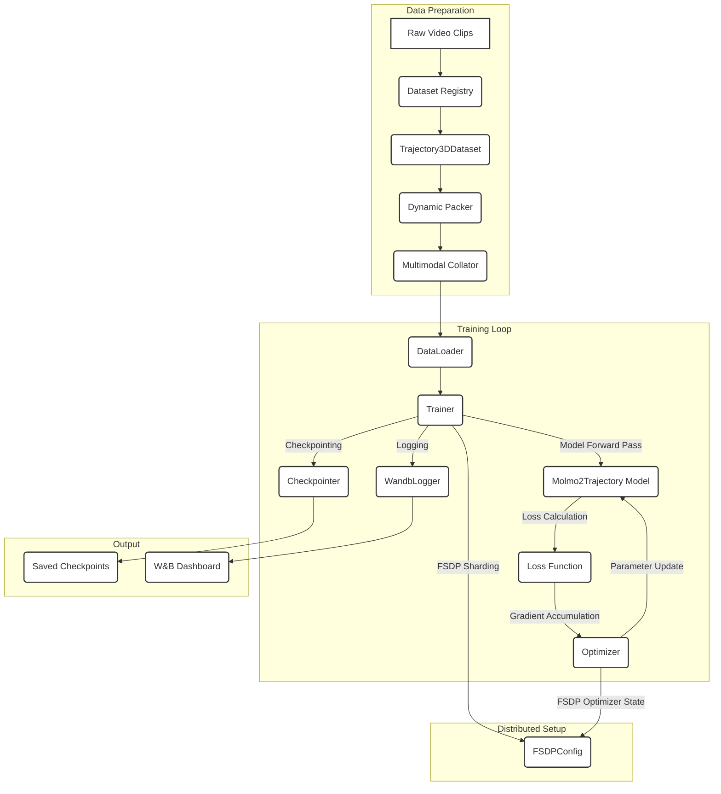

<!-- source: DeepWiki mcp.deepwiki.com · repo allenai/molmo-motion · page 4 Training · fetched 2026-10-26 -->

# Training

Relevant source files

The following files were used as context for generating this wiki page:

- [.gitignore](.gitignore)
- [README.md](README.md)

This page provides a high-level overview of the MolmoMotion training pipeline, which employs a two-stage supervised fine-tuning (SFT) approach. It covers the distributed training setup using FSDP, the optimizer and scheduler configurations, and the checkpointing mechanism. For detailed information on each component, refer to the linked child pages.

MolmoMotion training is structured into two main stages:
1.  **Stage 1 (Pretrain)**: Focuses on learning general motion patterns from a diverse set of human-video datasets. This stage uses a shorter prediction horizon.
2.  **Stage 2 (Long-horizon finetune)**: Extends the prediction horizon and refines the model's ability to forecast longer trajectories.

The training process leverages `torchrun` for distributed execution and relies on YAML configuration files for defining training parameters and recipes.

## Two-Stage Supervised Fine-Tuning (SFT)

MolmoMotion is trained using a two-stage supervised fine-tuning (SFT) pipeline. This approach allows for progressive learning, starting with broad motion understanding and then specializing in longer-term forecasting.

The first stage, referred to as "Pretrain," typically involves training on a large, diverse dataset with a configuration like P=8, H=3, F=8 for 40,000 steps [README.md:58-58](). This stage aims to establish a strong foundation in predicting short-term point trajectories.

The second stage, "Long-horizon finetune," builds upon the first stage by extending the prediction horizon, for example, to F=30 or F=32, and training for an additional 10,000 steps [README.md:59-59](). This stage refines the model's ability to forecast trajectories over longer durations.

For detailed recipes and how to launch these training stages, see [Launch Scripts & Training Recipes](#4.1).

Sources:
- [README.md:58-59]()

## Distributed Training with FSDP

MolmoMotion utilizes PyTorch's Fully Sharded Data Parallel (FSDP) for efficient distributed training across multiple GPUs. FSDP shards model parameters, gradients, and optimizer states across available GPUs, enabling the training of large models that might otherwise exceed the memory capacity of a single device.

The FSDP configuration is managed through `FSDPConfig` [src/molmo_motion/train/trainer_config.py:100-114](), which defines parameters such as the FSDP wrap policy, sharding strategy, and CPU offloading settings. The `Trainer` class [src/molmo_motion/train/trainer.py:100-100]() orchestrates the FSDP training loop, handling the distributed setup and communication.

For an in-depth look at the FSDP configuration and its integration within the `Trainer`, see [Trainer, Optimizer & Checkpointing](#4.2).

Sources:
- [src/molmo_motion/train/trainer.py:100-100]()
- [src/molmo_motion/train/trainer_config.py:100-114]()

## Optimizer and Scheduler

The training process employs a configurable optimizer and learning rate scheduler to guide model convergence. The `optim.py` module [src/molmo_motion/train/optim.py:1-1]() defines the available optimizer and scheduler types, allowing for flexibility in training strategies.

Commonly used optimizers include AdamW, while learning rate schedulers often follow a cosine annealing schedule with warm-up. These components are configured via the `TrainConfig` [src/molmo_motion/train/trainer_config.py:20-98]() and are initialized within the `Trainer` [src/molmo_motion/train/trainer.py:100-100]() before the training loop begins.

For specifics on the supported optimizers, schedulers, and their configuration, see [Trainer, Optimizer & Checkpointing](#4.2).

Sources:
- [src/molmo_motion/train/optim.py:1-1]()
- [src/molmo_motion/train/trainer.py:100-100]()
- [src/molmo_motion/train/trainer_config.py:20-98]()

## Checkpointing

Checkpointing is crucial for saving model progress and enabling fault tolerance during long training runs. The `checkpointer.py` module [src/molmo_motion/train/checkpointer.py:1-1]() provides functionalities for saving and loading model states, optimizer states, and other training metadata.

MolmoMotion supports distributed checkpointing, ensuring that the state of all FSDP-wrapped modules is correctly saved and restored across all ranks. Checkpoints are typically stored in a designated `checkpoints/` directory [README.md:24-24]() and can be managed through a remote filesystem interface [src/molmo_motion/train/remote_filesystem.py:1-1]() for cloud-based training.

For details on the checkpointing implementation, including distributed saving and loading, see [Trainer, Optimizer & Checkpointing](#4.2).

Sources:
- [README.md:24-24]()
- [src/molmo_motion/train/checkpointer.py:1-1]()
- [src/molmo_motion/train/remote_filesystem.py:1-1]()

## Training Pipeline Overview

The following diagram illustrates the high-level flow of the MolmoMotion training pipeline, connecting the data input, model, and training components.

Title: MolmoMotion Training Pipeline
Sources:
- [src/molmo_motion/train/trainer.py:100-100]()
- [src/molmo_motion/train/trainer_config.py:20-98]()
- [src/molmo_motion/train/trainer_config.py:100-114]()
- [src/molmo_motion/train/optim.py:1-1]()
- [src/molmo_motion/train/checkpointer.py:1-1]()
- [src/molmo_motion/train/remote_filesystem.py:1-1]()

## Code Entity Map: Training Components

This diagram maps the conceptual training components to their corresponding code entities within the MolmoMotion codebase.

```mermaid
graph TD
    subgraph "Conceptual Components"
        TC_Trainer["Trainer (High-level loop)"]
        TC_FSDP["FSDP (Distributed Training)"]
        TC_Optimizer["Optimizer"]
        TC_Scheduler["Learning Rate Scheduler"]
        TC_Checkpointer["Checkpointer"]
        TC_WandbLogger["W&B Logger"]
        TC_TrainConfig["Training Configuration"]
    end

    subgraph "Code Entities"
        CE_Trainer["src/molmo_motion/train/trainer.py::Trainer"]
        CE_FSDPConfig["src/molmo_motion/train/trainer_config.py::FSDPConfig"]
        CE_Optim["src/molmo_motion/train/optim.py::get_optimizer"]
        CE_Scheduler["src/molmo_motion/train/optim.py::get_scheduler"]
        CE_Checkpointer["src/molmo_motion/train/checkpointer.py::Checkpointer"]
        CE_WandbConfig["src/molmo_motion/train/trainer_config.py::WandbConfig"]
        CE_TrainConfigClass["src/molmo_motion/train/trainer_config.py::TrainConfig"]
    end

    TC_Trainer --> CE_Trainer;
    TC_FSDP --> CE_FSDPConfig;
    TC_Optimizer --> CE_Optim;
    TC_Scheduler --> CE_Scheduler;
    TC_Checkpointer --> CE_Checkpointer;
    TC_WandbLogger --> CE_WandbConfig;
    TC_TrainConfig --> CE_TrainConfigClass;

    style TC_Trainer fill:#fff,stroke:#333,stroke-width:2px
    style TC_FSDP fill:#fff,stroke:#333,stroke-width:2px
    style TC_Optimizer fill:#fff,stroke:#333,stroke-width:2px
    style TC_Scheduler fill:#fff,stroke:#333,stroke-width:2px
    style TC_Checkpointer fill:#fff,stroke:#333,stroke-width:2px
    style TC_WandbLogger fill:#fff,stroke:#333,stroke-width:2px
    style TC_TrainConfig fill:#fff,stroke:#333,stroke-width:2px
    style CE_Trainer fill:#fff,stroke:#333,stroke-width:2px
    style CE_FSDPConfig fill:#fff,stroke:#333,stroke-width:2px
    style CE_Optim fill:#fff,stroke:#333,stroke-width:2px
    style CE_Scheduler fill:#fff,stroke:#333,stroke-width:2px
    style CE_Checkpointer fill:#fff,stroke:#333,stroke-width:2px
    style CE_WandbConfig fill:#fff,stroke:#333,stroke-width:2px
    style CE_TrainConfigClass fill:#fff,stroke:#333,stroke-width:2px
```

Title: Training Code Entity Map
Sources:
- [src/molmo_motion/train/trainer.py:100-100]()
- [src/molmo_motion/train/trainer_config.py:20-98]()
- [src/molmo_motion/train/trainer_config.py:100-114]()
- [src/molmo_motion/train/optim.py:1-1]()
- [src/molmo_motion/train/checkpointer.py:1-1]()

## Launch Scripts & Training Recipes

Training is initiated using `torchrun` commands that execute specific launch scripts. These scripts, primarily `launch_scripts/sft.py` and `launch_scripts/train.py`, serve as the entry points for the two-stage SFT pipeline. They handle parsing command-line arguments, loading YAML configuration files, and setting up the distributed environment.

The training recipes define the specific parameters for each stage, including dataset configurations (e.g., P=8, H=3, F=8 for Stage-1), the number of training steps, and the base model for initialization (e.g., `Molmo2-4B-Pretrain`). YAML configuration files provide a flexible way to override default settings and customize training runs.

For a detailed explanation of the launch scripts, the specific parameters for Stage-1 and Stage-2 recipes, and how to initialize models and apply YAML overrides, see [Launch Scripts & Training Recipes](#4.1).

Sources:
- [README.md:99-99]()
- [README.md:58-59]()

## Trainer, Optimizer & Checkpointing Internals

The core training logic resides within the `src/molmo_motion/train/trainer.py` module. This `Trainer` class encapsulates the FSDP training loop, manages gradient clipping, and integrates with Weights & Biases (W&B) for logging metrics and visualizations.

Configuration for the trainer, FSDP, and W&B is defined in `trainer_config.py` through classes like `TrainConfig`, `FSDPConfig`, and `WandbConfig`. The `optim.py` module specifies the available optimizer and learning rate scheduler types, which are then instantiated by the `Trainer`. Checkpointing, including distributed saving and loading, is handled by the `checkpointer.py` module, often interacting with a `remote_filesystem.py` for cloud storage.

For an in-depth understanding of the `Trainer`'s implementation, FSDP configuration, optimizer/scheduler details, and the checkpointing mechanism, see [Trainer, Optimizer & Checkpointing](#4.2).

Sources:
- [src/molmo_motion/train/trainer.py:1-1]()
- [src/molmo_motion/train/trainer_config.py:1-1]()
- [src/molmo_motion/train/optim.py:1-1]()
- [src/molmo_motion/train/checkpointer.py:1-1]()
- [src/molmo_motion/train/remote_filesystem.py:1-1]()

---

