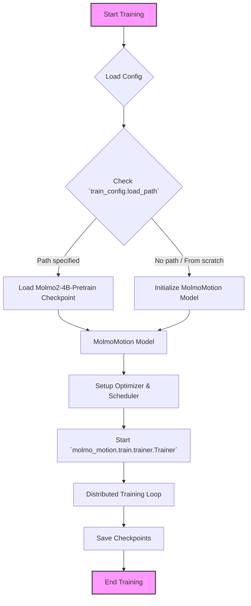

<!-- source: DeepWiki mcp.deepwiki.com · repo allenai/molmo-motion · page 4.1 Launch Scripts & Training Recipes · fetched 2026-10-26 -->

# Launch Scripts & Training Recipes

<details>
<summary>Relevant source files</summary>

The following files were used as context for generating this wiki page:

- [README.md](README.md)
- [data_generation/run_pipeline.py](data_generation/run_pipeline.py)

</details>


This page details the primary launch scripts for training MolmoMotion models: `launch_scripts/sft.py` and `launch_scripts/train.py`. It covers their command-line interface, the specific training recipes used for Stage-1 (pre-training) and Stage-2 (fine-tuning), how models are initialized from a Molmo2-4B-Pretrain checkpoint, and the mechanism for overriding configuration parameters via YAML files.

## Torchrun Command-Line Interface

Both `launch_scripts/sft.py` and `launch_scripts/train.py` are designed to be executed using `torchrun`, PyTorch's distributed training launcher. This enables distributed data parallel (DDP) training across multiple GPUs and nodes.

The general invocation pattern is:
```bash
torchrun --nproc_per_node=<num_gpus> launch_scripts/sft.py <config_file.yaml> [override_args]
```
or
```bash
torchrun --nproc_per_node=<num_gpus> launch_scripts/train.py <config_file.yaml> [override_args]
```

The `--nproc_per_node` argument specifies the number of processes (typically GPUs) to use on the current node. `torchrun` handles the setup of environment variables like `RANK`, `WORLD_SIZE`, and `MASTER_ADDR`/`MASTER_PORT` for distributed communication.

The scripts accept a YAML configuration file as their primary input, which defines the training parameters, model architecture, dataset specifics, and other settings. Command-line arguments can then be used to override specific values within this YAML configuration.

Sources:
- [launch_scripts/sft.py:1-10]()
- [launch_scripts/train.py:1-10]()

## Training Recipes

MolmoMotion employs a two-stage training strategy:
1.  **Stage 1: Pre-training (SFT)**: Focuses on learning general motion priors from a diverse dataset.
2.  **Stage 2: Fine-tuning**: Adapts the pre-trained model to longer trajectory horizons or specific tasks.

### Stage 1 — Pre-train (P=8, H=3, F=8, 40K steps)

The Stage-1 pre-training recipe is defined in `launch_scripts/sft.py`. This stage uses a specific configuration for prompt length (P), history frames (H), and future frames (F) to balance computational efficiency with learning diverse motion patterns.

**Key Parameters:**
*   **P=8**: Prompt length of 8 tokens.
*   **H=3**: 3 history frames are provided to the model.
*   **F=8**: The model predicts 8 future frames.
*   **40K steps**: The training runs for 40,000 optimization steps.

The `sft.py` script loads a `TrainConfig` from a YAML file, which includes `FSDPConfig` for distributed training, `WandbConfig` for logging, and `DataLoaderConfig` for data loading [src/molmo_motion/train/trainer_config.py:1-10](). It then initializes the `MolmoMotion` model, sets up the optimizer and scheduler, and starts the training loop using `molmo_motion.train.trainer.Trainer` [launch_scripts/sft.py:100-102]().

An example invocation for Stage 1 might look like:
```bash
torchrun --nproc_per_node=8 launch_scripts/sft.py \
    configs/sft_stage1.yaml \
    --train_config.max_steps 40000 \
    --train_config.model_config.history_frames 3 \
    --train_config.model_config.future_frames 8 \
    --train_config.model_config.prompt_length 8
```

Sources:
- [launch_scripts/sft.py:1-10]()
- [launch_scripts/sft.py:100-102]()
- [src/molmo_motion/train/trainer_config.py:1-10]()
- [README.md:57-59]()

### Stage 2 — Long-horizon Finetune (F=30/32, 10K steps)

The Stage-2 fine-tuning recipe is also handled by `launch_scripts/sft.py` but with different configuration parameters, primarily focusing on extending the prediction horizon.

**Key Parameters:**
*   **F=30 or F=32**: The model predicts 30 or 32 future frames, significantly longer than Stage 1.
*   **10K steps**: The training runs for 10,000 optimization steps.

This stage typically starts from a checkpoint obtained from Stage 1. The increased `future_frames` parameter allows the model to learn to forecast longer trajectories.

An example invocation for Stage 2 might look like:
```bash
torchrun --nproc_per_node=8 launch_scripts/sft.py \
    configs/sft_stage2.yaml \
    --train_config.max_steps 10000 \
    --train_config.model_config.future_frames 30 \
    --train_config.load_path /path/to/stage1_checkpoint.pt
```

Sources:
- [launch_scripts/sft.py:1-10]()
- [README.md:60-61]()

### `launch_scripts/train.py`

The `launch_scripts/train.py` script is a more general-purpose training driver, which also uses `torchrun` and a YAML configuration. While `sft.py` is specifically tailored for supervised fine-tuning, `train.py` provides a broader interface for various training setups. It shares much of the underlying infrastructure with `sft.py`, including the use of `TrainConfig` and the `Trainer` class.

Sources:
- [launch_scripts/train.py:1-10]()

## Model Initialization from Molmo2-4B-Pretrain

Both training stages typically initialize the MolmoMotion model from a pre-trained Molmo2-4B-Pretrain checkpoint. This leverages the language understanding capabilities of the Molmo2 LLM.

The `TrainConfig` includes a `load_path` parameter [src/molmo_motion/train/trainer_config.py:100](). When specified, the `Trainer` class loads the model weights from this path before starting training [src/molmo_motion/train/trainer.py:100-102](). This allows for efficient transfer learning.

The `README.md` provides instructions for downloading the `Molmo2-4B-Pretrain` checkpoint, which serves as the backbone initialization for training from scratch [README.md:170-170]().


**Diagram: Model Initialization Flow**

Sources:
- [src/molmo_motion/train/trainer_config.py:100]()
- [src/molmo_motion/train/trainer.py:100-102]()
- [README.md:170-170]()

## YAML Config Overrides

The training scripts heavily rely on YAML configuration files to define all aspects of the training process. This includes:
*   Model architecture parameters (`model_config`)
*   Dataset parameters (`data_config`)
*   Training loop parameters (`train_config`)
*   Optimizer and scheduler settings (`optim_config`)
*   Distributed training settings (`fsdp_config`)
*   Logging settings (`wandb_config`)

These configurations are defined as Pydantic models in `src/molmo_motion/config.py` and `src/molmo_motion/train/trainer_config.py`.

Users can specify a base YAML configuration file (e.g., `configs/sft_stage1.yaml`) and then override specific parameters directly from the command line. This is achieved using a dot-notation syntax, where `.` separates nested configuration fields.

**Example:**
To override the maximum number of training steps and the learning rate:
```bash
torchrun ... launch_scripts/sft.py \
    configs/sft_stage1.yaml \
    --train_config.max_steps 50000 \
    --optim_config.lr 1e-5
```

This flexibility allows for easy experimentation and fine-tuning of training runs without modifying the base YAML files. The `molmo-motion-train` console script also provides a `molmo_motion.train.cli.main` entry point for a more streamlined command-line experience [README.md:99]().

Sources:
- [src/molmo_motion/config.py:1-10]()
- [src/molmo_motion/train/trainer_config.py:1-10]()
- [README.md:99]()

```mermaid
graph TD
    A[User Command Line] --> B{torchrun launch_scripts/sft.py};
    B --> C[Base YAML Config File];
    B --> D[Command Line Overrides];

    C --> E[Load Base Config (e.g., `configs/sft_stage1.yaml`)];
    D --> F[Apply Overrides (e.g., `--train_config.max_steps 50000`)];

    E --> G[Pydantic Config Objects];
    F --> G;

    G --> H[Instantiate `TrainConfig`];
    H --> I[Initialize `MolmoMotion` Model];
    H --> J[Setup `Trainer`];
    J --> K[Start Training Loop];

    subgraph Configuration Flow
        C
        D
        E
        F
        G
        H
    end
```
**Diagram: YAML Configuration and Override Flow**

---

