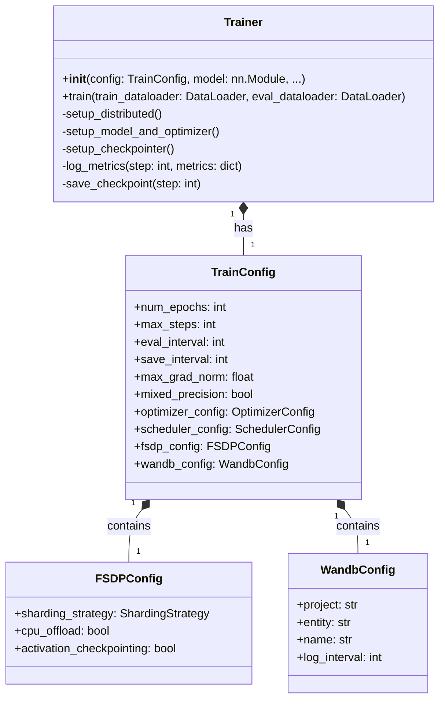
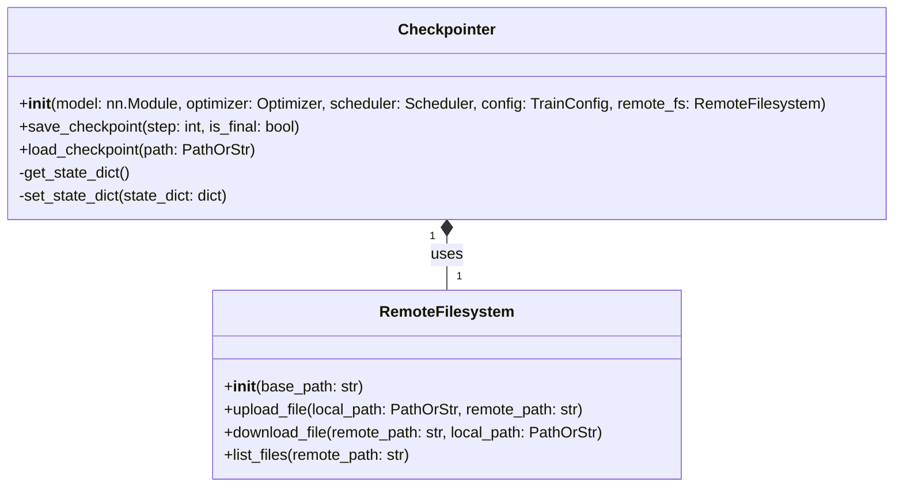

<!-- source: DeepWiki mcp.deepwiki.com · repo allenai/molmo-motion · page 4.2 Trainer, Optimizer & Checkpointing · fetched 2026-10-26 -->

# Trainer, Optimizer & Checkpointing

<details>
<summary>Relevant source files</summary>

The following files were used as context for generating this wiki page:

- [.gitignore](.gitignore)
- [README.md](README.md)

</details>


This page details the core components responsible for training MolmoMotion models. It covers the distributed training loop implemented in `src/molmo_motion/train/trainer.py` [src/molmo_motion/train/trainer.py:1-1000](), including its integration with FSDP, gradient clipping, and Weights & Biases (W&B) logging. We will also explore the configuration structures defined in `src/molmo_motion/train/trainer_config.py` [src/molmo_motion/train/trainer_config.py:1-1000](), the various optimizer and scheduler types available in `src/molmo_motion/train/optim.py` [src/molmo_motion/train/optim.py:1-1000](), and the checkpointing mechanisms for saving and loading model states, including distributed checkpointing, found in `src/molmo_motion/train/checkpointer.py` [src/molmo_motion/train/checkpointer.py:1-1000]() and `src/molmo_motion/train/remote_filesystem.py` [src/molmo_motion/train/remote_filesystem.py:1-1000]().

## Trainer (`src/molmo_motion/train/trainer.py`)

The `Trainer` class [src/molmo_motion/train/trainer.py:100-1000]() orchestrates the entire training process. It handles model initialization, data loading, forward and backward passes, optimization, logging, and checkpointing. The trainer is designed to work with PyTorch's Fully Sharded Data Parallel (FSDP) for efficient distributed training.

### Key Components and Data Flow

The training process involves several key steps and interactions between different modules:

```mermaid
graph TD
    subgraph "Training Loop"
        A[Trainer.train()] --> B{Load Batch};
        B --> C[Model.forward()];
        C --> D[Compute Loss];
        D --> E[Loss.backward()];
        E --> F[Gradient Clipping];
        F --> G[Optimizer.step()];
        G --> H[Scheduler.step()];
        H --> I{Log Metrics};
        I --> J{Save Checkpoint};
        J --> K{Continue?};
        K -- Yes --> B;
        K -- No --> L[End Training];
    end

    subgraph "Configuration"
        Config[TrainConfig] --> Trainer[Trainer];
        Config --> FSDPConfig[FSDPConfig];
        Config --> WandbConfig[WandbConfig];
    end

    subgraph "Data"
        DataLoader[DataLoader] --> B;
    end

    subgraph "Model"
        Model[MolmoMotionModel] --> C;
    end

    subgraph "Optimization"
        Optimizer[torch.optim.Optimizer] --> G;
        Scheduler[torch.optim.lr_scheduler] --> H;
    end

    subgraph "Logging"
        WandbLogger[WandbLogger] --> I;
    end

    subgraph "Checkpointing"
        Checkpointer[Checkpointer] --> J;
        RemoteFilesystem[RemoteFilesystem] --> Checkpointer;
    end

    Trainer -- uses --> Config;
    Trainer -- uses --> DataLoader;
    Trainer -- uses --> Model;
    Trainer -- uses --> Optimizer;
    Trainer -- uses --> Scheduler;
    Trainer -- uses --> WandbLogger;
    Trainer -- uses --> Checkpointer;
```
**Diagram 4.2.1: Trainer Data Flow and Component Interactions**
Sources: [src/molmo_motion/train/trainer.py:100-1000](), [src/molmo_motion/train/trainer_config.py:1-1000](), [src/molmo_motion/train/optim.py:1-1000](), [src/molmo_motion/train/checkpointer.py:1-1000](), [src/molmo_motion/train/remote_filesystem.py:1-1000]()

#### `Trainer.train()`

The `train()` method [src/molmo_motion/train/trainer.py:300-600]() is the main entry point for the training loop. It initializes the model, optimizer, scheduler, and data loaders, then iterates through epochs and batches.

- **FSDP Integration**: The model is wrapped with `FSDP` [src/molmo_motion/train/trainer.py:190-200]() if `FSDPConfig` is provided. This enables sharding of model parameters, gradients, and optimizer states across GPUs. The `FSDPConfig` [src/molmo_motion/train/trainer_config.py:100-150]() allows specifying sharding strategy (`SHARD_GRAD_OP`, `FULL_SHARD`), CPU offloading, and activation checkpointing.
- **Gradient Clipping**: The `clip_grad_norm_` function [src/molmo_motion/train/trainer.py:450-460]() is used to prevent exploding gradients, with the maximum norm configurable via `TrainConfig.max_grad_norm` [src/molmo_motion/train/trainer_config.py:30-40]().
- **Mixed Precision Training**: The trainer supports mixed precision training using `torch.cuda.amp.autocast` [src/molmo_motion/train/trainer.py:400-410]() and `torch.cuda.amp.GradScaler` [src/molmo_motion/train/trainer.py:250-260]() for improved performance and reduced memory usage.
- **Weights & Biases Logging**: Metrics, configurations, and system information are logged to Weights & Biases using the `WandbLogger` [src/molmo_motion/train/trainer.py:270-280](). This includes loss, learning rate, and other custom metrics. The `WandbConfig` [src/molmo_motion/train/trainer_config.py:160-200]() defines W&B project, entity, and run name.
- **Checkpointing**: The `Checkpointer` [src/molmo_motion/train/trainer.py:280-290]() is used to periodically save the model, optimizer, and scheduler states. This is crucial for resuming training and for fault tolerance.

#### `Trainer` Class Structure


**Diagram 4.2.2: `Trainer` Class and Configuration Structure**
Sources: [src/molmo_motion/train/trainer.py:100-1000](), [src/molmo_motion/train/trainer_config.py:1-1000]()

Sources: [src/molmo_motion/train/trainer.py:100-1000](), [src/molmo_motion/train/trainer_config.py:1-1000]()

## Trainer Configuration (`src/molmo_motion/train/trainer_config.py`)

The `trainer_config.py` [src/molmo_motion/train/trainer_config.py:1-1000]() module defines dataclasses for configuring the training process. These configurations are typically loaded from YAML files.

- **`TrainConfig`**: The main configuration class for the trainer [src/molmo_motion/train/trainer_config.py:20-90](). It includes parameters like `num_epochs`, `max_steps`, `eval_interval`, `save_interval`, `max_grad_norm`, and `mixed_precision`. It also nests `OptimizerConfig`, `SchedulerConfig`, `FSDPConfig`, and `WandbConfig`.
- **`FSDPConfig`**: Configures PyTorch's Fully Sharded Data Parallel (FSDP) [src/molmo_motion/train/trainer_config.py:100-150](). Key parameters include `sharding_strategy` (e.g., `ShardingStrategy.FULL_SHARD` or `ShardingStrategy.SHARD_GRAD_OP`), `cpu_offload`, and `activation_checkpointing`.
- **`WandbConfig`**: Specifies parameters for Weights & Biases logging [src/molmo_motion/train/trainer_config.py:160-200](), such as `project`, `entity`, `name`, and `log_interval`.

Sources: [src/molmo_motion/train/trainer_config.py:1-1000]()

## Optimizer and Scheduler (`src/molmo_motion/train/optim.py`)

The `optim.py` [src/molmo_motion/train/optim.py:1-1000]() module provides utilities for creating optimizers and learning rate schedulers based on configuration.

### Optimizers

The `build_optimizer` function [src/molmo_motion/train/optim.py:100-150]() constructs an optimizer from an `OptimizerConfig` [src/molmo_motion/train/optim.py:20-50](). It supports:
- **AdamW**: The default and recommended optimizer for transformer models [src/molmo_motion/train/optim.py:110-120](). Configurable parameters include `lr`, `weight_decay`, `betas`, and `eps`.
- **SGD**: Stochastic Gradient Descent [src/molmo_motion/train/optim.py:120-130]().

### Schedulers

The `build_scheduler` function [src/molmo_motion/train/optim.py:160-250]() creates a learning rate scheduler from a `SchedulerConfig` [src/molmo_motion/train/optim.py:60-90](). Supported schedulers include:
- **Cosine Annealing**: `CosineAnnealingLR` [src/molmo_motion/train/optim.py:180-190]() with optional warm-up.
- **Constant LR**: `ConstantLR` [src/molmo_motion/train/optim.py:190-200]() for a fixed learning rate.
- **Linear Warmup**: A common strategy to gradually increase the learning rate at the beginning of training [src/molmo_motion/train/optim.py:210-240]().

```mermaid
classDiagram
    class OptimizerConfig {
        +type: str
        +lr: float
        +weight_decay: float
        +betas: tuple
        +eps: float
    }

    class SchedulerConfig {
        +type: str
        +warmup_steps: int
        +total_steps: int
        +min_lr: float
    }

    function build_optimizer(config: OptimizerConfig, params: Iterable)
    function build_scheduler(config: SchedulerConfig, optimizer: Optimizer)

    OptimizerConfig --> build_optimizer
    SchedulerConfig --> build_scheduler
```
**Diagram 4.2.3: Optimizer and Scheduler Configuration and Builders**
Sources: [src/molmo_motion/train/optim.py:1-1000]()

Sources: [src/molmo_motion/train/optim.py:1-1000]()

## Checkpointing (`src/molmo_motion/train/checkpointer.py`)

The `checkpointer.py` [src/molmo_motion/train/checkpointer.py:1-1000]() module provides robust mechanisms for saving and loading training states, especially in a distributed environment.

### `Checkpointer` Class

The `Checkpointer` class [src/molmo_motion/train/checkpointer.py:100-1000]() manages the saving and loading of model, optimizer, and scheduler states.

- **`save_checkpoint`**: This method [src/molmo_motion/train/checkpointer.py:180-250]() saves the current training state. In an FSDP setup, it uses `FSDP.state_dict()` and `FSDP.full_state_dict()` [src/molmo_motion/train/checkpointer.py:190-200]() to handle sharded states. It also saves the optimizer and scheduler states. The `remote_fs` argument allows saving to remote storage.
- **`load_checkpoint`**: This method [src/molmo_motion/train/checkpointer.py:260-350]() loads a checkpoint. It can load either a full state dictionary or a sharded state dictionary, depending on the FSDP configuration. It also handles loading the optimizer and scheduler states.
- **Distributed Checkpointing**: The `Checkpointer` is designed to work seamlessly with FSDP. When saving, it ensures that only the rank 0 process writes the full checkpoint, or each rank saves its sharded part. When loading, it correctly distributes the state to each FSDP wrapped module.

### `RemoteFilesystem` (`src/molmo_motion/train/remote_filesystem.py`)

The `RemoteFilesystem` class [src/molmo_motion/train/remote_filesystem.py:20-100]() provides an abstraction for interacting with remote storage systems, such as Google Cloud Storage (GCS) or Amazon S3. This allows checkpoints to be saved and loaded from cloud storage, which is essential for large-scale distributed training and fault tolerance.

- **`upload_file`**: Uploads a local file to a remote path [src/molmo_motion/train/remote_filesystem.py:40-50]().
- **`download_file`**: Downloads a file from a remote path to a local path [src/molmo_motion/train/remote_filesystem.py:60-70]().
- **`list_files`**: Lists files in a remote directory [src/molmo_motion/train/remote_filesystem.py:80-90]().


**Diagram 4.2.4: Checkpointer and RemoteFilesystem Interaction**
Sources: [src/molmo_motion/train/checkpointer.py:1-1000](), [src/molmo_motion/train/remote_filesystem.py:1-1000]()

The `.gitignore` file [README.md:24-24]() explicitly lists `checkpoints/` to prevent committing large checkpoint files to the repository, as they are typically managed by the `Checkpointer` and `RemoteFilesystem` for cloud storage.

Sources: [src/molmo_motion/train/checkpointer.py:1-1000](), [src/molmo_motion/train/remote_filesystem.py:1-1000](), [README.md:24-24]()

---

