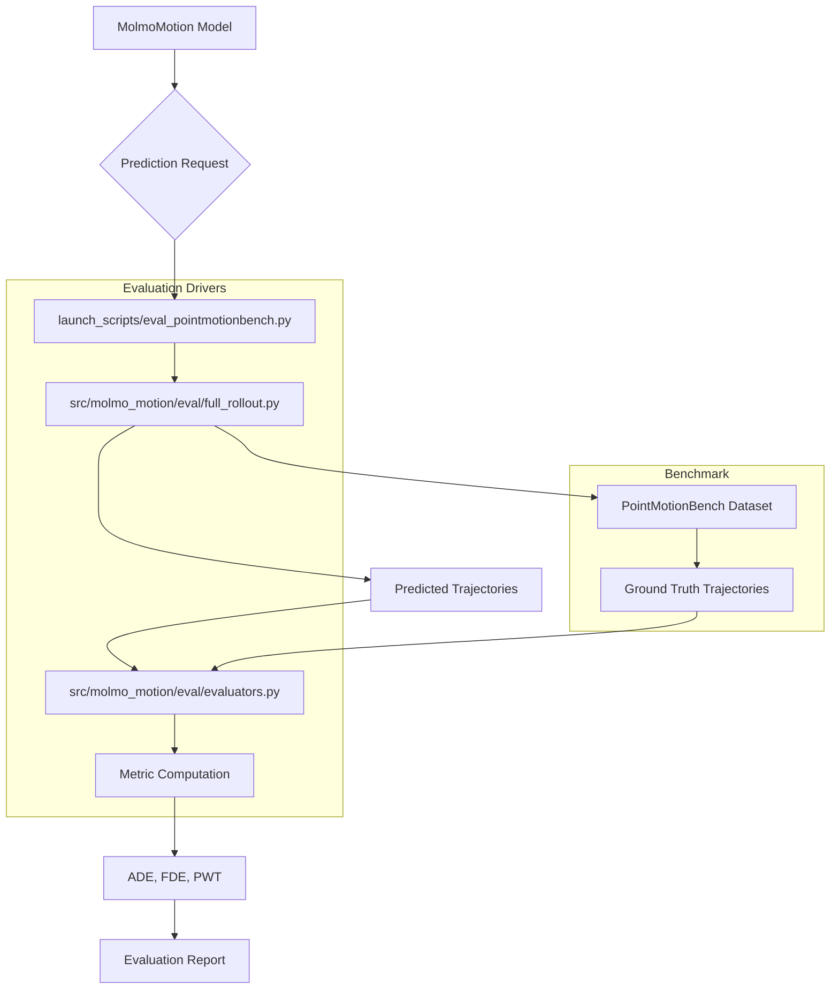
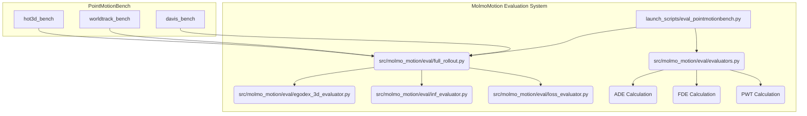

<!-- source: DeepWiki mcp.deepwiki.com · repo allenai/molmo-motion · page 5 Evaluation & PointMotionBench · fetched 2026-10-26 -->

# Evaluation & PointMotionBench

Relevant source files

The following files were used as context for generating this wiki page:

- [README.md](README.md)
- [assets/qualitative_examples.png](assets/qualitative_examples.png)

This page provides a high-level overview of the MolmoMotion evaluation infrastructure. It introduces the PointMotionBench benchmark, the full-rollout evaluation engine, and the key metrics used to assess model performance: Average Displacement Error (ADE), Final Displacement Error (FDE), and Point-wise Trajectory Error (PWT). For detailed information on each component, please refer to the linked child pages.

## PointMotionBench: The Evaluation Benchmark

PointMotionBench is a comprehensive benchmark suite designed to evaluate the performance of MolmoMotion models. It comprises three distinct sub-datasets: HOT3D, WorldTrack, and DAVIS. These datasets are available for download from HuggingFace under the `allenai/PointMotionBench` repository [README.md:44](). The benchmark also includes tools and scripts for reconstructing video data from original sources, as many raw videos are license-restricted. The benchmark datasets are referenced using specific tokens like `hot3d_bench`, `worldtrack_bench`, and `davis_bench`.

For details on the construction of PointMotionBench, how to download the datasets, and the video reconstruction process, see [PointMotionBench: Benchmark Construction & Datasets](#5.1).

Sources:
- [README.md:44]()
- [README.md:148-152]()

## Evaluation Drivers & Metrics

The MolmoMotion codebase includes dedicated evaluation drivers responsible for running models against the PointMotionBench and computing performance metrics. The primary evaluation script is `launch_scripts/eval_pointmotionbench.py` [README.md:131](), which supports chunked all-points evaluation and best-of-N sampling strategies. Another general evaluation script, `launch_scripts/eval.py`, is also available.

The core evaluation logic resides in the `src/molmo_motion/eval/` directory, containing modules such as `full_rollout.py`, `egodex_3d_evaluator.py`, `evaluators.py`, `inf_evaluator.py`, and `loss_evaluator.py`. These modules implement the full-rollout evaluation engine, which simulates the model's trajectory predictions over time.

The key metrics computed during evaluation are:
- **Average Displacement Error (ADE)**: Measures the average Euclidean distance between the predicted and ground-truth trajectory points over the entire trajectory.
- **Final Displacement Error (FDE)**: Measures the Euclidean distance between the predicted and ground-truth final trajectory points.
- **Point-wise Trajectory Error (PWT)**: A more granular metric that assesses the error at each point in the predicted trajectory.

For a detailed explanation of the evaluation drivers, their functionalities, and the precise computation of ADE, FDE, and PWT, see [Evaluation Drivers & Metrics](#5.2).

### Evaluation Workflow

**Diagram 1: High-Level Evaluation Workflow**

Sources:
- [README.md:131]()
- [README.md:60-61]()
- [src/molmo_motion/eval/full_rollout.py]()
- [src/molmo_motion/eval/egodex_3d_evaluator.py]()
- [src/molmo_motion/eval/evaluators.py]()
- [src/molmo_motion/eval/inf_evaluator.py]()
- [src/molmo_motion/eval/loss_evaluator.py]()

### Evaluation Components

**Diagram 2: Evaluation System Components and Benchmark Interaction**

Sources:
- [launch_scripts/eval_pointmotionbench.py]()
- [src/molmo_motion/eval/full_rollout.py]()
- [src/molmo_motion/eval/evaluators.py]()
- [src/molmo_motion/eval/egodex_3d_evaluator.py]()
- [src/molmo_motion/eval/inf_evaluator.py]()
- [src/molmo_motion/eval/loss_evaluator.py]()

---

