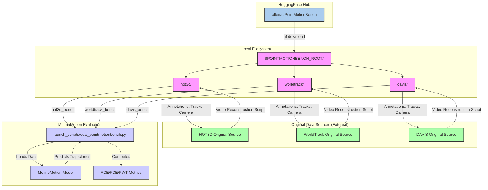

<!-- source: DeepWiki mcp.deepwiki.com · repo allenai/molmo-motion · page 5.1 PointMotionBench: Benchmark Construction & Datasets · fetched 2026-10-26 -->

# PointMotionBench: Benchmark Construction & Datasets

<details>
<summary>Relevant source files</summary>

The following files were used as context for generating this wiki page:

- [README.md](README.md)
- [data_generation/examples/tasks_example.json](data_generation/examples/tasks_example.json)

</details>


This page documents the `pointmotionbench/` directory, which contains the PointMotionBench evaluation suite. It details the three sub-datasets (HOT3D, WorldTrack, DAVIS), explains how to download them from HuggingFace, outlines the video reconstruction steps, and lists the benchmark dataset-name tokens used for evaluation.

## PointMotionBench Overview

PointMotionBench is the evaluation suite for MolmoMotion, comprising three distinct datasets: HOT3D, WorldTrack, and DAVIS. These datasets provide diverse scenarios for evaluating 3D point trajectory forecasting. The benchmark is available on HuggingFace at `allenai/PointMotionBench` [README.md:23]().

Sources: [README.md:23]()

## Downloading PointMotionBench

The PointMotionBench dataset can be downloaded from HuggingFace. First, set the `POINTMOTIONBENCH_ROOT` environment variable to a new, empty directory outside of the MolmoMotion repository [README.md:112-113]().

```bash
export POINTMOTIONBENCH_ROOT=/your/path/to/PointMotionBench
hf download allenai/PointMotionBench \
    --repo-type dataset --local-dir $POINTMOTIONBENCH_ROOT
```

After download, the directory structure will be:

```
$POINTMOTIONBENCH_ROOT/
├── hot3d/
├── worldtrack/
└── davis/
```

Sources: [README.md:111-113](), [README.md:121-122](), [README.md:148-152]()

## Sub-datasets

PointMotionBench consists of three sub-datasets, each with unique characteristics:

### HOT3D

The HOT3D dataset focuses on human object interaction in 3D. It provides annotations and tracks for evaluating fine-grained human motion and object manipulation.

Sources: [README.md:149]()

### WorldTrack

WorldTrack is designed for tracking objects in diverse real-world scenarios. It offers a variety of scenes and object types, making it suitable for evaluating general object tracking capabilities.

Sources: [README.md:150]()

### DAVIS

The DAVIS (Densely Annotated VIdeo Segmentation) dataset is primarily known for video object segmentation, but it also provides valuable data for motion tracking due to its dense annotations.

Sources: [README.md:151]()

## Video Reconstruction

For all three sub-datasets within PointMotionBench, the raw videos are not directly included in the HuggingFace download due to licensing restrictions. Instead, the downloaded data includes annotations, tracks, and per-frame camera information. Users are required to reconstruct the raw videos locally from each subset's original source [README.md:159-161]().

Each dataset directory on HuggingFace contains its own `README.md` and a reconstruction script to guide this process [README.md:161-162](). This ensures compliance with licensing agreements while allowing full access to the benchmark data.

Sources: [README.md:159-162]()

## Benchmark Dataset-Name Tokens

When performing evaluation with MolmoMotion, specific tokens are used to refer to each sub-dataset within PointMotionBench. These tokens are used in configuration files or command-line arguments to specify which benchmark dataset to evaluate against.

| Dataset | Benchmark Token |
| :------ | :-------------- |
| HOT3D   | `hot3d_bench`   |
| WorldTrack | `worldtrack_bench` |
| DAVIS   | `davis_bench`   |

These tokens are typically used in the `dataset_name` field of evaluation configurations.

## PointMotionBench Data Flow

The following diagram illustrates the high-level data flow for PointMotionBench, from its source to its use in evaluation.


**Diagram: PointMotionBench Data Flow**

Sources: [README.md:121-122](), [README.md:148-152](), [README.md:159-162]()

---

