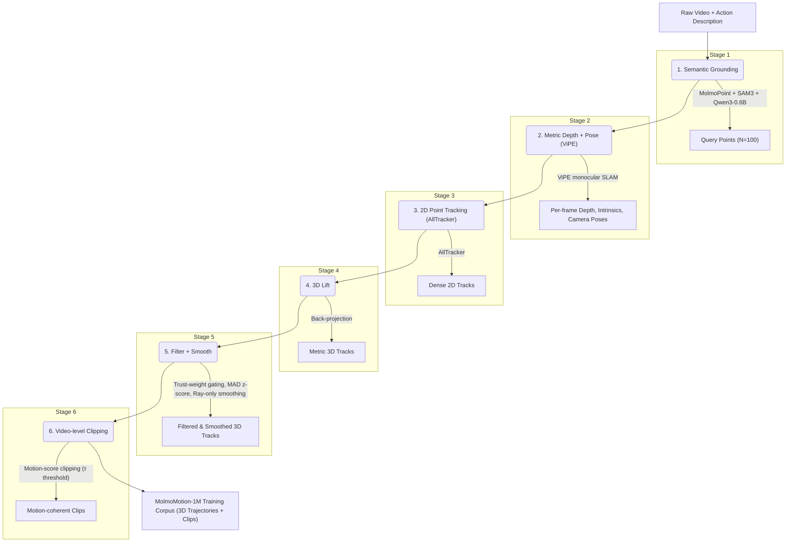

<!-- source: DeepWiki mcp.deepwiki.com · repo allenai/molmo-motion · page 6 Data Generation Pipeline (MolmoMotion-1M) · fetched 2026-10-26 -->

# Data Generation Pipeline (MolmoMotion-1M)

<details>
<summary>Relevant source files</summary>

The following files were used as context for generating this wiki page:

- [data_generation/README.md](data_generation/README.md)
- [data_generation/configs/default.yaml](data_generation/configs/default.yaml)
- [data_generation/run_pipeline.py](data_generation/run_pipeline.py)

</details>


This page provides an overview of the automated annotation pipeline used to create the MolmoMotion-1M training corpus. This pipeline processes raw RGB video and an action description to extract object-grounded 3D point trajectories and motion-coherent video clips. The entire process is divided into six stages, each building upon the output of the previous one.

The MolmoMotion-1M dataset, generated by applying this pipeline to approximately 1.16 million public video clips, is crucial for pretraining the MolmoMotion model. All model components used within this pipeline are frozen, publicly released checkpoints, meaning no weights are trained during this data generation process.

## Pipeline Overview

The data generation pipeline transforms raw video and an action description into structured 3D trajectory data and segmented clips. The six stages are:

1.  **Semantic Grounding**: Identifies the object of interest based on the action description and samples query points on it.
2.  **Metric Depth + Pose**: Estimates per-frame metric depth and camera poses using monocular SLAM.
3.  **2D Point Tracking**: Propagates the initial query points through the video to create dense 2D tracks.
4.  **3D Lift**: Back-projects the 2D tracks into a metric 3D world frame.
5.  **Filter + Smooth**: Refines the 3D tracks by filtering outliers and smoothing based on an object-level rigidity prior.
6.  **Video-level Clipping**: Segments the video into motion-coherent clips based on object displacement.

The pipeline is designed to be resumable, with each stage caching its output. This allows for efficient re-runs and debugging.

### Pipeline Stages Diagram


Sources: [data_generation/README.md:1-18](), [data_generation/run_pipeline.py:9-15]()

## Pipeline Stages 1–3: Grounding, SLAM & 2D Tracking

The initial stages of the pipeline focus on identifying the object of interest, understanding the 3D scene, and tracking the object's 2D movement.

**Stage 1: Semantic Grounding**
This stage takes the video and an action description to identify the target object. It uses a combination of language models (Qwen3-0.6B, Molmo2-8B for re-captioning) and vision models (MolmoPoint-Vid-4B, SAM3) to pinpoint the object. Finally, K-means clustering is applied to the resulting mask to sample `N=100` query points on the object. These query points are saved as `grounding/<vid>/query_points/*.npz`.
For details, see [Pipeline Stages 1–3: Grounding, SLAM & 2D Tracking](#6.1).

**Stage 2: Metric Depth + Pose**
ViPE, a monocular visual SLAM system, is used to estimate per-frame metric depth, camera intrinsics (`fx, fy, cx, cy`), and a camera-to-world trajectory. This provides the necessary 3D context for later stages. The outputs are stored in `vipe_results/{depth,pose,intrinsics,rgb}/<vid>.*`.
For details, see [Pipeline Stages 1–3: Grounding, SLAM & 2D Tracking](#6.1).

**Stage 3: 2D Point Tracking**
AllTracker propagates the `N=100` query points generated in Stage 1 through the video. This results in dense, temporally persistent 2D tracks and per-frame visibility information, stored in `tracks_2d/<vid>/<vid>_merged.npz`.
For details, see [Pipeline Stages 1–3: Grounding, SLAM & 2D Tracking](#6.1).

Sources: [data_generation/README.md:28-31](), [data_generation/README.md:37-52](), [data_generation/run_pipeline.py:145-169]()

## Pipeline Stages 4–6: 3D Lifting, Filtering & Clip Extraction

These later stages transform the 2D tracking data into robust 3D trajectories and then segment the video into relevant clips.

**Stage 4: 3D Lift**
Each visible 2D track point from Stage 3 is back-projected into a metric 3D world frame. This process uses the depth and intrinsics from Stage 2 and transforms the points by the camera pose, anchoring the world frame at the query-time camera. The output is `(N, T, 3)` metric tracks, saved in `tracks_3d/<corpus>/<vid>_merged_3d_tracks.npz`.
For details, see [Pipeline Stages 4–6: 3D Lifting, Filtering & Clip Extraction](#6.2).

**Stage 5: Filtering + Smoothing**
This stage addresses noise and drift in the lifted 3D tracks. It applies several techniques: selecting `K=16` anchor tracks, computing per-frame trust weights `w = exp(-e/s)^p`, splitting physically separate instances using mean-shift, dropping outlier tracks via a MAD z-score, and smoothing each surviving track along its camera ray only, penalizing multi-stride acceleration. The refined tracks are stored in `final_tracks/<vid>_{3d,2d}.npz` and `<vid>_filter_meta.npz`.
For details, see [Pipeline Stages 4–6: 3D Lifting, Filtering & Clip Extraction](#6.2).

**Stage 6: Video-level Clipping**
The final stage segments the video into motion-coherent clips. It calculates a per-frame object motion score `s_t = trimmed-mean_n ||p_n(t) - p_n(t-1)||` and thresholds it at `τ` (defined by `clip_threshold` in the config, e.g., `0.02` meters/frame) to identify contiguous high-motion segments. Gaps are merged, and short runs are dropped. The output is a JSON file (`clips/<corpus>_clips.json`) detailing the extracted clips.
For details, see [Pipeline Stages 4–6: 3D Lifting, Filtering & Clip Extraction](#6.2).

Sources: [data_generation/README.md:32-34](), [data_generation/README.md:53-73](), [data_generation/configs/default.yaml:33-37]()

## Third-Party Tools

The data generation pipeline heavily relies on several vendored third-party models and tools. These are integrated into the `data_generation/third_party/` directory.

*   **AllTracker**: Used for dense 2D point tracking (Stage 3). Its implementation can be found in `data_generation/third_party/alltracker/`.
*   **SAM3**: Employed for video object segmentation as part of the semantic grounding (Stage 1). Related code is in `data_generation/third_party/sam3/`.
*   **ViPE**: Provides monocular SLAM capabilities for metric depth and camera pose estimation (Stage 2). Its components are located in `data_generation/third_party/vipe/`.

These tools are crucial for the pipeline's functionality, and their installation and usage are detailed in their respective sub-directories.
For details, see [Third-Party Tools: AllTracker, SAM3 & ViPE](#6.3).

Sources: [data_generation/README.md:90-93]()

## Pipeline Configuration & Running the Pipeline

The entire pipeline is orchestrated by `run_pipeline.py`, which allows for flexible configuration and execution.

### Configuration

Pipeline parameters are managed through YAML configuration files located in `data_generation/configs/`.
The `default.yaml` file contains all hyperparameters matching the paper's defaults. Specific corpus presets like `human_manipulation.yaml`, `robot.yaml`, and `in_the_wild.yaml` override only the necessary fields. Key parameters include `kmeans_k` (number of query points), `fps` (pipeline frame rate), `z_thresh` (z-score track-drop threshold), and `clip_threshold` (motion clipping threshold).

### Running the Pipeline

The `run_pipeline.py` script is the main entry point. It accepts several command-line arguments:
*   `--tasks`: A JSON file specifying the videos to process, each with a `video_id`, `video_path`, and `action`. An example is `examples/tasks_example.json`.
*   `--config`: The path to a YAML configuration file (e.g., `configs/human_manipulation.yaml`).
*   `--work_dir`: The directory where all intermediate and final artifacts will be stored.
*   `--start_stage` / `--end_stage`: Allows running a contiguous subset of the pipeline stages.

The pipeline is designed to be resumable; if output for a stage is already present, it will be skipped.

```mermaid
graph TD
    A[run_pipeline.py] --> B{Load Configuration}
    B --> C{Load Tasks JSON}
    C --> D{Iterate Tasks}
    D --> E[Stage 1: Grounding]
    E --> F[Stage 2: ViPE]
    F --> G[Stage 3: AllTracker]
    G --> H[Stage 4: 3D Lift]
    H --> I[Stage 5: Filter + Smooth]
    I --> J[Stage 6: Clipping]
    J --> K[Output: MolmoMotion-1M Corpus]

    subgraph Configuration
        B -- "configs/default.yaml" --> B1
        B -- "configs/human_manipulation.yaml" --> B2
        B -- "configs/robot.yaml" --> B3
        B -- "configs/in_the_wild.yaml" --> B4
    end

    subgraph Inputs
        C -- "examples/tasks_example.json" --> C1
        A -- "--tasks" --> C
        A -- "--config" --> B
        A -- "--work_dir" --> K
        A -- "--start_stage / --end_stage" --> D
    end

    subgraph Pipeline Stages (run_pipeline.py)
        E -- "grounding_worker.py" --> E1["query_points/*.npz"]
        F -- "vipe_cmd" --> F1["vipe_results/"]
        G -- "alltracker_run_query_points.py" --> G1["tracks_2d/"]
        H -- "vipe_3d_lift.py" --> H1["tracks_3d/"]
        I -- "vipe_filter_smooth.py" --> I1["final_tracks/"]
        J -- "clip_segments.py" --> J1["clips/"]
    end
```
Sources: [data_generation/run_pipeline.py:30-33](), [data_generation/run_pipeline.py:96-105](), [data_generation/configs/default.yaml:1-37](), [data_generation/README.md:79-89]()

For details on running the pipeline and its configuration, see [Pipeline Configuration & Running the Pipeline](#6.4).

---

