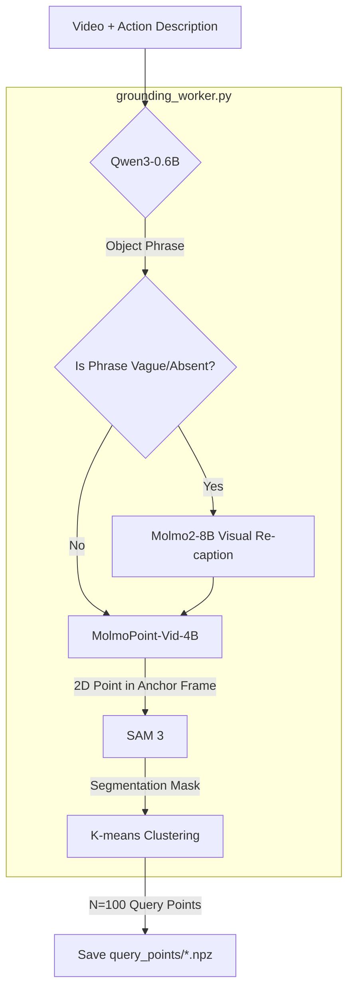
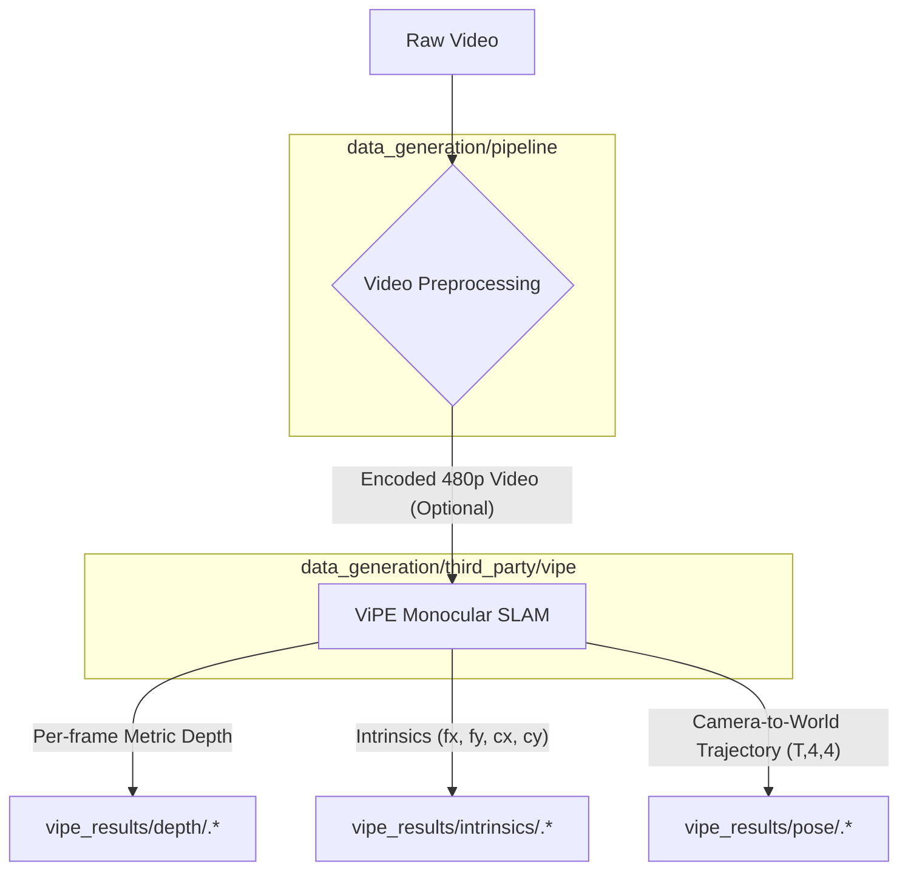

<!-- source: DeepWiki mcp.deepwiki.com · repo allenai/molmo-motion · page 6.1 Pipeline Stages 1–3: Grounding, SLAM & 2D Tracking · fetched 2026-10-26 -->

# Pipeline Stages 1–3: Grounding, SLAM & 2D Tracking

<details>
<summary>Relevant source files</summary>

The following files were used as context for generating this wiki page:

- [data_generation/README.md](data_generation/README.md)
- [data_generation/configs/default.yaml](data_generation/configs/default.yaml)
- [data_generation/configs/human_manipulation.yaml](data_generation/configs/human_manipulation.yaml)
- [data_generation/configs/in_the_wild.yaml](data_generation/configs/in_the_wild.yaml)
- [data_generation/configs/robot.yaml](data_generation/configs/robot.yaml)
- [data_generation/pipeline/grounding_worker.py](data_generation/pipeline/grounding_worker.py)
- [data_generation/third_party/alltracker/run-query-points.py](data_generation/third_party/alltracker/run-query-points.py)

</details>


This page details the initial three stages of the MolmoMotion-1M data generation pipeline: Semantic Grounding, Metric Depth + Pose estimation, and 2D Point Tracking. These stages transform raw video and an action description into dense 2D point trajectories, camera poses, and metric depth information, which are then used in subsequent stages for 3D lifting and filtering.

## 1. Semantic Grounding (Stage 1)

The first stage, Semantic Grounding, identifies the object of interest within a video based on a natural language action description and samples a set of query points on it.

### 1.1. Process Overview

The grounding process involves several steps, orchestrated by `grounding_worker.py` [data_generation/pipeline/grounding_worker.py:3-31]():

1.  **Object Phrase Extraction**: A Qwen3-0.6B model extracts a concise object phrase from the provided action description [data_generation/README.md:38-39]().
2.  **Optional Visual Re-captioning**: If the extracted phrase is vague (e.g., "it", "the object") or absent, an optional Molmo2-8B model visually re-captions the video to generate a more specific object description [data_generation/README.md:39-40](). This uses a specific prompt template [data_generation/pipeline/grounding_worker.py:77-86]().
3.  **2D Point Localization**: MolmoPoint-Vid-4B localizes the object as a 2D point in the anchor frame. The pointing prompt is constructed using the object phrase and an agent (e.g., "hand", "robot gripper") [data_generation/README.md:40-42]().
4.  **Mask Generation**: SAM 3 (Segment Anything Model) generates a segmentation mask for the object based on the localized 2D point [data_generation/README.md:42-43]().
5.  **Query Point Sampling**: K-means clustering is applied to the pixels within the generated mask to sample `N=100` query points [data_generation/README.md:43-44]().

These query points, along with their corresponding frame index and the original video dimensions, are saved as an NPZ file [data_generation/pipeline/grounding_worker.py:15-17]().

### 1.2. Configuration

The behavior of the grounding stage is controlled by parameters in the YAML configuration files:

*   `kmeans_k`: Number of query points to sample per object (default: 100) [data_generation/configs/default.yaml:8]().
*   `agent`: Specifies the agent performing the action (e.g., "hand", "robot gripper"). This is used in the pointing prompt [data_generation/configs/default.yaml:10]().
*   `point_prompt_template`: The template for the pointing prompt, which is filled with the object and agent [data_generation/configs/default.yaml:11]().
*   `recaption`: Boolean flag to enable/disable Molmo2-8B visual re-captioning [data_generation/configs/default.yaml:12]().

Different presets like `human_manipulation.yaml`, `robot.yaml`, and `in_the_wild.yaml` override these defaults to suit specific video types [data_generation/configs/human_manipulation.yaml:1-7](), [data_generation/configs/robot.yaml:1-5](), [data_generation/configs/in_the_wild.yaml:1-5]().

### 1.3. Implementation Details

The `grounding_worker.py` script loads all necessary models once to process multiple tasks efficiently [data_generation/pipeline/grounding_worker.py:4-7](). It supports resumability by checking for existing query point NPZ files [data_generation/pipeline/grounding_worker.py:147-153]().

The `recaption_with_molmo2_8b_video` function [data_generation/pipeline/grounding_worker.py:89-115]() handles the Molmo2-8B re-captioning, taking video frames and FPS as input. It constructs a chat template with a specific prompt [data_generation/pipeline/grounding_worker.py:98-102]() and uses the Molmo2-8B model to generate a new caption.

#### Diagram: Grounding Stage Data Flow


Sources:
* [data_generation/README.md:38-44]()
* [data_generation/pipeline/grounding_worker.py:3-31]()
* [data_generation/pipeline/grounding_worker.py:77-86]()
* [data_generation/pipeline/grounding_worker.py:15-17]()
* [data_generation/configs/default.yaml:8]()
* [data_generation/configs/default.yaml:10]()
* [data_generation/configs/default.yaml:11]()
* [data_generation/configs/default.yaml:12]()
* [data_generation/configs/human_manipulation.yaml:1-7]()
* [data_generation/configs/robot.yaml:1-5]()
* [data_generation/configs/in_the_wild.yaml:1-5]()
* [data_generation/pipeline/grounding_worker.py:4-7]()
* [data_generation/pipeline/grounding_worker.py:147-153]()
* [data_generation/pipeline/grounding_worker.py:89-115]()
* [data_generation/pipeline/grounding_worker.py:98-102]()

## 2. Metric Depth + Pose (Stage 2)

Stage 2 utilizes ViPE (Visual Pose Estimation) to estimate per-frame metric depth, camera intrinsics, and camera poses for the video.

### 2.1. Process Overview

ViPE runs monocular visual SLAM in a single pass to produce the following outputs [data_generation/README.md:47-49]():

*   **Per-frame metric depth**: Provides depth information for each pixel in every frame.
*   **Intrinsics**: Camera parameters `(fx, fy, cx, cy)`.
*   **Camera-to-world trajectory**: A `(T, 4, 4)` transformation matrix for each frame, representing the camera's pose relative to a world frame anchored at the first frame.

### 2.2. Configuration

The `vipe_cmd` parameter in `default.yaml` specifies the console script for ViPE [data_generation/configs/default.yaml:40](). The `encode_480p` setting [data_generation/configs/default.yaml:18]() indicates whether to re-encode the source video to 854x480 resolution before processing with ViPE and AllTracker, which can affect performance and output quality.

### 2.3. Implementation Details

ViPE is a third-party tool integrated into the pipeline. Its output is stored in `vipe_results/{depth,pose,intrinsics,rgb}/<vid>.*` [data_generation/README.md:29](). The `install.sh` script handles the installation of ViPE, including compiling its CUDA extension [data_generation/README.md:106-107]().

#### Diagram: ViPE Integration


Sources:
* [data_generation/README.md:47-49]()
* [data_generation/configs/default.yaml:40]()
* [data_generation/configs/default.yaml:18]()
* [data_generation/README.md:29]()
* [data_generation/README.md:106-107]()

## 3. 2D Point Tracking (Stage 3)

The third stage uses AllTracker to propagate the query points sampled in Stage 1 through the entire video, generating dense 2D point trajectories.

### 3.1. Process Overview

AllTracker takes the video frames and the initial query points as input. It then propagates these points across frames, yielding:

*   **Temporally persistent 2D tracks**: The `(T, N_queries, 2)` coordinates of each query point over time.
*   **Per-frame visibility**: A confidence score indicating whether each point is visible in a given frame.

### 3.2. Configuration

The `alltracker_max_side` parameter in `default.yaml` controls the maximum side length for video frames processed by AllTracker [data_generation/configs/default.yaml:19](). Similar to ViPE, the `encode_480p` setting [data_generation/configs/default.yaml:18]() also applies here, ensuring consistent input resolution.

### 3.3. Implementation Details

The `run-query-points.py` script within `data_generation/third_party/alltracker/` is responsible for executing AllTracker [data_generation/third_party/alltracker/run-query-points.py:1-16]().

The script reads the video frames and the query points from the NPZ file generated in Stage 1 [data_generation/third_party/alltracker/run-query-points.py:17-27](). It then scales the query points to match the resolution used by AllTracker [data_generation/third_party/alltracker/run-query-points.py:141-144]().

The core tracking logic is performed by the `model` (AllTracker) which outputs `flows_e` (flow fields) and `visconf_maps_e` (visibility confidence maps) [data_generation/third_party/alltracker/run-query-points.py:91-92](). The script handles edge cases where the forward chunk has only one timestep, ensuring consistent 5D tensor shapes for flows and visibility maps [data_generation/third_party/alltracker/run-query-points.py:94-105](). It also processes backward flows to ensure full temporal coverage [data_generation/third_party/alltracker/run-query-points.py:107-123]().

Finally, it extracts the 2D tracks and their visibility from the full-resolution maps based on the scaled query points [data_generation/third_party/alltracker/run-query-points.py:156-167](). The output is saved as `tracks_2d/<vid>/<vid>_merged.npz` [data_generation/README.md:30]().

#### Diagram: 2D Tracking with AllTracker

```mermaid
graph TD
    A[Video Frames] --> B{AllTracker Model};
    C[Query Points (from Stage 1)] --> B;
    B -- "Flow Fields (flows_e)" --> D[Extract Tracks];
    B -- "Visibility Confidence Maps (visconf_maps_e)" --> D;
    D -- "Scaled Query Points" --> D;
    D -- "Temporally Persistent 2D Tracks (T, N, 2)" --> E[tracks_2d/<vid>/<vid>_merged.npz];
    D -- "Per-frame Visibility" --> E;

    subgraph "data_generation/third_party/alltracker/run-query-points.py"
        B
        D
    end
```
Sources:
* [data_generation/README.md:50-51]()
* [data_generation/configs/default.yaml:19]()
* [data_generation/configs/default.yaml:18]()
* [data_generation/third_party/alltracker/run-query-points.py:1-16]()
* [data_generation/third_party/alltracker/run-query-points.py:17-27]()
* [data_generation/third_party/alltracker/run-query-points.py:141-144]()
* [data_generation/third_party/alltracker/run-query-points.py:91-92]()
* [data_generation/third_party/alltracker/run-query-points.py:94-105]()
* [data_generation/third_party/alltracker/run-query-points.py:107-123]()
* [data_generation/third_party/alltracker/run-query-points.py:156-167]()
* [data_generation/README.md:30]()

---

