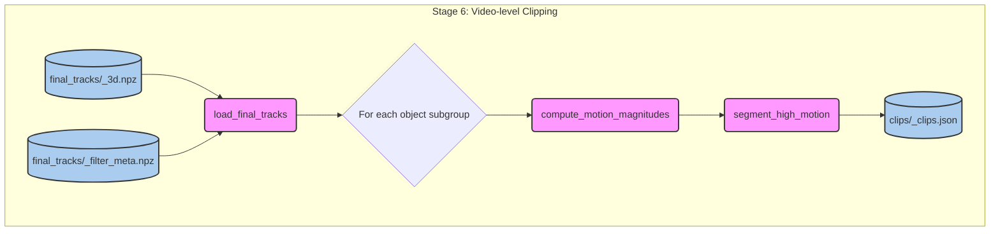

<!-- source: DeepWiki mcp.deepwiki.com · repo allenai/molmo-motion · page 6.2 Pipeline Stages 4–6: 3D Lifting, Filtering & Clip Extraction · fetched 2026-10-26 -->

# Pipeline Stages 4–6: 3D Lifting, Filtering & Clip Extraction

<details>
<summary>Relevant source files</summary>

The following files were used as context for generating this wiki page:

- [data_generation/README.md](data_generation/README.md)
- [data_generation/configs/default.yaml](data_generation/configs/default.yaml)
- [data_generation/pipeline/__init__.py](data_generation/pipeline/__init__.py)
- [data_generation/pipeline/clip_segments.py](data_generation/pipeline/clip_segments.py)

</details>


This page details Stages 4, 5, and 6 of the MolmoMotion-1M data generation pipeline. These stages transform 2D tracked points and camera metadata into refined 3D trajectories and then segment the original video into motion-coherent clips suitable for training.

## Stage 4: 3D Lifting

Stage 4 is responsible for back-projecting the 2D tracks into a 3D metric world frame. This process uses the depth information, camera intrinsics, and camera poses estimated by ViPE (Stage 2) along with the 2D tracks from AllTracker (Stage 3).

The core idea is to take each visible 2D point at a given frame, use its corresponding depth value to determine its 3D position relative to the camera, and then transform this 3D point into a global world coordinate system using the camera's pose for that frame. The world frame is anchored at the query-time camera [data_generation/README.md:53-56]().

**Input:**
*   `vipe_results/{depth,pose,intrinsics,rgb}/<vid>.*`: Metric depth, intrinsics (`fx, fy, cx, cy`), and `(T,4,4)` camera-to-world trajectory from ViPE [data_generation/README.md:30-31,48-49]().
*   `tracks_2d/<vid>/<vid>_merged.npz`: 2D tracks and per-frame visibility from AllTracker [data_generation/README.md:31-31,50-51]().

**Output:**
*   `tracks_3d/<corpus>/<vid>_merged_3d_tracks.npz`: `(N, T, 3)` metric 3D tracks [data_generation/README.md:32-32]().

**Implementation Details:**
The 3D lifting process is handled within the `third_party/vipe/` directory, specifically by scripts that integrate ViPE's output with the 2D tracks. This involves standard computer vision techniques for back-projection and coordinate transformation.

Sources:
*   [data_generation/README.md:30-32]()
*   [data_generation/README.md:48-56]()

## Stage 5: Filtering & Smoothing

Lifted 3D tracks are often noisy due to tracking drift and depth estimation errors. Stage 5 refines these tracks by applying several filtering and smoothing techniques, leveraging an object-level rigidity prior [data_generation/README.md:58-59]().

The process involves:
1.  **Anchor Track Selection:** `K=16` anchor tracks are selected [data_generation/README.md:59-59](). The number of anchor tracks `n_anchors` is configurable via `default.yaml` [data_generation/configs/default.yaml:28-28]().
2.  **Trust-Weight Gating:** Per-frame trust weights `w = exp(-e/s)^p` are computed [data_generation/README.md:59-60](). The `gating_power` `p` is configurable [data_generation/configs/default.yaml:29-29]().
3.  **Mean-Shift Spatial Auto-Split:** Physically separate instances are identified and split using mean-shift clustering [data_generation/README.md:60-60](). The `min_cluster_size` for mean-shift is configurable [data_generation/configs/default.yaml:30-30]().
4.  **MAD Z-score Filtering:** Outlier tracks are dropped based on a Median Absolute Deviation (MAD) z-score [data_generation/README.md:60-61](). The `z_thresh` is configurable [data_generation/configs/default.yaml:27-27]().
5.  **Ray-Only Consensus Smoothing:** Each surviving track is smoothed along its camera ray only, penalizing multi-stride acceleration (Δ ∈ {1,3,5}) following Stereo4D [data_generation/README.md:61-62](). This smoothing process uses an `L_pin` loss with a configurable weight `alpha` [data_generation/configs/default.yaml:25-25]() and a regularization term `lambda_reg` [data_generation/configs/default.yaml:26-26](). The number of `smooth_steps` and `smooth_lr` are also configurable [data_generation/configs/default.yaml:23-24]().

**Input:**
*   `tracks_3d/<corpus>/<vid>_merged_3d_tracks.npz`: Raw 3D tracks from Stage 4.

**Output:**
*   `final_tracks/<vid>_{3d,2d}.npz`: Filtered and smoothed 3D and 2D tracks.
*   `<vid>_filter_meta.npz`: Metadata about the filtering process, including sub-object labels and a `keep_mask` [data_generation/README.md:33-33]().

**Configuration:**
The hyperparameters for Stage 5 are defined in `data_generation/configs/default.yaml` [data_generation/configs/default.yaml:22-31]().

```yaml
# ── Stage 5: filter + smooth (App. A.6) ───────────────────────────────────────
smooth_steps: 100
smooth_lr: 0.05
alpha: 1000.0                # L_pin weight
lambda_reg: 1.0e-4
z_thresh: 1.0                # z-score track-drop threshold
n_anchors: 16               # K anchor tracks
gating_power: 2             # p in trust weight w = exp(-e/s)^p
min_cluster_size: 10        # mean-shift spatial auto-split min size
depth_step: 1
```

**Diagram: Stage 5 Filtering and Smoothing Flow**
```mermaid
graph TD
    subgraph "Stage 5: Filter + Smooth"
        A[("3D Tracks (N, T, 3)")] --> B{Anchor Track Selection (K=16)};
        B --> C{Trust-Weight Gating};
        C --> D{Mean-Shift Spatial Auto-Split};
        D --> E{MAD Z-score Filtering};
        E --> F{Ray-Only Consensus Smoothing};
        F --> G[("Filtered 3D Tracks (N', T, 3)")];
        F --> H[("Filter Metadata (sub_object_labels, keep_mask)")];
    end

    style A fill:#ace,stroke:#333,stroke-width:2px
    style G fill:#ace,stroke:#333,stroke-width:2px
    style H fill:#ace,stroke:#333,stroke-width:2px
```

Sources:
*   [data_generation/README.md:33-33]()
*   [data_generation/README.md:58-62]()
*   [data_generation/configs/default.yaml:22-31]()

## Stage 6: Clip Extraction

Stage 6 segments the long source videos into short, motion-coherent training clips based on the refined 3D trajectories. This process is implemented in `data_generation/pipeline/clip_segments.py` [data_generation/pipeline/clip_segments.py:1-1-1]().

For each object subgroup identified in Stage 5, the following steps are performed:
1.  **Motion Score Computation:** A per-frame object motion score `s_t` is calculated. This is the trimmed-mean (bottom 80% of points) of the L2 displacement `||p_n(t) - p_n(t-1)||_2` over visible points [data_generation/pipeline/clip_segments.py:8-9,36-63](). The `TRIM_PERCENTILE` is set to 80 [data_generation/pipeline/clip_segments.py:13-13]().
2.  **Thresholding:** The `active` frames are determined where `s_t >= tau` (a motion threshold) to identify contiguous high-motion runs [data_generation/pipeline/clip_segments.py:10-10,71-71](). The `clip_threshold` (`tau`) is configurable [data_generation/configs/default.yaml:34-34]().
3.  **Gap Merging:** Runs separated by a gap shorter than `min_gap` frames are merged [data_generation/pipeline/clip_segments.py:11-11,86-90](). The `clip_min_gap` is configurable [data_generation/configs/default.yaml:35-35]().
4.  **Short Run Dropping:** Runs shorter than a minimum-clip floor are dropped [data_generation/pipeline/clip_segments.py:12-12,92-95](). The minimum clip length can be specified by `clip_min_clip_sec` (in seconds) or `clip_min_frames` (in frames) [data_generation/configs/default.yaml:36-37]().

**Input:**
*   `final_tracks/<vid>_3d.npz`: 3D points `(N,T,3)` and visibility `(N,T[,1])` from Stage 5 [data_generation/pipeline/clip_segments.py:15-15,100-102]().
*   `final_tracks/<vid>_filter_meta.npz`: Sub-object labels `(N,)` and `keep_mask` `(N,)` from Stage 5 [data_generation/pipeline/clip_segments.py:16-16,107-108]().

**Output:**
*   A JSON file containing per-object clip ranges (inclusive on both ends) [data_generation/README.md:34-34,69-73]().

```json
{ "file": "<vid>", "fps": 15, "num_frames": 468,
  "clips_by_object": { "obj0": [[32, 48]], "obj1": [[100, 150], [200, 220]] },
  "num_clips_total": 3 }
```

**Key Functions:**
*   `compute_motion_magnitudes(pts_NT3: np.ndarray, vis_NT: np.ndarray) -> np.ndarray`: Calculates the per-frame trimmed-mean L2 displacement [data_generation/pipeline/clip_segments.py:36-63]().
*   `segment_high_motion(magnitudes: np.ndarray, fps: int, threshold: float, min_gap: int = 5, min_clip_sec: float = 0.5, min_frames: int | None = None) -> list`: Performs thresholding, gap merging, and short run dropping [data_generation/pipeline/clip_segments.py:66-95]().
*   `load_final_tracks(vid: str, final_tracks_dir: Path) -> dict`: Loads Stage-5 output and groups points by object [data_generation/pipeline/clip_segments.py:98-123]().
*   `clip_one_video(...)`: Orchestrates the clipping process for a single video [data_generation/pipeline/clip_segments.py:126-155]().

**Configuration:**
The clipping parameters are defined in `data_generation/configs/default.yaml` [data_generation/configs/default.yaml:33-37]().

```yaml
# ── Stage 6: video-level clipping (§4.1) ──────────────────────────────────────
clip_threshold: 0.02         # tau, metres/frame
clip_min_gap: 5              # merge runs separated by < this many frames
clip_min_clip_sec: 0.5       # min-clip floor = max(3, round(0.5 * fps))
clip_min_frames: null        # override the floor (e.g. 24 for sim corpora)
```

**Diagram: Stage 6 Clip Extraction Flow**


Sources:
*   [data_generation/README.md:34-34]()
*   [data_generation/README.md:65-73]()
*   [data_generation/configs/default.yaml:33-37]()
*   [data_generation/pipeline/clip_segments.py:1-1-1]()
*   [data_generation/pipeline/clip_segments.py:8-9]()
*   [data_generation/pipeline/clip_segments.py:10-12]()
*   [data_generation/pipeline/clip_segments.py:13-13]()
*   [data_generation/pipeline/clip_segments.py:15-16]()
*   [data_generation/pipeline/clip_segments.py:36-63]()
*   [data_generation/pipeline/clip_segments.py:66-95]()
*   [data_generation/pipeline/clip_segments.py:98-123]()
*   [data_generation/pipeline/clip_segments.py:126-155]()

---

