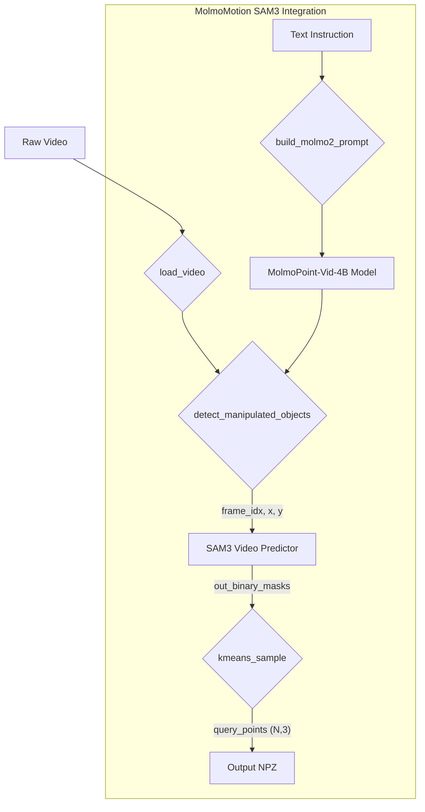

<!-- source: DeepWiki mcp.deepwiki.com · repo allenai/molmo-motion · page 6.3 Third-Party Tools: AllTracker, SAM3 & ViPE · fetched 2026-10-26 -->

# Third-Party Tools: AllTracker, SAM3 & ViPE

<details>
<summary>Relevant source files</summary>

The following files were used as context for generating this wiki page:

- [data_generation/scripts/check_env.py](data_generation/scripts/check_env.py)
- [data_generation/scripts/download_models.sh](data_generation/scripts/download_models.sh)
- [data_generation/scripts/install.sh](data_generation/scripts/install.sh)
- [data_generation/third_party/README.md](data_generation/third_party/README.md)
- [data_generation/third_party/alltracker/nets/alltracker.py](data_generation/third_party/alltracker/nets/alltracker.py)
- [data_generation/third_party/alltracker/nets/blocks.py](data_generation/third_party/alltracker/nets/blocks.py)
- [data_generation/third_party/alltracker/run-query-points.py](data_generation/third_party/alltracker/run-query-points.py)
- [data_generation/third_party/sam3/molmo2_pointing.py](data_generation/third_party/sam3/molmo2_pointing.py)
- [data_generation/third_party/sam3/querypoints_from_video.py](data_generation/third_party/sam3/querypoints_from_video.py)
- [data_generation/third_party/sam3/sam3/agent/agent_core.py](data_generation/third_party/sam3/sam3/agent/agent_core.py)
- [data_generation/third_party/sam3/sam3/agent/inference.py](data_generation/third_party/sam3/sam3/agent/inference.py)

</details>


This page details the integration of three key third-party models vendored within the MolmoMotion data generation pipeline: AllTracker for dense 2D tracking, SAM3 for video object segmentation, and ViPE for monocular SLAM. These models are crucial for annotating raw video data to create the MolmoMotion-1M corpus. This section covers their roles, implementation details, and the scripts used for their installation and model weight downloads.

## AllTracker: Dense 2D Tracking

AllTracker is a model designed for dense 2D point tracking across video frames. It propagates query points through a video sequence, generating trajectories and visibility scores for each point.

### Role in MolmoMotion

In the MolmoMotion data generation pipeline, AllTracker is used in Stage 3 to propagate 2D query points. These query points are initially sampled from object masks generated by SAM3. AllTracker takes these initial points and tracks them throughout the video, producing dense 2D trajectories.

### Implementation Details

The AllTracker model is vendored in `data_generation/third_party/alltracker/` [data_generation/third_party/README.md:10-10](). The core model definition is found in `data_generation/third_party/alltracker/nets/alltracker.py` [data_generation/third_party/alltracker/nets/alltracker.py:9-110](), with supporting blocks in `data_generation/third_party/alltracker/nets/blocks.py` [data_generation/third_party/alltracker/nets/blocks.py:1-146]().

The inference script `data_generation/third_party/alltracker/run-query-points.py` [data_generation/third_party/alltracker/run-query-points.py:1-20]() is responsible for running AllTracker on a set of query points.

#### Data Flow in `run-query-points.py`

1.  **Input Video and Query Points**: The script takes a video path and a `.npz` file containing `query_points` (N, 3) and `dim` (H, W) as input [data_generation/third_party/alltracker/run-query-points.py:71-75](). `query_points` are `[frame_idx, x, y]` coordinates.
2.  **Model Loading**: The AllTracker model is loaded, typically from a pre-trained checkpoint.
3.  **Forward Pass**: The `forward_video` function [data_generation/third_party/alltracker/run-query-points.py:65-65]() processes the video frames.
    *   It extracts the `frame_idx` from the first query point to determine the anchor frame [data_generation/third_party/alltracker/run-query-points.py:76-76]().
    *   The video frames are padded and processed by the `model` [data_generation/third_party/alltracker/run-query-points.py:92-92]().
    *   AllTracker computes `flows_e` (flow maps) and `visconf_maps_e` (visibility/confidence maps) [data_generation/third_party/alltracker/run-query-points.py:92-92]().
    *   It handles cases where the forward pass might return 4D tensors (single timestep) and normalizes them to 5D, inserting zero flow for the anchor frame [data_generation/third_party/alltracker/run-query-points.py:96-106]().
    *   If the anchor frame is not the first frame, it also runs a backward pass on the preceding frames and concatenates the results to get full trajectories [data_generation/third_party/alltracker/run-query-points.py:107-123]().
    *   `traj_maps_e` are computed by adding the flow to a coordinate grid [data_generation/third_party/alltracker/run-query-points.py:122-122]().
4.  **Query Point Extraction**: The initial `query_points` are scaled to match the resolution of the `traj_maps_e` [data_generation/third_party/alltracker/run-query-points.py:141-147]().
5.  **Track and Visibility Extraction**: For each scaled query point, the corresponding trajectory and visibility are extracted from `traj_maps_e` and `visconf_maps_e` [data_generation/third_party/alltracker/run-query-points.py:156-167]().
6.  **Output**: The script saves the computed `tracks` (N, T, 2) and `visibility` (N, T) to an output `.npz` file [data_generation/third_party/alltracker/run-query-points.py:170-173]().

#### AllTracker Data Flow
```mermaid
graph TD
    A[Video Path] --> B{read_video};
    C[Query Points NPZ] --> D{Load query_points, dim};
    B --> E[Video Frames (rgbs)];
    D --> E;
    E --> F{forward_video};
    F --> G[AllTracker Model];
    G -- "flows_e, visconf_maps_e" --> H{Process Flows & Visconf};
    H -- "traj_maps_e, visconf_maps_e" --> I{Scale Query Points};
    I --> J{Extract Tracks & Visibility};
    J -- "tracks, visibility" --> K[Output NPZ];

    subgraph AllTracker Inference (run-query-points.py)
        B; C; D; E; F; G; H; I; J; K;
    end
```
Sources:
- `data_generation/third_party/alltracker/run-query-points.py`
- `data_generation/third_party/alltracker/nets/alltracker.py`
- `data_generation/third_party/alltracker/nets/blocks.py`

### Installation and Download

AllTracker is used as plain source code and does not require a `pip install`. Its checkpoint is downloaded from `aharley/alltracker` via `torch.hub` on first use [data_generation/third_party/README.md:32-33](). The `data_generation/scripts/download_models.sh` script explicitly pre-fetches this checkpoint [data_generation/scripts/download_models.sh:13-19]().

## SAM3: Video Object Segmentation

SAM3 (Segment Anything Model 3) is used for video object segmentation, allowing for the extraction of object masks based on text prompts.

### Role in MolmoMotion

SAM3 is a core component of Stage 1 (semantic grounding) of the data generation pipeline. It takes a video and a text prompt (e.g., "the blue block") and generates binary masks for the described object. From these masks, K-means clustering is used to sample initial 2D query points.

### Implementation Details

The SAM3 model is vendored in `data_generation/third_party/sam3/` [data_generation/third_party/README.md:9-9](). The MolmoMotion project integrates SAM3 through two main scripts:

1.  `data_generation/third_party/sam3/molmo2_pointing.py`: This script integrates MolmoPoint-Vid-4B (a Molmo2 variant) to generate precise pointing coordinates from video and text instructions. It also uses Qwen3-0.6B for object-phrase extraction and Molmo2-8B for re-captioning [data_generation/third_party/README.md:18-19]().
    *   `load_molmo2()`: Loads the MolmoPoint-Vid-4B model and processor [data_generation/third_party/sam3/molmo2_pointing.py:49-81]().
    *   `extract_object_and_action()`: Parses DROID language instructions to extract target objects and action verbs [data_generation/third_party/sam3/molmo2_pointing.py:84-135]().
    *   `build_molmo2_prompt()`: Constructs a Molmo2-specific prompt from the instruction [data_generation/third_party/sam3/molmo2_pointing.py:138-151]().
    *   `detect_manipulated_objects()`: The core function that uses the MolmoPoint model to generate `(frame_idx, x_pixel, y_pixel)` tuples for manipulated objects [data_generation/third_party/sam3/molmo2_pointing.py:154-200](). It uses `processor.apply_chat_template` and `model.generate` with pointing metadata [data_generation/third_party/sam3/molmo2_pointing.py:163-166]().

2.  `data_generation/third_party/sam3/querypoints_from_video.py`: This script uses the SAM3 video predictor to generate object masks and then samples query points from these masks.
    *   `_safe_filename_component()`: Utility to sanitize strings for use in filenames [data_generation/third_party/sam3/querypoints_from_video.py:53-63]().
    *   `kmeans_sample()`: Samples `k` points from a boolean mask using K-means clustering. This is crucial for generating the initial 2D query points from SAM3's segmentation output [data_generation/third_party/sam3/querypoints_from_video.py:66-91]().
    *   `process_one_prompt()`: This function orchestrates the SAM3 segmentation for a given video and prompt. It tries detection at uniformly sampled frames (25%, 50%, 75% of video duration) [data_generation/third_party/sam3/querypoints_from_video.py:113-122]().
        *   It calls `video_predictor.handle_request` with an `add_prompt` type request [data_generation/third_party/sam3/querypoints_from_video.py:133-139]().
        *   If objects are detected, it extracts `out_binary_masks` [data_generation/third_party/sam3/querypoints_from_video.py:149-150]() and uses `kmeans_sample` to generate query points from each mask [data_generation/third_party/sam3/querypoints_from_video.py:165-167]().
        *   The generated `query_points` and video `dim` are saved to a `.npz` file [data_generation/third_party/sam3/querypoints_from_video.py:178-181]().

#### SAM3 Agent Sub-system

The `sam3/agent/` directory contains an agentic sub-system for SAM3, which allows for iterative refinement of segmentation using an LLM. While `molmo2_pointing.py` and `querypoints_from_video.py` are the primary integration points for MolmoMotion, the agent sub-system provides a more advanced interaction pattern.

*   `sam3/agent/agent_core.py`: Defines the core logic for the SAM3 agent, including managing conversation history, calling LLMs (`send_generate_request`), and interacting with the SAM service (`call_sam_service`) [data_generation/third_party/sam3/sam3/agent/agent_core.py:122-130]().
*   `sam3/agent/inference.py`: Provides a high-level interface `run_single_image_inference` to run the SAM3 agent on a single image with a text prompt [data_generation/third_party/sam3/sam3/agent/inference.py:9-16]().

#### SAM3 Data Flow (Simplified for MolmoMotion)

Sources:
- `data_generation/third_party/sam3/molmo2_pointing.py`
- `data_generation/third_party/sam3/querypoints_from_video.py`
- `data_generation/third_party/sam3/sam3/agent/agent_core.py`
- `data_generation/third_party/sam3/sam3/agent/inference.py`

### Installation and Download

SAM3 requires `pip install -e third_party/sam3` [data_generation/scripts/install.sh:12-12](). Its model weights (`facebook/sam3`) are downloaded from HuggingFace and cached in `HF_HOME` [data_generation/scripts/download_models.sh:8-8, data_generation/scripts/download_models.sh:25-28]().

## ViPE: Monocular SLAM

ViPE (Video Pose Estimation) is a monocular SLAM (Simultaneous Localization and Mapping) system that estimates metric depth and camera poses from video.

### Role in MolmoMotion

ViPE is used in Stage 2 of the data generation pipeline to provide metric depth information and camera poses. This information is critical for lifting the 2D tracks generated by AllTracker into 3D space (Stage 4).

### Implementation Details

The ViPE model is vendored in `data_generation/third_party/vipe/` [data_generation/third_party/README.md:11-11](). The MolmoMotion project uses specific integration scripts on top of the vendored ViPE:

*   `data_generation/third_party/vipe/scripts/vipe_to_colmap_general.py`: This script is responsible for the back-projection of 2D tracks to a metric 3D world frame, which is part of Stage 4 of the pipeline [data_generation/third_party/README.md:22-23]().
*   `data_generation/third_party/vipe/track-filter-smooth.py`: This script implements consensus-gated trust weighting and ray-only smoothing, which are part of Stage 5 of the pipeline [data_generation/third_party/README.md:24-25]().

The `data_generation/scripts/check_env.py` script verifies that the `vipe` package can be imported and that the `vipe` CLI is on the system's PATH [data_generation/scripts/check_env.py:36-39]().

#### ViPE Integration Overview
```mermaid
graph TD
    A[Raw Video] --> B[ViPE Monocular SLAM];
    B -- "Metric Depth Maps" --> C[3D Lifting (Stage 4)];
    B -- "Camera Poses" --> C;
    C -- "2D Tracks from AllTracker" --> C;
    C --> D[3D Tracks];
    D --> E[Filtering & Smoothing (Stage 5)];

    subgraph MolmoMotion ViPE Integration
        B; C; D; E;
    end
```
Sources:
- `data_generation/third_party/README.md`
- `data_generation/scripts/check_env.py`

### Installation and Download

ViPE requires `pip install -e third_party/vipe` [data_generation/scripts/install.sh:15-15](). This installation compiles a CUDA extension, necessitating `nvcc` (CUDA 12.x) and `ninja` to be available in the environment [data_generation/third_party/README.md:29-31](). ViPE does not have a separate model weight download step in `download_models.sh` as it likely handles its own model loading or is included in the package.

## Overall Installation and Environment Check

The `data_generation/scripts/install.sh` script orchestrates the installation of all necessary Python dependencies and the third-party models [data_generation/scripts/install.sh:1-22]().

The `data_generation/scripts/check_env.py` script performs a sanity check of the environment, verifying Python dependencies, CUDA availability, and the importability of `sam3`, `molmo2_pointing`, and `vipe` [data_generation/scripts/check_env.py:1-43]().

Sources:
- `data_generation/scripts/install.sh`
- `data_generation/scripts/check_env.py`

---

