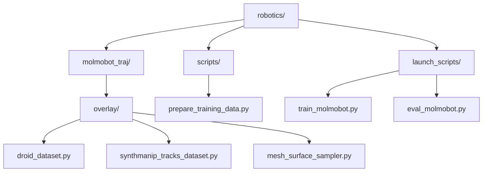

<!-- source: DeepWiki mcp.deepwiki.com · repo allenai/molmo-motion · page 7 Robotics Integration (MolmoBot) · fetched 2026-10-26 -->

# Robotics Integration (MolmoBot)

<details>
<summary>Relevant source files</summary>

The following files were used as context for generating this wiki page:

- [README.md](README.md)

</details>


This page provides a high-level overview of how MolmoMotion checkpoints can be leveraged as a motion prior for MolmoBot robot policies. It covers the `robotics/` directory structure, the `trajectory-conditioning.patch` for MolmoBot, the MolmoSpaces dataset, and the Franka pick-and-place evaluation pipeline.

The MolmoMotion model, trained on diverse 3D trajectory data, learns a powerful motion prior that can be transferred to robotic control tasks. By conditioning robot policies on these learned trajectories, MolmoBot can achieve more natural and effective manipulation.

## MolmoBot Finetuning Recipe

To integrate MolmoMotion with MolmoBot, a specific finetuning recipe is followed. This involves applying a patch to the MolmoBot codebase to enable trajectory conditioning, setting up the necessary environment, converting MolmoMotion checkpoints into a compatible format, and then running specialized training scripts within the `robotics/launch_scripts/` directory. This process allows the MolmoBot policy to learn from the MolmoMotion's predicted trajectories.

For a detailed, step-by-step guide on applying the patch, environment setup, checkpoint conversion, and running the training scripts, see [MolmoBot Finetuning Recipe](#7.1).

Sources:
- [README.md:64-64]()

## MolmoSpaces Data Preparation & Evaluation

The MolmoSpaces dataset plays a crucial role in training and evaluating MolmoBot policies. This dataset, along with other synthetic and real-world data, is prepared using specific scripts that handle data splitting, HDF5 injection, and the creation of specialized dataset modules. The performance of the finetuned MolmoBot policies is then evaluated using a Franka pick-and-place benchmark, which assesses the robot's ability to execute manipulation tasks based on the learned motion priors.

For comprehensive information on preparing the MolmoSpaces data, including details on `robotics/scripts/prepare_training_data.py`, the `molmobot_traj/overlay/` modules, and the Franka pick-and-place evaluation pipeline, see [MolmoSpaces Data Preparation & Evaluation](#7.2).

Sources:
- [README.md:146-146]()

## Robotics Directory Structure

The `robotics/` directory within the MolmoMotion repository houses all the necessary components for integrating MolmoMotion with robotic systems, specifically MolmoBot. This includes scripts for data preparation, launch scripts for training and evaluation, and modules for handling trajectory data and overlays.


**Diagram 1: `robotics/` Directory Structure**

Sources:
- [robotics/scripts/prepare_training_data.py]()
- [robotics/molmobot_traj/overlay/droid_dataset.py]()
- [robotics/molmobot_traj/overlay/synthmanip_tracks_dataset.py]()
- [robotics/molmobot_traj/overlay/mesh_surface_sampler.py]()

## MolmoMotion Checkpoints as Motion Prior

MolmoMotion checkpoints, which encapsulate the learned 3D trajectory forecasting capabilities, serve as a crucial motion prior for MolmoBot. This integration allows MolmoBot to leverage the rich motion understanding acquired by MolmoMotion during its pre-training on large-scale datasets. The `trajectory-conditioning.patch` modifies the MolmoBot policy to accept and utilize these predicted trajectories, guiding the robot's actions.

```mermaid
graph TD
    MM[MolmoMotion Checkpoint] --> |"Provides 3D Trajectory Prior"| TC[trajectory-conditioning.patch];
    TC --> MB[MolmoBot Policy];
    MB --> |"Robot Actions"| R[Robot (e.g., Franka)];
    MM -- "Trained on MolmoMotion-1M" --> D[MolmoSpaces Dataset];
    D -- "Data Preparation" --> C[prepare_training_data.py];
    C --> MB;
    MB -- "Evaluated on" --> E[Franka Pick-and-Place Benchmark];
```
**Diagram 2: MolmoMotion as a Motion Prior for MolmoBot**

Sources:
- [README.md:33-38]()
- [README.md:64-64]()
- [robotics/scripts/prepare_training_data.py]()

---

