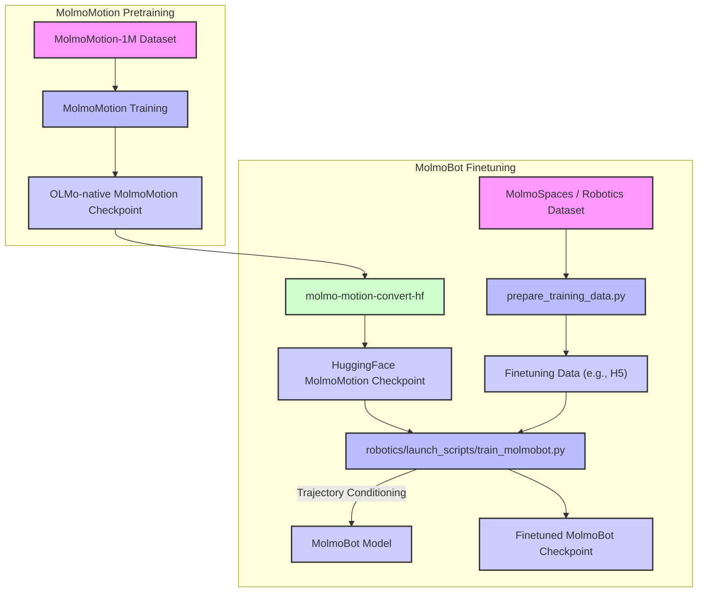

<!-- source: DeepWiki mcp.deepwiki.com · repo allenai/molmo-motion · page 7.1 MolmoBot Finetuning Recipe · fetched 2026-10-26 -->

# MolmoBot Finetuning Recipe

<details>
<summary>Relevant source files</summary>

The following files were used as context for generating this wiki page:

- [README.md](README.md)
- [data_generation/run_pipeline.py](data_generation/run_pipeline.py)

</details>


This page provides a step-by-step guide for finetuning MolmoBot using MolmoMotion checkpoints. It covers applying the `trajectory_conditioning.patch`, setting up the `uv` environment with `torchcodec` and `FFmpeg`, converting MolmoMotion checkpoints to a compatible format, and finally, running the training scripts located in `robotics/launch_scripts/`.

## 1. Applying the Trajectory Conditioning Patch

The MolmoBot finetuning process requires a specific patch to enable trajectory conditioning. This patch modifies the MolmoBot codebase to integrate the MolmoMotion trajectory predictions.

The patch file, `trajectory_conditioning.patch`, is located in the `robotics/` directory. To apply it, navigate to the root of your MolmoBot repository and execute the `patch` command.

```bash
cd /path/to/your/molmobot/repo
patch -p1 < robotics/trajectory_conditioning.patch
```

This command applies the changes defined in the patch file to your MolmoBot codebase. Ensure you are in the correct directory when running this command.

Sources: `robotics/trajectory_conditioning.patch`

## 2. Setting up the Environment

Finetuning MolmoBot with MolmoMotion requires specific dependencies, particularly for video processing. This section details how to set up the `uv` environment, including `torchcodec` and `FFmpeg`.

### 2.1. `uv` Environment Setup

It is recommended to use `uv` for managing Python environments due to its speed and reliability. First, ensure `uv` is installed. If not, you can install it via `pip`:

```bash
pip install uv
```

Next, create and activate a new `uv` environment for MolmoBot finetuning:

```bash
uv venv
source .venv/bin/activate
```

### 2.2. `torchcodec` and `FFmpeg` Notes

`torchcodec` is a crucial dependency for efficient video decoding. It requires `FFmpeg` shared libraries to be available on your system.

1.  **Install `FFmpeg`**: The easiest way to install `FFmpeg` is via `conda-forge`:

    ```bash
    conda install -c conda-forge ffmpeg
    ```

    Alternatively, you can install it using your system's package manager (e.g., `sudo apt-get install ffmpeg` on Ubuntu).

2.  **Install `torchcodec`**: When installing `torchcodec`, it's important to match its version with your PyTorch minor version. The `README.md` [README.md:89-93]() provides guidance on this. For example, if you are using PyTorch 2.9.1 with CUDA 12.8, you would install `torchcodec` as follows:

    ```bash
    pip install "torch==2.9.1" torchvision "torchcodec==0.9.*" \
        --index-url https://download.pytorch.org/whl/cu128
    ```

    If `torch.cuda.is_available()` returns `False` after installation, it likely indicates a mismatch between your PyTorch installation and your CUDA driver. In such cases, refer to the `README.md` [README.md:80-87]() for instructions on installing a PyTorch build that matches your driver.

Sources: `README.md:80-93`

## 3. Converting MolmoMotion Checkpoints

MolmoMotion checkpoints are typically in an OLMo-native format. For finetuning MolmoBot, these checkpoints need to be converted into a HuggingFace `AutoModel` compatible format. This conversion is handled by the `molmo-motion-convert-hf` console script.

### 3.1. `molmo-motion-convert-hf` Utility

The `molmo-motion-convert-hf` script is registered as a console entry point when you install the `molmo-motion` package [README.md:101](). Its purpose is to convert an OLMo-native MolmoMotion checkpoint into a HuggingFace-compatible format, making it loadable by `MolmoMotion.from_pretrained()` [src/molmo_motion/models/molmo_motion.py:100-100]().

**Usage:**

```bash
molmo-motion-convert-hf --input_path /path/to/olmo_checkpoint.pt --output_path /path/to/hf_model_dir
```

*   `--input_path`: Specifies the path to the original OLMo-native MolmoMotion checkpoint file (e.g., `molmomotion-4b-h3-f30.pt`).
*   `--output_path`: Specifies the directory where the converted HuggingFace model files (e.g., `config.json`, `pytorch_model.bin`, `tokenizer.json`) will be saved.

### 3.2. Example Conversion

Let's say you have downloaded the `MolmoMotion-4B-H3-F30` checkpoint. You would first download it from HuggingFace [README.md:172]() and then convert it:

```bash
# Download the checkpoint (if not already done)
hf download allenai/MolmoMotion-4B-H3-F30 --local-dir /path/to/molmomotion_checkpoints

# Convert the checkpoint
molmo-motion-convert-hf \
    --input_path /path/to/molmomotion_checkpoints/molmomotion-4b-h3-f30.pt \
    --output_path /path/to/molmomotion_hf_format
```

After this step, the `/path/to/molmomotion_hf_format` directory will contain the necessary files to load the MolmoMotion model using HuggingFace's `AutoModel` API, which MolmoBot expects.

Sources: `README.md:101`, `README.md:172`, `src/molmo_motion/models/molmo_motion.py:100-100`

## 4. Running Robotics Training Scripts

Once the environment is set up and the MolmoMotion checkpoint is converted, you can proceed with running the MolmoBot finetuning scripts. These scripts are located in `robotics/launch_scripts/`.

### 4.1. Training Script Overview

The `robotics/launch_scripts/` directory contains scripts designed for training MolmoBot. These scripts typically leverage `torchrun` for distributed training and accept YAML configuration files to define training parameters.

A common pattern for launching training is:

```bash
torchrun --nproc_per_node=N robotics/launch_scripts/train_molmobot.py \
    --config_path /path/to/molmobot_config.yaml \
    --molmomotion_checkpoint_path /path/to/molmomotion_hf_format
```

*   `--nproc_per_node=N`: Specifies the number of GPUs to use per node.
*   `robotics/launch_scripts/train_molmobot.py`: The main training script for MolmoBot.
*   `--config_path`: Path to a YAML configuration file that defines MolmoBot-specific training parameters (e.g., learning rate, batch size, dataset paths).
*   `--molmomotion_checkpoint_path`: Path to the directory containing the converted MolmoMotion HuggingFace checkpoint (from the previous step). This allows MolmoBot to initialize its motion prior from the pretrained MolmoMotion model.

### 4.2. Key Configuration Parameters

The MolmoBot training configuration YAML will typically include parameters related to:

*   **Dataset**: Paths to the MolmoSpaces dataset [README.md:146]() or other robotics datasets used for finetuning. The `robotics/scripts/prepare_training_data.py` script is used to prepare this data [robotics/scripts/prepare_training_data.py:1-1]().
*   **Model Architecture**: Specifics of the MolmoBot model, including how it integrates the MolmoMotion prior.
*   **Optimizer and Scheduler**: Learning rate, weight decay, and learning rate schedule.
*   **Training Loop**: Number of epochs/steps, logging frequency, checkpointing strategy.

### 4.3. Data Flow for MolmoBot Finetuning

The following diagram illustrates the data flow during MolmoBot finetuning, highlighting the integration of the MolmoMotion prior.


Title: MolmoBot Finetuning Data Flow
Sources: `README.md:146`, `robotics/scripts/prepare_training_data.py:1-1`

### 4.4. Example Training Command

A typical training command might look like this (adjust paths and `nproc_per_node` as needed):

```bash
torchrun --nproc_per_node=8 robotics/launch_scripts/train_molmobot.py \
    --config_path robotics/configs/molmobot_finetune.yaml \
    --molmomotion_checkpoint_path /path/to/molmomotion_hf_format \
    --output_dir /path/to/molmobot_finetuned_checkpoints
```

This command would launch a distributed training job using 8 GPUs, loading the MolmoBot configuration from `molmobot_finetune.yaml`, initializing the motion prior from the converted MolmoMotion checkpoint, and saving the finetuned MolmoBot checkpoints to `/path/to/molmobot_finetuned_checkpoints`.

Sources: `robotics/launch_scripts/`

---

