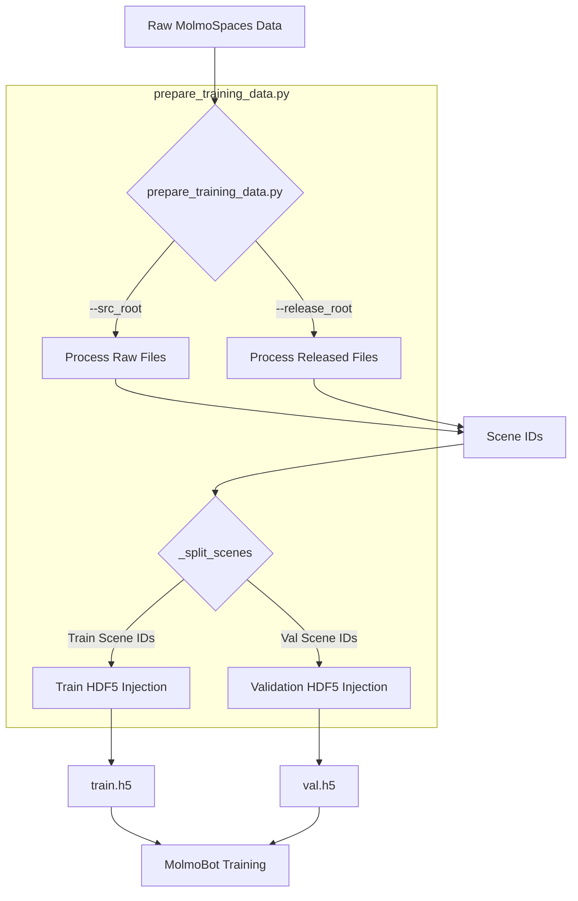

<!-- source: DeepWiki mcp.deepwiki.com · repo allenai/molmo-motion · page 7.2 MolmoSpaces Data Preparation & Evaluation · fetched 2026-10-26 -->

# MolmoSpaces Data Preparation & Evaluation

<details>
<summary>Relevant source files</summary>

The following files were used as context for generating this wiki page:

- [README.md](README.md)
- [data_generation/examples/tasks_example.json](data_generation/examples/tasks_example.json)

</details>


This page details the data preparation process for the MolmoSpaces dataset, which is used for training MolmoBot, a robotic manipulation system. It covers the `robotics/scripts/prepare_training_data.py` script, its modes of operation, the train/validation split, and the injection of data into HDF5 files. Additionally, it introduces new modules within `molmobot_traj/overlay/` that facilitate dataset handling and surface sampling, and briefly touches upon the Franka pick-and-place benchmark evaluation.

## MolmoSpaces Data Preparation Script

The `robotics/scripts/prepare_training_data.py` script is central to preparing the MolmoSpaces dataset for MolmoBot training. It handles the organization, splitting, and formatting of the data.

### Modes of Operation: `src_root` vs. `release_root`

The script operates in two primary modes, determined by the `--src_root` and `--release_root` arguments [robotics/scripts/prepare_training_data.py:30-31]():

*   **`--src_root`**: This mode is used when the raw MolmoSpaces data is available in its original, uncompressed format. It expects a directory structure where each scene (e.g., `scene_0000`) contains subdirectories for `rgb`, `depth`, `camera_intrinsics`, `camera_extrinsics`, `tracks`, and `annotations`. The script will process these raw files.
*   **`--release_root`**: This mode is designed for processing the MolmoSpaces dataset as it is released, typically in a more compressed or pre-processed format. It expects the data to be organized in a way that aligns with the released dataset structure, often involving HDF5 files.

The choice of mode dictates how the script locates and interprets the input data.

### Train/Validation Split

The script performs a train/validation split of the MolmoSpaces data. This is crucial for evaluating the generalization performance of trained models. The split is controlled by the `--val_ratio` argument [robotics/scripts/prepare_training_data.py:32](), which specifies the proportion of data to be allocated for validation. For example, a `val_ratio` of `0.1` would reserve 10% of the scenes for validation and the remaining 90% for training.

The splitting logic is implemented in the `_split_scenes` function [robotics/scripts/prepare_training_data.py:100-110](). It takes a list of all scene IDs and the `val_ratio`, then shuffles the scene IDs and partitions them into training and validation sets.

### HDF5 Injection

A key function of `prepare_training_data.py` is to inject the processed data into HDF5 files. HDF5 (Hierarchical Data Format 5) is a file format designed to store and organize large amounts of numerical data. It's commonly used in scientific computing for its efficiency in storing and retrieving complex datasets.

The `_inject_h5` function [robotics/scripts/prepare_training_data.py:113-129]() is responsible for this injection. It takes the output directory, a list of scene IDs, and the root directory of the MolmoSpaces data. For each scene, it reads the relevant data (e.g., RGB images, depth maps, camera parameters, 3D tracks, annotations) and writes them into a structured HDF5 file. This process consolidates various data types for a given scene into a single, easily accessible file, which improves data loading efficiency during training.


**Diagram: MolmoSpaces Data Preparation Workflow**

Sources:
- [robotics/scripts/prepare_training_data.py:30-31]()
- [robotics/scripts/prepare_training_data.py:32]()
- [robotics/scripts/prepare_training_data.py:100-110]()
- [robotics/scripts/prepare_training_data.py:113-129]()

## New Modules in `molmobot_traj/overlay/`

The `molmobot_traj/overlay/` directory introduces several new modules that are crucial for handling and processing the MolmoSpaces data within the MolmoBot framework.

### `droid_dataset.py`

The `droid_dataset.py` module defines the `DroidDataset` class [molmobot_traj/overlay/droid_dataset.py:16-17](), which is a PyTorch `Dataset` implementation specifically tailored for the DROID dataset. Although the MolmoSpaces dataset is the primary focus here, `DroidDataset` provides a similar structure and functionality for handling robot teleoperation data. It is designed to load and preprocess data from HDF5 files, extracting information such as RGB images, depth maps, camera intrinsics, and 3D tracks.

Key functionalities include:
*   **Initialization**: Takes the HDF5 file path, a list of scene IDs, and various configuration parameters [molmobot_traj/overlay/droid_dataset.py:20-34]().
*   **Data Loading**: The `__getitem__` method [molmobot_traj/overlay/droid_dataset.py:40-100]() reads data for a specific scene and frame, including images, depth, camera parameters, and 3D tracks.
*   **Preprocessing**: It handles image resizing, normalization, and conversion to PyTorch tensors.

### `synthmanip_tracks_dataset.py`

The `synthmanip_tracks_dataset.py` module introduces the `SynthManipTracksDataset` class [molmobot_traj/overlay/synthmanip_tracks_dataset.py:17-18](). This dataset is designed to work with synthetic manipulation data, which includes 3D tracks and associated metadata. It extends the `DroidDataset` and adds specific handling for synthetic data characteristics.

Key aspects:
*   **Inheritance**: It inherits from `DroidDataset`, leveraging its core data loading capabilities [molmobot_traj/overlay/synthmanip_tracks_dataset.py:17]().
*   **Track Processing**: It focuses on processing 3D tracks, which are crucial for robotic manipulation tasks. This includes handling track IDs, 3D coordinates, and potentially other track-specific attributes.
*   **Configuration**: It allows for flexible configuration of data paths and processing options.

### `mesh_surface_sampler.py`

The `mesh_surface_sampler.py` module provides utilities for sampling points from mesh surfaces. This is particularly relevant for robotic manipulation, where understanding the geometry of objects is essential for interaction.

The `MeshSurfaceSampler` class [molmobot_traj/overlay/mesh_surface_sampler.py:16-17]() is designed to:
*   **Load Meshes**: It can load 3D mesh models (e.g., from `.obj` files).
*   **Sample Points**: It provides methods to sample a specified number of points uniformly or strategically from the surface of the loaded mesh. This can be used to generate target points for manipulation or to create dense point clouds for object representation.
*   **Coordinate Transformations**: It handles transformations between different coordinate frames, which is critical when integrating with a robotic system.

```mermaid
graph TD
    A[HDF5 Files (train.h5, val.h5)] --> B(DroidDataset);
    B --> C(SynthManipTracksDataset);
    C --> D[MolmoBot Training Loop];

    E[3D Mesh Models (.obj)] --> F(MeshSurfaceSampler);
    F --> G[Sampled Surface Points];
    G --> D;

    subgraph "molmobot_traj/overlay/"
        B
        C
        F
    end
```
**Diagram: MolmoBot Data Flow with Overlay Modules**

Sources:
- [molmobot_traj/overlay/droid_dataset.py:16-17]()
- [molmobot_traj/overlay/droid_dataset.py:20-34]()
- [molmobot_traj/overlay/droid_dataset.py:40-100]()
- [molmobot_traj/overlay/synthmanip_tracks_dataset.py:17-18]()
- [molmobot_traj/overlay/synthmanip_tracks_dataset.py:17]()
- [molmobot_traj/overlay/mesh_surface_sampler.py:16-17]()

## Franka Pick-and-Place Benchmark Evaluation

The MolmoSpaces dataset and the MolmoBot framework are used to evaluate robotic manipulation capabilities, particularly for tasks like Franka pick-and-place. This evaluation assesses how well MolmoBot, leveraging the MolmoMotion prior, can execute complex manipulation sequences.

The evaluation typically involves:
1.  **Task Definition**: Defining specific pick-and-place scenarios, including object types, initial positions, and target locations.
2.  **Policy Execution**: Running the MolmoBot policy, which uses the MolmoMotion model to predict trajectories for manipulation.
3.  **Success Metrics**: Measuring the success rate of completing the pick-and-place task, often considering factors like object stability, collision avoidance, and final placement accuracy.
4.  **Trajectory Analysis**: Analyzing the predicted and executed trajectories to understand the robot's motion planning and control performance.

While the specific evaluation scripts are not detailed in the provided context, the overall goal is to demonstrate the effectiveness of MolmoMotion as a motion prior for real-world robotic tasks. The MolmoSpaces dataset provides the necessary data for training and evaluating such policies in a controlled environment.

Sources:
- [README.md:64]()

---

