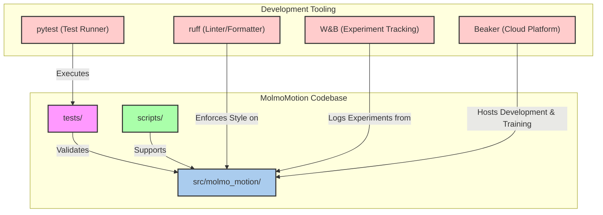

<!-- source: DeepWiki mcp.deepwiki.com · repo allenai/molmo-motion · page 8 Testing & Development Utilities · fetched 2026-10-26 -->

# Testing & Development Utilities

Relevant source files

The following files were used as context for generating this wiki page:

- [.gitignore](.gitignore)
- [README.md](README.md)

This page provides an overview of the testing infrastructure and various development utilities within the MolmoMotion codebase. It covers the test suite, shared utility modules, and essential development tooling. The goal is to ensure code quality, maintain numerical stability, and streamline the development workflow.

For detailed information on the test modules and how to run them, see [Test Suite](#8.1). For an in-depth look at the shared utility modules, refer to [Utility Modules & Infrastructure](#8.2).

## Overview of Testing and Development Tooling

The MolmoMotion project employs a robust testing strategy to ensure the correctness and numerical stability of its models and data pipelines. This includes dedicated tests for the public API surface, the model's forward pass, and the preprocessor's output. Beyond testing, several scripts and tools are integrated into the development workflow to enhance productivity and code quality.

The primary components covered are:
*   **Test Suite**: Located in the `tests/` directory, these tests validate critical aspects of the codebase.
*   **Scripts**: The `scripts/` directory contains various utilities, such as those for building caches.
*   **Development Tooling**: This includes code formatters (`ruff`), testing frameworks (`pytest`), experiment tracking (`W&B`), and cloud computing platforms (`Beaker`).

The following diagram illustrates the relationship between these components and their role in maintaining the MolmoMotion codebase.

Title: "MolmoMotion Development Ecosystem"
Sources: [README.md:1-172](), [.gitignore:1-42]()

## Test Suite

The `tests/` directory houses the project's test suite, which is crucial for ensuring the reliability and correctness of the MolmoMotion model and its associated components. The tests are designed to catch regressions and verify numerical equivalence across different environments and configurations.

The main test modules include:
*   `test_import_surface.py`: Verifies that the public API surface can be imported correctly, ensuring basic package integrity.
*   `test_numerical_equivalence_model.py`: Checks for numerical equivalence in the model's forward pass, which is critical for maintaining consistent model behavior.
*   `test_numerical_equivalence_preproc.py`: Ensures that the preprocessor outputs numerically equivalent results, guaranteeing consistent data preparation.

These tests are typically run using `pytest`. For a comprehensive guide on each test module, how to execute them, and the specific invariants they protect, see [Test Suite](#8.1).

Sources: [tests/test_import_surface.py](), [tests/test_numerical_equivalence_model.py](), [tests/test_numerical_equivalence_preproc.py]()

## Utility Modules & Infrastructure

The codebase includes a set of shared utility modules designed to support various functionalities across the project, from distributed training to data handling and visualization. These modules encapsulate common patterns and helper functions, promoting code reusability and maintainability.

Key utility modules include:
*   `torch_util.py`: Provides helpers for PyTorch-specific operations, including distributed training and FSDP utilities.
*   `io.py`: Handles input/output operations, including `PathOrStr` type hinting and clients for `cached-path`.
*   `dist_util.py`: Contains utilities for distributed computing setups.
*   `safetensors_util.py`: Facilitates working with `safetensors` for model serialization.
*   `registry.py`: Implements a flexible registry pattern for managing datasets and other configurable components.
*   `html_utils.py`: Provides utilities for generating HTML content, potentially for visualization or reporting.
*   `viz.py`: Contains functions for rendering trajectories and other visual outputs.
*   `_optional.py`: A shim for handling optional dependencies gracefully.

For a detailed breakdown of each utility module, its purpose, and how to use it, refer to [Utility Modules & Infrastructure](#8.2).

Sources: [src/molmo_motion/utils/torch_util.py](), [src/molmo_motion/utils/io.py](), [src/molmo_motion/utils/dist_util.py](), [src/molmo_motion/utils/safetensors_util.py](), [src/molmo_motion/utils/registry.py](), [src/molmo_motion/utils/html_utils.py](), [src/molmo_motion/utils/viz.py](), [src/molmo_motion/utils/_optional.py]()

## Development Tooling

Beyond the core codebase, several external tools and internal scripts are used to facilitate development, ensure code quality, and manage experiments.

### `scripts/` Utilities

The `scripts/` directory contains various standalone utilities that aid in development and data preparation. A notable example is `build_track_keys_cache.py`, which is used to pre-compute and cache track keys for datasets, optimizing data loading performance.

Sources: [scripts/build_track_keys_cache.py]()

### Code Quality and Testing

*   **Ruff**: `ruff` is used as a fast Python linter and formatter. It helps enforce consistent code style and identify potential issues early in the development cycle. The `.ruff_cache/` directory is ignored by Git [./.gitignore:9]().
*   **Pytest**: `pytest` is the testing framework used to run the test suite. It provides a flexible and extensible way to write and execute tests. The `.pytest_cache/` directory is ignored by Git [./.gitignore:8]().

### Experiment Tracking and Cloud Infrastructure

*   **Weights & Biases (W&B)**: `W&B` is integrated for experiment tracking, logging metrics, configurations, and artifacts during training and evaluation runs. The `wandb/` directory, which stores local W&B run data, is ignored by Git [./.gitignore:24]().
*   **Beaker**: Beaker is used as the cloud computing platform for running large-scale training and evaluation jobs. It provides the necessary infrastructure for distributed training and resource management.

Sources: [./.gitignore:8-9](), [./.gitignore:24]()

---

