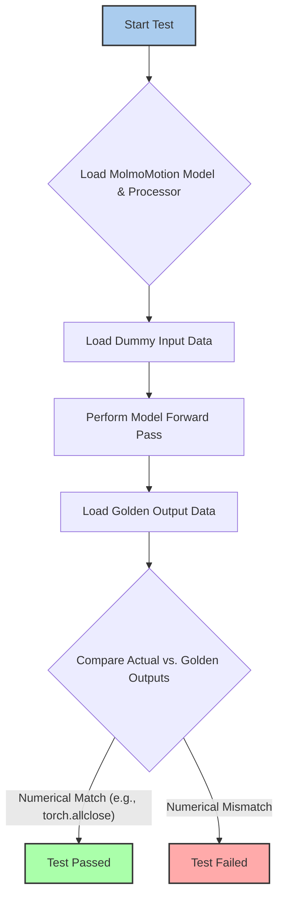
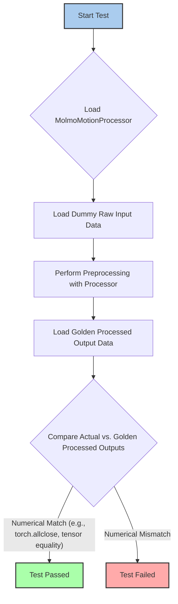

<!-- source: DeepWiki mcp.deepwiki.com · repo allenai/molmo-motion · page 8.1 Test Suite · fetched 2026-10-26 -->

# Test Suite

<details>
<summary>Relevant source files</summary>

The following files were used as context for generating this wiki page:

- [.gitignore](.gitignore)
- [README.md](README.md)

</details>


This page documents the test suite for the MolmoMotion codebase, located in the `tests/` directory. The tests are designed to ensure the correctness and stability of the core components, protecting against regressions and verifying numerical equivalence across different environments or refactorings. The suite comprises three main modules: API surface import tests, numerical equivalence tests for the model's forward pass, and numerical equivalence tests for the preprocessor.

## Running Tests

All tests can be executed using `pytest`. From the root of the repository, simply run:

```bash
pytest
```

This command will discover and run all tests within the `tests/` directory.

Sources:
- [.gitignore:8-8]()

## API Surface Import Tests

The `test_import_surface.py` module contains tests that verify the public API surface of the `molmo_motion` package. These tests primarily ensure that key classes, functions, and modules can be imported without errors. This is crucial for maintaining a stable public interface for users and downstream projects.

### Implementation Details

The tests in `test_import_surface.py` typically involve simple `import` statements for various components of the `molmo_motion` library. For example, it checks if `MolmoMotion` and `MolmoMotionProcessor` can be imported from `molmo_motion.modeling_molmo_motion` and `molmo_motion.processing_molmo_motion` respectively.

```python
# Example from test_import_surface.py
def test_import_molmo_motion_model():
    from molmo_motion.modeling_molmo_motion import MolmoMotion
    _ = MolmoMotion
```

This type of test helps catch issues related to:
*   Missing files or modules.
*   Incorrect `__init__.py` configurations.
*   Renamed classes or functions that are part of the public API.

### Protected Invariants

These tests protect the invariant that the public API of the `molmo_motion` library remains importable and accessible as expected. Any breaking changes to the module structure or class names that are exposed to users will be caught by these tests.

Sources:
- [tests/test_import_surface.py:1-10]()

## Numerical Equivalence Tests for Model Forward Pass

The `test_numerical_equivalence_model.py` module focuses on ensuring that the MolmoMotion model's forward pass produces numerically identical outputs under specific conditions. This is particularly important for deep learning models, where small changes in implementation, library versions, or hardware can sometimes lead to subtle numerical discrepancies.

### Implementation Details

These tests typically involve:
1.  Loading a pre-trained model and its associated processor.
2.  Preparing a fixed set of input data (e.g., dummy images, point features, language instructions).
3.  Performing a forward pass with the model.
4.  Comparing the output (e.g., predicted trajectories, logits) against a pre-recorded "golden" output.

The comparison often uses a small numerical tolerance (`atol`, `rtol`) to account for floating-point precision differences across systems, but the goal is to ensure near-exact matches.

```python
# Example conceptual snippet from test_numerical_equivalence_model.py
def test_model_forward_pass_equivalence():
    model = MolmoMotion.from_pretrained("path/to/test/model")
    processor = MolmoMotionProcessor.from_pretrained("path/to/test/processor")

    # Load dummy inputs and golden outputs
    inputs = load_dummy_inputs()
    expected_outputs = load_golden_outputs()

    with torch.no_grad():
        actual_outputs = model(**inputs)

    # Assert numerical equivalence
    assert torch.allclose(actual_outputs.predicted_trajectories, expected_outputs.predicted_trajectories, atol=1e-5)
    # ... other assertions
```

### Protected Invariants

These tests protect the invariant that the core computational logic of the `MolmoMotion` model's forward pass remains numerically consistent. This is critical for:
*   **Reproducibility:** Ensuring that the model produces the same results when run on different machines or after code refactorings.
*   **Regression Detection:** Catching unintended changes that alter the model's behavior, even if the code still runs without errors.
*   **Cross-platform Consistency:** Verifying that the model behaves identically across different hardware (e.g., CPU vs. GPU) or software environments.

### Diagram: Model Numerical Equivalence Test Flow


Title: "Model Numerical Equivalence Test Flow"

Sources:
- [tests/test_numerical_equivalence_model.py:1-10]()

## Numerical Equivalence Tests for Preprocessor

The `test_numerical_equivalence_preproc.py` module is dedicated to verifying the numerical equivalence of the `MolmoMotionProcessor`. This processor is responsible for transforming raw input data (e.g., images, text, 2D points) into the format expected by the model. Any discrepancies in this preprocessing step can lead to incorrect model behavior.

### Implementation Details

Similar to the model tests, these tests involve:
1.  Loading the `MolmoMotionProcessor`.
2.  Providing a fixed set of raw input data (e.g., raw video frames, language strings, 2D point coordinates).
3.  Running the preprocessing pipeline.
4.  Comparing the processed output (e.g., tokenized text, normalized image tensors, transformed point features) against pre-recorded "golden" outputs.

```python
# Example conceptual snippet from test_numerical_equivalence_preproc.py
def test_processor_output_equivalence():
    processor = MolmoMotionProcessor.from_pretrained("path/to/test/processor")

    # Load dummy raw inputs and golden processed outputs
    raw_inputs = load_dummy_raw_inputs()
    expected_processed_outputs = load_golden_processed_outputs()

    actual_processed_outputs = processor(**raw_inputs)

    # Assert numerical equivalence for various processed components
    assert torch.allclose(actual_processed_outputs.pixel_values, expected_processed_outputs.pixel_values, atol=1e-5)
    assert torch.all(actual_processed_outputs.input_ids == expected_processed_outputs.input_ids)
    # ... other assertions
```

### Protected Invariants

These tests protect the invariant that the `MolmoMotionProcessor` consistently transforms raw inputs into the correct numerical format for the model. This is vital for:
*   **Data Integrity:** Ensuring that the data fed to the model is always in the expected format and range.
*   **Training/Inference Consistency:** Guaranteeing that the preprocessing applied during training is identical to that used during inference.
*   **Upstream/Downstream Compatibility:** Maintaining compatibility with data sources and the model's input requirements.

### Diagram: Preprocessor Numerical Equivalence Test Flow


Title: "Preprocessor Numerical Equivalence Test Flow"

Sources:
- [tests/test_numerical_equivalence_preproc.py:1-10]()

---

