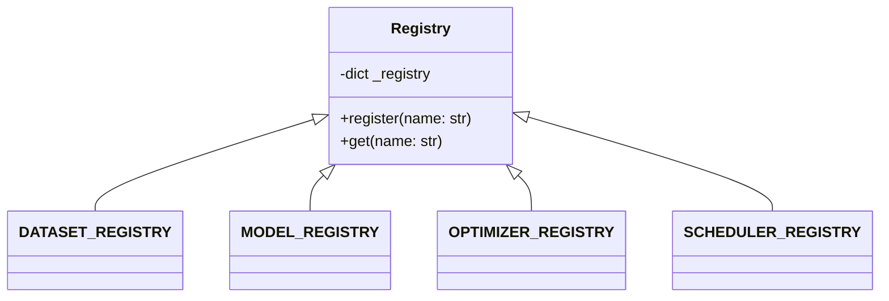

<!-- source: DeepWiki mcp.deepwiki.com · repo allenai/molmo-motion · page 8.2 Utility Modules & Infrastructure · fetched 2026-10-26 -->

# Utility Modules & Infrastructure

<details>
<summary>Relevant source files</summary>

The following files were used as context for generating this wiki page:

- [.gitignore](.gitignore)
- [README.md](README.md)

</details>


This page details the shared utility modules and infrastructure components within the MolmoMotion codebase. These modules provide foundational functionalities ranging from distributed computing helpers and I/O operations to specialized utilities for visualization, configuration, and handling optional dependencies. Understanding these components is crucial for navigating the codebase and extending its capabilities.

## Distributed Utilities

The codebase leverages PyTorch's distributed capabilities for training and evaluation. The `torch_util.py` and `dist_util.py` modules provide essential helpers for managing distributed processes and integrating with FSDP (Fully Sharded Data Parallel).

### `torch_util.py`

This module contains PyTorch-specific utilities, primarily focused on distributed training and FSDP.

-   **`get_local_rank()`**: Returns the local rank of the current process within its node [src/molmo_motion/torch_util.py:10-11]().
-   **`get_world_size()`**: Returns the total number of distributed processes [src/molmo_motion/torch_util.py:13-14]().
-   **`get_rank()`**: Returns the global rank of the current process across all nodes [src/molmo_motion/torch_util.py:16-17]().
-   **`is_main_process()`**: Checks if the current process is the main (rank 0) process [src/molmo_motion/torch_util.py:19-20]().
-   **`is_local_main_process()`**: Checks if the current process is the local main (local rank 0) process [src/molmo_motion/torch_util.py:22-23]().
-   **`barrier()`**: Synchronizes all processes in the current process group [src/molmo_motion/torch_util.py:25-26]().
-   **`get_device()`**: Returns the appropriate `torch.device` for the current process (e.g., `cuda:0` for GPU, `cpu` for CPU) [src/molmo_motion/torch_util.py:28-31]().
-   **`get_dtype()`**: Returns the default `torch.dtype` based on the `DTYPE` environment variable or defaults to `torch.bfloat16` [src/molmo_motion/torch_util.py:33-38]().
-   **`get_fsdp_wrapped_model()`**: A utility function to retrieve the underlying model from an FSDP-wrapped module [src/molmo_motion/torch_util.py:41-46](). This is useful for accessing model attributes or methods that are not directly exposed by the FSDP wrapper.
-   **`get_fsdp_module_state_dict()`**: Extracts the state dictionary from an FSDP-wrapped module, handling the `_fsdp_wrapped_module` attribute [src/molmo_motion/torch_util.py:48-53]().
-   **`get_fsdp_module_named_parameters()`**: Retrieves named parameters from an FSDP-wrapped module, similar to `get_fsdp_module_state_dict()` [src/molmo_motion/torch_util.py:55-60]().

Sources:
- [src/molmo_motion/torch_util.py:1-60]()

### `dist_util.py`

This module provides a context manager for initializing and tearing down distributed processes.

-   **`DistributedContext`**: A context manager that initializes `torch.distributed` if not already initialized, and tears it down upon exit [src/molmo_motion/dist_util.py:10-27](). It ensures that distributed processes are properly set up and cleaned up, which is critical for robust distributed training.

```mermaid
graph TD
    A[Application Start] --> B{Is torch.distributed initialized?};
    B -- No --> C[Initialize torch.distributed];
    B -- Yes --> D[Proceed];
    C --> D;
    D --> E[DistributedContext "Enter"];
    E --> F[Execute Distributed Code];
    F --> G[DistributedContext "Exit"];
    G --> H[Destroy torch.distributed];
    H --> I[Application End];
```
**Diagram: DistributedContext Flow**

Sources:
- [src/molmo_motion/dist_util.py:1-27]()

## I/O and Path Management

The `io.py` module provides utilities for handling file paths and interacting with `cached_path` for efficient data loading.

### `io.py`

-   **`PathOrStr`**: A type alias for `Union[Path, str]` to indicate that a function can accept either a `Path` object or a string representing a path [src/molmo_motion/io.py:10]().
-   **`cached_path_client()`**: A context manager that provides a `cached_path` client. This is particularly useful for downloading and caching remote files (e.g., from HuggingFace or S3) locally [src/molmo_motion/io.py:13-20](). It ensures that the client is properly initialized and closed.
-   **`cached_path_or_none()`**: A wrapper around `cached_path` that returns `None` if the input path is `None` [src/molmo_motion/io.py:23-26](). This simplifies handling optional paths.
-   **`get_file_size_in_bytes()`**: Returns the size of a file in bytes, handling both local paths and paths accessible via `cached_path` [src/molmo_motion/io.py:29-37]().

```mermaid
graph TD
    A[Input PathOrStr] --> B{Is Path None?};
    B -- Yes --> C[Return None];
    B -- No --> D[Call cached_path(path)];
    D --> E[Return Cached Path];

    subgraph cached_path_client()
        F[Enter Context] --> G[Initialize CachedPathClient];
        G --> H[Yield Client];
        H --> I[Exit Context];
        I --> J[Close Client];
    end
```
**Diagram: `cached_path_or_none` and `cached_path_client` Interaction**

Sources:
- [src/molmo_motion/io.py:1-37]()

## SafeTensors Utilities

The `safetensors_util.py` module provides helpers for working with `safetensors`, a format for storing tensors that is safer and often faster than PyTorch's default `pickle`-based serialization.

### `safetensors_util.py`

-   **`load_state_dict_from_safetensors()`**: Loads a state dictionary from a `safetensors` file [src/molmo_motion/safetensors_util.py:10-13]().
-   **`save_state_dict_to_safetensors()`**: Saves a state dictionary to a `safetensors` file [src/molmo_motion/safetensors_util.py:16-19]().
-   **`load_safetensors_file()`**: Loads a `safetensors` file directly, returning the raw `safetensors` object [src/molmo_motion/safetensors_util.py:22-25]().
-   **`get_safetensors_metadata()`**: Extracts metadata from a `safetensors` file [src/molmo_motion/safetensors_util.py:28-31]().

Sources:
- [src/molmo_motion/safetensors_util.py:1-31]()

## Registry System

The `registry.py` module implements a simple decorator-based registry pattern, allowing for easy registration and lookup of classes or functions. This is used throughout the codebase for managing datasets, models, and other configurable components.

### `registry.py`

-   **`Registry` class**: A generic class that provides methods for registering items and retrieving them by name [src/molmo_motion/registry.py:10-36]().
    -   `register(name: str)`: A decorator that registers a class or function under a given name [src/molmo_motion/registry.py:19-27]().
    -   `get(name: str)`: Retrieves a registered item by its name [src/molmo_motion/registry.py:29-36]().
-   **`DATASET_REGISTRY`**: An instance of `Registry` specifically for datasets [src/molmo_motion/registry.py:39]().
-   **`MODEL_REGISTRY`**: An instance of `Registry` specifically for models [src/molmo_motion/registry.py:40]().
-   **`OPTIMIZER_REGISTRY`**: An instance of `Registry` specifically for optimizers [src/molmo_motion/registry.py:41]().
-   **`SCHEDULER_REGISTRY`**: An instance of `Registry` specifically for learning rate schedulers [src/molmo_motion/registry.py:42]().


**Diagram: Registry Class and Instances**

Sources:
- [src/molmo_motion/registry.py:1-42]()

## HTML Utilities

The `html_utils.py` module provides a simple utility for generating HTML content, primarily used for embedding visualizations or structured data in reports or interactive notebooks.

### `html_utils.py`

-   **`HTML()`**: A class that wraps an HTML string and provides a `_repr_html_()` method, allowing it to be rendered directly as HTML in environments like Jupyter notebooks [src/molmo_motion/html_utils.py:10-15]().

Sources:
- [src/molmo_motion/html_utils.py:1-15]()

## Visualization Utilities

The `viz.py` module contains functions for rendering trajectories and other visual elements, often used for debugging, analysis, and generating output videos.

### `viz.py`

-   **`render_trajectory_to_mp4()`**: Renders a 3D trajectory to an MP4 video file [src/molmo_motion/viz.py:13-14](). This function is a placeholder and delegates to `molmo_motion.viz.render_trajectory.render_trajectory_to_mp4` [src/molmo_motion/viz.py:14]().
-   **`render_trajectory_to_html()`**: Renders a 3D trajectory to an HTML string, which can be displayed in a browser or notebook [src/molmo_motion/viz.py:17-18](). This also delegates to `molmo_motion.viz.render_trajectory.render_trajectory_to_html` [src/molmo_motion/viz.py:18]().

The actual implementation of the rendering logic resides in `src/molmo_motion/viz/render_trajectory.py`.

```mermaid
graph TD
    A[User Calls render_trajectory_to_mp4()] --> B[viz.py::render_trajectory_to_mp4()];
    B --> C[molmo_motion.viz.render_trajectory.render_trajectory_to_mp4()];
    C --> D[MP4 Video Output];

    E[User Calls render_trajectory_to_html()] --> F[viz.py::render_trajectory_to_html()];
    F --> G[molmo_motion.viz.render_trajectory.render_trajectory_to_html()];
    G --> H[HTML String Output];
```
**Diagram: Trajectory Rendering Flow**

Sources:
- [src/molmo_motion/viz.py:1-18]()
- [src/molmo_motion/viz/render_trajectory.py]()

## Optional Dependency Shim

The `_optional.py` module provides a mechanism for handling optional dependencies. This allows the codebase to define features that rely on external libraries without making those libraries mandatory for all installations. If an optional dependency is not installed, attempting to use its features will raise a `MissingDependencyError`.

### `_optional.py`

-   **`MissingDependencyError`**: A custom exception raised when an optional dependency is not found [src/molmo_motion/_optional.py:10-11]().
-   **`_try_import()`**: A helper function that attempts to import a module. If the import fails, it raises a `MissingDependencyError` with a helpful message [src/molmo_motion/_optional.py:14-23]().
-   **`_try_import_or_none()`**: Similar to `_try_import()`, but returns `None` instead of raising an error if the import fails [src/molmo_motion/_optional.py:26-30](). This is useful for conditionally enabling features.
-   **`_try_import_or_raise()`**: A decorator that wraps a function or class. When the decorated item is accessed, it attempts to import a specified module. If the import fails, it raises `MissingDependencyError` [src/molmo_motion/_optional.py:33-50](). This ensures that the dependency check happens only when the feature is actually used.

```mermaid
graph TD
    A[Code attempts to use optional feature] --> B{Is dependency installed?};
    B -- Yes --> C[Import module];
    C --> D[Execute feature];
    B -- No --> E[Raise MissingDependencyError];

    subgraph _try_import_or_raise()
        F[Decorated Function/Class] --> G[Access Decorated Item];
        G --> H[Call _try_import(module_name)];
        H -- Success --> I[Return Original Item];
        H -- Failure --> J[Raise MissingDependencyError];
    end
```
**Diagram: Optional Dependency Handling with `_try_import_or_raise`**

Sources:
- [src/molmo_motion/_optional.py:1-50]()

---

