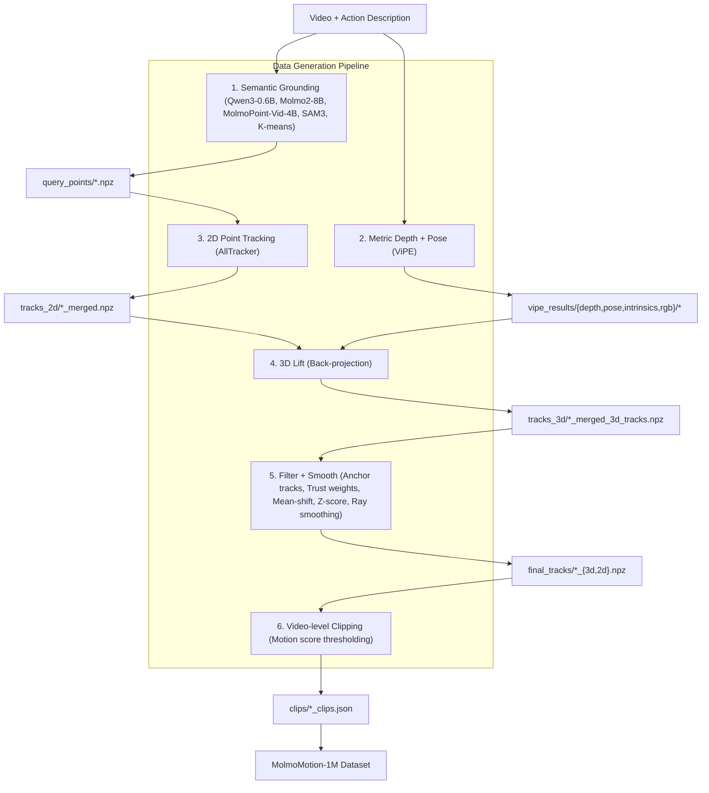
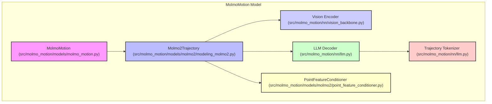
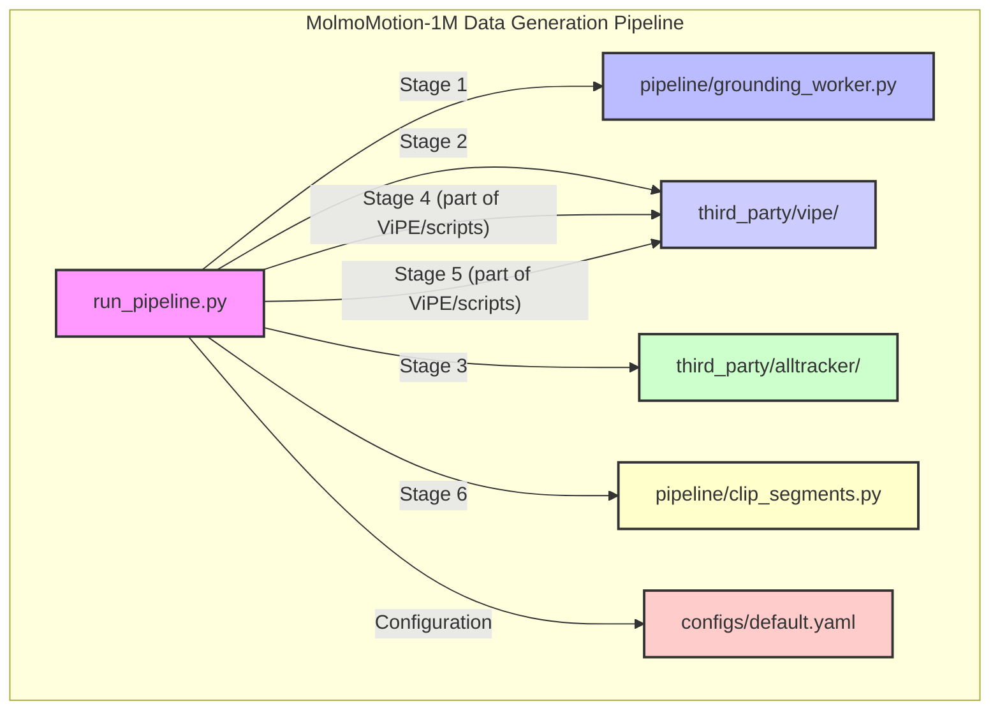

<!-- source: DeepWiki mcp.deepwiki.com · repo allenai/molmo-motion · page 9 Glossary · fetched 2026-10-26 -->

# Glossary

Relevant source files

The following files were used as context for generating this wiki page:

- [README.md](README.md)
- [assets/architecture.png](assets/architecture.png)
- [data_generation/README.md](data_generation/README.md)
- [data_generation/configs/default.yaml](data_generation/configs/default.yaml)

This page defines key terms, abbreviations, and domain-specific concepts used within the MolmoMotion codebase. It aims to provide a comprehensive reference for new and existing engineers, linking concepts directly to their implementation in the code.

## MolmoMotion
MolmoMotion is a 4B vision-language model designed to forecast 3D point trajectories based on natural-language action instructions. It takes a short RGB observation history, user-specified 2D query points with initial 3D positions, and a language description of an action, then predicts each query point's 3D trajectory for up to ~2 seconds in the camera-frame-at-t₀ coordinate system. The model's learned motion prior is applicable to robotics planning and motion-guided video generation. The repository focuses on the autoregressive (AR) variant of the model.
Sources: [README.md:33-40]()

## MolmoMotion-1M
MolmoMotion-1M is a large-scale training corpus used to pretrain the MolmoMotion model. It consists of approximately 1.16 million public video clips annotated with object-grounded 3D point trajectories. The dataset is generated using an automated annotation pipeline that extracts these trajectories from unconstrained RGB video.
Sources: [README.md:42-43](), [data_generation/README.md:10-11]()

## PointMotionBench
PointMotionBench is an evaluation suite and benchmark specifically designed for MolmoMotion. It is used to assess the model's performance in forecasting 3D point trajectories. The benchmark includes three sub-datasets: HOT3D, WorldTrack, and DAVIS.
Sources: [README.md:44-45](), [README.md:110](), [README.md:148-151]()

## Autoregressive (AR) Variant
This refers to the specific architecture of MolmoMotion where the model predicts future trajectory points sequentially, conditioning each prediction on the previously predicted points and the input context. All released checkpoints of MolmoMotion are of this AR variant.
Sources: [README.md:41](), [README.md:167-168]()

## Two-Stage Training
MolmoMotion employs a two-stage supervised fine-tuning (SFT) training pipeline.
*   **Stage 1 (Pretrain):** This stage uses a larger dataset (MolmoMotion-1M) with specific parameters (P=8, H=3, F=8) for 40,000 steps.
*   **Stage 2 (Long-horizon finetune):** This stage focuses on longer trajectory horizons (F=30/32) for 10,000 steps.
Sources: [README.md:58-59]()

## Trajectory Tokenization
The process of encoding 3D point trajectories into a token format suitable for the LLM decoder. This involves using `<tracks coords='...'>` tokens, delta-from-anchor quantization (×1000 integer encoding), and special tokens like `POINT_FEATURE_TOKEN` and `FRAME_START_TOKEN`.

## Point Feature Injection
The mechanism by which 2D point features are conditioned into the Molmo2Trajectory backbone. This involves a `PointFeatureConditioner` and the injection of `<|point_feat|>` tokens during the LLM's forward pass.

## Vision Backbone
The component responsible for processing input images and videos. It utilizes a SigLIP2+DINOv2 vision encoder, various image pooling strategies (`ImagePooling2DType`), an MLP connector, and a video preprocessor that feeds `H` history frames to the Vision Transformer (ViT).

## LLM Decoder
The language model component, based on Qwen2, responsible for decoding trajectory tokens and generating the final 3D point trajectories. It incorporates beam search and generation utilities.

## MolmoMotion-1M Data Generation Pipeline
An automated annotation pipeline that extracts object-grounded 3D point trajectories from unconstrained RGB video. This pipeline consists of six stages: grounding, depth+pose estimation, 2D tracking, 3D lifting, filtering+smoothing, and video-level clipping.

### Pipeline Stages
The MolmoMotion-1M data generation pipeline consists of the following stages:

#### 1. Semantic Grounding
This stage identifies and samples query points on the object of interest.
*   **Input:** Video and action description.
*   **Process:**
    *   Qwen3-0.6B reduces the action description to an object phrase.
    *   Molmo2-8B re-captions the video if the phrase is vague.
    *   MolmoPoint-Vid-4B localizes the object as a 2D point in the anchor frame, prompted by the action.
    *   SAM 3 converts the point into a mask.
    *   K-means samples N=100 query points from the mask pixels.
*   **Output:** `grounding/<vid>/query_points/*.npz`
Sources: [data_generation/README.md:14](), [data_generation/README.md:38-45]()

#### 2. Metric Depth + Pose
This stage estimates per-frame metric depth, intrinsics, and camera pose.
*   **Input:** Video.
*   **Process:** ViPE monocular SLAM is run in a single pass.
*   **Output:** `vipe_results/{depth,pose,intrinsics,rgb}/<vid>.*`
Sources: [data_generation/README.md:15](), [data_generation/README.md:47-49]()

#### 3. 2D Point Tracking
This stage propagates the query points through the video to generate 2D tracks.
*   **Input:** Query points from Stage 1, video.
*   **Process:** AllTracker propagates query points, yielding temporally persistent 2D tracks and per-frame visibility.
*   **Output:** `tracks_2d/<vid>/<vid>_merged.npz`
Sources: [data_generation/README.md:16](), [data_generation/README.md:51-52]()

#### 4. 3D Lift
This stage back-projects 2D tracks into 3D space.
*   **Input:** Visible 2D tracks, estimated depth, intrinsics, and camera pose from Stage 2.
*   **Process:** Each visible 2D track point is back-projected using depth and intrinsics, then transformed by the camera pose into a metric world frame anchored at the query-time camera, resulting in `(N, T, 3)` metric tracks.
*   **Output:** `tracks_3d/<corpus>/<vid>_merged_3d_tracks.npz`
Sources: [data_generation/README.md:17](), [data_generation/README.md:54-57]()

#### 5. Filtering + Smoothing
This stage refines the lifted 3D tracks to reduce noise and drift.
*   **Input:** Lifted 3D tracks.
*   **Process:**
    *   K=16 anchor tracks are selected.
    *   Per-frame trust weights `w = exp(-e/s)^p` are computed.
    *   Mean-shift is used to auto-split physically separate instances.
    *   Outlier tracks are dropped using a MAD z-score.
    *   Surviving tracks are smoothed along their camera ray only, penalizing multi-stride acceleration.
*   **Output:** `final_tracks/<vid>_{3d,2d}.npz` + `<vid>_filter_meta.npz`
Sources: [data_generation/README.md:18](), [data_generation/README.md:59-63](), [data_generation/configs/default.yaml:23-31]()

#### 6. Video-level Clipping
This stage extracts motion-coherent clips from the video.
*   **Input:** Filtered and smoothed 3D tracks.
*   **Process:**
    *   An object motion score `s_t = trimmed-mean_n ||p_n(t) - p_n(t-1)||` is calculated per frame.
    *   This score is thresholded at `τ` (clip_threshold) to identify contiguous high-motion segments.
    *   Gaps between segments are merged if smaller than `clip_min_gap`.
    *   Short runs are dropped based on `clip_min_clip_sec` or `clip_min_frames`.
*   **Output:** `clips/<corpus>_clips.json`
Sources: [data_generation/README.md:19](), [data_generation/README.md:65-68](), [data_generation/configs/default.yaml:34-37]()

### Data Generation Pipeline Diagram

Sources: [data_generation/README.md:14-19]()

## MolmoBot
MolmoBot is a robot policy that can be finetuned using MolmoMotion checkpoints as a motion prior. This integration allows MolmoMotion's learned trajectory forecasting capabilities to enhance robotic control and planning, particularly for tasks like pick-and-place.
Sources: [README.md:64]()

## Metrics
MolmoMotion's performance is evaluated using several standard metrics:
*   **ADE (Average Displacement Error):** Measures the average Euclidean distance between the predicted and ground-truth trajectories over all time steps.
*   **FDE (Final Displacement Error):** Measures the Euclidean distance between the predicted and ground-truth final points of the trajectories.
*   **PWT (Point-Wise Tracking):** A metric specific to point trajectory forecasting, often related to the accuracy of individual point predictions.
Sources: [README.md:61]()

## Special Tokens
These are specific tokens used within the MolmoMotion model's vocabulary to denote different types of information or structural elements in the input and output sequences.
*   `<|point_feat|>`: Token injected into the LLM forward pass to represent 2D point features.
*   `<tracks coords='...'>`: Token format used for encoding trajectory coordinates.
*   `POINT_FEATURE_TOKEN`: A special token indicating the presence of point features.
*   `FRAME_START_TOKEN`: A special token indicating the beginning of a new frame's data within a sequence.

## `L_pin` Loss
A loss function used during the filtering and smoothing stage (Stage 5) of the MolmoMotion-1M data generation pipeline. It is a weight applied to the optimization process, with `alpha` controlling its influence.
Sources: [data_generation/README.md:62](), [data_generation/configs/default.yaml:25]()

## `tau` Threshold
A threshold value (`clip_threshold`) used in the video-level clipping stage (Stage 6) of the MolmoMotion-1M data generation pipeline. It determines which segments of video are considered "high-motion" based on the object motion score.
Sources: [data_generation/README.md:66](), [data_generation/configs/default.yaml:34]()

## `H`, `F`, `P` Parameters
These parameters define the input and output dimensions of the MolmoMotion model:
*   `H`: Number of history frames provided as input to the vision backbone.
*   `F`: Number of future frames (trajectory length) the model is tasked to predict.
*   `P`: Number of query points per object.
Sources: [README.md:58-59](), [README.md:170-171]()

## `MolmoMotion.from_pretrained()`
A class method for loading a pre-trained MolmoMotion model from a specified path or HuggingFace model identifier. This is the primary entry point for users to instantiate the model.

## `MolmoMotionProcessor.__call__()`
The main method of the `MolmoMotionProcessor` class, responsible for preparing raw input data (e.g., images, text) into the format expected by the `MolmoMotion` model. This typically involves preprocessing steps like resizing, normalization, and tokenization.

## `predict_trajectory()`
A method of the `MolmoMotion` class that takes processed input and generates predicted 3D point trajectories. This method encapsulates the model's forward pass and trajectory generation logic.

## `MolmoMotionOutput`
A data structure or class that encapsulates the output of the `MolmoMotion` model's `predict_trajectory()` method. It typically contains the predicted 3D trajectories and potentially other relevant information like confidence scores or attention weights.

## `Molmo2ForConditionalGeneration`
The HuggingFace AutoModel compatible class for the MolmoMotion model, specifically designed for conditional generation tasks. This class facilitates integration with the HuggingFace ecosystem for easy loading and usage.

## `molmo-motion-convert-hf`
A console script provided by the MolmoMotion repository. Its purpose is to convert checkpoints trained in the OLMo-native format into a format compatible with HuggingFace's `AutoModel` classes.
Sources: [README.md:101]()

## `torchcodec`
A library used for video decoding within the MolmoMotion data pipeline. It is mentioned as an alternative to OpenCV for video decoding, particularly when exact frame decoding is required.
Sources: [README.md:85-92]()

## `ViPE`
A monocular SLAM (Simultaneous Localization and Mapping) system used in Stage 2 of the MolmoMotion-1M data generation pipeline. It estimates per-frame metric depth, camera intrinsics, and camera-to-world poses.
Sources: [data_generation/README.md:15](), [data_generation/README.md:47-49](), [data_generation/third_party/README.md]()

## `AllTracker`
A dense 2D point tracking algorithm used in Stage 3 of the MolmoMotion-1M data generation pipeline. It propagates query points through video frames, generating temporally persistent 2D tracks and per-frame visibility information.
Sources: [data_generation/README.md:16](), [data_generation/README.md:51-52](), [data_generation/third_party/README.md]()

## `SAM3`
A video object segmentation model (Segment Anything Model 3) used in Stage 1 of the MolmoMotion-1M data generation pipeline. It takes a 2D point (from MolmoPoint-Vid-4B) and generates a mask for the object.
Sources: [data_generation/README.md:14](), [data_generation/README.md:43](), [data_generation/third_party/README.md]()

## `MolmoPoint-Vid-4B`
A model used in Stage 1 of the MolmoMotion-1M data generation pipeline for localizing objects as 2D points in an anchor frame, prompted by an action description.
Sources: [data_generation/README.md:14](), [data_generation/README.md:42]()

## `Qwen3-0.6B`
A language model used in Stage 1 of the MolmoMotion-1M data generation pipeline to reduce action descriptions to short object phrases.
Sources: [data_generation/README.md:14](), [data_generation/README.md:39]()

## `Molmo2-8B`
A visual re-captioning model used in Stage 1 of the MolmoMotion-1M data generation pipeline. It re-captions videos visually if the object phrase generated by Qwen3-0.6B is vague or absent.
Sources: [data_generation/README.md:14](), [data_generation/README.md:39]()

## Codebase-Specific Terms to Code Entities

### MolmoMotion Model Components
This diagram illustrates the mapping of high-level MolmoMotion model components to their corresponding code entities.

Sources: [src/molmo_motion/models/molmo_motion.py](), [src/molmo_motion/models/molmo2/modeling_molmo2.py](), [src/molmo_motion/nn/vision_backbone.py](), [src/molmo_motion/nn/llm.py](), [src/molmo_motion/models/molmo2/point_feature_conditioner.py]()

### MolmoMotion-1M Data Generation Pipeline Code Entities
This diagram maps the stages of the MolmoMotion-1M data generation pipeline to their primary code implementations.

Sources: [data_generation/run_pipeline.py](), [data_generation/pipeline/grounding_worker.py](), [data_generation/third_party/vipe/](), [data_generation/third_party/alltracker/](), [data_generation/pipeline/clip_segments.py](), [data_generation/configs/default.yaml]()