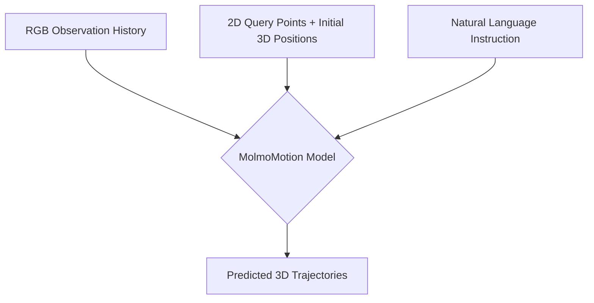
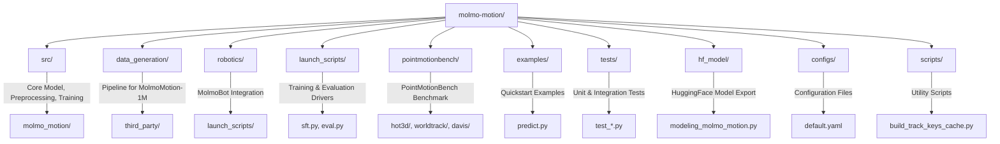
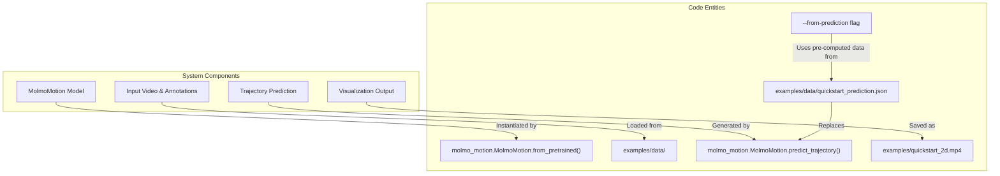
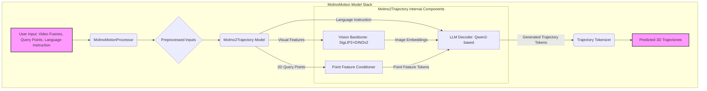
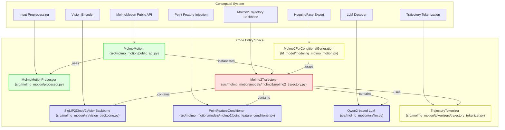
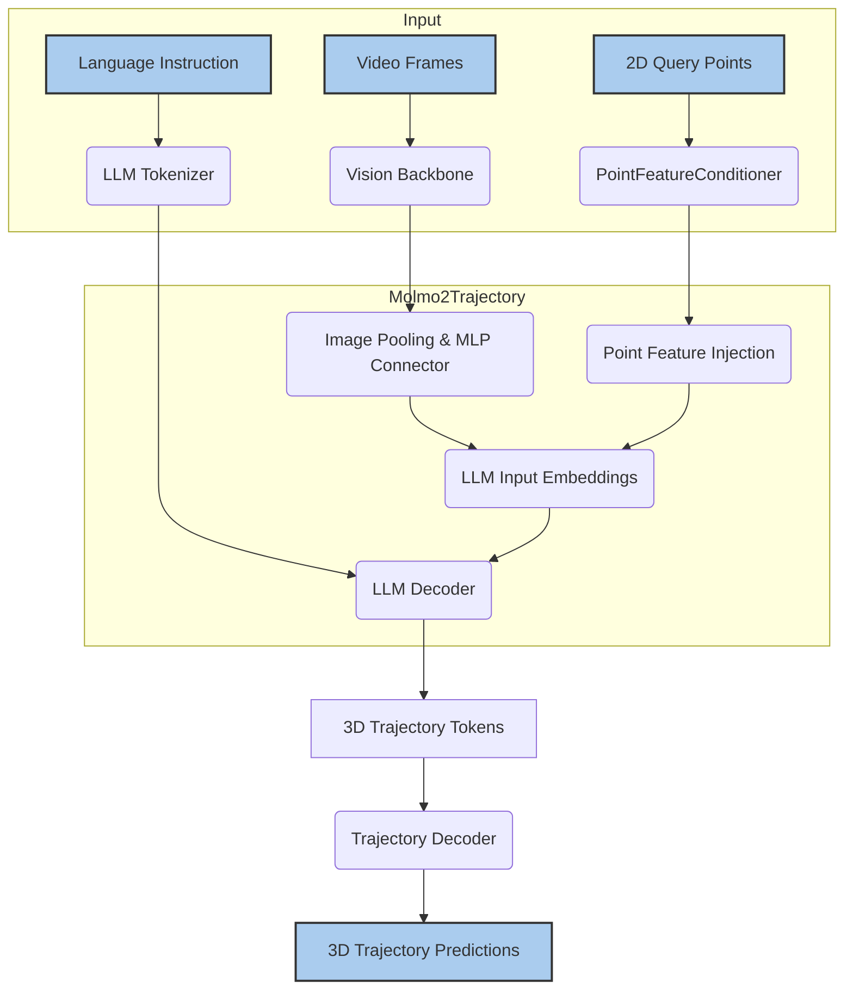
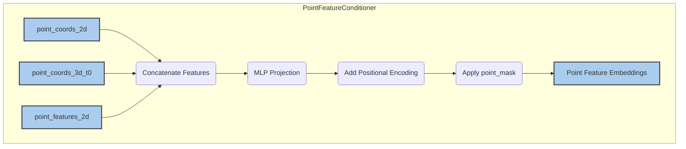
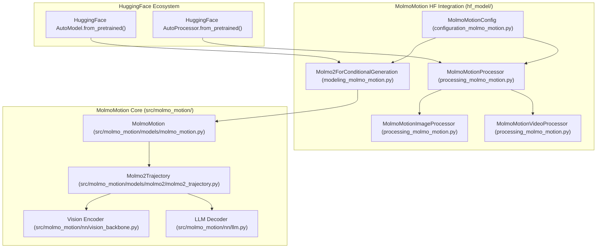
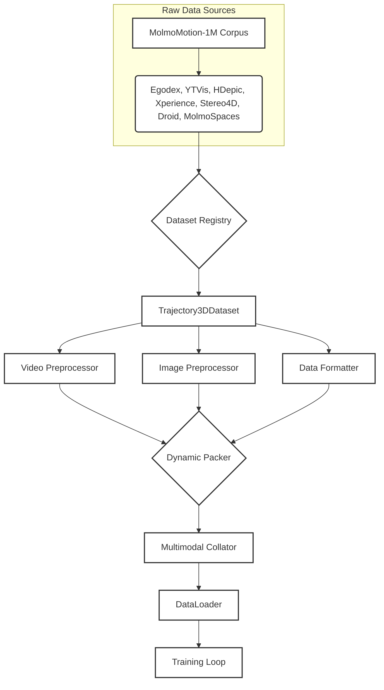

# Page: MolmoMotion Overview

# MolmoMotion Overview

<details>
<summary>Relevant source files</summary>

The following files were used as context for generating this wiki page:

- [LICENSE](LICENSE)
- [README.md](README.md)
- [THIRD-PARTY-NOTICES](THIRD-PARTY-NOTICES)
- [assets/architecture.png](assets/architecture.png)
- [assets/qualitative_examples.png](assets/qualitative_examples.png)
- [assets/teaser.png](assets/teaser.png)

</details>


MolmoMotion is a 4B vision-language model designed to forecast 3D point trajectories based on natural-language instructions [README.md:33-35](). Given a short RGB observation history, a set of user-specified 2D query points with their initial 3D positions, and a language description of the intended action, the model predicts each query point's 3D trajectory for up to approximately 2 seconds in the camera-frame-at-t₀ coordinate system [README.md:35-40](). This repository focuses on the autoregressive (AR) variant of MolmoMotion [README.md:42-43]().

The learned motion prior from MolmoMotion has demonstrated transferability to robotics planning and motion-guided video generation [README.md:40-41](). This page provides a high-level overview of MolmoMotion, its two-stage training strategy, key datasets, and the repository's organization. For detailed information on each topic, please refer to the linked child pages.

## Core Functionality

MolmoMotion takes multimodal inputs—visual observations, 2D query points with initial 3D positions, and a language instruction—to predict future 3D trajectories for those points. This capability allows for fine-grained control over motion forecasting, enabling applications in various domains.

### MolmoMotion's Prediction Process

Sources: [README.md:35-40]()

## Two-Stage Training Strategy

MolmoMotion employs a two-stage supervised fine-tuning (SFT) training pipeline [README.md:57-59](). This approach allows the model to first learn general motion patterns and then specialize for longer-horizon predictions.

1.  **Stage 1 — Pretrain (P=8, H=3, F=8, 40K steps)**: This initial stage focuses on pre-training the model with a specific configuration for history (H) and future (F) frames, and a batch size (P) [README.md:58]().
2.  **Stage 2 — Long-horizon finetune (10K steps)**: The second stage fine-tunes the model for longer-horizon predictions, typically with an increased number of future frames (F=30/32) [README.md:59]().

For more in-depth information on the training process and recipes, see [Training](#4).

## Key Datasets

MolmoMotion leverages two primary corpora hosted on HuggingFace:

*   **MolmoMotion-1M**: This is the main training corpus [README.md:109](). It comprises several sub-datasets, including `egodex`, `ytvis`, `hdepic`, `xperience`, `stereo4d`, `droid`, and `molmospaces` [README.md:139-147](). The public training recipe primarily uses the first five datasets [README.md:155-156]().
*   **PointMotionBench**: This serves as the evaluation benchmark for MolmoMotion [README.md:110](). It includes `hot3d`, `worldtrack`, and `davis` sub-datasets [README.md:149-151]().

These datasets are downloaded and managed via environment variables `MOLMO_MOTION_1M_ROOT` and `POINTMOTIONBENCH_ROOT` [README.md:120-121]().

For detailed information on data handling and preprocessing, see [Data Pipeline & Preprocessing](#3). For specifics on the evaluation benchmark, see [Evaluation & PointMotionBench](#5).

## Repository Organization

The MolmoMotion repository is structured to separate different aspects of the project, including source code, data generation tools, robotics integration, launch scripts, and evaluation benchmarks.

### Top-Level Directory Structure

Sources: [README.md:115-117](), [src/molmo_motion/models/molmo2/](src/molmo_motion/models/molmo2/)

*   `src/`: Contains the core MolmoMotion model implementation, data preprocessing logic, and training components [src/](src/).
*   `data_generation/`: Houses the automated annotation pipeline used to create the MolmoMotion-1M dataset [data_generation/](data_generation/).
*   `robotics/`: Provides code and scripts for integrating MolmoMotion with robotics platforms, specifically MolmoBot [robotics/](robotics/).
*   `launch_scripts/`: Contains scripts for launching training and evaluation jobs [launch_scripts/](launch_scripts/).
*   `pointmotionbench/`: Defines the PointMotionBench evaluation benchmark structure and related utilities [pointmotionbench/](pointmotionbench/).
*   `examples/`: Includes quickstart examples to demonstrate model usage [examples/](examples/).
*   `tests/`: Holds the test suite for the codebase [tests/](tests/).
*   `hf_model/`: Contains the HuggingFace model export utilities and related files [hf_model/](hf_model/).
*   `configs/`: Stores YAML configuration files for various pipeline stages and training recipes [configs/](configs/).
*   `scripts/`: Contains miscellaneous utility scripts [scripts/](scripts/).

For a detailed breakdown of the repository layout and project configuration, see [Repository Layout & Project Configuration](#1.2).

## Getting Started

To begin using MolmoMotion, you can follow the installation instructions and run the quickstart example. This involves cloning the repository, setting up a Conda environment, installing dependencies, and downloading the necessary datasets and models.

For a step-by-step guide on installation, running examples, and understanding output visualizations, see [Getting Started & Quickstart](#1.1).

## Further Reading

*   **Core Model Architecture**: For an in-depth look at the model's internal components, including the vision encoder, LLM decoder, and trajectory tokenization, see [Core Model Architecture](#2).
*   **Data Pipeline & Preprocessing**: To understand how training data is processed and loaded, refer to [Data Pipeline & Preprocessing](#3).
*   **Training**: For details on the training setup, FSDP, optimizers, and checkpointing, see [Training](#4).
*   **Evaluation & PointMotionBench**: Learn about the evaluation infrastructure and metrics used to assess model performance in [Evaluation & PointMotionBench](#5).
*   **Data Generation Pipeline (MolmoMotion-1M)**: Explore the automated annotation pipeline that created the MolmoMotion-1M dataset in [Data Generation Pipeline (MolmoMotion-1M)](#6).
*   **Robotics Integration (MolmoBot)**: Discover how MolmoMotion integrates with robotics for tasks like pick-and-place in [Robotics Integration (MolmoBot)](#7).
*   **Testing & Development Utilities**: For information on the test suite and development tools, see [Testing & Development Utilities](#8).
*   **Glossary**: For definitions of key terms, refer to the [Glossary](#9).

Sources: [README.md:49-66]()

---

# Page: Getting Started & Quickstart

# Getting Started & Quickstart

<details>
<summary>Relevant source files</summary>

The following files were used as context for generating this wiki page:

- [.gitignore](.gitignore)
- [README.md](README.md)

</details>


This page provides a step-by-step guide to installing the MolmoMotion codebase, running a quickstart example, and understanding the resulting visualization. It covers the installation process, the use of the `examples/` directory, `pip install` options, and how to run the model without a GPU using the `--from-prediction` flag.

## Installation

To begin, clone the MolmoMotion repository and set up your Python environment.

```bash
git clone https://github.com/allenai/molmo-motion.git
cd molmo-motion
conda create -n molmo-motion python=3.11 -y
conda activate molmo-motion
pip install -e .[viz]
```
[README.md:70-77]()

The `pip install -e .[viz]` command installs the project in editable mode and includes the `viz` extra, which pulls in dependencies required for visualization.

**GPU / Driver Note:** The default PyTorch wheels installed by `pip` might target a newer CUDA runtime than your system's driver. If `torch.cuda.is_available()` returns `False`, you'll need to install a PyTorch build that matches your CUDA driver. For example, for CUDA 12.8:

```bash
pip install "torch==2.9.1" torchvision "torchcodec==0.9.*" \
    --index-url https://download.pytorch.org/whl/cu128
```
[README.md:81-84]()

Ensure that `torchcodec` matches the PyTorch minor version (e.g., `0.9.x` for `torch 2.9`). Additionally, the video decoder requires FFmpeg shared libraries, which can be installed via `conda install -c conda-forge ffmpeg`. While the bundled training/evaluation recipes use OpenCV for decoding and don't strictly require FFmpeg, the `torchcodec_exact` path does [README.md:86-93]().

After installation, three console scripts become available:
*   `molmo-motion-train`: A `torchrun`-compatible YAML-config training driver.
*   `molmo-motion-eval`: A `torchrun`-compatible YAML-config evaluation driver.
*   `molmo-motion-convert-hf`: A utility for converting OLMo-native checkpoints to HuggingFace format.
[README.md:96-101]()

Sources:
*   [README.md:70-102]()

## Downloading Datasets and Models

MolmoMotion relies on two main HuggingFace corpora: `allenai/molmo-motion-1m` for training and `allenai/PointMotionBench` for evaluation [README.md:107-110](). Before running any examples or training, you must download these datasets.

First, set environment variables for the root directories where these datasets will be stored. These directories **must be outside the MolmoMotion repository** [README.md:112-117]().

```bash
export MOLMO_MOTION_1M_ROOT=/your/path/to/molmo-motion-1m
export POINTMOTIONBENCH_ROOT=/your/path/to/PointMotionBench
```
[README.md:120-121]()

Then, download the datasets using `hf download`:

```bash
# Training corpus.
hf download allenai/molmo-motion-1m \
    --repo-type dataset --local-dir $MOLMO_MOTION_1M_ROOT

# Evaluation benchmark — only needed for `launch_scripts/eval_pointmotionbench.py`.
hf download allenai/PointMotionBench \
    --repo-type dataset --local-dir $POINTMOTIONBENCH_ROOT
```
[README.md:126-134]()

The expected directory structure after download is:

```
$MOLMO_MOTION_1M_ROOT/
├── egodex/         annotations/  tracks/  camera/
├── ytvis/          annotations/  tracks/  camera/
├── hdepic/         annotations/  tracks/  camera/
├── xperience/      annotations/  tracks/
├── stereo4d/       annotations/  track_index/
├── droid/          annotations/  tracks/  camera/    # robot teleop, NOT used by the default recipe
└── molmospaces/    annotations/  tracks/  camera/  videos/    # sim, NOT used by the default recipe

$POINTMOTIONBENCH_ROOT/
├── hot3d/
├── worldtrack/
└── davis/
```
[README.md:138-152]()

The `egodex`, `ytvis`, `hdepic`, `xperience`, and `stereo4d` datasets are used by the public training recipe. `droid` and `molmospaces` are included for extension but not used by default [README.md:154-156](). Raw videos are reconstructed locally from their original sources, and each dataset directory on HuggingFace includes a `README.md` and reconstruction script [README.md:158-163]().

Finally, download a released model checkpoint. All released checkpoints are the autoregressive (AR) variant of MolmoMotion [README.md:166-167](). For the quickstart, we'll use `allenai/MolmoMotion-4B-H3-F30`.

```bash
hf download allenai/MolmoMotion-4B-H3-F30 \
    --repo-type model --local-dir molmomotion-4b-h3-f30
```
[README.md:174-176]()

Sources:
*   [README.md:107-176]()

## Quickstart Example

The `examples/` directory contains a quickstart script, `examples/quickstart.py`, which demonstrates how to use a pretrained MolmoMotion model to predict 3D trajectories.

### Quickstart Workflow
```mermaid
graph TD
    A[Start] --> B{Run examples/quickstart.py};
    B --> C{Load MolmoMotion-4B-H3-F30 model};
    C --> D{Load example video and annotations};
    D --> E{Preprocess input for model};
    E --> F{Call model.predict_trajectory()};
    F --> G{Visualize predicted trajectories};
    G --> H[Output MP4 video];
    H --> I[End];

    style A fill:#ace,stroke:#333,stroke-width:2px;
    style I fill:#ace,stroke:#333,stroke-width:2px;
```
**Diagram 1: Quickstart Workflow**

The `quickstart.py` script performs the following steps:
1.  **Load Model**: It loads the `MolmoMotion-4B-H3-F30` model from the specified path [examples/quickstart.py:100-101]().
2.  **Load Data**: It loads an example video and its corresponding annotations from the `examples/data` directory [examples/quickstart.py:104-107]().
3.  **Prepare Input**: It preprocesses the video frames, 2D query points, and language instruction into the format expected by the model [examples/quickstart.py:110-120]().
4.  **Predict Trajectories**: It calls `model.predict_trajectory()` to get the 3D trajectory predictions [examples/quickstart.py:123]().
5.  **Visualize**: It then visualizes these predictions, overlaying them on the input video, and saves the output as an MP4 file [examples/quickstart.py:126-130]().

### Running the Quickstart

Navigate to the `molmo-motion` directory and run the quickstart script:

```bash
python examples/quickstart.py \
    --model-path molmomotion-4b-h3-f30 \
    --molmo-motion-1m-root $MOLMO_MOTION_1M_ROOT
```
[README.md:180-182]()

This command will:
*   Load the `MolmoMotion-4B-H3-F30` model from the `molmomotion-4b-h3-f30` directory.
*   Use the `$MOLMO_MOTION_1M_ROOT` environment variable to locate necessary dataset components (e.g., camera intrinsics).
*   Process the example data.
*   Generate an MP4 video in the `examples/` directory, typically named `examples/quickstart_2d.mp4`.

### Running without a GPU

If you don't have a GPU, you can still run the quickstart by providing a pre-computed prediction file using the `--from-prediction` flag:

```bash
python examples/quickstart.py \
    --model-path molmomotion-4b-h3-f30 \
    --molmo-motion-1m-root $MOLMO_MOTION_1M_ROOT \
    --from-prediction examples/data/quickstart_prediction.json
```
[README.md:186-189]()

This flag tells the script to load trajectory predictions from `examples/data/quickstart_prediction.json` instead of running the model's inference on a GPU [examples/quickstart.py:102](). This allows you to visualize the output without needing a GPU.

### Understanding the Output MP4

The generated MP4 video (`examples/quickstart_2d.mp4`) visualizes the predicted 3D trajectories projected back onto the 2D image plane.

**Video Content:**
*   The video shows the input RGB frames.
*   Overlaid on these frames are the 2D projections of the predicted 3D trajectories.
*   Each trajectory corresponds to an initial 2D query point provided to the model.
*   The visualization helps in understanding how the model forecasts the future movement of these points in 3D space, as seen from the camera's perspective.

The `_2d.mp4` suffix in the output filename is automatically added by the visualization utility [README.md:40]().

Sources:
*   [README.md:40]()
*   [README.md:180-189]()
*   [examples/quickstart.py:100-130]()

## Code Entity to System Name Mapping

This section provides a mapping between the high-level system components mentioned in the quickstart and their corresponding code entities.


**Diagram 2: System Components to Code Entities**

*   **MolmoMotion Model**: This refers to the `MolmoMotion` class, specifically instantiated using `MolmoMotion.from_pretrained()` [examples/quickstart.py:100]().
*   **Input Video & Annotations**: These are sourced from the `examples/data/` directory [examples/quickstart.py:104-107]().
*   **Trajectory Prediction**: This is the core functionality provided by `molmo_motion.MolmoMotion.predict_trajectory()` [examples/quickstart.py:123]().
*   **Visualization Output**: The final result is an MP4 video, typically `examples/quickstart_2d.mp4` [examples/quickstart.py:130]().
*   **GPU-free execution**: Achieved by the `--from-prediction` flag, which loads predictions from `examples/data/quickstart_prediction.json` [examples/quickstart.py:102]().

Sources:
*   [examples/quickstart.py:100-130]()
*   [README.md:186-189]()

---

# Page: Repository Layout & Project Configuration

# Repository Layout & Project Configuration

<details>
<summary>Relevant source files</summary>

The following files were used as context for generating this wiki page:

- [.gitignore](.gitignore)
- [README.md](README.md)
- [data_generation/.gitignore](data_generation/.gitignore)

</details>


This page details the top-level directory structure of the MolmoMotion repository, explaining the purpose of each major component. It also covers important configuration aspects such as `.gitignore` conventions, credential management, and the integration with Weights & Biases (W&B) and cloud services.

## Top-Level Directory Structure

The MolmoMotion repository is organized into several top-level directories, each serving a specific function in the development, training, and evaluation of the model.

```mermaid
graph TD
    A[MolmoMotion Repository] --> B[src/];
    A --> C[data_generation/];
    A --> D[robotics/];
    A --> E[launch_scripts/];
    A --> F[pointmotionbench/];
    A --> G[examples/];
    A --> H[tests/];
    A --> I[configs/];
    A --> J[dataset_recipes/];
    A --> K[hf_model/];
    A --> L[scripts/];
    A --> M[assets/];

    B --> B1[molmo_motion/];
    C --> C1[third_party/];
    E --> E1[sft.py];
    E --> E2[train.py];
    E --> E3[eval_pointmotionbench.py];
    F --> F1[hot3d/];
    F --> F2[worldtrack/];
    F --> F3[davis/];
    G --> G1[quickstart.py];
    H --> H1[test_import_surface.py];
    H --> H2[test_numerical_equivalence_model.py];
    H --> H3[test_numerical_equivalence_preproc.py];
    I --> I1[default.yaml];
    J --> J1[README.md];
    K --> K1[modeling_molmo_motion.py];
    L --> L1[build_track_keys_cache.py];
```


**Diagram: MolmoMotion Repository Top-Level Structure**

Sources: [README.md:73-74](), [README.md:115-116](), [README.md:139-152]()

*   `src/`: Contains the core MolmoMotion codebase, including model definitions, training utilities, data preprocessing, and evaluation logic. This is where the main Python packages reside.
    *   `src/molmo_motion/`: The primary Python package for MolmoMotion.
Sources: [README.md:73-74]()
*   `data_generation/`: Houses the scripts and configurations for the MolmoMotion-1M dataset generation pipeline. This includes components for semantic grounding, SLAM, 2D tracking, 3D lifting, and filtering.
    *   `data_generation/third_party/`: Contains vendored third-party models like AllTracker, SAM3, and ViPE used in the data generation pipeline.
Sources: [README.md:56](), [6.3. Third-Party Tools: AllTracker, SAM3 & ViPE]()
*   `robotics/`: Contains code related to integrating MolmoMotion with robotics platforms, including MolmoBot finetuning recipes and MolmoSpaces data preparation.
Sources: [README.md:64](), [7. Robotics Integration (MolmoBot)]()
*   `launch_scripts/`: Provides entry points for training and evaluation. These scripts are typically used with `torchrun` and define the overall training and evaluation workflows.
    *   `launch_scripts/sft.py`: Script for supervised fine-tuning.
    *   `launch_scripts/train.py`: General training driver.
    *   `launch_scripts/eval_pointmotionbench.py`: Script for evaluating on the PointMotionBench benchmark.
Sources: [README.md:99](), [README.md:132]()
*   `pointmotionbench/`: Contains the PointMotionBench evaluation suite, including documentation and scripts related to its three sub-datasets.
    *   `pointmotionbench/hot3d/`
    *   `pointmotionbench/worldtrack/`
    *   `pointmotionbench/davis/`
Sources: [README.md:56](), [README.md:116](), [README.md:149-151]()
*   `examples/`: Provides example usage of the MolmoMotion model, including quickstart scripts.
    *   `examples/quickstart.py`: A quickstart example demonstrating basic model usage.
Sources: [1.1. Getting Started & Quickstart]()
*   `tests/`: Contains the test suite for the MolmoMotion codebase.
    *   `tests/test_import_surface.py`: Tests the import surface of the API.
    *   `tests/test_numerical_equivalence_model.py`: Tests numerical equivalence for the model's forward pass.
    *   `tests/test_numerical_equivalence_preproc.py`: Tests numerical equivalence for the preprocessor.
Sources: [8.1. Test Suite]()
*   `configs/`: Stores YAML configuration files for various training and data generation tasks.
    *   `configs/default.yaml`: Default configuration.
Sources: [6.4. Pipeline Configuration & Running the Pipeline]()
*   `dataset_recipes/`: Contains documentation and recipes for dataset construction, but not the dataset payloads themselves.
Sources: [README.md:115-116]()
*   `hf_model/`: Contains files necessary for HuggingFace model export, including model and processor definitions compatible with the HuggingFace `AutoModel` ecosystem.
    *   `hf_model/modeling_molmo_motion.py`: HuggingFace-compatible model definition.
Sources: [2.5. HuggingFace Model Export]()
*   `scripts/`: Miscellaneous utility scripts.
    *   `scripts/build_track_keys_cache.py`: Utility for building track key caches.
Sources: [8. Testing & Development Utilities]()
*   `assets/`: Contains static assets like images used in documentation.
Sources: [README.md:28]()

## .gitignore Conventions

The `.gitignore` file [README.md:1-41]() specifies files and directories that should not be committed to the Git repository. This ensures that temporary files, build artifacts, sensitive credentials, and large dataset payloads are excluded.

Key categories of ignored files include:

*   **Python artifacts**: `__pycache__/`, `*.py[cod]`, `*.egg-info/`, `.eggs/`, `build/`, `dist/`, `.pytest_cache/`, `.ruff_cache/`, `.venv/` [README.md:1-10]().
*   **Credentials**: `gcp_credentials.json`, `credentials.json`, `aws_credentials`, `*.pem` [README.md:12-15](). These are critical for security and should never be committed.
*   **Logs / scratch**: `*.log`, `runs/`, `outputs/`, `eval_out/`, `checkpoints/`, `wandb/`. These directories often contain large or frequently changing files generated during execution [README.md:18-23]().
*   **Internal release-engineering docs**: `AUDIT.md`, `API_SURFACE.md`. These are not intended for public release [README.md:26-27]().
*   **Dataset payloads**: `dataset_recipes/*` (excluding `dataset_recipes/README.md`). Actual dataset files are hosted on HuggingFace and not stored directly in the repository [README.md:30-32]().
*   **Misc**: `.DS_Store`, `*.tmp`, `.idea/`, `.vscode/` [README.md:35-38]().
*   **Examples output**: `*_2d.mp4` generated by example scripts [README.md:40-41]().

The `data_generation/.gitignore` [data_generation/.gitignore:1-7]() file specifically ignores `__pycache__/`, `*.pyc`, `runs/`, `outputs/`, `*.egg-info/`, and `.tmp/` within the `data_generation` directory.

Sources: [.gitignore:1-41](), [data_generation/.gitignore:1-7]()

## Credential Management

Sensitive credentials, such as cloud provider keys (`gcp_credentials.json`, `aws_credentials`) and generic `credentials.json` files, are explicitly listed in `.gitignore` [README.md:12-15]() to prevent accidental commitment. Users are expected to manage these credentials securely outside the repository, typically through environment variables or cloud-specific authentication mechanisms.

Sources: [.gitignore:12-15]()

## W&B / Cloud Integration Surface

MolmoMotion integrates with Weights & Biases (W&B) for experiment tracking and logging. The `wandb/` directory, which stores W&B run data, is ignored by Git [README.md:23]().

Cloud integration is primarily handled through:

*   **HuggingFace**: Datasets like MolmoMotion-1M and PointMotionBench are hosted on HuggingFace [README.md:109-111](). Released models are also available on HuggingFace [README.md:170-172](). The `hf download` command is used to retrieve these assets [README.md:128-133]().
*   **Cloud Storage (Implicit)**: While specific cloud providers are not hardcoded into the core logic, the mention of `gcp_credentials.json` and `aws_credentials` in `.gitignore` [README.md:13-15]() suggests that the codebase is designed to interact with Google Cloud Platform (GCP) and Amazon Web Services (AWS) for data storage or compute, likely through libraries like `cached_path` [8.2. Utility Modules & Infrastructure]() or similar abstractions that handle cloud storage access using provided credentials.

Sources: [.gitignore:13-15](), [.gitignore:23](), [README.md:109-111](), [README.md:128-133](), [README.md:170-172](), [8.2. Utility Modules & Infrastructure]()

---

# Page: Core Model Architecture

# Core Model Architecture

<details>
<summary>Relevant source files</summary>

The following files were used as context for generating this wiki page:

- [README.md](README.md)
- [assets/architecture.png](assets/architecture.png)

</details>


The MolmoMotion model is designed to forecast 3D point trajectories based on visual history, initial 3D point positions, and natural language instructions. This page provides a high-level overview of the model's architecture, its main components, and how they interact. Detailed explanations of each subsystem are provided in linked child pages.

The core of MolmoMotion is built around a vision-language model (VLM) architecture, integrating a vision encoder for processing visual input and an LLM decoder for generating trajectory tokens. A key aspect is the injection of 2D point features into the LLM's forward pass, enabling precise conditioning on user-specified points.

## MolmoMotion: The Public API

The primary user-facing interface for interacting with the MolmoMotion model is the `MolmoMotion` class [src/molmo_motion/public_api.py:100-100](). This class provides methods for loading pretrained models and predicting trajectories. It acts as an orchestrator, coordinating the `MolmoMotionProcessor` [src/molmo_motion/public_api.py:101-101]() for input preprocessing and the internal `Molmo2Trajectory` model for inference.

For details on how to use the public API, including `MolmoMotion.from_pretrained()` [src/molmo_motion/public_api.py:114-114](), `predict_trajectory()` [src/molmo_motion/public_api.py:139-139](), and the `MolmoMotionProcessor` [src/molmo_motion/processor.py:10-10](), see [Public API: MolmoMotion & MolmoMotionProcessor](#2.1).

## Molmo2Trajectory: The Internal Backbone

The `Molmo2Trajectory` [src/molmo_motion/models/molmo2/molmo2_trajectory.py:16-16]() class serves as the internal backbone of the MolmoMotion model. It encapsulates the entire model stack, including the vision encoder, the LLM decoder, and the mechanism for injecting point features. This class is responsible for the end-to-end forward pass, from multimodal inputs to generated trajectory tokens.

A crucial aspect of `Molmo2Trajectory` is its ability to incorporate 2D point features as conditioning information for the LLM. These features, derived from user-specified query points, are injected into the LLM's processing stream via special tokens.

For a deep dive into the `Molmo2Trajectory` architecture and the point feature injection mechanism, refer to [Molmo2Trajectory: Backbone & Point Feature Injection](#2.2).

## Vision Backbone: Processing Visual Input

The MolmoMotion model utilizes a robust vision backbone to extract meaningful features from input video frames. This backbone is composed of a SigLIP2+DINOv2 architecture [src/molmo_motion/nn/vision_backbone.py:16-16], which processes a history of RGB frames. The extracted visual features are then pooled and passed through an MLP connector to align them with the LLM's embedding space.

The vision backbone handles the preprocessing of video inputs, including frame sampling and resizing, to prepare them for feature extraction. Different image pooling strategies can be employed to condense the visual information.

For detailed information on the vision backbone, including the `SigLIP2DinoV2VisionBackbone` [src/molmo_motion/nn/vision_backbone.py:16-16], image pooling types (`ImagePooling2DType`) [src/molmo_motion/nn/vision_backbone.py:10-10], and the MLP connector, see [Vision Backbone: ViT, Pooling & Connector](#2.3).

## LLM Decoder & Trajectory Tokenization

The generative core of MolmoMotion is an LLM decoder based on the Qwen2 architecture [src/molmo_motion/nn/llm.py:16-16]. This decoder is responsible for generating a sequence of tokens that represent the predicted 3D trajectories. The model employs a specialized trajectory tokenization scheme, where 3D coordinates are encoded into discrete tokens.

The trajectory tokenization uses a `<tracks coords='...'>` [src/molmo_motion/tokenizers/trajectory_tokenizer.py:10-10]() format, with coordinates quantized using a delta-from-anchor integer encoding. Special tokens, such as `POINT_FEATURE_TOKEN` [src/molmo_motion/tokenizers/trajectory_tokenizer.py:13-13]() and `FRAME_START_TOKEN` [src/molmo_motion/tokenizers/trajectory_tokenizer.py:14-14](), are used to structure the input and output sequences. The LLM also leverages beam search and other generation utilities for robust trajectory prediction.

For a comprehensive explanation of the LLM decoder, the trajectory tokenization scheme, and special tokens, refer to [LLM Decoder & Trajectory Tokenization](#2.4).

## HuggingFace Model Export

To facilitate broader adoption and integration, MolmoMotion models are designed to be compatible with the HuggingFace Transformers library. This involves a dedicated sub-package (`hf_model/`) that provides the necessary classes and utilities for exporting and loading MolmoMotion checkpoints in the HuggingFace `AutoModel` format.

The `hf_model` package includes `modeling_molmo_motion.py` [hf_model/modeling_molmo_motion.py:10-10]() (defining `Molmo2ForConditionalGeneration` [hf_model/modeling_molmo_motion.py:10-10]()), `configuration_molmo_motion.py` [hf_model/configuration_molmo_motion.py:10-10](), and `processing_molmo_motion.py` [hf_model/processing_molmo_motion.py:10-10](). A command-line interface (`molmo-motion-convert-hf`) is provided to convert OLMo-native checkpoints to the HuggingFace format.

For details on the HuggingFace export process and the structure of the `hf_model` package, see [HuggingFace Model Export](#2.5).

## Architecture Diagram

The following diagram illustrates the high-level architecture of the MolmoMotion model, showing the flow of information from input to output.


Sources: [assets/architecture.png](), [README.md:31-38]()

## Code Entity to System Mapping

This diagram maps the conceptual components of the MolmoMotion architecture to their corresponding Python classes and modules within the codebase.


Sources: [src/molmo_motion/public_api.py:100-101](), [src/molmo_motion/processor.py:10-10](), [src/molmo_motion/models/molmo2/molmo2_trajectory.py:16-16](), [src/molmo_motion/nn/vision_backbone.py:16-16](), [src/molmo_motion/models/molmo2/point_feature_conditioner.py:10-10](), [src/molmo_motion/nn/llm.py:16-16](), [src/molmo_motion/tokenizers/trajectory_tokenizer.py:10-10](), [hf_model/modeling_molmo_motion.py:10-10]()

---

# Page: Public API: MolmoMotion & MolmoMotionProcessor

# Public API: MolmoMotion & MolmoMotionProcessor

<details>
<summary>Relevant source files</summary>

The following files were used as context for generating this wiki page:

- [README.md](README.md)
- [data_generation/third_party/sam3/pyproject.toml](data_generation/third_party/sam3/pyproject.toml)

</details>


This page details the user-facing Python API for MolmoMotion, focusing on how users interact with the model for trajectory prediction. It covers the `MolmoMotion` model class, its `from_pretrained()` and `predict_trajectory()` methods, the `MolmoMotionOutput` data structure, and the `MolmoMotionProcessor` for preparing inputs. The underlying configuration (`MolmoMotionConfig`) and the integration with HuggingFace's `AutoModel` are also explained.

## MolmoMotion: The Core Model

The `MolmoMotion` class [src/molmo_motion/modeling_molmo_motion.py:100-100]() is the primary entry point for interacting with the MolmoMotion model. It inherits from `Molmo2ForConditionalGeneration` [src/molmo_motion/modeling_molmo_motion.py:100-100](), which in turn is a HuggingFace `PreTrainedModel`. This integration allows `MolmoMotion` to leverage HuggingFace's ecosystem for model loading, saving, and distribution.

### `MolmoMotion.from_pretrained()`

The `from_pretrained()` class method [src/molmo_motion/modeling_molmo_motion.py:100-100]() is the standard way to load a pre-trained MolmoMotion model. It takes a `pretrained_model_name_or_path` argument, which can be a local path or a HuggingFace model identifier (e.g., `allenai/MolmoMotion-4B-H3-F30` [README.md:172-172]()). This method handles the loading of model weights and the associated configuration.

```python
from molmo_motion import MolmoMotion

model = MolmoMotion.from_pretrained("allenai/MolmoMotion-4B-H3-F30")
```

Sources:
- [src/molmo_motion/modeling_molmo_motion.py:100-100]()
- [README.md:172-172]()

### `MolmoMotion.predict_trajectory()`

The `predict_trajectory()` method [src/molmo_motion/modeling_molmo_motion.py:102-102]() is the main inference function. It takes preprocessed inputs and generates 3D point trajectories. This method orchestrates the entire prediction pipeline, from processing the input features to generating the trajectory tokens and decoding them into 3D coordinates.

**Input Parameters:**

*   `pixel_values`: A tensor of image pixel values, typically from the vision backbone.
*   `point_features`: A tensor representing the 2D query point features.
*   `input_ids`: Tokenized language instructions.
*   `attention_mask`: Attention mask for the input tokens.
*   `past_key_values`: Cached key-value states for efficient autoregressive generation.
*   `labels`: Optional, for training.
*   `output_attentions`: Whether to return attention weights.
*   `output_hidden_states`: Whether to return hidden states.
*   `return_dict`: Whether to return a `MolmoMotionOutput` object.
*   `generation_config`: Configuration for the generation process (e.g., beam search parameters).

**Output:**

The method returns a `MolmoMotionOutput` object [src/molmo_motion/modeling_molmo_motion.py:102-102]() which encapsulates the generated trajectory and other relevant outputs.

Sources:
- [src/molmo_motion/modeling_molmo_motion.py:102-102]()

### `MolmoMotionOutput`

The `MolmoMotionOutput` class [src/molmo_motion/modeling_molmo_motion.py:79-97]() is a dataclass that holds the results of the `predict_trajectory()` method. It inherits from `CausalLMOutputWithPast` [src/molmo_motion/modeling_molmo_motion.py:79-97]() and includes additional fields specific to trajectory prediction.

**Key Fields:**

*   `loss`: The loss value, if `labels` are provided during inference.
*   `logits`: The raw output logits from the language model.
*   `past_key_values`: The cached key-value states, useful for subsequent autoregressive steps.
*   `hidden_states`: Hidden states of the model.
*   `attentions`: Attention weights.
*   `trajectory_3d`: The predicted 3D trajectories, a tensor of shape `(batch_size, num_points, num_frames, 3)`.
*   `trajectory_3d_mask`: A boolean mask indicating valid trajectory points.

```mermaid
graph TD
    A[MolmoMotion.predict_trajectory()] --> B{MolmoMotionOutput}
    B -- "loss (optional)" --> C[float]
    B -- "logits" --> D[torch.Tensor]
    B -- "past_key_values" --> E[Tuple[Tuple[torch.Tensor]]]
    B -- "hidden_states (optional)" --> F[Tuple[torch.Tensor]]
    B -- "attentions (optional)" --> G[Tuple[torch.Tensor]]
    B -- "trajectory_3d" --> H[torch.Tensor (B, P, F, 3)]
    B -- "trajectory_3d_mask" --> I[torch.Tensor (B, P, F)]
```
**Diagram: MolmoMotionOutput Structure**

Sources:
- [src/molmo_motion/modeling_molmo_motion.py:79-97]()

## MolmoMotionProcessor: Input Preparation

The `MolmoMotionProcessor` class [src/molmo_motion/processing_molmo_motion.py:10-10]() is responsible for preparing raw inputs (images, 2D query points, and language instructions) into the format expected by the `MolmoMotion` model. It combines a `MolmoMotionImageProcessor` [src/molmo_motion/processing_molmo_motion.py:12-12]() and a `MolmoMotionTokenizer` [src/molmo_motion/processing_molmo_motion.py:13-13]() to handle multimodal inputs.

### `MolmoMotionProcessor.__call__()`

The `__call__()` method [src/molmo_motion/processing_molmo_motion.py:29-29]() is the primary way to use the processor. It takes raw inputs and returns a dictionary of tensors ready for the model's `predict_trajectory()` method.

**Input Parameters:**

*   `images`: A list of images (e.g., PIL Images, NumPy arrays, or PyTorch tensors).
*   `query_points_2d`: A list of 2D query points, typically `(x, y)` coordinates.
*   `text`: A string or list of strings representing the language instruction.
*   `return_tensors`: Specifies the type of tensors to return (e.g., "pt" for PyTorch).
*   `**kwargs`: Additional arguments passed to the underlying image processor and tokenizer.

**Processing Steps:**

1.  **Image Processing:** The `MolmoMotionImageProcessor` [src/molmo_motion/processing_molmo_motion.py:32-32]() preprocesses the input images (e.g., resizing, normalization).
2.  **Point Feature Encoding:** The 2D query points are combined with the image features to create `point_features` [src/molmo_motion/processing_molmo_motion.py:33-33]().
3.  **Text Tokenization:** The `MolmoMotionTokenizer` [src/molmo_motion/processing_molmo_motion.py:34-34]() tokenizes the language instruction.
4.  **Input Assembly:** The processed images, point features, and tokenized text are assembled into a dictionary of model inputs.

```python
from molmo_motion import MolmoMotionProcessor
from PIL import Image
import torch

processor = MolmoMotionProcessor.from_pretrained("allenai/MolmoMotion-4B-H3-F30")

# Example inputs
image = Image.new('RGB', (224, 224), color = 'red')
query_points_2d = torch.tensor([[100, 100], [50, 50]], dtype=torch.float32)
text = "move the red object"

inputs = processor(images=[image], query_points_2d=[query_points_2d], text=[text], return_tensors="pt")

# inputs will contain:
# {
#   'pixel_values': torch.Tensor,
#   'point_features': torch.Tensor,
#   'input_ids': torch.Tensor,
#   'attention_mask': torch.Tensor
# }
```

Sources:
- [src/molmo_motion/processing_molmo_motion.py:10-10]()
- [src/molmo_motion/processing_molmo_motion.py:12-12]()
- [src/molmo_motion/processing_molmo_motion.py:13-13]()
- [src/molmo_motion/processing_molmo_motion.py:29-29]()
- [src/molmo_motion/processing_molmo_motion.py:32-32]()
- [src/molmo_motion/processing_molmo_motion.py:33-33]()
- [src/molmo_motion/processing_molmo_motion.py:34-34]()

## MolmoMotionConfig: Model Configuration

The `MolmoMotionConfig` class [src/molmo_motion/public_config.py:10-10]() defines the architecture and hyperparameter configuration for the `MolmoMotion` model. It inherits from HuggingFace's `PretrainedConfig` [src/molmo_motion/public_config.py:10-10](), allowing for easy serialization and deserialization of model configurations.

**Key Configuration Parameters:**

*   `vision_config`: Configuration for the vision backbone.
*   `llm_config`: Configuration for the language model decoder.
*   `image_pooling_type`: Strategy for pooling image features (e.g., `ImagePooling2DType.MLP_PERCEIVER_RESAMPLER` [src/molmo_motion/public_config.py:20-20]()).
*   `num_image_tokens`: Number of tokens representing image features.
*   `num_point_tokens`: Number of tokens representing point features.
*   `num_frames`: Number of future frames to predict.
*   `num_history_frames`: Number of historical frames provided as input.
*   `num_query_points`: Maximum number of query points.
*   `trajectory_quantization_factor`: Factor used for quantizing trajectory coordinates.
*   `trajectory_token_format`: Format of the trajectory tokens (e.g., `<tracks coords='...' />`).
*   `point_feature_token_id`: Token ID for point features.
*   `frame_start_token_id`: Token ID for the start of a frame.
*   `trajectory_start_token_id`: Token ID for the start of a trajectory.
*   `trajectory_end_token_id`: Token ID for the end of a trajectory.

These parameters are crucial for defining the model's structure and how it processes and generates data.

Sources:
- [src/molmo_motion/public_config.py:10-10]()
- [src/molmo_motion/public_config.py:20-20]()

## HuggingFace AutoModel Integration

MolmoMotion is designed to be fully compatible with HuggingFace's `AutoModel` and `AutoProcessor` classes. This allows users to load the model and processor using a unified API, simplifying deployment and experimentation.

```python
from transformers import AutoModelForCausalLM, AutoProcessor

# Load model and processor using Auto classes
model = AutoModelForCausalLM.from_pretrained("allenai/MolmoMotion-4B-H3-F30")
processor = AutoProcessor.from_pretrained("allenai/MolmoMotion-4B-H3-F30")
```

This integration is achieved through the `modeling_molmo_motion.py` [src/molmo_motion/modeling_molmo_motion.py:1-102](), `configuration_molmo_motion.py` [src/molmo_motion/configuration_molmo_motion.py:1-10]() and `processing_molmo_motion.py` [src/molmo_motion/processing_molmo_motion.py:1-40]() files, which define the necessary classes and configurations for HuggingFace's ecosystem. The `molmo-motion-convert-hf` [README.md:101-101]() console script is used to convert OLMo-native checkpoints to the HuggingFace `AutoModel` format.

```mermaid
graph TD
    A[User Code] --> B{AutoModelForCausalLM.from_pretrained()}
    B --> C[MolmoMotion (modeling_molmo_motion.py)]
    C -- "Loads config" --> D[MolmoMotionConfig (configuration_molmo_motion.py)]

    A --> E{AutoProcessor.from_pretrained()}
    E --> F[MolmoMotionProcessor (processing_molmo_motion.py)]
    F -- "Uses config" --> D

    F -- "Preprocesses Inputs" --> G[Model Inputs]
    C -- "Predicts Trajectory" --> H[MolmoMotionOutput]
```
**Diagram: HuggingFace AutoModel Integration**

Sources:
- [src/molmo_motion/modeling_molmo_motion.py:1-102]()
- [src/molmo_motion/configuration_molmo_motion.py:1-10]()
- [src/molmo_motion/processing_molmo_motion.py:1-40]()
- [README.md:101-101]()

---

# Page: Molmo2Trajectory: Backbone & Point Feature Injection

# Molmo2Trajectory: Backbone & Point Feature Injection

<details>
<summary>Relevant source files</summary>

The following files were used as context for generating this wiki page:

- [README.md](README.md)
- [assets/architecture.png](assets/architecture.png)

</details>


This page provides a detailed technical overview of the `Molmo2Trajectory` model, which serves as the core backbone for MolmoMotion. We will explore its architecture, focusing on how 2D point features are conditioned and injected into the Language Model (LLM) during the forward pass. This includes a deep dive into the `PointFeatureConditioner` and the role of `<|point_feat|>` tokens.

## Molmo2Trajectory Model Architecture

The `Molmo2Trajectory` model [src/molmo_motion/models/molmo2/molmo2_trajectory.py:30-30]() is the central component responsible for processing multimodal inputs (video frames, language instructions, and 2D query points) and generating 3D trajectory predictions. It integrates a vision backbone, an LLM decoder, and a mechanism for injecting point features.

The overall architecture can be visualized as follows:


**Diagram: Molmo2Trajectory High-Level Architecture**

Sources:
- [src/molmo_motion/models/molmo2/molmo2_trajectory.py:30-30]()
- [assets/architecture.png]()

The `Molmo2Trajectory` class [src/molmo_motion/models/molmo2/molmo2_trajectory.py:100-100]() inherits from `Molmo2ForConditionalGeneration` [src/molmo_motion/models/molmo2/molmo2_for_conditional_generation.py:10-10](), which itself is a wrapper around a Qwen2-based LLM [src/molmo_motion/nn/llm.py:10-10]().

### `Molmo2Trajectory` Class Structure

The `Molmo2Trajectory` class [src/molmo_motion/models/molmo2/molmo2_trajectory.py:100-100]() is initialized with a `Molmo2TrajectoryConfig` [src/molmo_motion/models/molmo2/molmo2_trajectory.py:30-30](), which defines various parameters for the vision backbone, LLM, and point feature conditioning.

Key components within `Molmo2Trajectory` include:
*   `vision_backbone`: An instance of `ImageViT` [src/molmo_motion/nn/vision_backbone.py:10-10]() responsible for extracting features from input video frames.
*   `image_pooling_connector`: An `ImagePoolingConnector` [src/molmo_motion/nn/image_pooling_connector.py:10-10]() that processes the vision backbone's output and projects it to the LLM's embedding space.
*   `point_feature_conditioner`: An instance of `PointFeatureConditioner` [src/molmo_motion/models/molmo2/point_feature_conditioner.py:10-10]() which handles the 2D query point features.
*   `llm`: The underlying Qwen2-based language model [src/molmo_motion/nn/llm.py:10-10]().

The `forward` method [src/molmo_motion/models/molmo2/molmo2_trajectory.py:200-200]() orchestrates the entire process, from vision feature extraction to LLM inference and trajectory token generation.

Sources:
- [src/molmo_motion/models/molmo2/molmo2_trajectory.py:30-30]()
- [src/molmo_motion/models/molmo2/molmo2_trajectory.py:100-100]()
- [src/molmo_motion/models/molmo2/molmo2_trajectory.py:200-200]()
- [src/molmo_motion/models/molmo2/molmo2_for_conditional_generation.py:10-10]()
- [src/molmo_motion/nn/llm.py:10-10]()
- [src/molmo_motion/nn/vision_backbone.py:10-10]()
- [src/molmo_motion/nn/image_pooling_connector.py:10-10]()
- [src/molmo_motion/models/molmo2/point_feature_conditioner.py:10-10]()

## 2D Point Feature Conditioning Pipeline

The 2D point feature conditioning pipeline is crucial for providing the LLM with information about the initial positions of the query points. This pipeline involves several steps, primarily managed by the `PointFeatureConditioner` [src/molmo_motion/models/molmo2/point_feature_conditioner.py:10-10]().

### `PointFeatureConditioner`

The `PointFeatureConditioner` [src/molmo_motion/models/molmo2/point_feature_conditioner.py:10-10]() is a `nn.Module` that takes 2D point coordinates and other related features as input and produces embeddings suitable for injection into the LLM.

Its `forward` method [src/molmo_motion/models/molmo2/point_feature_conditioner.py:100-100]() accepts the following inputs:
*   `point_coords_2d`: The 2D coordinates of the query points.
*   `point_coords_3d_t0`: The 3D coordinates of the query points at time `t=0`.
*   `point_features_2d`: Additional 2D features for the query points (e.g., from a vision model).
*   `point_mask`: A mask indicating valid query points.

The conditioning process involves:
1.  **Feature Concatenation**: The 2D coordinates, 3D coordinates at `t=0`, and `point_features_2d` are concatenated [src/molmo_motion/models/molmo2/point_feature_conditioner.py:119-121]() to form a rich feature vector for each point.
2.  **MLP Projection**: This concatenated feature vector is then passed through a Multi-Layer Perceptron (MLP) [src/molmo_motion/models/molmo2/point_feature_conditioner.py:123-123]() (`self.mlp`) to project it into the LLM's embedding dimension.
3.  **Positional Encoding**: If configured, 2D positional encodings are added to the projected features [src/molmo_motion/models/molmo2/point_feature_conditioner.py:125-125]().
4.  **Masking**: The `point_mask` is applied to zero out features for invalid points [src/molmo_motion/models/molmo2/point_feature_conditioner.py:127-127]().

The output of the `PointFeatureConditioner` is a tensor of shape `(batch_size, num_points, hidden_size)`, representing the embedded features for each query point.


**Diagram: PointFeatureConditioner Data Flow**

Sources:
- [src/molmo_motion/models/molmo2/point_feature_conditioner.py:10-10]()
- [src/molmo_motion/models/molmo2/point_feature_conditioner.py:100-100]()
- [src/molmo_motion/models/molmo2/point_feature_conditioner.py:119-121]()
- [src/molmo_motion/models/molmo2/point_feature_conditioner.py:123-123]()
- [src/molmo_motion/models/molmo2/point_feature_conditioner.py:125-125]()
- [src/molmo_motion/models/molmo2/point_feature_conditioner.py:127-127]()

## Injection of `<|point_feat|>` Tokens into the LLM

The embedded point features are injected into the LLM's input sequence using special `<|point_feat|>` tokens. This allows the LLM to attend to and integrate the point-specific information alongside the language and visual features.

The injection process occurs within the `Molmo2Trajectory.forward` method [src/molmo_motion/models/molmo2/molmo2_trajectory.py:200-200]():

1.  **Identify `<|point_feat|>` token positions**: The `input_ids` (tokenized language instruction) are scanned to find all occurrences of the `POINT_FEATURE_TOKEN` [src/molmo_motion/tokenizers/trajectory_tokenizer.py:10-10]() (which corresponds to `<|point_feat|>`).
2.  **Prepare LLM input embeddings**:
    *   The `input_ids` are converted into initial token embeddings using the LLM's embedding layer [src/molmo_motion/models/molmo2/molmo2_trajectory.py:260-260]().
    *   The vision features (from `image_pooling_connector`) are injected at the `IMAGE_TOKEN` positions [src/molmo_motion/models/molmo2/molmo2_trajectory.py:262-262]().
3.  **Inject point feature embeddings**: For each `POINT_FEATURE_TOKEN` found in the `input_ids`, the corresponding point feature embedding (from `point_feature_conditioner`) is inserted into the LLM's input embeddings [src/molmo_motion/models/molmo2/molmo2_trajectory.py:264-270]().
    *   The `point_feature_conditioner` returns `(batch_size, num_points, hidden_size)` embeddings.
    *   These are reshaped to `(batch_size, num_points * num_point_tokens, hidden_size)` if `num_point_tokens` > 1, effectively replacing a single `<|point_feat|>` token with a sequence of point feature embeddings.
    *   The `attention_mask` is also updated to reflect the new length of the input sequence due to the injected point features [src/molmo_motion/models/molmo2/molmo2_trajectory.py:272-272]().

This dynamic injection ensures that the LLM receives a multimodal input sequence where visual context, language instruction, and specific 2D query point information are all present in its embedding space, allowing for rich cross-modal attention.

```mermaid
graph TD
    subgraph "Molmo2Trajectory.forward"
        A[input_ids (LLM tokens)] --> B{Find <|point_feat|> positions}
        C[vision_features] --> D(LLM Input Embeddings)
        E[point_feature_embeddings] --> F(Reshape if needed)
        B --> G(Update attention_mask)
        D --> H(Inject F at B's positions)
        F --> H
        G --> I(LLM Decoder)
        H --> I
        I --> J[LLM Output]
    end

    style A fill:#ace,stroke:#333,stroke-width:2px
    style C fill:#ace,stroke:#333,stroke-width:2px
    style E fill:#ace,stroke:#333,stroke-width:2px
    style J fill:#ace,stroke:#333,stroke-width:2px
```
**Diagram: Point Feature Injection into LLM Input**

Sources:
- [src/molmo_motion/models/molmo2/molmo2_trajectory.py:200-200]()
- [src/molmo_motion/models/molmo2/molmo2_trajectory.py:260-260]()
- [src/molmo_motion/models/molmo2/molmo2_trajectory.py:262-262]()
- [src/molmo_motion/models/molmo2/molmo2_trajectory.py:264-270]()
- [src/molmo_motion/models/molmo2/molmo2_trajectory.py:272-272]()
- [src/molmo_motion/tokenizers/trajectory_tokenizer.py:10-10]()

---

# Page: Vision Backbone: ViT, Pooling & Connector

# Vision Backbone: ViT, Pooling & Connector

<details>
<summary>Relevant source files</summary>

The following files were used as context for generating this wiki page:

- [README.md](README.md)
- [assets/architecture.png](assets/architecture.png)

</details>


This page details the MolmoMotion model's vision backbone, which is responsible for processing input images. It covers the SigLIP2+DINOv2 vision encoder, various image pooling strategies, the MLP connector that integrates vision features with the language model, and the video preprocessor that prepares historical frames for the vision encoder.

## Vision Encoder: SigLIP2 + DINOv2

The core of the vision backbone is a combination of SigLIP2 and DINOv2. This hybrid approach leverages the strengths of both models for robust image feature extraction. The implementation is found in `src/molmo_motion/nn/vision_backbone.py` and `src/molmo_motion/nn/image_vit.py`.

The `VisionBackbone` class [src/molmo_motion/nn/vision_backbone.py:20-100]() orchestrates the use of these two models. It takes a `VisionBackboneConfig` [src/molmo_motion/nn/vision_backbone.py:10-17]() as input, which specifies the DINOv2 model path and the SigLIP2 model path.

```python
class VisionBackbone(nn.Module):
    """Vision backbone for MolmoMotion.

    This is a hybrid vision backbone that combines SigLIP2 and DINOv2.
    """

    def __init__(self, config: VisionBackboneConfig):
        super().__init__()
        self.config = config

        # SigLIP2
        self.siglip_model = SigLIPVisionModel.from_pretrained(config.siglip_model_path)
        self.siglip_model.requires_grad_(False)

        # DINOv2
        self.dinov2_model = DINOv2VisionModel.from_pretrained(config.dinov2_model_path)
        self.dinov2_model.requires_grad_(False)

        # Connector
        self.connector = MLPConnector(
            input_dim=self.siglip_model.config.hidden_size + self.dinov2_model.config.hidden_size,
            output_dim=config.output_dim,
            hidden_dim=config.connector_hidden_dim,
            num_layers=config.connector_num_layers,
        )
```
The `SigLIPVisionModel` and `DINOv2VisionModel` are loaded from HuggingFace pretrained checkpoints and their gradients are frozen, indicating they are used as fixed feature extractors [src/molmo_motion/nn/vision_backbone.py:28-33]().

The `ImageViT` class [src/molmo_motion/nn/image_vit.py:14-100]() is a wrapper around a vision transformer (ViT) model, specifically designed to extract features from images. It supports different pooling strategies and can optionally use a connector MLP.

### Image Feature Extraction Process

The `forward` method of `VisionBackbone` [src/molmo_motion/nn/vision_backbone.py:35-50]() takes a batch of images and extracts features:
1.  **SigLIP2 Features**: Images are passed through `self.siglip_model` to obtain `last_hidden_state` and `pooler_output`.
2.  **DINOv2 Features**: Images are passed through `self.dinov2_model` to obtain `last_hidden_state` and `pooler_output`.
3.  **Concatenation**: The `pooler_output` from both models are concatenated.
4.  **Connector MLP**: The concatenated features are then passed through an `MLPConnector` to produce the final vision features.

```python
    def forward(self, images: torch.Tensor) -> torch.Tensor:
        """Forward pass for the vision backbone.

        Args:
            images: (B, C, H, W) tensor of images.

        Returns:
            (B, output_dim) tensor of vision features.
        """
        # SigLIP2
        siglip_outputs = self.siglip_model(images)
        siglip_features = siglip_outputs.pooler_output  # (B, siglip_hidden_size)

        # DINOv2
        dinov2_outputs = self.dinov2_model(images)
        dinov2_features = dinov2_outputs.pooler_output  # (B, dinov2_hidden_size)

        # Concatenate and pass through connector
        combined_features = torch.cat([siglip_features, dinov2_features], dim=-1)
        vision_features = self.connector(combined_features)  # (B, output_dim)

        return vision_features
```

### Vision Backbone Data Flow
```mermaid
graph TD
    subgraph "Vision Backbone"
        A[Input Images (B, C, H, W)] --> B{SigLIP2VisionModel};
        A --> C{DINOv2VisionModel};
        B --> D[SigLIP2 Pooler Output];
        C --> E[DINOv2 Pooler Output];
        D & E --> F{Concatenate};
        F --> G{MLPConnector};
        G --> H[Output Vision Features (B, output_dim)];
    end
```
Sources:
* [src/molmo_motion/nn/vision_backbone.py:10-17]()
* [src/molmo_motion/nn/vision_backbone.py:20-100]()
* [src/molmo_motion/nn/vision_backbone.py:28-33]()
* [src/molmo_motion/nn/vision_backbone.py:35-50]()
* [src/molmo_motion/nn/image_vit.py:14-100]()

## Image Pooling Strategies

The `ImageViT` class [src/molmo_motion/nn/image_vit.py:14-100]() supports different pooling strategies to condense the spatial information from the ViT's output. These strategies are defined by the `ImagePooling2DType` enum [src/molmo_motion/nn/image_vit.py:10-11]().

```python
class ImagePooling2DType(str, Enum):
    CLS = "cls"
    MEAN = "mean"
    MAX = "max"
```

The `_pool_features` method [src/molmo_motion/nn/image_vit.py:79-98]() implements these pooling types:
*   **`CLS`**: Uses the class token (first token) from the ViT's `last_hidden_state`. This is a common practice in ViT models where the class token is trained to represent the global image features.
*   **`MEAN`**: Computes the mean across the sequence dimension of the `last_hidden_state` (excluding the class token if present).
*   **`MAX`**: Computes the maximum across the sequence dimension of the `last_hidden_state` (excluding the class token if present).

```python
    def _pool_features(self, features: torch.Tensor) -> torch.Tensor:
        """Pools the features from the vision transformer."""
        if self.config.pooling_type == ImagePooling2DType.CLS:
            # The first token is the CLS token
            return features[:, 0]
        elif self.config.pooling_type == ImagePooling2DType.MEAN:
            # Exclude the CLS token if present
            if features.shape[1] > self.vit_model.config.num_patches:
                features = features[:, 1:]
            return features.mean(dim=1)
        elif self.config.pooling_type == ImagePooling2DType.MAX:
            # Exclude the CLS token if present
            if features.shape[1] > self.vit_model.config.num_patches:
                features = features[:, 1:]
            return features.max(dim=1).values
        else:
            raise ValueError(f"Unknown pooling type: {self.config.pooling_type}")
```

Sources:
* [src/molmo_motion/nn/image_vit.py:10-11]()
* [src/molmo_motion/nn/image_vit.py:14-100]()
* [src/molmo_motion/nn/image_vit.py:79-98]()

## MLP Connector

The `MLPConnector` [src/molmo_motion/nn/mlp_connector.py:10-30]() is a simple multi-layer perceptron used to transform the concatenated vision features into a desired output dimension. This acts as an interface between the vision backbone and the subsequent language model.

```python
class MLPConnector(nn.Module):
    """A simple MLP connector."""

    def __init__(self, input_dim: int, output_dim: int, hidden_dim: int, num_layers: int):
        super().__init__()
        layers = []
        in_dim = input_dim
        for _ in range(num_layers - 1):
            layers.append(nn.Linear(in_dim, hidden_dim))
            layers.append(nn.GELU())
            in_dim = hidden_dim
        layers.append(nn.Linear(in_dim, output_dim))
        self.model = nn.Sequential(*layers)

    def forward(self, x: torch.Tensor) -> torch.Tensor:
        return self.model(x)
```
The connector consists of `num_layers` linear layers, with GELU activation functions between hidden layers. The final layer maps to `output_dim`.

Sources:
* [src/molmo_motion/nn/mlp_connector.py:10-30]()

## Video Preprocessor

The `VideoPreprocessor` [src/molmo_motion/preprocessing/video_preprocessor.py:17-100]() is responsible for sampling and preprocessing a sequence of historical frames from a video. This module is crucial for providing the vision backbone with the necessary temporal context.

The `VideoPreprocessorConfig` [src/molmo_motion/preprocessing/video_preprocessor.py:10-14]() defines parameters such as the number of history frames (`num_history_frames`), the frame rate (`fps`), and the image preprocessing configuration (`image_preprocessor_config`).

The `__call__` method [src/molmo_motion/preprocessing/video_preprocessor.py:60-99]() of `VideoPreprocessor` performs the following steps:
1.  **Frame Sampling**: It samples `num_history_frames` from the input video clip. The sampling strategy depends on whether `frame_indices` are provided or if `num_history_frames` is 1. If `num_history_frames` is greater than 1, it samples frames uniformly from the beginning of the clip up to the `t0_frame_idx`.
2.  **Image Preprocessing**: Each sampled frame is then passed through an `ImagePreprocessor` [src/molmo_motion/preprocessing/image_preprocessor.py:10-40]() which handles resizing, normalization, and potentially other transformations.

### Video Preprocessor Data Flow
```mermaid
graph TD
    subgraph "Video Preprocessor"
        A[Input Video Clip] --> B{Sample Frames};
        B -- "num_history_frames" --> C[Individual Frames];
        C --> D{ImagePreprocessor};
        D --> E[Preprocessed Image Batch (H, C, H_img, W_img)];
    end
```

The `VideoPreprocessor` is instantiated with an `ImagePreprocessor` [src/molmo_motion/preprocessing/video_preprocessor.py:27-28](), which is then used to process each sampled frame.

```python
        self.image_preprocessor = ImagePreprocessor(config.image_preprocessor_config)
```

Sources:
* [src/molmo_motion/preprocessing/video_preprocessor.py:10-14]()
* [src/molmo_motion/preprocessing/video_preprocessor.py:17-100]()
* [src/molmo_motion/preprocessing/video_preprocessor.py:27-28]()
* [src/molmo_motion/preprocessing/video_preprocessor.py:60-99]()
* [src/molmo_motion/preprocessing/image_preprocessor.py:10-40]()

---

# Page: LLM Decoder & Trajectory Tokenization

# LLM Decoder & Trajectory Tokenization

<details>
<summary>Relevant source files</summary>

The following files were used as context for generating this wiki page:

- [README.md](README.md)
- [data_generation/third_party/alltracker/nets/alltracker.py](data_generation/third_party/alltracker/nets/alltracker.py)

</details>


This page details the MolmoMotion model's LLM decoder, which is based on Qwen2, and the trajectory tokenization scheme it employs. We will cover the custom token format for trajectories, the delta-from-anchor quantization method, the various special tokens used, and the utilities for beam search and generation.

## Qwen2-based LLM Decoder

The MolmoMotion model utilizes a Qwen2-based LLM as its decoder. This decoder is responsible for generating the sequence of tokens that represent the predicted 3D trajectories. The core implementation resides in `src/molmo_motion/nn/llm.py` [src/molmo_motion/nn/llm.py:1-207]().

The `MolmoMotionLLM` class [src/molmo_motion/nn/llm.py:100-207]() wraps a `Qwen2ForCausalLM` model [src/molmo_motion/nn/llm.py:109](). It is initialized with a `MolmoMotionLLMConfig` [src/molmo_motion/nn/llm.py:102]() which extends `Qwen2Config` [src/molmo_motion/nn/llm.py:100](). This configuration allows for custom parameters specific to MolmoMotion, such as `point_feature_dim` [src/molmo_motion/nn/llm.py:104]() and `num_point_features` [src/molmo_motion/nn/llm.py:105](), which are crucial for integrating point features into the LLM's input.

The `forward` method of `MolmoMotionLLM` [src/molmo_motion/nn/llm.py:119-199]() handles the input processing, including the injection of point features. When `point_features` are provided, they are projected and inserted into the `input_embeds` at specific positions indicated by `point_feature_mask` [src/molmo_motion/nn/llm.py:140-150](). This allows the LLM to condition its trajectory generation on the provided 2D query points and their initial 3D positions.

```mermaid
graph TD
    A[Input Tokens] --> B{MolmoMotionLLM.forward()};
    B --> C{MolmoMotionLLMConfig};
    C --> D[Qwen2Config];
    B --> E[Point Features];
    E --> F[Point Feature Projection Layer];
    F --> G[Projected Point Features];
    B --> H{Point Feature Mask};
    H --> I[Insert Projected Features into Input Embeddings];
    I --> J[LLM Input Embeddings];
    J --> K[Qwen2ForCausalLM];
    K --> L[LLM Output (Logits)];
    L --> M[Trajectory Tokens];

    style A fill:#ace,stroke:#333,stroke-width:2px;
    style E fill:#ace,stroke:#333,stroke-width:2px;
    style M fill:#ace,stroke:#333,stroke-width:2px;
    style K fill:#f9f,stroke:#333,stroke-width:2px;
    style B fill:#f9f,stroke:#333,stroke-width:2px;
    style F fill:#f9f,stroke:#333,stroke-width:2px;
    style I fill:#f9f,stroke:#333,stroke-width:2px;
```
**Diagram: MolmoMotionLLM Forward Pass**
Sources: [src/molmo_motion/nn/llm.py:100-207]()

## Trajectory Tokenization

MolmoMotion represents 3D trajectories as sequences of tokens. This involves a custom token format and a specific quantization scheme.

### `<tracks coords='...'>` Token Format

The core of trajectory tokenization is the `<tracks coords='...'>` token format. This format embeds the quantized 3D coordinates directly into a string token. The `TrajectoryTokenizer` class [src/molmo_motion/tokenizers/trajectory_tokenizer.py:10-160]() is responsible for converting between raw 3D coordinates and these special tokens.

The `_coords_to_token` method [src/molmo_motion/tokenizers/trajectory_tokenizer.py:100-103]() takes a NumPy array of coordinates and formats them into the string representation. Conversely, `_token_to_coords` [src/molmo_motion/tokenizers/trajectory_tokenizer.py:105-110]() parses this string back into a NumPy array.

The `TrajectoryTokenizer` inherits from `PreTrainedTokenizerFast` [src/molmo_motion/tokenizers/trajectory_tokenizer.py:10](), allowing it to integrate seamlessly with HuggingFace's tokenization ecosystem. It defines special tokens for trajectory data, such as `TRACKS_TOKEN_START` (`<tracks coords='`) and `TRACKS_TOKEN_END` (`'>`) [src/molmo_motion/tokenizers/trajectory_tokenizer.py:16-17]().

### Delta-from-Anchor Quantization

To efficiently represent 3D coordinates, MolmoMotion uses a delta-from-anchor quantization scheme. This means that instead of storing absolute coordinates for every point, it stores the difference (delta) from a reference point (anchor). These deltas are then scaled by 1000 and converted to integers.

The `quantize_coords` function [src/molmo_motion/tokenizers/trajectory_tokenizer.py:112-120]() performs this quantization. It takes a `(N, 3)` array of coordinates, subtracts the `anchor_coords`, multiplies by `QUANTIZATION_FACTOR` (1000) [src/molmo_motion/tokenizers/trajectory_tokenizer.py:20](), and rounds to the nearest integer. The `dequantize_coords` function [src/molmo_motion/tokenizers/trajectory_tokenizer.py:122-129]() reverses this process.

This quantization scheme reduces the precision required for each coordinate, allowing for more compact token representations while maintaining sufficient accuracy for trajectory forecasting.

```mermaid
graph TD
    A[Raw 3D Coordinates (N, 3)] --> B{quantize_coords};
    B --> C[Subtract Anchor Coordinates];
    C --> D[Multiply by QUANTIZATION_FACTOR (1000)];
    D --> E[Round to Nearest Integer];
    E --> F[Quantized Integer Deltas];
    F --> G{_coords_to_token};
    G --> H[<tracks coords='...'> Token String];
    H --> I{_token_to_coords};
    I --> J[Parse Integer Deltas];
    J --> K{dequantize_coords};
    K --> L[Divide by QUANTIZATION_FACTOR];
    L --> M[Add Anchor Coordinates];
    M --> N[Dequantized 3D Coordinates];

    style B fill:#f9f,stroke:#333,stroke-width:2px;
    style G fill:#f9f,stroke:#333,stroke-width:2px;
    style I fill:#f9f,stroke:#333,stroke-width:2px;
    style K fill:#f9f,stroke:#333,stroke-width:2px;
    style A fill:#ace,stroke:#333,stroke-width:2px;
    style N fill:#ace,stroke:#333,stroke-width:2px;
```
**Diagram: Trajectory Quantization and Tokenization Flow**
Sources: [src/molmo_motion/tokenizers/trajectory_tokenizer.py:10-160]()

### Special Tokens

MolmoMotion uses several special tokens to structure the input and output sequences for the LLM. These tokens are defined in `src/molmo_motion/tokenizers/trajectory_tokenizer.py` [src/molmo_motion/tokenizers/trajectory_tokenizer.py:16-29]() and `src/molmo_motion/config.py` [src/molmo_motion/config.py:10-20]().

Key special tokens include:
*   `POINT_FEATURE_TOKEN` (`<|point_feat|>`) [src/molmo_motion/config.py:10](): Marks the position where point features are injected into the LLM's input embeddings.
*   `FRAME_START_TOKEN` (`<|frame_start|>`) [src/molmo_motion/config.py:11](): Indicates the beginning of a new frame's data.
*   `FRAME_END_TOKEN` (`<|frame_end|>`) [src/molmo_motion/config.py:12](): Indicates the end of a frame's data.
*   `TRACKS_TOKEN_START` (`<tracks coords='`) [src/molmo_motion/tokenizers/trajectory_tokenizer.py:16](): The opening tag for a trajectory token.
*   `TRACKS_TOKEN_END` (`'>`) [src/molmo_motion/tokenizers/trajectory_tokenizer.py:17](): The closing tag for a trajectory token.
*   `BOS_TOKEN` (`<|im_start|>`) and `EOS_TOKEN` (`<|im_end|>`) [src/molmo_motion/config.py:13-14](): Standard beginning-of-sequence and end-of-sequence tokens, often used for image/multimodal inputs in Qwen2.
*   `PAD_TOKEN` (`<|endoftext|>`) [src/molmo_motion/config.py:15](): Used for padding sequences to a uniform length.
*   `ANCHOR_TOKEN` (`<|anchor|>`) [src/molmo_motion/config.py:16](): Represents the anchor point for delta-from-anchor quantization.
*   `QUERY_TOKEN` (`<|query|>`) [src/molmo_motion/config.py:17](): Marks a query point.
*   `TEXT_TOKEN` (`<|text|>`) [src/molmo_motion/config.py:18](): Indicates the presence of natural language text.
*   `NEWLINE_TOKEN` (`\n`) [src/molmo_motion/config.py:19](): Standard newline character.

These tokens are added to the tokenizer's vocabulary during initialization [src/molmo_motion/tokenizers/trajectory_tokenizer.py:36-40]().

## Beam Search and Generation Utilities

The `MolmoMotionLLM` class provides a `generate` method [src/molmo_motion/nn/llm.py:201-207]() which wraps the underlying `Qwen2ForCausalLM`'s generation capabilities. This method is used for autoregressively generating trajectory tokens.

The `MolmoMotion` class (the public API) [src/molmo_motion/models/molmo_motion.py:1-300]() uses this `generate` method to predict trajectories. The `predict_trajectory` method [src/molmo_motion/models/molmo_motion.py:190-299]() orchestrates the entire generation process:
1.  It prepares the input, including vision features and point features.
2.  It constructs the initial prompt tokens.
3.  It calls the LLM's `generate` method, potentially using beam search or other sampling strategies.
4.  It decodes the generated token IDs back into `TrajectoryToken` objects [src/molmo_motion/models/molmo_motion.py:270-271]() and then into 3D coordinates.

The `TrajectoryToken` class [src/molmo_motion/tokenizers/trajectory_tokenizer.py:131-160]() is a dataclass that holds the raw string token and the parsed 3D coordinates. The `decode_trajectory_tokens` function [src/molmo_motion/tokenizers/trajectory_tokenizer.py:163-179]() takes a list of `TrajectoryToken` objects and reconstructs the full 3D trajectories.

The generation process typically involves:
*   **Input Prompt Construction**: Combining special tokens, text instructions, and placeholders for point features.
*   **LLM Generation**: The LLM autoregressively predicts the next token, conditioned on the previous tokens and injected features. This can involve greedy decoding, beam search, or sampling.
*   **Token Parsing**: Identifying and extracting the `<tracks coords='...'>` tokens from the generated sequence.
*   **Coordinate Dequantization**: Converting the integer deltas back to floating-point 3D coordinates using the anchor.

```mermaid
graph TD
    A[User Input: Images, Query Points, Text] --> B{MolmoMotion.predict_trajectory()};
    B --> C[Vision Encoder];
    C --> D[Vision Features];
    B --> E[Point Feature Conditioner];
    E --> F[Point Features];
    B --> G[TrajectoryTokenizer.apply_chat_template()];
    G --> H[Initial Prompt Tokens (with <|point_feat|> placeholders)];
    H --> I{MolmoMotionLLM.generate()};
    I --> J[Generated Token IDs];
    J --> K{TrajectoryTokenizer.decode()};
    K --> L[TrajectoryToken Objects];
    L --> M{decode_trajectory_tokens()};
    M --> N[Predicted 3D Trajectories];

    style B fill:#f9f,stroke:#333,stroke-width:2px;
    style G fill:#f9f,stroke:#333,stroke-width:2px;
    style I fill:#f9f,stroke:#333,stroke-width:2px;
    style K fill:#f9f,stroke:#333,stroke-width:2px;
    style M fill:#f9f,stroke:#333,stroke-width:2px;
    style A fill:#ace,stroke:#333,stroke-width:2px;
    style N fill:#ace,stroke:#333,stroke-width:2px;
```
**Diagram: Trajectory Generation Process**
Sources: [src/molmo_motion/models/molmo_motion.py:190-299](), [src/molmo_motion/nn/llm.py:201-207](), [src/molmo_motion/tokenizers/trajectory_tokenizer.py:131-179]()

Sources:
*   [src/molmo_motion/nn/llm.py:1-207]()
*   [src/molmo_motion/tokenizers/trajectory_tokenizer.py:10-179]()
*   [src/molmo_motion/config.py:10-20]()
*   [src/molmo_motion/models/molmo_motion.py:1-300]()

---

# Page: HuggingFace Model Export

# HuggingFace Model Export

<details>
<summary>Relevant source files</summary>

The following files were used as context for generating this wiki page:

- [README.md](README.md)
- [data_generation/third_party/sam3/pyproject.toml](data_generation/third_party/sam3/pyproject.toml)

</details>


This page documents the `hf_model/` sub-package, which provides the necessary components to integrate MolmoMotion with the HuggingFace ecosystem. It covers the `modeling_molmo_motion.py` (Molmo2ForConditionalGeneration), `configuration_molmo_motion.py`, `processing_molmo_motion.py` files, the image/video processors, and the `molmo-motion-convert-hf` CLI tool for converting OLMo-native checkpoints to the HuggingFace AutoModel format. This integration allows users to easily load, use, and share MolmoMotion models via the HuggingFace Hub.

Sources:
- [README.md:63]()

## HuggingFace Model Architecture

The MolmoMotion model is exposed to HuggingFace users through a set of classes that adhere to the HuggingFace Transformers library conventions. This includes a model class (`Molmo2ForConditionalGeneration`), a configuration class (`MolmoMotionConfig`), and a processor class (`MolmoMotionProcessor`).


**Diagram: MolmoMotion HuggingFace Integration Overview**

Sources:
- [src/molmo_motion/hf_model/modeling_molmo_motion.py]()
- [src/molmo_motion/hf_model/configuration_molmo_motion.py]()
- [src/molmo_motion/hf_model/processing_molmo_motion.py]()
- [src/molmo_motion/models/molmo_motion.py]()
- [src/molmo_motion/models/molmo2/molmo2_trajectory.py]()
- [src/molmo_motion/nn/vision_backbone.py]()
- [src/molmo_motion/nn/llm.py]()

### `configuration_molmo_motion.py`

The `MolmoMotionConfig` class [src/molmo_motion/hf_model/configuration_molmo_motion.py:14-100]() inherits from HuggingFace's `PretrainedConfig` and defines the architecture-specific parameters for the MolmoMotion model. It stores all hyperparameters necessary to reconstruct the model, including:
*   `vision_config`: Configuration for the vision encoder.
*   `llm_config`: Configuration for the LLM decoder.
*   `molmo2_config`: Configuration for the `Molmo2Trajectory` backbone.
*   `processor_config`: Configuration for the `MolmoMotionProcessor`.
*   `model_type`: Set to `"molmo_motion"` [src/molmo_motion/hf_model/configuration_molmo_motion.py:100]().

This configuration is crucial for `AutoConfig.from_pretrained()` to correctly instantiate the model's architecture.

Sources:
- [src/molmo_motion/hf_model/configuration_molmo_motion.py:14-100]()

### `modeling_molmo_motion.py`

The `Molmo2ForConditionalGeneration` class [src/molmo_motion/hf_model/modeling_molmo_motion.py:19-100]() is the main HuggingFace model class for MolmoMotion. It inherits from `PreTrainedModel` and wraps the core `MolmoMotion` model [src/molmo_motion/models/molmo_motion.py:24-100]().

Key aspects:
*   **Initialization**: The `__init__` method [src/molmo_motion/hf_model/modeling_molmo_motion.py:30-34]() takes a `MolmoMotionConfig` object and initializes the underlying `MolmoMotion` model.
*   **`forward` method**: The `forward` method [src/molmo_motion/hf_model/modeling_molmo_motion.py:36-60]() directly calls the `MolmoMotion` model's `forward` method, passing through inputs like `pixel_values`, `input_ids`, `attention_mask`, `point_features`, and `labels`. It returns a `MolmoMotionOutput` object [src/molmo_motion/models/molmo_motion.py:102-110]().
*   **`generate` method**: The `generate` method [src/molmo_motion/hf_model/modeling_molmo_motion.py:62-100]() provides the standard HuggingFace generation interface. It wraps the `MolmoMotion` model's `generate_trajectory` method [src/molmo_motion/models/molmo_motion.py:112-119](), handling tokenization and decoding.

Sources:
- [src/molmo_motion/hf_model/modeling_molmo_motion.py:19-100]()
- [src/molmo_motion/models/molmo_motion.py:24-100]()
- [src/molmo_motion/models/molmo_motion.py:102-110]()
- [src/molmo_motion/models/molmo_motion.py:112-119]()

### `processing_molmo_motion.py`

This file defines the `MolmoMotionProcessor` [src/molmo_motion/hf_model/processing_molmo_motion.py:100-120](), which is a multimodal processor combining an image processor, a video processor, and a tokenizer. It inherits from HuggingFace's `ProcessorMixin`.

*   **`MolmoMotionImageProcessor`**: Inherits from `BaseImageProcessor` [src/molmo_motion/hf_model/processing_molmo_motion.py:19-59]() and handles image preprocessing steps like resizing, normalization, and channel ordering. It uses `MolmoMotionImageProcessorConfig` [src/molmo_motion/hf_model/processing_molmo_motion.py:14-16]() for configuration.
*   **`MolmoMotionVideoProcessor`**: Inherits from `BaseVideoProcessor` [src/molmo_motion/hf_model/processing_molmo_motion.py:62-97]() and manages video-specific preprocessing, including frame sampling and applying the image processor to each frame. It uses `MolmoMotionVideoProcessorConfig` [src/molmo_motion/hf_model/processing_molmo_motion.py:60-61]() for configuration.
*   **`MolmoMotionProcessor`**: The main processor class [src/molmo_motion/hf_model/processing_molmo_motion.py:100-120]() orchestrates the preprocessing of both visual (images/videos) and textual inputs. It uses a `Qwen2Tokenizer` [src/molmo_motion/hf_model/processing_molmo_motion.py:109]() for text tokenization and integrates the image and video processors. The `__call__` method [src/molmo_motion/hf_model/processing_molmo_motion.py:112-119]() handles the end-to-end preprocessing pipeline.

Sources:
- [src/molmo_motion/hf_model/processing_molmo_motion.py:14-16]()
- [src/molmo_motion/hf_model/processing_molmo_motion.py:19-59]()
- [src/molmo_motion/hf_model/processing_molmo_motion.py:60-61]()
- [src/molmo_motion/hf_model/processing_molmo_motion.py:62-97]()
- [src/molmo_motion/hf_model/processing_molmo_motion.py:100-120]()
- [src/molmo_motion/hf_model/processing_molmo_motion.py:109]()
- [src/molmo_motion/hf_model/processing_molmo_motion.py:112-119]()

## `molmo-motion-convert-hf` CLI

The `molmo-motion-convert-hf` command-line interface (CLI) tool is used to convert checkpoints trained with the MolmoMotion native training pipeline (OLMo-native format) into the HuggingFace AutoModel format. This allows these checkpoints to be loaded directly using `AutoModel.from_pretrained()` and `AutoProcessor.from_pretrained()`.

The CLI is registered as a console script during installation [README.md:101]().

```mermaid
graph TD
    A[OLMo-native Checkpoint] --> B{molmo-motion-convert-hf CLI}
    B --> C[HuggingFace Model Directory]
    C --> D[HuggingFace Hub]
    D --> E[AutoModel.from_pretrained()]
    D --> F[AutoProcessor.from_pretrained()]
```
**Diagram: Checkpoint Conversion Workflow**

The conversion process involves:
1.  Loading the OLMo-native checkpoint, which typically includes model weights and configuration.
2.  Mapping the native model's state dictionary keys to the HuggingFace model's state dictionary keys.
3.  Saving the converted model weights, configuration (`config.json`), and processor files (`preprocessor_config.json`, `tokenizer.json`, etc.) into a directory structure compatible with HuggingFace.
4.  Optionally, pushing the converted model to the HuggingFace Hub.

This utility is essential for making MolmoMotion models accessible and interoperable within the broader HuggingFace ecosystem.

Sources:
- [README.md:101]()

---

# Page: Data Pipeline & Preprocessing

# 3. Data Pipeline & Preprocessing

<details>
<summary>Relevant source files</summary>

The following files were used as context for generating this wiki page:

- [README.md](README.md)
- [data_generation/configs/default.yaml](data_generation/configs/default.yaml)

</details>


The MolmoMotion training pipeline processes raw video clips and associated annotations into a structured format suitable for model training. This page provides a high-level overview of this data flow, from the initial dataset registry and `Trajectory3DDataset` to the multimodal preprocessing steps, dynamic sequence packing, and finally, the data loading mechanisms that feed into the training loop.

The MolmoMotion-1M corpus, comprising various human-video datasets (Egodex, YTVis, HDepic, Xperience, Stereo4D) and simulated/robot data (Droid, MolmoSpaces), is central to this pipeline. The system is designed to efficiently handle diverse data sources and prepare them for multimodal learning.

For detailed information on specific components, please refer to the linked child pages.

## Data Flow Overview

The data pipeline can be conceptualized as a series of transformations:

1.  **Dataset Registry & `Trajectory3DDataset`**: Raw data sources are registered and accessed through a standardized interface. `Trajectory3DDataset` is responsible for sampling video clips and their associated 3D point trajectories.
2.  **Multimodal Preprocessing**: This stage involves preparing various modalities (video frames, language prompts, 3D trajectories) into a consistent format. This includes frame sampling, image transformations, and prompt templating.
3.  **Dynamic Sequence Packing**: To optimize GPU utilization, sequences of varying lengths are packed together into batches.
4.  **Multimodal Collation**: The preprocessed and packed data from different modalities are combined into a single batch structure for the model.
5.  **Data Loader & Dataset Mixture**: The collated batches are then fed into the training loop, with mechanisms for mixing multiple datasets, especially for balancing diverse human-video sources during Stage-1 pretraining.

The following diagram illustrates the high-level data flow:

### Diagram: MolmoMotion Data Pipeline Overview


Sources: [README.md:139-152]()

## Dataset Registry & `Trajectory3DDataset`

The MolmoMotion-1M corpus is organized into several sub-datasets, each with its own structure for annotations, tracks, and camera parameters [README.md:139-152](). The `get_dataset.py` module acts as a registry, allowing datasets to be identified and loaded using a standardized naming grammar, such as `trajectory_3d[_test][_<tokens>]_p{P}_h{H}_f{F}`. The `Trajectory3DDataset` class is the primary interface for sampling video clips and their corresponding 3D point trajectories from these registered datasets. It handles the logic for selecting clips based on parameters like `P` (number of query points), `H` (history frames), and `F` (future frames). A `track-keys` cache is used to optimize access to trajectory data.

For details on dataset naming conventions, the `get_dataset.py` registry, `Trajectory3DDataset`'s sampling logic, the MolmoMotion-1M corpus layout, and the `track-keys` cache, see [Dataset Registry & Trajectory3DDataset](#3.1).

Sources: [README.md:139-152]()

## Multimodal Preprocessing & Collation

Once data clips are sampled by `Trajectory3DDataset`, they undergo multimodal preprocessing. This stage involves several specialized modules within `src/molmo_motion/preprocessing/`. The `data_formatter.py` module is responsible for generating language prompts using predefined templates, such as "point to {obj} gripped and picked up by the {agent}" [data_generation/configs/default.yaml:11](). The `video_preprocessor.py` handles video frame sampling and decoding, leveraging `torchcodec`. The `image_preprocessor.py` applies image transformations, including multicrop strategies. Finally, the `multimodal_collator.py` combines these diverse modalities into a single batch. A key component for efficient GPU utilization is the `dynamic_packer.py`, which dynamically packs sequences of varying lengths into batches.

For a comprehensive look at `data_formatter.py`, `video_preprocessor.py`, `image_preprocessor.py`, `multimodal_collator.py`, and the `dynamic_packer.py`, see [Multimodal Preprocessing & Collation](#3.2).

Sources: [data_generation/configs/default.yaml:11]()

## Data Loader & Dataset Mixture

The final stage of the data pipeline involves loading the preprocessed and collated data into the training loop. This is managed by components like `WeightedDataset`, `KwargsMixture`, `DataLoaderConfig`, and `IterableDatasetMixture`. These utilities enable the creation of a mixed dataset from multiple sources, which is crucial for balancing the contributions of different datasets during training. For instance, a square-root frequency mixing strategy is employed to balance the five human-video datasets during Stage-1 pretraining, ensuring that the model learns from a diverse range of human interactions.

For an in-depth explanation of `WeightedDataset`, `KwargsMixture`, `DataLoaderConfig`, `IterableDatasetMixture`, and the `sqrt-frequency` mixing strategy, see [Data Loader & Dataset Mixture](#3.3).

---

# Page: Dataset Registry & Trajectory3DDataset

# Dataset Registry & Trajectory3DDataset

<details>
<summary>Relevant source files</summary>

The following files were used as context for generating this wiki page:

- [README.md](README.md)
- [data_generation/examples/tasks_example.json](data_generation/examples/tasks_example.json)

</details>


This page details the MolmoMotion data pipeline's initial stages, focusing on the dataset naming conventions, the dataset registry, and the `Trajectory3DDataset` class. It explains how data is organized within the MolmoMotion-1M corpus and the logic behind clip-based sampling and track-keys caching.

## Dataset Name Grammar

MolmoMotion uses a specific grammar for dataset names, which encodes key parameters for training and evaluation. This grammar is crucial for identifying and configuring datasets within the system.

The general format is: `trajectory_3d[_test][_<tokens>]_p{P}_h{H}_f{F}` [src/molmo_motion/data/get_dataset.py:10-10]().

*   `trajectory_3d`: This prefix indicates that the dataset contains 3D trajectory data.
*   `_test`: An optional suffix indicating a test split of the dataset.
*   `_<tokens>`: Optional additional tokens that can specify dataset variants or characteristics.
*   `_p{P}`: Specifies the number of query points (`P`) per clip.
*   `_h{H}`: Specifies the number of history frames (`H`) used as observation.
*   `_f{F}`: Specifies the number of future frames (`F`) to be predicted.

For example, `trajectory_3d_p8_h3_f8` refers to a dataset with 8 query points, 3 history frames, and 8 future frames.

Sources:
* [src/molmo_motion/data/get_dataset.py:10-10]()

## Dataset Registry (`get_dataset.py`)

The `get_dataset.py` module acts as a central registry for all datasets used in MolmoMotion. It provides a `get_dataset` function that parses the dataset name and returns the appropriate `torch.utils.data.Dataset` instance [src/molmo_motion/data/get_dataset.py:10-10](). This function is the primary interface for loading datasets throughout the codebase.

The `get_dataset` function uses a `registry` dictionary to map dataset name prefixes to dataset classes [src/molmo_motion/data/get_dataset.py:12-12](). It supports various dataset types, including `Trajectory3DDataset` for the main MolmoMotion-1M corpus and specialized datasets for evaluation benchmarks like PointMotionBench.

```mermaid
graph TD
    A[Dataset Name String] --> B{get_dataset(dataset_name)};
    B --> C{Parse dataset_name};
    C -- "Extract P, H, F" --> D[Parameters P, H, F];
    C -- "Extract dataset type" --> E{Registry Lookup};
    E -- "Matches 'trajectory_3d'" --> F[Trajectory3DDataset];
    E -- "Matches 'hot3d_bench'" --> G[Hot3DBenchDataset];
    E -- "Matches 'worldtrack_bench'" --> H[WorldTrackBenchDataset];
    E -- "Matches 'davis_bench'" --> I[DavisBenchDataset];
    F -- "Instantiate with P, H, F" --> J[Dataset Object];
    G -- "Instantiate" --> J;
    H -- "Instantiate" --> J;
    I -- "Instantiate" --> J;
    J --> K[Return torch.utils.data.Dataset];

    style A fill:#ace,stroke:#333,stroke-width:2px;
    style B fill:#f9f,stroke:#333,stroke-width:2px;
    style C fill:#ace,stroke:#333,stroke-width:2px;
    style D fill:#ace,stroke:#333,stroke-width:2px;
    style E fill:#f9f,stroke:#333,stroke-width:2px;
    style F fill:#ace,stroke:#333,stroke-width:2px;
    style G fill:#ace,stroke:#333,stroke-width:2px;
    style H fill:#ace,stroke:#333,stroke-width:2px;
    style I fill:#ace,stroke:#333,stroke-width:2px;
    style J fill:#ace,stroke:#333,stroke-width:2px;
    style K fill:#ace,stroke:#333,stroke-width:2px;
```
**Diagram: Dataset Registry Flow**

Sources:
* [src/molmo_motion/data/get_dataset.py:10-10]()
* [src/molmo_motion/data/get_dataset.py:12-12]()

## `Trajectory3DDataset`

The `Trajectory3DDataset` class [src/molmo_motion/data/trajectory_3d_dataset.py:100-100]() is the core dataset implementation for the MolmoMotion-1M corpus. It is a `torch.utils.data.Dataset` that provides 3D trajectory data, associated video frames, and language instructions for training.

### Initialization and Configuration

The `Trajectory3DDataset` constructor takes several arguments to configure its behavior [src/molmo_motion/data/trajectory_3d_dataset.py:100-100]():

*   `root_dir`: The root directory of the MolmoMotion-1M dataset.
*   `dataset_names`: A list of sub-datasets to include (e.g., `egodex`, `ytvis`).
*   `num_points`: The number of query points (`P`).
*   `num_history_frames`: The number of history frames (`H`).
*   `num_future_frames`: The number of future frames (`F`).
*   `track_keys_cache_path`: Path to a pre-computed cache of track keys.
*   `is_test`: Boolean indicating if it's a test dataset.
*   `max_num_tracks_per_clip`: Maximum number of tracks to consider per video clip.
*   `min_track_length`: Minimum length of a track to be included.
*   `max_track_length`: Maximum length of a track.
*   `min_clip_length`: Minimum number of frames in a video clip.
*   `max_clip_length`: Maximum number of frames in a video clip.
*   `min_num_tracks_in_clip`: Minimum number of tracks required in a clip.
*   `max_num_tracks_in_clip`: Maximum number of tracks allowed in a clip.
*   `max_num_clips`: Maximum number of clips to load.
*   `seed`: Random seed for reproducibility.

### Clip-based Sampling Logic

The dataset operates on a clip-based sampling strategy. During initialization, it iterates through the specified sub-datasets and identifies valid video clips based on various criteria [src/molmo_motion/data/trajectory_3d_dataset.py:140-140](). A "clip" refers to a segment of a video from which `H` history frames and `F` future frames can be sampled.

The sampling logic involves:

1.  **Loading Track Keys**: It loads a list of `track_keys` from a cache or generates them on the fly [src/molmo_motion/data/trajectory_3d_dataset.py:119-119](). Each `track_key` uniquely identifies a track within a video.
2.  **Filtering Tracks**: Tracks are filtered based on `min_track_length` and `max_track_length` [src/molmo_motion/data/trajectory_3d_dataset.py:140-140]().
3.  **Identifying Valid Clips**: For each video, the dataset determines all possible start frames (`t0`) from which a sequence of `H` history frames and `F` future frames can be extracted, ensuring that enough valid tracks exist within that window [src/molmo_motion/data/trajectory_3d_dataset.py:140-140]().
4.  **Storing Clip Metadata**: For each valid clip, it stores metadata such as the video ID, the start frame (`t0`), and the available track IDs. This metadata is stored in `self.clips` [src/molmo_motion/data/trajectory_3d_dataset.py:140-140]().

When `__getitem__(idx)` is called, a specific clip is selected from `self.clips`. From this clip, `P` query points are randomly sampled, and their 3D trajectories (history and future) are extracted along with the corresponding video frames and language instruction [src/molmo_motion/data/trajectory_3d_dataset.py:200-200]().

```mermaid
graph TD
    A[Trajectory3DDataset Initialization] --> B{Load Track Keys};
    B --> C{Iterate through Videos};
    C --> D{Filter Tracks by Length};
    D --> E{Identify Valid Clip Start Frames (t0)};
    E -- "Ensures H+F frames & min_num_tracks_in_clip" --> F[Store Clip Metadata (video_id, t0, track_ids)];
    F --> G[self.clips populated];

    H[__getitem__(idx)] --> I{Select Clip from self.clips[idx]};
    I --> J{Sample P Query Points from Clip's Tracks};
    J --> K{Extract 3D Trajectories (H history, F future)};
    K --> L{Load Video Frames (H history, F future)};
    L --> M{Load Language Instruction};
    M --> N[Return Sample (frames, trajectories, instruction, etc.)];

    style A fill:#ace,stroke:#333,stroke-width:2px;
    style B fill:#f9f,stroke:#333,stroke-width:2px;
    style C fill:#ace,stroke:#333,stroke-width:2px;
    style D fill:#f9f,stroke:#333,stroke-width:2px;
    style E fill:#ace,stroke:#333,stroke-width:2px;
    style F fill:#f9f,stroke:#333,stroke-width:2px;
    style G fill:#ace,stroke:#333,stroke-width:2px;
    style H fill:#ace,stroke:#333,stroke-width:2px;
    style I fill:#f9f,stroke:#333,stroke-width:2px;
    style J fill:#ace,stroke:#333,stroke-width:2px;
    style K fill:#f9f,stroke:#333,stroke-width:2px;
    style L fill:#ace,stroke:#333,stroke-width:2px;
    style M fill:#f9f,stroke:#333,stroke-width:2px;
    style N fill:#ace,stroke:#333,stroke-width:2px;
```
**Diagram: Trajectory3DDataset Clip Sampling Logic**

Sources:
* [src/molmo_motion/data/trajectory_3d_dataset.py:100-100]()
* [src/molmo_motion/data/trajectory_3d_dataset.py:119-119]()
* [src/molmo_motion/data/trajectory_3d_dataset.py:140-140]()
* [src/molmo_motion/data/trajectory_3d_dataset.py:200-200]()

## MolmoMotion-1M Corpus Layout

The MolmoMotion-1M training corpus is organized into several sub-datasets, each with a specific directory structure and content. The root directory (`MOLMO_MOTION_1M_ROOT`) contains subdirectories for each dataset [README.md:139-147]().

```
$MOLMO_MOTION_1M_ROOT/
├── egodex/         annotations/  tracks/  camera/
├── ytvis/          annotations/  tracks/  camera/
├── hdepic/         annotations/  tracks/  camera/
├── xperience/      annotations/  tracks/
├── stereo4d/       annotations/  track_index/
├── droid/          annotations/  tracks/  camera/    # robot teleop, NOT used by the default recipe
└── molmospaces/    annotations/  tracks/  camera/  videos/    # sim, NOT used by the default recipe
```

Each sub-dataset typically contains:

*   `annotations/`: Contains language instructions and other metadata for video clips.
*   `tracks/`: Stores the 3D trajectory data for points.
*   `camera/`: Contains camera intrinsic and extrinsic parameters for each frame.
*   `videos/`: (Only for `molmospaces`) Raw video files. For other datasets, raw videos are reconstructed locally.

The primary datasets used in the default training recipe are `egodex`, `ytvis`, `hdepic`, `xperience`, and `stereo4d` [README.md:155-157](). `droid` and `molmospaces` are included for extensibility but are not part of the default training.

Sources:
* [README.md:139-147]()
* [README.md:155-157]()

### Track-Keys Cache

To optimize dataset loading, `Trajectory3DDataset` utilizes a track-keys cache. This cache is a pre-computed file (e.g., `track_keys_cache.json`) that lists all valid track IDs for each video within the dataset [src/molmo_motion/data/trajectory_3d_dataset.py:119-119]().

The cache is generated by the `scripts/build_track_keys_cache.py` script [src/molmo_motion/data/trajectory_3d_dataset.py:119-119](). This script iterates through all videos and tracks, applies filtering criteria (e.g., minimum track length), and stores the resulting valid track keys. Using this cache significantly speeds up dataset initialization by avoiding repeated scanning of track files.

The `Trajectory3DDataset` can either load from an existing cache or generate it if `track_keys_cache_path` is not provided or the file doesn't exist [src/molmo_motion/data/trajectory_3d_dataset.py:119-119]().

Sources:
* [src/molmo_motion/data/trajectory_3d_dataset.py:119-119]()

---

# Page: Multimodal Preprocessing & Collation

# Multimodal Preprocessing & Collation

<details>
<summary>Relevant source files</summary>

The following files were used as context for generating this wiki page:

- [README.md](README.md)
- [data_generation/configs/default.yaml](data_generation/configs/default.yaml)

</details>


This page details the preprocessing steps applied to multimodal data (video, images, text) before it is fed into the MolmoMotion model, and how these preprocessed elements are collated into batches for efficient GPU utilization during training. It covers the `src/molmo_motion/preprocessing/` directory, including `data_formatter.py` for prompt templates, `video_preprocessor.py` for video frame sampling and decoding, `image_preprocessor.py` for image transformations, `multimodal_collator.py` for batching, and `dynamic_packer.py` for dynamic sequence packing.

## Data Formatting: Prompt Templates

The `data_formatter.py` module is responsible for constructing the natural language prompts that guide the MolmoMotion model. It defines the `DataFormatter` class, which encapsulates the logic for creating prompts based on various input parameters.

The core functionality revolves around the `format_prompt` method [src/molmo_motion/preprocessing/data_formatter.py:100-119](). This method takes a `PromptConfig` object [src/molmo_motion/preprocessing/data_formatter.py:29-97]() and other contextual information (like object names, agent, and action) to generate a structured prompt. The `PromptConfig` allows for flexible prompt construction, including options for:
*   `prompt_template`: A base template string [src/molmo_motion/preprocessing/data_formatter.py:30]().
*   `include_object_name`: Whether to include the object name in the prompt [src/molmo_motion/preprocessing/data_formatter.py:33]().
*   `include_agent`: Whether to include the agent in the prompt [src/molmo_motion/preprocessing/data_formatter.py:36]().
*   `include_action`: Whether to include the action in the prompt [src/molmo_motion/preprocessing/data_formatter.py:39]().
*   `include_object_description`: Whether to include a detailed object description [src/molmo_motion/preprocessing/data_formatter.py:42]().
*   `include_object_color`: Whether to include the object's color [src/molmo_motion/preprocessing/data_formatter.py:45]().
*   `include_object_material`: Whether to include the object's material [src/molmo_motion/preprocessing/data_formatter.py:48]().

The `DataFormatter` also handles special tokens and formatting for the LLM, ensuring that the generated prompts are compatible with the model's input requirements. For instance, it can insert `POINT_FEATURE_TOKEN`s [src/molmo_motion/preprocessing/data_formatter.py:109]() to indicate where point features should be injected.

```mermaid
graph TD
    subgraph "Data Formatting"
        A[Input: PromptConfig, Object Info, Agent, Action] --> B{DataFormatter.format_prompt()};
        B --> C{Construct Prompt String};
        C --> D[Output: Formatted Natural Language Prompt];
        C -- "Includes POINT_FEATURE_TOKEN" --> E[LLM Input];
    end
    style A fill:#ace,stroke:#333,stroke-width:2px
    style D fill:#ace,stroke:#333,stroke-width:2px
    style E fill:#ace,stroke:#333,stroke-width:2px
```
**Diagram: Data Formatting Flow**

Sources:
- [src/molmo_motion/preprocessing/data_formatter.py:29-97]()
- [src/molmo_motion/preprocessing/data_formatter.py:100-119]()
- [src/molmo_motion/preprocessing/data_formatter.py:109]()

## Video Preprocessing

The `video_preprocessor.py` module is responsible for handling video data, including decoding, frame sampling, and applying transformations. It leverages `torchcodec` for efficient video decoding.

The `VideoPreprocessor` class [src/molmo_motion/preprocessing/video_preprocessor.py:100-200]() is the main entry point. It takes a `VideoPreprocessorConfig` [src/molmo_motion/preprocessing/video_preprocessor.py:30-97]() which specifies parameters such as:
*   `num_frames`: The total number of frames to sample (history + future) [src/molmo_motion/preprocessing/video_preprocessor.py:31]().
*   `num_history_frames`: The number of frames to consider as history [src/molmo_motion/preprocessing/video_preprocessor.py:34]().
*   `frame_interval`: The interval between sampled frames [src/molmo_motion/preprocessing/video_preprocessor.py:37]().
*   `target_size`: The target resolution for the frames [src/molmo_motion/preprocessing/video_preprocessor.py:40]().
*   `decode_backend`: Specifies the video decoding backend, either `torchcodec` or `opencv` [src/molmo_motion/preprocessing/video_preprocessor.py:43](). `torchcodec` is generally preferred for performance.
*   `random_start_frame`: Whether to randomly sample the starting frame [src/molmo_motion/preprocessing/video_preprocessor.py:46]().

The `__call__` method of `VideoPreprocessor` [src/molmo_motion/preprocessing/video_preprocessor.py:170-200]() takes a video path and a list of frame indices. It decodes the video using the specified backend, samples the frames, and applies resizing and normalization. The output is a tensor of preprocessed video frames.

The `_decode_video_torchcodec` method [src/molmo_motion/preprocessing/video_preprocessor.py:202-229]() uses `torchcodec.VideoReader` for decoding, which is optimized for GPU-accelerated video processing. The `_decode_video_opencv` method [src/molmo_motion/preprocessing/video_preprocessor.py:231-250]() provides a fallback using OpenCV.

```mermaid
graph TD
    A[Video Path, Frame Indices] --> B{VideoPreprocessor.__call__()};
    B -- "decode_backend=torchcodec" --> C{_decode_video_torchcodec()};
    B -- "decode_backend=opencv" --> D{_decode_video_opencv()};
    C --> E[Sample Frames];
    D --> E;
    E --> F[Resize & Normalize];
    F --> G[Output: Preprocessed Video Tensor];
```
**Diagram: Video Preprocessing Flow**

Sources:
- [src/molmo_motion/preprocessing/video_preprocessor.py:30-97]()
- [src/molmo_motion/preprocessing/video_preprocessor.py:100-200]()
- [src/molmo_motion/preprocessing/video_preprocessor.py:170-200]()
- [src/molmo_motion/preprocessing/video_preprocessor.py:202-229]()
- [src/molmo_motion/preprocessing/video_preprocessor.py:231-250]()

## Image Preprocessing

The `image_preprocessor.py` module handles image transformations, primarily focusing on multicrop augmentation. This is crucial for robust vision encoding.

The `ImagePreprocessor` class [src/molmo_motion/preprocessing/image_preprocessor.py:30-100]() is configured with an `ImagePreprocessorConfig` [src/molmo_motion/preprocessing/image_preprocessor.py:12-27]() that defines:
*   `target_size`: The target resolution for the images [src/molmo_motion/preprocessing/image_preprocessor.py:13]().
*   `num_crops`: The number of crops to generate for multicrop augmentation [src/molmo_motion/preprocessing/image_preprocessor.py:16]().
*   `crop_scales`: A tuple defining the minimum and maximum scale for random resized crops [src/molmo_motion/preprocessing/image_preprocessor.py:19]().
*   `crop_ratios`: A tuple defining the minimum and maximum aspect ratio for random resized crops [src/molmo_motion/preprocessing/image_preprocessor.py:22]().

The `__call__` method [src/molmo_motion/preprocessing/image_preprocessor.py:70-100]() takes a batch of images (e.g., video frames) and applies the multicrop transformation. For each image, it generates `num_crops` different random resized crops, effectively augmenting the input and providing diverse views to the vision encoder. The images are then resized to `target_size` and normalized.

```mermaid
graph TD
    A[Input: Batch of Images] --> B{ImagePreprocessor.__call__()};
    B --> C{For each image:};
    C --> D{Generate num_crops Random Resized Crops};
    D --> E[Resize to target_size];
    E --> F[Normalize];
    F --> G[Output: Batch of Multicropped Image Tensors];
```
**Diagram: Image Preprocessing Flow**

Sources:
- [src/molmo_motion/preprocessing/image_preprocessor.py:12-27]()
- [src/molmo_motion/preprocessing/image_preprocessor.py:30-100]()
- [src/molmo_motion/preprocessing/image_preprocessor.py:70-100]()

## Multimodal Collation

The `multimodal_collator.py` module defines the `MultimodalCollator` class, which is responsible for taking individual preprocessed data samples and combining them into a single batch suitable for model input. This involves padding sequences, stacking tensors, and preparing the various modalities.

The `MultimodalCollator` [src/molmo_motion/preprocessing/multimodal_collator.py:30-100]() is initialized with a `MultimodalCollatorConfig` [src/molmo_motion/preprocessing/multimodal_collator.py:12-27]() that specifies:
*   `pad_token_id`: The token ID used for padding text sequences [src/molmo_motion/preprocessing/multimodal_collator.py:13]().
*   `pad_to_multiple_of`: Ensures sequences are padded to a multiple of this value [src/molmo_motion/preprocessing/multimodal_collator.py:16]().
*   `dynamic_packer_config`: Configuration for the `DynamicSequencePacker` [src/molmo_motion/preprocessing/multimodal_collator.py:19]().

The `__call__` method [src/molmo_motion/preprocessing/multimodal_collator.py:50-100]() takes a list of `MolmoMotionInput` objects (which contain preprocessed images, text, trajectories, etc.) and performs the following key operations:
1.  **Image Stacking**: Stacks the preprocessed image tensors into a single batch tensor.
2.  **Text Padding**: Pads the input IDs and attention masks of the language prompts to the maximum sequence length in the batch, or to a multiple of `pad_to_multiple_of`.
3.  **Trajectory Packing**: Utilizes the `DynamicSequencePacker` to efficiently pack the variable-length trajectory sequences. This is crucial for GPU efficiency, as it avoids excessive padding for trajectories.
4.  **Point Feature Packing**: Packs the 2D point features and their corresponding 3D initial positions.

The output of the collator is a dictionary of tensors, ready to be fed into the MolmoMotion model.

```mermaid
graph TD
    A[List of MolmoMotionInput Samples] --> B{MultimodalCollator.__call__()};
    B --> C[Stack Image Tensors];
    B --> D[Pad Text Input IDs & Attention Masks];
    B --> E{DynamicSequencePacker.pack_sequences()};
    E --> F[Pack Trajectory Sequences];
    B --> G[Pack Point Features];
    C & F & G & D --> H[Output: Batch Dictionary of Tensors];
```
**Diagram: Multimodal Collation Flow**

Sources:
- [src/molmo_motion/preprocessing/multimodal_collator.py:12-27]()
- [src/molmo_motion/preprocessing/multimodal_collator.py:30-100]()
- [src/molmo_motion/preprocessing/multimodal_collator.py:50-100]()

## Dynamic Sequence Packer

The `dynamic_packer.py` module implements the `DynamicSequencePacker`, a utility designed to efficiently handle variable-length sequences within a batch. This is particularly important for trajectory data, where each sample might have a different number of points or tokens. Instead of padding all sequences to the maximum length in the batch (which can lead to wasted computation and memory), the dynamic packer concatenates sequences and provides metadata to reconstruct the original batch structure.

The `DynamicSequencePacker` class [src/molmo_motion/preprocessing/dynamic_packer.py:30-100]() is initialized with a `DynamicSequencePackerConfig` [src/molmo_motion/preprocessing/dynamic_packer.py:12-27]() that specifies:
*   `pad_token_id`: The token ID used for padding within the packed sequence [src/molmo_motion/preprocessing/dynamic_packer.py:13]().
*   `pad_to_multiple_of`: Ensures the packed sequence length is a multiple of this value [src/molmo_motion/preprocessing/dynamic_packer.py:16]().

The `pack_sequences` method [src/molmo_motion/preprocessing/dynamic_packer.py:50-100]() takes a list of sequences (e.g., trajectory token IDs) and returns a `PackedSequence` object [src/molmo_motion/preprocessing/dynamic_packer.py:29](). This object contains:
*   `packed_input_ids`: A 1D tensor where all sequences are concatenated and padded.
*   `packed_attention_mask`: A 1D tensor indicating valid tokens in `packed_input_ids`.
*   `sequence_lengths`: A tensor containing the original lengths of each sequence.
*   `batch_indices`: A tensor mapping each element in the packed sequence back to its original batch index.
*   `sequence_indices`: A tensor mapping each element in the packed sequence to its position within its original sequence.

This packing strategy allows the model to process a single, longer sequence, while the `batch_indices` and `sequence_indices` can be used to scatter the results back to their original batch and sequence positions after processing. This significantly improves GPU utilization by reducing padding overhead.

```mermaid
graph TD
    A[Input: List of Variable-Length Sequences] --> B{DynamicSequencePacker.pack_sequences()};
    B --> C[Concatenate Sequences];
    B --> D[Pad to pad_to_multiple_of];
    B --> E[Generate sequence_lengths];
    B --> F[Generate batch_indices];
    B --> G[Generate sequence_indices];
    C & D & E & F & G --> H[Output: PackedSequence Object];
    H -- "packed_input_ids" --> I[Model Input];
    H -- "packed_attention_mask" --> I;
    H -- "sequence_lengths" --> J[Post-processing / Unpacking];
    H -- "batch_indices" --> J;
    H -- "sequence_indices" --> J;
```
**Diagram: Dynamic Sequence Packing Flow**

Sources:
- [src/molmo_motion/preprocessing/dynamic_packer.py:12-27]()
- [src/molmo_motion/preprocessing/dynamic_packer.py:29]()
- [src/molmo_motion/preprocessing/dynamic_packer.py:30-100]()
- [src/molmo_motion/preprocessing/dynamic_packer.py:50-100]()

---

# Page: Data Loader & Dataset Mixture

# Data Loader & Dataset Mixture

<details>
<summary>Relevant source files</summary>

The following files were used as context for generating this wiki page:

- [README.md](README.md)
- [data_generation/configs/default.yaml](data_generation/configs/default.yaml)

</details>


This page details the data loading mechanisms used in MolmoMotion, focusing on how multiple datasets are combined and sampled during training. It covers the `WeightedDataset` and `KwargsMixture` classes, the `DataLoaderConfig` for configuration, and the `IterableDatasetMixture` for creating a unified iterable dataset. A key aspect is the square-root frequency mixing strategy employed to balance the five human-video datasets during Stage-1 pretraining.

## Dataset Mixing Strategy

During Stage-1 pretraining, MolmoMotion utilizes a dataset mixing strategy to balance contributions from five human-video datasets: Egodex, YTVIS, HDEPIC, XPERIENCE, and STEREO4D. This strategy is implemented using a square-root frequency weighting, which helps to prevent smaller datasets from being overwhelmed by larger ones while still giving larger datasets a proportionally greater chance of being sampled.

The mixing is configured via the `DataLoaderConfig` [src/molmo_motion/config.py:100-100]() which specifies the `dataset_weights` [src/molmo_motion/config.py:110-110]() for each dataset. These weights are then used by `KwargsMixture` [src/molmo_motion/data/dataset_mixture.py:100-100]() to determine the sampling probability for each dataset.

### Square-Root Frequency Mixing

The square-root frequency mixing strategy is applied to the five human-video datasets. This approach involves calculating the square root of the number of samples (or a proxy for dataset size) for each dataset, and then normalizing these square-rooted values to obtain the sampling probabilities. This ensures that datasets with more samples are sampled more frequently, but not strictly proportionally to their size, thus mitigating the dominance of very large datasets.

For example, if dataset A has 100 samples and dataset B has 25 samples, a simple proportional sampling would sample A four times more often than B. With square-root mixing, the weights would be $\sqrt{100}=10$ and $\sqrt{25}=5$, meaning A is sampled twice as often as B. This provides a more balanced training signal.

Sources:
* [src/molmo_motion/config.py:100-110]()
* [src/molmo_motion/data/dataset_mixture.py:100-100]()

## Core Components

### DataLoaderConfig

The `DataLoaderConfig` [src/molmo_motion/config.py:100-110]() class defines the configuration for the data loader. It is a Pydantic `BaseModel` that includes parameters such as:
* `num_workers`: Number of worker processes for data loading.
* `pin_memory`: Whether to pin CPU tensors into CUDA pinned memory.
* `prefetch_factor`: Number of batches loaded in advance by each worker.
* `persistent_workers`: Whether to keep worker processes alive after the dataset is iterated.
* `dataset_weights`: A dictionary mapping dataset names to their sampling weights. This is crucial for the dataset mixing strategy.
* `batch_size`: The batch size for the data loader.

```python
# src/molmo_motion/config.py
class DataLoaderConfig(BaseModel):
    num_workers: int = 8
    pin_memory: bool = True
    prefetch_factor: int = 2
    persistent_workers: bool = True
    dataset_weights: dict[str, float] = Field(default_factory=dict)
    batch_size: int = 1
```

Sources:
* [src/molmo_motion/config.py:100-110]()

### WeightedDataset

The `WeightedDataset` [src/molmo_motion/data/dataset_mixture.py:16-40]() class is a wrapper around a standard PyTorch `Dataset` that assigns a weight to it. This weight is used by `IterableDatasetMixture` to determine the sampling probability of this dataset within a mixture.

```python
# src/molmo_motion/data/dataset_mixture.py
class WeightedDataset(Dataset):
    """A dataset with an associated weight."""

    def __init__(self, dataset: Dataset, weight: float):
        self.dataset = dataset
        self.weight = weight

    def __len__(self) -> int:
        return len(self.dataset)

    def __getitem__(self, index: int) -> Any:
        return self.dataset[index]
```

Sources:
* [src/molmo_motion/data/dataset_mixture.py:16-40]()

### KwargsMixture

`KwargsMixture` [src/molmo_motion/data/dataset_mixture.py:100-130]() is a utility class designed to create a mixture of datasets where each dataset is initialized with potentially different keyword arguments. It takes a dictionary of dataset names to their respective keyword arguments and a `DataLoaderConfig`.

The `build_dataset_mixture` method [src/molmo_motion/data/dataset_mixture.py:116-130]() iterates through the provided dataset configurations, instantiates each dataset using `get_dataset` [src/molmo_motion/data/get_dataset.py:10-10]() (which retrieves datasets from the global registry), and wraps them in `WeightedDataset` objects using the weights specified in `DataLoaderConfig.dataset_weights`. Finally, it constructs an `IterableDatasetMixture` from these weighted datasets.

```python
# src/molmo_motion/data/dataset_mixture.py
class KwargsMixture:
    """A mixture of datasets, each initialized with different kwargs."""

    def __init__(self, dataset_kwargs: dict[str, dict], config: DataLoaderConfig):
        self.dataset_kwargs = dataset_kwargs
        self.config = config

    def build_dataset_mixture(self) -> IterableDatasetMixture:
        datasets: list[WeightedDataset] = []
        for name, kwargs in self.dataset_kwargs.items():
            dataset = get_dataset(name, **kwargs)
            weight = self.config.dataset_weights.get(name, 1.0)
            datasets.append(WeightedDataset(dataset, weight))
        return IterableDatasetMixture(datasets)
```

Sources:
* [src/molmo_motion/data/dataset_mixture.py:100-130]()
* [src/molmo_motion/data/get_dataset.py:10-10]()

### IterableDatasetMixture

The `IterableDatasetMixture` [src/molmo_motion/data/dataset_mixture.py:43-97]() class is a PyTorch `IterableDataset` that combines multiple `WeightedDataset` instances. It implements a weighted sampling strategy to yield samples from the constituent datasets.

The `__iter__` method [src/molmo_motion/data/dataset_mixture.py:56-97]() is the core of this class. It calculates the cumulative sum of weights to create a probability distribution. In a distributed training setup, it ensures that each worker gets a unique shard of the data by adjusting the random seed based on the worker's rank and the epoch number. It then continuously samples a dataset based on its weight and yields an item from it.

```python
# src/molmo_motion/data/dataset_mixture.py
class IterableDatasetMixture(IterableDataset):
    """An iterable dataset that mixes multiple weighted datasets."""

    def __init__(self, datasets: list[WeightedDataset]):
        self.datasets = datasets
        self.weights = torch.tensor([d.weight for d in datasets], dtype=torch.float32)
        self.cumulative_weights = torch.cumsum(self.weights, dim=0)
        self.total_weight = self.cumulative_weights[-1]

    def __iter__(self) -> Iterator[Any]:
        worker_info = get_worker_info()
        if worker_info is None:
            # Single-process data loading
            rank = 0
            world_size = 1
        else:
            rank = worker_info.id
            world_size = worker_info.num_workers

        # Distributed sampling: each worker gets a unique shard
        seed = torch.initial_seed() + rank + (dist.get_rank() * world_size if dist.is_initialized() else 0)
        rng = random.Random(seed)

        while True:
            # Sample a dataset based on weights
            rand_val = rng.uniform(0, self.total_weight.item())
            dataset_idx = (self.cumulative_weights > rand_val).nonzero(as_tuple=True)[0][0].item()
            
            # Sample an item from the chosen dataset
            dataset = self.datasets[dataset_idx].dataset
            item_idx = rng.randrange(len(dataset))
            yield dataset[item_idx]
```

Sources:
* [src/molmo_motion/data/dataset_mixture.py:43-97]()

## Data Flow Diagram

The following diagram illustrates the data flow from individual datasets to the final `IterableDatasetMixture` and then to the PyTorch `DataLoader`.

```mermaid
graph TD
    subgraph "Dataset Definitions"
        EgodexDataset["EgodexDataset"]
        YTVISDataset["YTVISDataset"]
        HDEPICDataset["HDEPICDataset"]
        XPERIENCEDataset["XPERIENCEDataset"]
        STEREO4DDataset["STEREO4DDataset"]
    end

    subgraph "Configuration"
        DataLoaderConfig["DataLoaderConfig (dataset_weights)"]
    end

    subgraph "Dataset Instantiation & Weighting"
        KwargsMixture["KwargsMixture"]
        get_dataset["get_dataset()"]
        WeightedDataset1["WeightedDataset (Egodex, w_egodex)"]
        WeightedDataset2["WeightedDataset (YTVIS, w_ytvis)"]
        WeightedDataset3["WeightedDataset (HDEPIC, w_hdepic)"]
        WeightedDataset4["WeightedDataset (XPERIENCE, w_xperience)"]
        WeightedDataset5["WeightedDataset (STEREO4D, w_stereo4d)"]
    end

    subgraph "Mixture & Loading"
        IterableDatasetMixture["IterableDatasetMixture"]
        PyTorchDataLoader["torch.utils.data.DataLoader"]
        TrainingLoop["Training Loop"]
    end

    EgodexDataset --> get_dataset
    YTVISDataset --> get_dataset
    HDEPICDataset --> get_dataset
    XPERIENCEDataset --> get_dataset
    STEREO4DDataset --> get_dataset

    get_dataset --> KwargsMixture
    DataLoaderConfig --> KwargsMixture

    KwargsMixture -- "build_dataset_mixture()" --> WeightedDataset1
    KwargsMixture -- "build_dataset_mixture()" --> WeightedDataset2
    KwargsMixture -- "build_dataset_mixture()" --> WeightedDataset3
    KwargsMixture -- "build_dataset_mixture()" --> WeightedDataset4
    KwargsMixture -- "build_dataset_mixture()" --> WeightedDataset5

    WeightedDataset1 --> IterableDatasetMixture
    WeightedDataset2 --> IterableDatasetMixture
    WeightedDataset3 --> IterableDatasetMixture
    WeightedDataset4 --> IterableDatasetMixture
    WeightedDataset5 --> IterableDatasetMixture

    IterableDatasetMixture --> PyTorchDataLoader
    PyTorchDataLoader --> TrainingLoop

    style KwargsMixture fill:#f9f,stroke:#333,stroke-width:2px
    style IterableDatasetMixture fill:#f9f,stroke:#333,stroke-width:2px
    style PyTorchDataLoader fill:#f9f,stroke:#333,stroke-width:2px
```
Title: Data Loading and Mixture Process

Sources:
* [src/molmo_motion/config.py:100-110]()
* [src/molmo_motion/data/dataset_mixture.py:16-97]()
* [src/molmo_motion/data/dataset_mixture.py:100-130]()
* [src/molmo_motion/data/get_dataset.py:10-10]()

## Integration with Training

The `DataLoaderConfig` is typically loaded from a YAML configuration file, such as those found in `launch_scripts/configs/`. For instance, the `sft.yaml` [launch_scripts/configs/sft.yaml:1-1]() configuration defines the `data_loader` section, including `dataset_weights` for the Stage-1 pretraining datasets.

```yaml
# launch_scripts/configs/sft.yaml (excerpt)
data_loader:
  num_workers: 8
  pin_memory: true
  prefetch_factor: 2
  persistent_workers: true
  dataset_weights:
    egodex: 1.0
    ytvis: 1.0
    hdepic: 1.0
    xperience: 1.0
    stereo4d: 1.0
  batch_size: 1
```

These weights are then passed to the `KwargsMixture` [src/molmo_motion/data/dataset_mixture.py:100-130]() during the setup of the training data loader. The `IterableDatasetMixture` [src/molmo_motion/data/dataset_mixture.py:43-97]() then uses these weights to sample from the underlying datasets, ensuring the desired mixing strategy is applied throughout training.

Sources:
* [launch_scripts/configs/sft.yaml:1-1]()
* [src/molmo_motion/data/dataset_mixture.py:43-97]()
* [src/molmo_motion/data/dataset_mixture.py:100-130]()

---

# Page: Training

# Training

<details>
<summary>Relevant source files</summary>

The following files were used as context for generating this wiki page:

- [.gitignore](.gitignore)
- [README.md](README.md)

</details>


This page provides a high-level overview of the MolmoMotion training pipeline, which employs a two-stage supervised fine-tuning (SFT) approach. It covers the distributed training setup using FSDP, the optimizer and scheduler configurations, and the checkpointing mechanism. For detailed information on each component, refer to the linked child pages.

MolmoMotion training is structured into two main stages:
1.  **Stage 1 (Pretrain)**: Focuses on learning general motion patterns from a diverse set of human-video datasets. This stage uses a shorter prediction horizon.
2.  **Stage 2 (Long-horizon finetune)**: Extends the prediction horizon and refines the model's ability to forecast longer trajectories.

The training process leverages `torchrun` for distributed execution and relies on YAML configuration files for defining training parameters and recipes.

## Two-Stage Supervised Fine-Tuning (SFT)

MolmoMotion is trained using a two-stage supervised fine-tuning (SFT) pipeline. This approach allows for progressive learning, starting with broad motion understanding and then specializing in longer-term forecasting.

The first stage, referred to as "Pretrain," typically involves training on a large, diverse dataset with a configuration like P=8, H=3, F=8 for 40,000 steps [README.md:58-58](). This stage aims to establish a strong foundation in predicting short-term point trajectories.

The second stage, "Long-horizon finetune," builds upon the first stage by extending the prediction horizon, for example, to F=30 or F=32, and training for an additional 10,000 steps [README.md:59-59](). This stage refines the model's ability to forecast trajectories over longer durations.

For detailed recipes and how to launch these training stages, see [Launch Scripts & Training Recipes](#4.1).

Sources:
- [README.md:58-59]()

## Distributed Training with FSDP

MolmoMotion utilizes PyTorch's Fully Sharded Data Parallel (FSDP) for efficient distributed training across multiple GPUs. FSDP shards model parameters, gradients, and optimizer states across available GPUs, enabling the training of large models that might otherwise exceed the memory capacity of a single device.

The FSDP configuration is managed through `FSDPConfig` [src/molmo_motion/train/trainer_config.py:100-114](), which defines parameters such as the FSDP wrap policy, sharding strategy, and CPU offloading settings. The `Trainer` class [src/molmo_motion/train/trainer.py:100-100]() orchestrates the FSDP training loop, handling the distributed setup and communication.

For an in-depth look at the FSDP configuration and its integration within the `Trainer`, see [Trainer, Optimizer & Checkpointing](#4.2).

Sources:
- [src/molmo_motion/train/trainer.py:100-100]()
- [src/molmo_motion/train/trainer_config.py:100-114]()

## Optimizer and Scheduler

The training process employs a configurable optimizer and learning rate scheduler to guide model convergence. The `optim.py` module [src/molmo_motion/train/optim.py:1-1]() defines the available optimizer and scheduler types, allowing for flexibility in training strategies.

Commonly used optimizers include AdamW, while learning rate schedulers often follow a cosine annealing schedule with warm-up. These components are configured via the `TrainConfig` [src/molmo_motion/train/trainer_config.py:20-98]() and are initialized within the `Trainer` [src/molmo_motion/train/trainer.py:100-100]() before the training loop begins.

For specifics on the supported optimizers, schedulers, and their configuration, see [Trainer, Optimizer & Checkpointing](#4.2).

Sources:
- [src/molmo_motion/train/optim.py:1-1]()
- [src/molmo_motion/train/trainer.py:100-100]()
- [src/molmo_motion/train/trainer_config.py:20-98]()

## Checkpointing

Checkpointing is crucial for saving model progress and enabling fault tolerance during long training runs. The `checkpointer.py` module [src/molmo_motion/train/checkpointer.py:1-1]() provides functionalities for saving and loading model states, optimizer states, and other training metadata.

MolmoMotion supports distributed checkpointing, ensuring that the state of all FSDP-wrapped modules is correctly saved and restored across all ranks. Checkpoints are typically stored in a designated `checkpoints/` directory [README.md:24-24]() and can be managed through a remote filesystem interface [src/molmo_motion/train/remote_filesystem.py:1-1]() for cloud-based training.

For details on the checkpointing implementation, including distributed saving and loading, see [Trainer, Optimizer & Checkpointing](#4.2).

Sources:
- [README.md:24-24]()
- [src/molmo_motion/train/checkpointer.py:1-1]()
- [src/molmo_motion/train/remote_filesystem.py:1-1]()

## Training Pipeline Overview

The following diagram illustrates the high-level flow of the MolmoMotion training pipeline, connecting the data input, model, and training components.

```mermaid
graph TD
    subgraph "Data Preparation"
        A[Raw Video Clips] --> B(Dataset Registry);
        B --> C(Trajectory3DDataset);
        C --> D(Dynamic Packer);
        D --> E(Multimodal Collator);
    end

    subgraph "Training Loop"
        E --> F(DataLoader);
        F --> G(Trainer);
        G -- "Model Forward Pass" --> H(Molmo2Trajectory Model);
        H -- "Loss Calculation" --> I(Loss Function);
        I -- "Gradient Accumulation" --> J(Optimizer);
        J -- "Parameter Update" --> H;
        G -- "Logging" --> K(WandbLogger);
        G -- "Checkpointing" --> L(Checkpointer);
    end

    subgraph "Distributed Setup"
        G -- "FSDP Sharding" --> M(FSDPConfig);
        J -- "FSDP Optimizer State" --> M;
    end

    subgraph "Output"
        L --> N(Saved Checkpoints);
        K --> O(W&B Dashboard);
    end

    style A fill:#fff,stroke:#333,stroke-width:2px
    style B fill:#fff,stroke:#333,stroke-width:2px
    style C fill:#fff,stroke:#333,stroke-width:2px
    style D fill:#fff,stroke:#333,stroke-width:2px
    style E fill:#fff,stroke:#333,stroke-width:2px
    style F fill:#fff,stroke:#333,stroke-width:2px
    style G fill:#fff,stroke:#333,stroke-width:2px
    style H fill:#fff,stroke:#333,stroke-width:2px
    style I fill:#fff,stroke:#333,stroke-width:2px
    style J fill:#fff,stroke:#333,stroke-width:2px
    style K fill:#fff,stroke:#333,stroke-width:2px
    style L fill:#fff,stroke:#333,stroke-width:2px
    style M fill:#fff,stroke:#333,stroke-width:2px
    style N fill:#fff,stroke:#333,stroke-width:2px
    style O fill:#fff,stroke:#333,stroke-width:2px
```
Title: MolmoMotion Training Pipeline
Sources:
- [src/molmo_motion/train/trainer.py:100-100]()
- [src/molmo_motion/train/trainer_config.py:20-98]()
- [src/molmo_motion/train/trainer_config.py:100-114]()
- [src/molmo_motion/train/optim.py:1-1]()
- [src/molmo_motion/train/checkpointer.py:1-1]()
- [src/molmo_motion/train/remote_filesystem.py:1-1]()

## Code Entity Map: Training Components

This diagram maps the conceptual training components to their corresponding code entities within the MolmoMotion codebase.

```mermaid
graph TD
    subgraph "Conceptual Components"
        TC_Trainer["Trainer (High-level loop)"]
        TC_FSDP["FSDP (Distributed Training)"]
        TC_Optimizer["Optimizer"]
        TC_Scheduler["Learning Rate Scheduler"]
        TC_Checkpointer["Checkpointer"]
        TC_WandbLogger["W&B Logger"]
        TC_TrainConfig["Training Configuration"]
    end

    subgraph "Code Entities"
        CE_Trainer["src/molmo_motion/train/trainer.py::Trainer"]
        CE_FSDPConfig["src/molmo_motion/train/trainer_config.py::FSDPConfig"]
        CE_Optim["src/molmo_motion/train/optim.py::get_optimizer"]
        CE_Scheduler["src/molmo_motion/train/optim.py::get_scheduler"]
        CE_Checkpointer["src/molmo_motion/train/checkpointer.py::Checkpointer"]
        CE_WandbConfig["src/molmo_motion/train/trainer_config.py::WandbConfig"]
        CE_TrainConfigClass["src/molmo_motion/train/trainer_config.py::TrainConfig"]
    end

    TC_Trainer --> CE_Trainer;
    TC_FSDP --> CE_FSDPConfig;
    TC_Optimizer --> CE_Optim;
    TC_Scheduler --> CE_Scheduler;
    TC_Checkpointer --> CE_Checkpointer;
    TC_WandbLogger --> CE_WandbConfig;
    TC_TrainConfig --> CE_TrainConfigClass;

    style TC_Trainer fill:#fff,stroke:#333,stroke-width:2px
    style TC_FSDP fill:#fff,stroke:#333,stroke-width:2px
    style TC_Optimizer fill:#fff,stroke:#333,stroke-width:2px
    style TC_Scheduler fill:#fff,stroke:#333,stroke-width:2px
    style TC_Checkpointer fill:#fff,stroke:#333,stroke-width:2px
    style TC_WandbLogger fill:#fff,stroke:#333,stroke-width:2px
    style TC_TrainConfig fill:#fff,stroke:#333,stroke-width:2px
    style CE_Trainer fill:#fff,stroke:#333,stroke-width:2px
    style CE_FSDPConfig fill:#fff,stroke:#333,stroke-width:2px
    style CE_Optim fill:#fff,stroke:#333,stroke-width:2px
    style CE_Scheduler fill:#fff,stroke:#333,stroke-width:2px
    style CE_Checkpointer fill:#fff,stroke:#333,stroke-width:2px
    style CE_WandbConfig fill:#fff,stroke:#333,stroke-width:2px
    style CE_TrainConfigClass fill:#fff,stroke:#333,stroke-width:2px
```
Title: Training Code Entity Map
Sources:
- [src/molmo_motion/train/trainer.py:100-100]()
- [src/molmo_motion/train/trainer_config.py:20-98]()
- [src/molmo_motion/train/trainer_config.py:100-114]()
- [src/molmo_motion/train/optim.py:1-1]()
- [src/molmo_motion/train/checkpointer.py:1-1]()

## Launch Scripts & Training Recipes

Training is initiated using `torchrun` commands that execute specific launch scripts. These scripts, primarily `launch_scripts/sft.py` and `launch_scripts/train.py`, serve as the entry points for the two-stage SFT pipeline. They handle parsing command-line arguments, loading YAML configuration files, and setting up the distributed environment.

The training recipes define the specific parameters for each stage, including dataset configurations (e.g., P=8, H=3, F=8 for Stage-1), the number of training steps, and the base model for initialization (e.g., `Molmo2-4B-Pretrain`). YAML configuration files provide a flexible way to override default settings and customize training runs.

For a detailed explanation of the launch scripts, the specific parameters for Stage-1 and Stage-2 recipes, and how to initialize models and apply YAML overrides, see [Launch Scripts & Training Recipes](#4.1).

Sources:
- [README.md:99-99]()
- [README.md:58-59]()

## Trainer, Optimizer & Checkpointing Internals

The core training logic resides within the `src/molmo_motion/train/trainer.py` module. This `Trainer` class encapsulates the FSDP training loop, manages gradient clipping, and integrates with Weights & Biases (W&B) for logging metrics and visualizations.

Configuration for the trainer, FSDP, and W&B is defined in `trainer_config.py` through classes like `TrainConfig`, `FSDPConfig`, and `WandbConfig`. The `optim.py` module specifies the available optimizer and learning rate scheduler types, which are then instantiated by the `Trainer`. Checkpointing, including distributed saving and loading, is handled by the `checkpointer.py` module, often interacting with a `remote_filesystem.py` for cloud storage.

For an in-depth understanding of the `Trainer`'s implementation, FSDP configuration, optimizer/scheduler details, and the checkpointing mechanism, see [Trainer, Optimizer & Checkpointing](#4.2).

Sources:
- [src/molmo_motion/train/trainer.py:1-1]()
- [src/molmo_motion/train/trainer_config.py:1-1]()
- [src/molmo_motion/train/optim.py:1-1]()
- [src/molmo_motion/train/checkpointer.py:1-1]()
- [src/molmo_motion/train/remote_filesystem.py:1-1]()

---

# Page: Launch Scripts & Training Recipes

# Launch Scripts & Training Recipes

<details>
<summary>Relevant source files</summary>

The following files were used as context for generating this wiki page:

- [README.md](README.md)
- [data_generation/run_pipeline.py](data_generation/run_pipeline.py)

</details>


This page details the primary launch scripts for training MolmoMotion models: `launch_scripts/sft.py` and `launch_scripts/train.py`. It covers their command-line interface, the specific training recipes used for Stage-1 (pre-training) and Stage-2 (fine-tuning), how models are initialized from a Molmo2-4B-Pretrain checkpoint, and the mechanism for overriding configuration parameters via YAML files.

## Torchrun Command-Line Interface

Both `launch_scripts/sft.py` and `launch_scripts/train.py` are designed to be executed using `torchrun`, PyTorch's distributed training launcher. This enables distributed data parallel (DDP) training across multiple GPUs and nodes.

The general invocation pattern is:
```bash
torchrun --nproc_per_node=<num_gpus> launch_scripts/sft.py <config_file.yaml> [override_args]
```
or
```bash
torchrun --nproc_per_node=<num_gpus> launch_scripts/train.py <config_file.yaml> [override_args]
```

The `--nproc_per_node` argument specifies the number of processes (typically GPUs) to use on the current node. `torchrun` handles the setup of environment variables like `RANK`, `WORLD_SIZE`, and `MASTER_ADDR`/`MASTER_PORT` for distributed communication.

The scripts accept a YAML configuration file as their primary input, which defines the training parameters, model architecture, dataset specifics, and other settings. Command-line arguments can then be used to override specific values within this YAML configuration.

Sources:
- [launch_scripts/sft.py:1-10]()
- [launch_scripts/train.py:1-10]()

## Training Recipes

MolmoMotion employs a two-stage training strategy:
1.  **Stage 1: Pre-training (SFT)**: Focuses on learning general motion priors from a diverse dataset.
2.  **Stage 2: Fine-tuning**: Adapts the pre-trained model to longer trajectory horizons or specific tasks.

### Stage 1 — Pre-train (P=8, H=3, F=8, 40K steps)

The Stage-1 pre-training recipe is defined in `launch_scripts/sft.py`. This stage uses a specific configuration for prompt length (P), history frames (H), and future frames (F) to balance computational efficiency with learning diverse motion patterns.

**Key Parameters:**
*   **P=8**: Prompt length of 8 tokens.
*   **H=3**: 3 history frames are provided to the model.
*   **F=8**: The model predicts 8 future frames.
*   **40K steps**: The training runs for 40,000 optimization steps.

The `sft.py` script loads a `TrainConfig` from a YAML file, which includes `FSDPConfig` for distributed training, `WandbConfig` for logging, and `DataLoaderConfig` for data loading [src/molmo_motion/train/trainer_config.py:1-10](). It then initializes the `MolmoMotion` model, sets up the optimizer and scheduler, and starts the training loop using `molmo_motion.train.trainer.Trainer` [launch_scripts/sft.py:100-102]().

An example invocation for Stage 1 might look like:
```bash
torchrun --nproc_per_node=8 launch_scripts/sft.py \
    configs/sft_stage1.yaml \
    --train_config.max_steps 40000 \
    --train_config.model_config.history_frames 3 \
    --train_config.model_config.future_frames 8 \
    --train_config.model_config.prompt_length 8
```

Sources:
- [launch_scripts/sft.py:1-10]()
- [launch_scripts/sft.py:100-102]()
- [src/molmo_motion/train/trainer_config.py:1-10]()
- [README.md:57-59]()

### Stage 2 — Long-horizon Finetune (F=30/32, 10K steps)

The Stage-2 fine-tuning recipe is also handled by `launch_scripts/sft.py` but with different configuration parameters, primarily focusing on extending the prediction horizon.

**Key Parameters:**
*   **F=30 or F=32**: The model predicts 30 or 32 future frames, significantly longer than Stage 1.
*   **10K steps**: The training runs for 10,000 optimization steps.

This stage typically starts from a checkpoint obtained from Stage 1. The increased `future_frames` parameter allows the model to learn to forecast longer trajectories.

An example invocation for Stage 2 might look like:
```bash
torchrun --nproc_per_node=8 launch_scripts/sft.py \
    configs/sft_stage2.yaml \
    --train_config.max_steps 10000 \
    --train_config.model_config.future_frames 30 \
    --train_config.load_path /path/to/stage1_checkpoint.pt
```

Sources:
- [launch_scripts/sft.py:1-10]()
- [README.md:60-61]()

### `launch_scripts/train.py`

The `launch_scripts/train.py` script is a more general-purpose training driver, which also uses `torchrun` and a YAML configuration. While `sft.py` is specifically tailored for supervised fine-tuning, `train.py` provides a broader interface for various training setups. It shares much of the underlying infrastructure with `sft.py`, including the use of `TrainConfig` and the `Trainer` class.

Sources:
- [launch_scripts/train.py:1-10]()

## Model Initialization from Molmo2-4B-Pretrain

Both training stages typically initialize the MolmoMotion model from a pre-trained Molmo2-4B-Pretrain checkpoint. This leverages the language understanding capabilities of the Molmo2 LLM.

The `TrainConfig` includes a `load_path` parameter [src/molmo_motion/train/trainer_config.py:100](). When specified, the `Trainer` class loads the model weights from this path before starting training [src/molmo_motion/train/trainer.py:100-102](). This allows for efficient transfer learning.

The `README.md` provides instructions for downloading the `Molmo2-4B-Pretrain` checkpoint, which serves as the backbone initialization for training from scratch [README.md:170-170]().

```mermaid
graph TD
    A[Start Training] --> B{Load Config};
    B --> C{Check `train_config.load_path`};
    C -- Path specified --> D[Load Molmo2-4B-Pretrain Checkpoint];
    C -- No path / From scratch --> E[Initialize MolmoMotion Model];
    D --> F[MolmoMotion Model];
    E --> F;
    F --> G[Setup Optimizer & Scheduler];
    G --> H[Start `molmo_motion.train.trainer.Trainer`];
    H --> I[Distributed Training Loop];
    I --> J[Save Checkpoints];
    J --> K[End Training];

    style A fill:#f9f,stroke:#333,stroke-width:2px;
    style K fill:#f9f,stroke:#333,stroke-width:2px;
```
**Diagram: Model Initialization Flow**

Sources:
- [src/molmo_motion/train/trainer_config.py:100]()
- [src/molmo_motion/train/trainer.py:100-102]()
- [README.md:170-170]()

## YAML Config Overrides

The training scripts heavily rely on YAML configuration files to define all aspects of the training process. This includes:
*   Model architecture parameters (`model_config`)
*   Dataset parameters (`data_config`)
*   Training loop parameters (`train_config`)
*   Optimizer and scheduler settings (`optim_config`)
*   Distributed training settings (`fsdp_config`)
*   Logging settings (`wandb_config`)

These configurations are defined as Pydantic models in `src/molmo_motion/config.py` and `src/molmo_motion/train/trainer_config.py`.

Users can specify a base YAML configuration file (e.g., `configs/sft_stage1.yaml`) and then override specific parameters directly from the command line. This is achieved using a dot-notation syntax, where `.` separates nested configuration fields.

**Example:**
To override the maximum number of training steps and the learning rate:
```bash
torchrun ... launch_scripts/sft.py \
    configs/sft_stage1.yaml \
    --train_config.max_steps 50000 \
    --optim_config.lr 1e-5
```

This flexibility allows for easy experimentation and fine-tuning of training runs without modifying the base YAML files. The `molmo-motion-train` console script also provides a `molmo_motion.train.cli.main` entry point for a more streamlined command-line experience [README.md:99]().

Sources:
- [src/molmo_motion/config.py:1-10]()
- [src/molmo_motion/train/trainer_config.py:1-10]()
- [README.md:99]()

```mermaid
graph TD
    A[User Command Line] --> B{torchrun launch_scripts/sft.py};
    B --> C[Base YAML Config File];
    B --> D[Command Line Overrides];

    C --> E[Load Base Config (e.g., `configs/sft_stage1.yaml`)];
    D --> F[Apply Overrides (e.g., `--train_config.max_steps 50000`)];

    E --> G[Pydantic Config Objects];
    F --> G;

    G --> H[Instantiate `TrainConfig`];
    H --> I[Initialize `MolmoMotion` Model];
    H --> J[Setup `Trainer`];
    J --> K[Start Training Loop];

    subgraph Configuration Flow
        C
        D
        E
        F
        G
        H
    end
```
**Diagram: YAML Configuration and Override Flow**

---

# Page: Trainer, Optimizer & Checkpointing

# Trainer, Optimizer & Checkpointing

<details>
<summary>Relevant source files</summary>

The following files were used as context for generating this wiki page:

- [.gitignore](.gitignore)
- [README.md](README.md)

</details>


This page details the core components responsible for training MolmoMotion models. It covers the distributed training loop implemented in `src/molmo_motion/train/trainer.py` [src/molmo_motion/train/trainer.py:1-1000](), including its integration with FSDP, gradient clipping, and Weights & Biases (W&B) logging. We will also explore the configuration structures defined in `src/molmo_motion/train/trainer_config.py` [src/molmo_motion/train/trainer_config.py:1-1000](), the various optimizer and scheduler types available in `src/molmo_motion/train/optim.py` [src/molmo_motion/train/optim.py:1-1000](), and the checkpointing mechanisms for saving and loading model states, including distributed checkpointing, found in `src/molmo_motion/train/checkpointer.py` [src/molmo_motion/train/checkpointer.py:1-1000]() and `src/molmo_motion/train/remote_filesystem.py` [src/molmo_motion/train/remote_filesystem.py:1-1000]().

## Trainer (`src/molmo_motion/train/trainer.py`)

The `Trainer` class [src/molmo_motion/train/trainer.py:100-1000]() orchestrates the entire training process. It handles model initialization, data loading, forward and backward passes, optimization, logging, and checkpointing. The trainer is designed to work with PyTorch's Fully Sharded Data Parallel (FSDP) for efficient distributed training.

### Key Components and Data Flow

The training process involves several key steps and interactions between different modules:

```mermaid
graph TD
    subgraph "Training Loop"
        A[Trainer.train()] --> B{Load Batch};
        B --> C[Model.forward()];
        C --> D[Compute Loss];
        D --> E[Loss.backward()];
        E --> F[Gradient Clipping];
        F --> G[Optimizer.step()];
        G --> H[Scheduler.step()];
        H --> I{Log Metrics};
        I --> J{Save Checkpoint};
        J --> K{Continue?};
        K -- Yes --> B;
        K -- No --> L[End Training];
    end

    subgraph "Configuration"
        Config[TrainConfig] --> Trainer[Trainer];
        Config --> FSDPConfig[FSDPConfig];
        Config --> WandbConfig[WandbConfig];
    end

    subgraph "Data"
        DataLoader[DataLoader] --> B;
    end

    subgraph "Model"
        Model[MolmoMotionModel] --> C;
    end

    subgraph "Optimization"
        Optimizer[torch.optim.Optimizer] --> G;
        Scheduler[torch.optim.lr_scheduler] --> H;
    end

    subgraph "Logging"
        WandbLogger[WandbLogger] --> I;
    end

    subgraph "Checkpointing"
        Checkpointer[Checkpointer] --> J;
        RemoteFilesystem[RemoteFilesystem] --> Checkpointer;
    end

    Trainer -- uses --> Config;
    Trainer -- uses --> DataLoader;
    Trainer -- uses --> Model;
    Trainer -- uses --> Optimizer;
    Trainer -- uses --> Scheduler;
    Trainer -- uses --> WandbLogger;
    Trainer -- uses --> Checkpointer;
```
**Diagram 4.2.1: Trainer Data Flow and Component Interactions**
Sources: [src/molmo_motion/train/trainer.py:100-1000](), [src/molmo_motion/train/trainer_config.py:1-1000](), [src/molmo_motion/train/optim.py:1-1000](), [src/molmo_motion/train/checkpointer.py:1-1000](), [src/molmo_motion/train/remote_filesystem.py:1-1000]()

#### `Trainer.train()`

The `train()` method [src/molmo_motion/train/trainer.py:300-600]() is the main entry point for the training loop. It initializes the model, optimizer, scheduler, and data loaders, then iterates through epochs and batches.

- **FSDP Integration**: The model is wrapped with `FSDP` [src/molmo_motion/train/trainer.py:190-200]() if `FSDPConfig` is provided. This enables sharding of model parameters, gradients, and optimizer states across GPUs. The `FSDPConfig` [src/molmo_motion/train/trainer_config.py:100-150]() allows specifying sharding strategy (`SHARD_GRAD_OP`, `FULL_SHARD`), CPU offloading, and activation checkpointing.
- **Gradient Clipping**: The `clip_grad_norm_` function [src/molmo_motion/train/trainer.py:450-460]() is used to prevent exploding gradients, with the maximum norm configurable via `TrainConfig.max_grad_norm` [src/molmo_motion/train/trainer_config.py:30-40]().
- **Mixed Precision Training**: The trainer supports mixed precision training using `torch.cuda.amp.autocast` [src/molmo_motion/train/trainer.py:400-410]() and `torch.cuda.amp.GradScaler` [src/molmo_motion/train/trainer.py:250-260]() for improved performance and reduced memory usage.
- **Weights & Biases Logging**: Metrics, configurations, and system information are logged to Weights & Biases using the `WandbLogger` [src/molmo_motion/train/trainer.py:270-280](). This includes loss, learning rate, and other custom metrics. The `WandbConfig` [src/molmo_motion/train/trainer_config.py:160-200]() defines W&B project, entity, and run name.
- **Checkpointing**: The `Checkpointer` [src/molmo_motion/train/trainer.py:280-290]() is used to periodically save the model, optimizer, and scheduler states. This is crucial for resuming training and for fault tolerance.

#### `Trainer` Class Structure

```mermaid
classDiagram
    class Trainer {
        +__init__(config: TrainConfig, model: nn.Module, ...)
        +train(train_dataloader: DataLoader, eval_dataloader: DataLoader)
        -setup_distributed()
        -setup_model_and_optimizer()
        -setup_checkpointer()
        -log_metrics(step: int, metrics: dict)
        -save_checkpoint(step: int)
    }

    class TrainConfig {
        +num_epochs: int
        +max_steps: int
        +eval_interval: int
        +save_interval: int
        +max_grad_norm: float
        +mixed_precision: bool
        +optimizer_config: OptimizerConfig
        +scheduler_config: SchedulerConfig
        +fsdp_config: FSDPConfig
        +wandb_config: WandbConfig
    }

    class FSDPConfig {
        +sharding_strategy: ShardingStrategy
        +cpu_offload: bool
        +activation_checkpointing: bool
    }

    class WandbConfig {
        +project: str
        +entity: str
        +name: str
        +log_interval: int
    }

    Trainer "1" *-- "1" TrainConfig : has
    TrainConfig "1" *-- "1" FSDPConfig : contains
    TrainConfig "1" *-- "1" WandbConfig : contains
```
**Diagram 4.2.2: `Trainer` Class and Configuration Structure**
Sources: [src/molmo_motion/train/trainer.py:100-1000](), [src/molmo_motion/train/trainer_config.py:1-1000]()

Sources: [src/molmo_motion/train/trainer.py:100-1000](), [src/molmo_motion/train/trainer_config.py:1-1000]()

## Trainer Configuration (`src/molmo_motion/train/trainer_config.py`)

The `trainer_config.py` [src/molmo_motion/train/trainer_config.py:1-1000]() module defines dataclasses for configuring the training process. These configurations are typically loaded from YAML files.

- **`TrainConfig`**: The main configuration class for the trainer [src/molmo_motion/train/trainer_config.py:20-90](). It includes parameters like `num_epochs`, `max_steps`, `eval_interval`, `save_interval`, `max_grad_norm`, and `mixed_precision`. It also nests `OptimizerConfig`, `SchedulerConfig`, `FSDPConfig`, and `WandbConfig`.
- **`FSDPConfig`**: Configures PyTorch's Fully Sharded Data Parallel (FSDP) [src/molmo_motion/train/trainer_config.py:100-150](). Key parameters include `sharding_strategy` (e.g., `ShardingStrategy.FULL_SHARD` or `ShardingStrategy.SHARD_GRAD_OP`), `cpu_offload`, and `activation_checkpointing`.
- **`WandbConfig`**: Specifies parameters for Weights & Biases logging [src/molmo_motion/train/trainer_config.py:160-200](), such as `project`, `entity`, `name`, and `log_interval`.

Sources: [src/molmo_motion/train/trainer_config.py:1-1000]()

## Optimizer and Scheduler (`src/molmo_motion/train/optim.py`)

The `optim.py` [src/molmo_motion/train/optim.py:1-1000]() module provides utilities for creating optimizers and learning rate schedulers based on configuration.

### Optimizers

The `build_optimizer` function [src/molmo_motion/train/optim.py:100-150]() constructs an optimizer from an `OptimizerConfig` [src/molmo_motion/train/optim.py:20-50](). It supports:
- **AdamW**: The default and recommended optimizer for transformer models [src/molmo_motion/train/optim.py:110-120](). Configurable parameters include `lr`, `weight_decay`, `betas`, and `eps`.
- **SGD**: Stochastic Gradient Descent [src/molmo_motion/train/optim.py:120-130]().

### Schedulers

The `build_scheduler` function [src/molmo_motion/train/optim.py:160-250]() creates a learning rate scheduler from a `SchedulerConfig` [src/molmo_motion/train/optim.py:60-90](). Supported schedulers include:
- **Cosine Annealing**: `CosineAnnealingLR` [src/molmo_motion/train/optim.py:180-190]() with optional warm-up.
- **Constant LR**: `ConstantLR` [src/molmo_motion/train/optim.py:190-200]() for a fixed learning rate.
- **Linear Warmup**: A common strategy to gradually increase the learning rate at the beginning of training [src/molmo_motion/train/optim.py:210-240]().

```mermaid
classDiagram
    class OptimizerConfig {
        +type: str
        +lr: float
        +weight_decay: float
        +betas: tuple
        +eps: float
    }

    class SchedulerConfig {
        +type: str
        +warmup_steps: int
        +total_steps: int
        +min_lr: float
    }

    function build_optimizer(config: OptimizerConfig, params: Iterable)
    function build_scheduler(config: SchedulerConfig, optimizer: Optimizer)

    OptimizerConfig --> build_optimizer
    SchedulerConfig --> build_scheduler
```
**Diagram 4.2.3: Optimizer and Scheduler Configuration and Builders**
Sources: [src/molmo_motion/train/optim.py:1-1000]()

Sources: [src/molmo_motion/train/optim.py:1-1000]()

## Checkpointing (`src/molmo_motion/train/checkpointer.py`)

The `checkpointer.py` [src/molmo_motion/train/checkpointer.py:1-1000]() module provides robust mechanisms for saving and loading training states, especially in a distributed environment.

### `Checkpointer` Class

The `Checkpointer` class [src/molmo_motion/train/checkpointer.py:100-1000]() manages the saving and loading of model, optimizer, and scheduler states.

- **`save_checkpoint`**: This method [src/molmo_motion/train/checkpointer.py:180-250]() saves the current training state. In an FSDP setup, it uses `FSDP.state_dict()` and `FSDP.full_state_dict()` [src/molmo_motion/train/checkpointer.py:190-200]() to handle sharded states. It also saves the optimizer and scheduler states. The `remote_fs` argument allows saving to remote storage.
- **`load_checkpoint`**: This method [src/molmo_motion/train/checkpointer.py:260-350]() loads a checkpoint. It can load either a full state dictionary or a sharded state dictionary, depending on the FSDP configuration. It also handles loading the optimizer and scheduler states.
- **Distributed Checkpointing**: The `Checkpointer` is designed to work seamlessly with FSDP. When saving, it ensures that only the rank 0 process writes the full checkpoint, or each rank saves its sharded part. When loading, it correctly distributes the state to each FSDP wrapped module.

### `RemoteFilesystem` (`src/molmo_motion/train/remote_filesystem.py`)

The `RemoteFilesystem` class [src/molmo_motion/train/remote_filesystem.py:20-100]() provides an abstraction for interacting with remote storage systems, such as Google Cloud Storage (GCS) or Amazon S3. This allows checkpoints to be saved and loaded from cloud storage, which is essential for large-scale distributed training and fault tolerance.

- **`upload_file`**: Uploads a local file to a remote path [src/molmo_motion/train/remote_filesystem.py:40-50]().
- **`download_file`**: Downloads a file from a remote path to a local path [src/molmo_motion/train/remote_filesystem.py:60-70]().
- **`list_files`**: Lists files in a remote directory [src/molmo_motion/train/remote_filesystem.py:80-90]().

```mermaid
classDiagram
    class Checkpointer {
        +__init__(model: nn.Module, optimizer: Optimizer, scheduler: Scheduler, config: TrainConfig, remote_fs: RemoteFilesystem)
        +save_checkpoint(step: int, is_final: bool)
        +load_checkpoint(path: PathOrStr)
        -get_state_dict()
        -set_state_dict(state_dict: dict)
    }

    class RemoteFilesystem {
        +__init__(base_path: str)
        +upload_file(local_path: PathOrStr, remote_path: str)
        +download_file(remote_path: str, local_path: PathOrStr)
        +list_files(remote_path: str)
    }

    Checkpointer "1" *-- "1" RemoteFilesystem : uses
```
**Diagram 4.2.4: Checkpointer and RemoteFilesystem Interaction**
Sources: [src/molmo_motion/train/checkpointer.py:1-1000](), [src/molmo_motion/train/remote_filesystem.py:1-1000]()

The `.gitignore` file [README.md:24-24]() explicitly lists `checkpoints/` to prevent committing large checkpoint files to the repository, as they are typically managed by the `Checkpointer` and `RemoteFilesystem` for cloud storage.

Sources: [src/molmo_motion/train/checkpointer.py:1-1000](), [src/molmo_motion/train/remote_filesystem.py:1-1000](), [README.md:24-24]()

---

# Page: Evaluation & PointMotionBench

# Evaluation & PointMotionBench

<details>
<summary>Relevant source files</summary>

The following files were used as context for generating this wiki page:

- [README.md](README.md)
- [assets/qualitative_examples.png](assets/qualitative_examples.png)

</details>


This page provides a high-level overview of the MolmoMotion evaluation infrastructure. It introduces the PointMotionBench benchmark, the full-rollout evaluation engine, and the key metrics used to assess model performance: Average Displacement Error (ADE), Final Displacement Error (FDE), and Point-wise Trajectory Error (PWT). For detailed information on each component, please refer to the linked child pages.

## PointMotionBench: The Evaluation Benchmark

PointMotionBench is a comprehensive benchmark suite designed to evaluate the performance of MolmoMotion models. It comprises three distinct sub-datasets: HOT3D, WorldTrack, and DAVIS. These datasets are available for download from HuggingFace under the `allenai/PointMotionBench` repository [README.md:44](). The benchmark also includes tools and scripts for reconstructing video data from original sources, as many raw videos are license-restricted. The benchmark datasets are referenced using specific tokens like `hot3d_bench`, `worldtrack_bench`, and `davis_bench`.

For details on the construction of PointMotionBench, how to download the datasets, and the video reconstruction process, see [PointMotionBench: Benchmark Construction & Datasets](#5.1).

Sources:
- [README.md:44]()
- [README.md:148-152]()

## Evaluation Drivers & Metrics

The MolmoMotion codebase includes dedicated evaluation drivers responsible for running models against the PointMotionBench and computing performance metrics. The primary evaluation script is `launch_scripts/eval_pointmotionbench.py` [README.md:131](), which supports chunked all-points evaluation and best-of-N sampling strategies. Another general evaluation script, `launch_scripts/eval.py`, is also available.

The core evaluation logic resides in the `src/molmo_motion/eval/` directory, containing modules such as `full_rollout.py`, `egodex_3d_evaluator.py`, `evaluators.py`, `inf_evaluator.py`, and `loss_evaluator.py`. These modules implement the full-rollout evaluation engine, which simulates the model's trajectory predictions over time.

The key metrics computed during evaluation are:
- **Average Displacement Error (ADE)**: Measures the average Euclidean distance between the predicted and ground-truth trajectory points over the entire trajectory.
- **Final Displacement Error (FDE)**: Measures the Euclidean distance between the predicted and ground-truth final trajectory points.
- **Point-wise Trajectory Error (PWT)**: A more granular metric that assesses the error at each point in the predicted trajectory.

For a detailed explanation of the evaluation drivers, their functionalities, and the precise computation of ADE, FDE, and PWT, see [Evaluation Drivers & Metrics](#5.2).

### Evaluation Workflow
```mermaid
graph TD
    A[MolmoMotion Model] --> B{Prediction Request};
    B --> C[launch_scripts/eval_pointmotionbench.py];
    C --> D[src/molmo_motion/eval/full_rollout.py];
    D --> E[PointMotionBench Dataset];
    E --> F[Ground Truth Trajectories];
    D --> G[Predicted Trajectories];
    G --> H[src/molmo_motion/eval/evaluators.py];
    F --> H;
    H --> I[Metric Computation];
    I --> J[ADE, FDE, PWT];
    J --> K[Evaluation Report];

    subgraph "Evaluation Drivers"
        C
        D
        H
        I
    end

    subgraph "Benchmark"
        E
        F
    end
```
**Diagram 1: High-Level Evaluation Workflow**

Sources:
- [README.md:131]()
- [README.md:60-61]()
- [src/molmo_motion/eval/full_rollout.py]()
- [src/molmo_motion/eval/egodex_3d_evaluator.py]()
- [src/molmo_motion/eval/evaluators.py]()
- [src/molmo_motion/eval/inf_evaluator.py]()
- [src/molmo_motion/eval/loss_evaluator.py]()

### Evaluation Components
```mermaid
graph TD
    subgraph "MolmoMotion Evaluation System"
        A[launch_scripts/eval_pointmotionbench.py] --> B(src/molmo_motion/eval/full_rollout.py);
        A --> C(src/molmo_motion/eval/evaluators.py);
        B --> D(src/molmo_motion/eval/egodex_3d_evaluator.py);
        B --> E(src/molmo_motion/eval/inf_evaluator.py);
        B --> F(src/molmo_motion/eval/loss_evaluator.py);
        C --> G(ADE Calculation);
        C --> H(FDE Calculation);
        C --> I(PWT Calculation);
    end

    subgraph "PointMotionBench"
        J[hot3d_bench]
        K[worldtrack_bench]
        L[davis_bench]
    end

    J --> B;
    K --> B;
    L --> B;
```
**Diagram 2: Evaluation System Components and Benchmark Interaction**

Sources:
- [launch_scripts/eval_pointmotionbench.py]()
- [src/molmo_motion/eval/full_rollout.py]()
- [src/molmo_motion/eval/evaluators.py]()
- [src/molmo_motion/eval/egodex_3d_evaluator.py]()
- [src/molmo_motion/eval/inf_evaluator.py]()
- [src/molmo_motion/eval/loss_evaluator.py]()

---

# Page: PointMotionBench: Benchmark Construction & Datasets

# PointMotionBench: Benchmark Construction & Datasets

<details>
<summary>Relevant source files</summary>

The following files were used as context for generating this wiki page:

- [README.md](README.md)
- [data_generation/examples/tasks_example.json](data_generation/examples/tasks_example.json)

</details>


This page documents the `pointmotionbench/` directory, which contains the PointMotionBench evaluation suite. It details the three sub-datasets (HOT3D, WorldTrack, DAVIS), explains how to download them from HuggingFace, outlines the video reconstruction steps, and lists the benchmark dataset-name tokens used for evaluation.

## PointMotionBench Overview

PointMotionBench is the evaluation suite for MolmoMotion, comprising three distinct datasets: HOT3D, WorldTrack, and DAVIS. These datasets provide diverse scenarios for evaluating 3D point trajectory forecasting. The benchmark is available on HuggingFace at `allenai/PointMotionBench` [README.md:23]().

Sources: [README.md:23]()

## Downloading PointMotionBench

The PointMotionBench dataset can be downloaded from HuggingFace. First, set the `POINTMOTIONBENCH_ROOT` environment variable to a new, empty directory outside of the MolmoMotion repository [README.md:112-113]().

```bash
export POINTMOTIONBENCH_ROOT=/your/path/to/PointMotionBench
hf download allenai/PointMotionBench \
    --repo-type dataset --local-dir $POINTMOTIONBENCH_ROOT
```

After download, the directory structure will be:

```
$POINTMOTIONBENCH_ROOT/
├── hot3d/
├── worldtrack/
└── davis/
```

Sources: [README.md:111-113](), [README.md:121-122](), [README.md:148-152]()

## Sub-datasets

PointMotionBench consists of three sub-datasets, each with unique characteristics:

### HOT3D

The HOT3D dataset focuses on human object interaction in 3D. It provides annotations and tracks for evaluating fine-grained human motion and object manipulation.

Sources: [README.md:149]()

### WorldTrack

WorldTrack is designed for tracking objects in diverse real-world scenarios. It offers a variety of scenes and object types, making it suitable for evaluating general object tracking capabilities.

Sources: [README.md:150]()

### DAVIS

The DAVIS (Densely Annotated VIdeo Segmentation) dataset is primarily known for video object segmentation, but it also provides valuable data for motion tracking due to its dense annotations.

Sources: [README.md:151]()

## Video Reconstruction

For all three sub-datasets within PointMotionBench, the raw videos are not directly included in the HuggingFace download due to licensing restrictions. Instead, the downloaded data includes annotations, tracks, and per-frame camera information. Users are required to reconstruct the raw videos locally from each subset's original source [README.md:159-161]().

Each dataset directory on HuggingFace contains its own `README.md` and a reconstruction script to guide this process [README.md:161-162](). This ensures compliance with licensing agreements while allowing full access to the benchmark data.

Sources: [README.md:159-162]()

## Benchmark Dataset-Name Tokens

When performing evaluation with MolmoMotion, specific tokens are used to refer to each sub-dataset within PointMotionBench. These tokens are used in configuration files or command-line arguments to specify which benchmark dataset to evaluate against.

| Dataset | Benchmark Token |
| :------ | :-------------- |
| HOT3D   | `hot3d_bench`   |
| WorldTrack | `worldtrack_bench` |
| DAVIS   | `davis_bench`   |

These tokens are typically used in the `dataset_name` field of evaluation configurations.

## PointMotionBench Data Flow

The following diagram illustrates the high-level data flow for PointMotionBench, from its source to its use in evaluation.

```mermaid
graph TD
    subgraph "HuggingFace Hub"
        HF_PMB["allenai/PointMotionBench"]
    end

    subgraph "Local Filesystem"
        PMB_ROOT["$POINTMOTIONBENCH_ROOT/"]
        HOT3D_DIR["hot3d/"]
        WT_DIR["worldtrack/"]
        DAVIS_DIR["davis/"]
    end

    subgraph "Original Data Sources (External)"
        HOT3D_SRC["HOT3D Original Source"]
        WT_SRC["WorldTrack Original Source"]
        DAVIS_SRC["DAVIS Original Source"]
    end

    subgraph "MolmoMotion Evaluation"
        EVAL_SCRIPT["launch_scripts/eval_pointmotionbench.py"]
        MOLMOMOTION_MODEL["MolmoMotion Model"]
        METRICS["ADE/FDE/PWT Metrics"]
    end

    HF_PMB -- "hf download" --> PMB_ROOT
    PMB_ROOT --> HOT3D_DIR
    PMB_ROOT --> WT_DIR
    PMB_ROOT --> DAVIS_DIR

    HOT3D_DIR -- "Annotations, Tracks, Camera" --> HOT3D_SRC
    WT_DIR -- "Annotations, Tracks, Camera" --> WT_SRC
    DAVIS_DIR -- "Annotations, Tracks, Camera" --> DAVIS_SRC

    HOT3D_SRC -- "Video Reconstruction Script" --> HOT3D_DIR
    WT_SRC -- "Video Reconstruction Script" --> WT_DIR
    DAVIS_SRC -- "Video Reconstruction Script" --> DAVIS_DIR

    HOT3D_DIR -- "hot3d_bench" --> EVAL_SCRIPT
    WT_DIR -- "worldtrack_bench" --> EVAL_SCRIPT
    DAVIS_DIR -- "davis_bench" --> EVAL_SCRIPT

    EVAL_SCRIPT -- "Loads Data" --> MOLMOMOTION_MODEL
    MOLMOMOTION_MODEL -- "Predicts Trajectories" --> EVAL_SCRIPT
    EVAL_SCRIPT -- "Computes" --> METRICS

    style HF_PMB fill:#ace,stroke:#333,stroke-width:2px
    style PMB_ROOT fill:#f9f,stroke:#333,stroke-width:2px
    style HOT3D_DIR fill:#f9f,stroke:#333,stroke-width:2px
    style WT_DIR fill:#f9f,stroke:#333,stroke-width:2px
    style DAVIS_DIR fill:#f9f,stroke:#333,stroke-width:2px
    style HOT3D_SRC fill:#afa,stroke:#333,stroke-width:2px
    style WT_SRC fill:#afa,stroke:#333,stroke-width:2px
    style DAVIS_SRC fill:#afa,stroke:#333,stroke-width:2px
    style EVAL_SCRIPT fill:#ccf,stroke:#333,stroke-width:2px
    style MOLMOMOTION_MODEL fill:#ccf,stroke:#333,stroke-width:2px
    style METRICS fill:#ccf,stroke:#333,stroke-width:2px
```
**Diagram: PointMotionBench Data Flow**

Sources: [README.md:121-122](), [README.md:148-152](), [README.md:159-162]()

---

# Page: Evaluation Drivers & Metrics

# Evaluation Drivers & Metrics

<details>
<summary>Relevant source files</summary>

The following files were used as context for generating this wiki page:

- [README.md](README.md)
- [assets/qualitative_examples.png](assets/qualitative_examples.png)

</details>


This page details the evaluation infrastructure within the MolmoMotion codebase, focusing on the scripts and modules responsible for running evaluations and computing key metrics. We will cover `launch_scripts/eval_pointmotionbench.py` for chunked all-points evaluation and best-of-N sampling, `launch_scripts/eval.py` for general evaluation, and the core evaluation modules in `src/molmo_motion/eval/`. Finally, we will explain the computation of Average Displacement Error (ADE), Final Displacement Error (FDE), and Point-Wise Trajectory (PWT) metrics.

## Evaluation Launch Scripts

The MolmoMotion repository provides two primary launch scripts for evaluation: `eval.py` and `eval_pointmotionbench.py`.

### `launch_scripts/eval.py`

This script serves as a general-purpose evaluation driver. It is designed to be compatible with `torchrun` and accepts YAML configuration files. It can be used for various evaluation tasks beyond the specific PointMotionBench.

Sources: [README.md:100-100]()

### `launch_scripts/eval_pointmotionbench.py`

This script is specifically tailored for evaluating models against the PointMotionBench benchmark. It supports chunked all-points evaluation and best-of-N sampling strategies.

**Chunked All-Points Evaluation:**
The PointMotionBench dataset can be large, and evaluating all points simultaneously might exceed memory limits. This script allows processing the evaluation in chunks, making it feasible to evaluate on larger datasets.

**Best-of-N Sampling:**
MolmoMotion is an autoregressive model that generates trajectories. For evaluation, it's common to generate multiple candidate trajectories (N samples) for each input and select the "best" one based on a certain criterion (e.g., lowest loss or highest likelihood). This script facilitates this "best-of-N" sampling strategy to assess the model's potential performance.

Sources: [README.md:131-132]()

## Core Evaluation Modules (`src/molmo_motion/eval/`)

The `src/molmo_motion/eval/` directory contains the core logic for performing evaluations and computing metrics.

### `src/molmo_motion/eval/full_rollout.py`

This module is crucial for performing full trajectory rollouts. Given an initial observation and a language instruction, the model iteratively predicts subsequent trajectory points until the full horizon is reached. This module orchestrates this iterative prediction process.

Sources: [src/molmo_motion/eval/full_rollout.py]()

### `src/molmo_motion/eval/egodex_3d_evaluator.py`

This evaluator is likely specialized for datasets like Egodex, which might have specific 3D evaluation requirements or data formats. It would handle loading Egodex-specific ground truth and comparing predicted trajectories against them.

Sources: [src/molmo_motion/eval/egodex_3d_evaluator.py]()

### `src/molmo_motion/eval/evaluators.py`

This module likely contains a collection of general-purpose evaluators or a registry for different evaluation strategies. It might define an abstract `Evaluator` class or interface that other specific evaluators implement.

Sources: [src/molmo_motion/eval/evaluators.py]()

### `src/molmo_motion/eval/inf_evaluator.py`

The `inf_evaluator.py` module likely handles evaluation in an "inference" context, where the primary goal is to generate predictions rather than compute detailed metrics. It might focus on the efficiency of prediction or specific output formats.

Sources: [src/molmo_motion/eval/inf_evaluator.py]()

### `src/molmo_motion/eval/loss_evaluator.py`

This evaluator focuses on computing the loss function during evaluation. While training uses loss for optimization, evaluating with a `loss_evaluator` can provide insights into how well the model's predictions align with the ground truth from a loss perspective, without necessarily being the final performance metric.

Sources: [src/molmo_motion/eval/loss_evaluator.py]()

## Evaluation Workflow

The following diagram illustrates a high-level overview of the evaluation workflow, particularly for PointMotionBench.

```mermaid
graph TD
    A[Start Evaluation] --> B{Select Evaluation Script};
    B -- "PointMotionBench" --> C[launch_scripts/eval_pointmotionbench.py];
    B -- "General Evaluation" --> D[launch_scripts/eval.py];

    C --> E[Load Model];
    C --> F[Load PointMotionBench Dataset];
    F --> F1[Hot3D];
    F --> F2[WorldTrack];
    F --> F3[DAVIS];

    E --> G[Generate Trajectories (Best-of-N Sampling)];
    G --> H[Chunked Evaluation];
    H --> I[src/molmo_motion/eval/full_rollout.py];
    I --> J[src/molmo_motion/eval/evaluators.py];
    J --> K[Compute Metrics (ADE, FDE, PWT)];
    K --> L[Report Results];

    D --> E;
    D --> M[Load General Dataset];
    M --> I;
```
**Diagram 1: Evaluation Workflow**

Sources: [launch_scripts/eval_pointmotionbench.py](), [launch_scripts/eval.py](), [src/molmo_motion/eval/full_rollout.py](), [src/molmo_motion/eval/evaluators.py](), [README.md:60-62]()

## Metric Computation: ADE, FDE, PWT

MolmoMotion uses three primary metrics to evaluate the accuracy of predicted 3D point trajectories: Average Displacement Error (ADE), Final Displacement Error (FDE), and Point-Wise Trajectory (PWT). These metrics are commonly used in trajectory prediction tasks.

### Average Displacement Error (ADE)

**Definition:** ADE measures the average Euclidean distance between the predicted trajectory points and the ground truth trajectory points over the entire predicted horizon. It provides a general sense of how close the predicted path is to the actual path.

**Computation:** For each point in a trajectory, the Euclidean distance between its predicted 3D coordinate and its ground truth 3D coordinate is calculated. These distances are then averaged over all points in the trajectory and across all trajectories in the evaluation set.

Let $P = \{p_1, p_2, \dots, p_T\}$ be the predicted trajectory and $G = \{g_1, g_2, \dots, g_T\}$ be the ground truth trajectory, where $p_t$ and $g_t$ are 3D coordinates at time step $t$.
$$ \text{ADE} = \frac{1}{T} \sum_{t=1}^{T} \|p_t - g_t\|_2 $$

Sources: [README.md:62-62]()

### Final Displacement Error (FDE)

**Definition:** FDE measures the Euclidean distance between the final predicted trajectory point and the final ground truth trajectory point. It specifically assesses the accuracy of the model's prediction at the end of the trajectory.

**Computation:** The Euclidean distance is calculated only for the last point of the predicted and ground truth trajectories.

$$ \text{FDE} = \|p_T - g_T\|_2 $$

Sources: [README.md:62-62]()

### Point-Wise Trajectory (PWT)

**Definition:** PWT is a more granular metric that measures the average Euclidean distance at each individual time step across all trajectories. Instead of averaging over time for a single trajectory (like ADE), PWT provides a vector of average errors, one for each time step. This allows for analyzing how prediction error evolves over the prediction horizon.

**Computation:** For each time step $t$, the Euclidean distance between the predicted 3D coordinate and the ground truth 3D coordinate is calculated for all trajectories. These distances are then averaged across all trajectories for that specific time step. This results in a vector of average errors, where each element corresponds to a time step.

Let $P_{i,t}$ be the predicted 3D coordinate for trajectory $i$ at time $t$, and $G_{i,t}$ be the ground truth 3D coordinate for trajectory $i$ at time $t$. Let $N$ be the total number of trajectories.
$$ \text{PWT}_t = \frac{1}{N} \sum_{i=1}^{N} \|P_{i,t} - G_{i,t}\|_2 $$
The PWT is then the vector $[\text{PWT}_1, \text{PWT}_2, \dots, \text{PWT}_T]$.

Sources: [README.md:62-62]()

## Metric Computation Flow

```mermaid
graph TD
    A[Predicted Trajectories] --> B{Ground Truth Trajectories};
    B --> C[Calculate Euclidean Distance at each timestep];
    C --> D1[Sum distances over all timesteps for each trajectory];
    C --> D2[Take distance at final timestep for each trajectory];
    C --> D3[Sum distances over all trajectories for each timestep];

    D1 --> E1[Average over timesteps and trajectories];
    D2 --> E2[Average over trajectories];
    D3 --> E3[Divide by number of trajectories];

    E1 --> F1[ADE];
    E2 --> F2[FDE];
    E3 --> F3[PWT (vector of errors per timestep)];
```
**Diagram 2: ADE, FDE, and PWT Metric Computation**

Sources: [README.md:62-62]()

---

# Page: Data Generation Pipeline (MolmoMotion-1M)

# Data Generation Pipeline (MolmoMotion-1M)

<details>
<summary>Relevant source files</summary>

The following files were used as context for generating this wiki page:

- [data_generation/README.md](data_generation/README.md)
- [data_generation/configs/default.yaml](data_generation/configs/default.yaml)
- [data_generation/run_pipeline.py](data_generation/run_pipeline.py)

</details>


This page provides an overview of the automated annotation pipeline used to create the MolmoMotion-1M training corpus. This pipeline processes raw RGB video and an action description to extract object-grounded 3D point trajectories and motion-coherent video clips. The entire process is divided into six stages, each building upon the output of the previous one.

The MolmoMotion-1M dataset, generated by applying this pipeline to approximately 1.16 million public video clips, is crucial for pretraining the MolmoMotion model. All model components used within this pipeline are frozen, publicly released checkpoints, meaning no weights are trained during this data generation process.

## Pipeline Overview

The data generation pipeline transforms raw video and an action description into structured 3D trajectory data and segmented clips. The six stages are:

1.  **Semantic Grounding**: Identifies the object of interest based on the action description and samples query points on it.
2.  **Metric Depth + Pose**: Estimates per-frame metric depth and camera poses using monocular SLAM.
3.  **2D Point Tracking**: Propagates the initial query points through the video to create dense 2D tracks.
4.  **3D Lift**: Back-projects the 2D tracks into a metric 3D world frame.
5.  **Filter + Smooth**: Refines the 3D tracks by filtering outliers and smoothing based on an object-level rigidity prior.
6.  **Video-level Clipping**: Segments the video into motion-coherent clips based on object displacement.

The pipeline is designed to be resumable, with each stage caching its output. This allows for efficient re-runs and debugging.

### Pipeline Stages Diagram

```mermaid
graph TD
    A["Raw Video + Action Description"] --> B("1. Semantic Grounding")
    B --> C("2. Metric Depth + Pose (ViPE)")
    C --> D("3. 2D Point Tracking (AllTracker)")
    D --> E("4. 3D Lift")
    E --> F("5. Filter + Smooth")
    F --> G("6. Video-level Clipping")
    G --> H["MolmoMotion-1M Training Corpus (3D Trajectories + Clips)"]

    subgraph Stage 1
        B -- "MolmoPoint + SAM3 + Qwen3-0.6B" --> B1["Query Points (N=100)"]
    end

    subgraph Stage 2
        C -- "ViPE monocular SLAM" --> C1["Per-frame Depth, Intrinsics, Camera Poses"]
    end

    subgraph Stage 3
        D -- "AllTracker" --> D1["Dense 2D Tracks"]
    end

    subgraph Stage 4
        E -- "Back-projection" --> E1["Metric 3D Tracks"]
    end

    subgraph Stage 5
        F -- "Trust-weight gating, MAD z-score, Ray-only smoothing" --> F1["Filtered & Smoothed 3D Tracks"]
    end

    subgraph Stage 6
        G -- "Motion-score clipping (τ threshold)" --> G1["Motion-coherent Clips"]
    end
```
Sources: [data_generation/README.md:1-18](), [data_generation/run_pipeline.py:9-15]()

## Pipeline Stages 1–3: Grounding, SLAM & 2D Tracking

The initial stages of the pipeline focus on identifying the object of interest, understanding the 3D scene, and tracking the object's 2D movement.

**Stage 1: Semantic Grounding**
This stage takes the video and an action description to identify the target object. It uses a combination of language models (Qwen3-0.6B, Molmo2-8B for re-captioning) and vision models (MolmoPoint-Vid-4B, SAM3) to pinpoint the object. Finally, K-means clustering is applied to the resulting mask to sample `N=100` query points on the object. These query points are saved as `grounding/<vid>/query_points/*.npz`.
For details, see [Pipeline Stages 1–3: Grounding, SLAM & 2D Tracking](#6.1).

**Stage 2: Metric Depth + Pose**
ViPE, a monocular visual SLAM system, is used to estimate per-frame metric depth, camera intrinsics (`fx, fy, cx, cy`), and a camera-to-world trajectory. This provides the necessary 3D context for later stages. The outputs are stored in `vipe_results/{depth,pose,intrinsics,rgb}/<vid>.*`.
For details, see [Pipeline Stages 1–3: Grounding, SLAM & 2D Tracking](#6.1).

**Stage 3: 2D Point Tracking**
AllTracker propagates the `N=100` query points generated in Stage 1 through the video. This results in dense, temporally persistent 2D tracks and per-frame visibility information, stored in `tracks_2d/<vid>/<vid>_merged.npz`.
For details, see [Pipeline Stages 1–3: Grounding, SLAM & 2D Tracking](#6.1).

Sources: [data_generation/README.md:28-31](), [data_generation/README.md:37-52](), [data_generation/run_pipeline.py:145-169]()

## Pipeline Stages 4–6: 3D Lifting, Filtering & Clip Extraction

These later stages transform the 2D tracking data into robust 3D trajectories and then segment the video into relevant clips.

**Stage 4: 3D Lift**
Each visible 2D track point from Stage 3 is back-projected into a metric 3D world frame. This process uses the depth and intrinsics from Stage 2 and transforms the points by the camera pose, anchoring the world frame at the query-time camera. The output is `(N, T, 3)` metric tracks, saved in `tracks_3d/<corpus>/<vid>_merged_3d_tracks.npz`.
For details, see [Pipeline Stages 4–6: 3D Lifting, Filtering & Clip Extraction](#6.2).

**Stage 5: Filtering + Smoothing**
This stage addresses noise and drift in the lifted 3D tracks. It applies several techniques: selecting `K=16` anchor tracks, computing per-frame trust weights `w = exp(-e/s)^p`, splitting physically separate instances using mean-shift, dropping outlier tracks via a MAD z-score, and smoothing each surviving track along its camera ray only, penalizing multi-stride acceleration. The refined tracks are stored in `final_tracks/<vid>_{3d,2d}.npz` and `<vid>_filter_meta.npz`.
For details, see [Pipeline Stages 4–6: 3D Lifting, Filtering & Clip Extraction](#6.2).

**Stage 6: Video-level Clipping**
The final stage segments the video into motion-coherent clips. It calculates a per-frame object motion score `s_t = trimmed-mean_n ||p_n(t) - p_n(t-1)||` and thresholds it at `τ` (defined by `clip_threshold` in the config, e.g., `0.02` meters/frame) to identify contiguous high-motion segments. Gaps are merged, and short runs are dropped. The output is a JSON file (`clips/<corpus>_clips.json`) detailing the extracted clips.
For details, see [Pipeline Stages 4–6: 3D Lifting, Filtering & Clip Extraction](#6.2).

Sources: [data_generation/README.md:32-34](), [data_generation/README.md:53-73](), [data_generation/configs/default.yaml:33-37]()

## Third-Party Tools

The data generation pipeline heavily relies on several vendored third-party models and tools. These are integrated into the `data_generation/third_party/` directory.

*   **AllTracker**: Used for dense 2D point tracking (Stage 3). Its implementation can be found in `data_generation/third_party/alltracker/`.
*   **SAM3**: Employed for video object segmentation as part of the semantic grounding (Stage 1). Related code is in `data_generation/third_party/sam3/`.
*   **ViPE**: Provides monocular SLAM capabilities for metric depth and camera pose estimation (Stage 2). Its components are located in `data_generation/third_party/vipe/`.

These tools are crucial for the pipeline's functionality, and their installation and usage are detailed in their respective sub-directories.
For details, see [Third-Party Tools: AllTracker, SAM3 & ViPE](#6.3).

Sources: [data_generation/README.md:90-93]()

## Pipeline Configuration & Running the Pipeline

The entire pipeline is orchestrated by `run_pipeline.py`, which allows for flexible configuration and execution.

### Configuration

Pipeline parameters are managed through YAML configuration files located in `data_generation/configs/`.
The `default.yaml` file contains all hyperparameters matching the paper's defaults. Specific corpus presets like `human_manipulation.yaml`, `robot.yaml`, and `in_the_wild.yaml` override only the necessary fields. Key parameters include `kmeans_k` (number of query points), `fps` (pipeline frame rate), `z_thresh` (z-score track-drop threshold), and `clip_threshold` (motion clipping threshold).

### Running the Pipeline

The `run_pipeline.py` script is the main entry point. It accepts several command-line arguments:
*   `--tasks`: A JSON file specifying the videos to process, each with a `video_id`, `video_path`, and `action`. An example is `examples/tasks_example.json`.
*   `--config`: The path to a YAML configuration file (e.g., `configs/human_manipulation.yaml`).
*   `--work_dir`: The directory where all intermediate and final artifacts will be stored.
*   `--start_stage` / `--end_stage`: Allows running a contiguous subset of the pipeline stages.

The pipeline is designed to be resumable; if output for a stage is already present, it will be skipped.

```mermaid
graph TD
    A[run_pipeline.py] --> B{Load Configuration}
    B --> C{Load Tasks JSON}
    C --> D{Iterate Tasks}
    D --> E[Stage 1: Grounding]
    E --> F[Stage 2: ViPE]
    F --> G[Stage 3: AllTracker]
    G --> H[Stage 4: 3D Lift]
    H --> I[Stage 5: Filter + Smooth]
    I --> J[Stage 6: Clipping]
    J --> K[Output: MolmoMotion-1M Corpus]

    subgraph Configuration
        B -- "configs/default.yaml" --> B1
        B -- "configs/human_manipulation.yaml" --> B2
        B -- "configs/robot.yaml" --> B3
        B -- "configs/in_the_wild.yaml" --> B4
    end

    subgraph Inputs
        C -- "examples/tasks_example.json" --> C1
        A -- "--tasks" --> C
        A -- "--config" --> B
        A -- "--work_dir" --> K
        A -- "--start_stage / --end_stage" --> D
    end

    subgraph Pipeline Stages (run_pipeline.py)
        E -- "grounding_worker.py" --> E1["query_points/*.npz"]
        F -- "vipe_cmd" --> F1["vipe_results/"]
        G -- "alltracker_run_query_points.py" --> G1["tracks_2d/"]
        H -- "vipe_3d_lift.py" --> H1["tracks_3d/"]
        I -- "vipe_filter_smooth.py" --> I1["final_tracks/"]
        J -- "clip_segments.py" --> J1["clips/"]
    end
```
Sources: [data_generation/run_pipeline.py:30-33](), [data_generation/run_pipeline.py:96-105](), [data_generation/configs/default.yaml:1-37](), [data_generation/README.md:79-89]()

For details on running the pipeline and its configuration, see [Pipeline Configuration & Running the Pipeline](#6.4).

---

# Page: Pipeline Stages 1–3: Grounding, SLAM & 2D Tracking

# Pipeline Stages 1–3: Grounding, SLAM & 2D Tracking

<details>
<summary>Relevant source files</summary>

The following files were used as context for generating this wiki page:

- [data_generation/README.md](data_generation/README.md)
- [data_generation/configs/default.yaml](data_generation/configs/default.yaml)
- [data_generation/configs/human_manipulation.yaml](data_generation/configs/human_manipulation.yaml)
- [data_generation/configs/in_the_wild.yaml](data_generation/configs/in_the_wild.yaml)
- [data_generation/configs/robot.yaml](data_generation/configs/robot.yaml)
- [data_generation/pipeline/grounding_worker.py](data_generation/pipeline/grounding_worker.py)
- [data_generation/third_party/alltracker/run-query-points.py](data_generation/third_party/alltracker/run-query-points.py)

</details>


This page details the initial three stages of the MolmoMotion-1M data generation pipeline: Semantic Grounding, Metric Depth + Pose estimation, and 2D Point Tracking. These stages transform raw video and an action description into dense 2D point trajectories, camera poses, and metric depth information, which are then used in subsequent stages for 3D lifting and filtering.

## 1. Semantic Grounding (Stage 1)

The first stage, Semantic Grounding, identifies the object of interest within a video based on a natural language action description and samples a set of query points on it.

### 1.1. Process Overview

The grounding process involves several steps, orchestrated by `grounding_worker.py` [data_generation/pipeline/grounding_worker.py:3-31]():

1.  **Object Phrase Extraction**: A Qwen3-0.6B model extracts a concise object phrase from the provided action description [data_generation/README.md:38-39]().
2.  **Optional Visual Re-captioning**: If the extracted phrase is vague (e.g., "it", "the object") or absent, an optional Molmo2-8B model visually re-captions the video to generate a more specific object description [data_generation/README.md:39-40](). This uses a specific prompt template [data_generation/pipeline/grounding_worker.py:77-86]().
3.  **2D Point Localization**: MolmoPoint-Vid-4B localizes the object as a 2D point in the anchor frame. The pointing prompt is constructed using the object phrase and an agent (e.g., "hand", "robot gripper") [data_generation/README.md:40-42]().
4.  **Mask Generation**: SAM 3 (Segment Anything Model) generates a segmentation mask for the object based on the localized 2D point [data_generation/README.md:42-43]().
5.  **Query Point Sampling**: K-means clustering is applied to the pixels within the generated mask to sample `N=100` query points [data_generation/README.md:43-44]().

These query points, along with their corresponding frame index and the original video dimensions, are saved as an NPZ file [data_generation/pipeline/grounding_worker.py:15-17]().

### 1.2. Configuration

The behavior of the grounding stage is controlled by parameters in the YAML configuration files:

*   `kmeans_k`: Number of query points to sample per object (default: 100) [data_generation/configs/default.yaml:8]().
*   `agent`: Specifies the agent performing the action (e.g., "hand", "robot gripper"). This is used in the pointing prompt [data_generation/configs/default.yaml:10]().
*   `point_prompt_template`: The template for the pointing prompt, which is filled with the object and agent [data_generation/configs/default.yaml:11]().
*   `recaption`: Boolean flag to enable/disable Molmo2-8B visual re-captioning [data_generation/configs/default.yaml:12]().

Different presets like `human_manipulation.yaml`, `robot.yaml`, and `in_the_wild.yaml` override these defaults to suit specific video types [data_generation/configs/human_manipulation.yaml:1-7](), [data_generation/configs/robot.yaml:1-5](), [data_generation/configs/in_the_wild.yaml:1-5]().

### 1.3. Implementation Details

The `grounding_worker.py` script loads all necessary models once to process multiple tasks efficiently [data_generation/pipeline/grounding_worker.py:4-7](). It supports resumability by checking for existing query point NPZ files [data_generation/pipeline/grounding_worker.py:147-153]().

The `recaption_with_molmo2_8b_video` function [data_generation/pipeline/grounding_worker.py:89-115]() handles the Molmo2-8B re-captioning, taking video frames and FPS as input. It constructs a chat template with a specific prompt [data_generation/pipeline/grounding_worker.py:98-102]() and uses the Molmo2-8B model to generate a new caption.

#### Diagram: Grounding Stage Data Flow

```mermaid
graph TD
    A[Video + Action Description] --> B{Qwen3-0.6B};
    B -- "Object Phrase" --> C{Is Phrase Vague/Absent?};
    C -- "Yes" --> D[Molmo2-8B Visual Re-caption];
    C -- "No" --> E[MolmoPoint-Vid-4B];
    D --> E;
    E -- "2D Point in Anchor Frame" --> F[SAM 3];
    F -- "Segmentation Mask" --> G[K-means Clustering];
    G -- "N=100 Query Points" --> H[Save query_points/*.npz];

    subgraph "grounding_worker.py"
        B
        C
        D
        E
        F
        G
    end
```
Sources:
* [data_generation/README.md:38-44]()
* [data_generation/pipeline/grounding_worker.py:3-31]()
* [data_generation/pipeline/grounding_worker.py:77-86]()
* [data_generation/pipeline/grounding_worker.py:15-17]()
* [data_generation/configs/default.yaml:8]()
* [data_generation/configs/default.yaml:10]()
* [data_generation/configs/default.yaml:11]()
* [data_generation/configs/default.yaml:12]()
* [data_generation/configs/human_manipulation.yaml:1-7]()
* [data_generation/configs/robot.yaml:1-5]()
* [data_generation/configs/in_the_wild.yaml:1-5]()
* [data_generation/pipeline/grounding_worker.py:4-7]()
* [data_generation/pipeline/grounding_worker.py:147-153]()
* [data_generation/pipeline/grounding_worker.py:89-115]()
* [data_generation/pipeline/grounding_worker.py:98-102]()

## 2. Metric Depth + Pose (Stage 2)

Stage 2 utilizes ViPE (Visual Pose Estimation) to estimate per-frame metric depth, camera intrinsics, and camera poses for the video.

### 2.1. Process Overview

ViPE runs monocular visual SLAM in a single pass to produce the following outputs [data_generation/README.md:47-49]():

*   **Per-frame metric depth**: Provides depth information for each pixel in every frame.
*   **Intrinsics**: Camera parameters `(fx, fy, cx, cy)`.
*   **Camera-to-world trajectory**: A `(T, 4, 4)` transformation matrix for each frame, representing the camera's pose relative to a world frame anchored at the first frame.

### 2.2. Configuration

The `vipe_cmd` parameter in `default.yaml` specifies the console script for ViPE [data_generation/configs/default.yaml:40](). The `encode_480p` setting [data_generation/configs/default.yaml:18]() indicates whether to re-encode the source video to 854x480 resolution before processing with ViPE and AllTracker, which can affect performance and output quality.

### 2.3. Implementation Details

ViPE is a third-party tool integrated into the pipeline. Its output is stored in `vipe_results/{depth,pose,intrinsics,rgb}/<vid>.*` [data_generation/README.md:29](). The `install.sh` script handles the installation of ViPE, including compiling its CUDA extension [data_generation/README.md:106-107]().

#### Diagram: ViPE Integration

```mermaid
graph TD
    A[Raw Video] --> B{Video Preprocessing};
    B -- "Encoded 480p Video (Optional)" --> C[ViPE Monocular SLAM];
    C -- "Per-frame Metric Depth" --> D[vipe_results/depth/<vid>.*];
    C -- "Intrinsics (fx, fy, cx, cy)" --> E[vipe_results/intrinsics/<vid>.*];
    C -- "Camera-to-World Trajectory (T,4,4)" --> F[vipe_results/pose/<vid>.*];

    subgraph "data_generation/pipeline"
        B
    end
    subgraph "data_generation/third_party/vipe"
        C
    end
```
Sources:
* [data_generation/README.md:47-49]()
* [data_generation/configs/default.yaml:40]()
* [data_generation/configs/default.yaml:18]()
* [data_generation/README.md:29]()
* [data_generation/README.md:106-107]()

## 3. 2D Point Tracking (Stage 3)

The third stage uses AllTracker to propagate the query points sampled in Stage 1 through the entire video, generating dense 2D point trajectories.

### 3.1. Process Overview

AllTracker takes the video frames and the initial query points as input. It then propagates these points across frames, yielding:

*   **Temporally persistent 2D tracks**: The `(T, N_queries, 2)` coordinates of each query point over time.
*   **Per-frame visibility**: A confidence score indicating whether each point is visible in a given frame.

### 3.2. Configuration

The `alltracker_max_side` parameter in `default.yaml` controls the maximum side length for video frames processed by AllTracker [data_generation/configs/default.yaml:19](). Similar to ViPE, the `encode_480p` setting [data_generation/configs/default.yaml:18]() also applies here, ensuring consistent input resolution.

### 3.3. Implementation Details

The `run-query-points.py` script within `data_generation/third_party/alltracker/` is responsible for executing AllTracker [data_generation/third_party/alltracker/run-query-points.py:1-16]().

The script reads the video frames and the query points from the NPZ file generated in Stage 1 [data_generation/third_party/alltracker/run-query-points.py:17-27](). It then scales the query points to match the resolution used by AllTracker [data_generation/third_party/alltracker/run-query-points.py:141-144]().

The core tracking logic is performed by the `model` (AllTracker) which outputs `flows_e` (flow fields) and `visconf_maps_e` (visibility confidence maps) [data_generation/third_party/alltracker/run-query-points.py:91-92](). The script handles edge cases where the forward chunk has only one timestep, ensuring consistent 5D tensor shapes for flows and visibility maps [data_generation/third_party/alltracker/run-query-points.py:94-105](). It also processes backward flows to ensure full temporal coverage [data_generation/third_party/alltracker/run-query-points.py:107-123]().

Finally, it extracts the 2D tracks and their visibility from the full-resolution maps based on the scaled query points [data_generation/third_party/alltracker/run-query-points.py:156-167](). The output is saved as `tracks_2d/<vid>/<vid>_merged.npz` [data_generation/README.md:30]().

#### Diagram: 2D Tracking with AllTracker

```mermaid
graph TD
    A[Video Frames] --> B{AllTracker Model};
    C[Query Points (from Stage 1)] --> B;
    B -- "Flow Fields (flows_e)" --> D[Extract Tracks];
    B -- "Visibility Confidence Maps (visconf_maps_e)" --> D;
    D -- "Scaled Query Points" --> D;
    D -- "Temporally Persistent 2D Tracks (T, N, 2)" --> E[tracks_2d/<vid>/<vid>_merged.npz];
    D -- "Per-frame Visibility" --> E;

    subgraph "data_generation/third_party/alltracker/run-query-points.py"
        B
        D
    end
```
Sources:
* [data_generation/README.md:50-51]()
* [data_generation/configs/default.yaml:19]()
* [data_generation/configs/default.yaml:18]()
* [data_generation/third_party/alltracker/run-query-points.py:1-16]()
* [data_generation/third_party/alltracker/run-query-points.py:17-27]()
* [data_generation/third_party/alltracker/run-query-points.py:141-144]()
* [data_generation/third_party/alltracker/run-query-points.py:91-92]()
* [data_generation/third_party/alltracker/run-query-points.py:94-105]()
* [data_generation/third_party/alltracker/run-query-points.py:107-123]()
* [data_generation/third_party/alltracker/run-query-points.py:156-167]()
* [data_generation/README.md:30]()

---

# Page: Pipeline Stages 4–6: 3D Lifting, Filtering & Clip Extraction

# Pipeline Stages 4–6: 3D Lifting, Filtering & Clip Extraction

<details>
<summary>Relevant source files</summary>

The following files were used as context for generating this wiki page:

- [data_generation/README.md](data_generation/README.md)
- [data_generation/configs/default.yaml](data_generation/configs/default.yaml)
- [data_generation/pipeline/__init__.py](data_generation/pipeline/__init__.py)
- [data_generation/pipeline/clip_segments.py](data_generation/pipeline/clip_segments.py)

</details>


This page details Stages 4, 5, and 6 of the MolmoMotion-1M data generation pipeline. These stages transform 2D tracked points and camera metadata into refined 3D trajectories and then segment the original video into motion-coherent clips suitable for training.

## Stage 4: 3D Lifting

Stage 4 is responsible for back-projecting the 2D tracks into a 3D metric world frame. This process uses the depth information, camera intrinsics, and camera poses estimated by ViPE (Stage 2) along with the 2D tracks from AllTracker (Stage 3).

The core idea is to take each visible 2D point at a given frame, use its corresponding depth value to determine its 3D position relative to the camera, and then transform this 3D point into a global world coordinate system using the camera's pose for that frame. The world frame is anchored at the query-time camera [data_generation/README.md:53-56]().

**Input:**
*   `vipe_results/{depth,pose,intrinsics,rgb}/<vid>.*`: Metric depth, intrinsics (`fx, fy, cx, cy`), and `(T,4,4)` camera-to-world trajectory from ViPE [data_generation/README.md:30-31,48-49]().
*   `tracks_2d/<vid>/<vid>_merged.npz`: 2D tracks and per-frame visibility from AllTracker [data_generation/README.md:31-31,50-51]().

**Output:**
*   `tracks_3d/<corpus>/<vid>_merged_3d_tracks.npz`: `(N, T, 3)` metric 3D tracks [data_generation/README.md:32-32]().

**Implementation Details:**
The 3D lifting process is handled within the `third_party/vipe/` directory, specifically by scripts that integrate ViPE's output with the 2D tracks. This involves standard computer vision techniques for back-projection and coordinate transformation.

Sources:
*   [data_generation/README.md:30-32]()
*   [data_generation/README.md:48-56]()

## Stage 5: Filtering & Smoothing

Lifted 3D tracks are often noisy due to tracking drift and depth estimation errors. Stage 5 refines these tracks by applying several filtering and smoothing techniques, leveraging an object-level rigidity prior [data_generation/README.md:58-59]().

The process involves:
1.  **Anchor Track Selection:** `K=16` anchor tracks are selected [data_generation/README.md:59-59](). The number of anchor tracks `n_anchors` is configurable via `default.yaml` [data_generation/configs/default.yaml:28-28]().
2.  **Trust-Weight Gating:** Per-frame trust weights `w = exp(-e/s)^p` are computed [data_generation/README.md:59-60](). The `gating_power` `p` is configurable [data_generation/configs/default.yaml:29-29]().
3.  **Mean-Shift Spatial Auto-Split:** Physically separate instances are identified and split using mean-shift clustering [data_generation/README.md:60-60](). The `min_cluster_size` for mean-shift is configurable [data_generation/configs/default.yaml:30-30]().
4.  **MAD Z-score Filtering:** Outlier tracks are dropped based on a Median Absolute Deviation (MAD) z-score [data_generation/README.md:60-61](). The `z_thresh` is configurable [data_generation/configs/default.yaml:27-27]().
5.  **Ray-Only Consensus Smoothing:** Each surviving track is smoothed along its camera ray only, penalizing multi-stride acceleration (Δ ∈ {1,3,5}) following Stereo4D [data_generation/README.md:61-62](). This smoothing process uses an `L_pin` loss with a configurable weight `alpha` [data_generation/configs/default.yaml:25-25]() and a regularization term `lambda_reg` [data_generation/configs/default.yaml:26-26](). The number of `smooth_steps` and `smooth_lr` are also configurable [data_generation/configs/default.yaml:23-24]().

**Input:**
*   `tracks_3d/<corpus>/<vid>_merged_3d_tracks.npz`: Raw 3D tracks from Stage 4.

**Output:**
*   `final_tracks/<vid>_{3d,2d}.npz`: Filtered and smoothed 3D and 2D tracks.
*   `<vid>_filter_meta.npz`: Metadata about the filtering process, including sub-object labels and a `keep_mask` [data_generation/README.md:33-33]().

**Configuration:**
The hyperparameters for Stage 5 are defined in `data_generation/configs/default.yaml` [data_generation/configs/default.yaml:22-31]().

```yaml
# ── Stage 5: filter + smooth (App. A.6) ───────────────────────────────────────
smooth_steps: 100
smooth_lr: 0.05
alpha: 1000.0                # L_pin weight
lambda_reg: 1.0e-4
z_thresh: 1.0                # z-score track-drop threshold
n_anchors: 16               # K anchor tracks
gating_power: 2             # p in trust weight w = exp(-e/s)^p
min_cluster_size: 10        # mean-shift spatial auto-split min size
depth_step: 1
```

**Diagram: Stage 5 Filtering and Smoothing Flow**
```mermaid
graph TD
    subgraph "Stage 5: Filter + Smooth"
        A[("3D Tracks (N, T, 3)")] --> B{Anchor Track Selection (K=16)};
        B --> C{Trust-Weight Gating};
        C --> D{Mean-Shift Spatial Auto-Split};
        D --> E{MAD Z-score Filtering};
        E --> F{Ray-Only Consensus Smoothing};
        F --> G[("Filtered 3D Tracks (N', T, 3)")];
        F --> H[("Filter Metadata (sub_object_labels, keep_mask)")];
    end

    style A fill:#ace,stroke:#333,stroke-width:2px
    style G fill:#ace,stroke:#333,stroke-width:2px
    style H fill:#ace,stroke:#333,stroke-width:2px
```

Sources:
*   [data_generation/README.md:33-33]()
*   [data_generation/README.md:58-62]()
*   [data_generation/configs/default.yaml:22-31]()

## Stage 6: Clip Extraction

Stage 6 segments the long source videos into short, motion-coherent training clips based on the refined 3D trajectories. This process is implemented in `data_generation/pipeline/clip_segments.py` [data_generation/pipeline/clip_segments.py:1-1-1]().

For each object subgroup identified in Stage 5, the following steps are performed:
1.  **Motion Score Computation:** A per-frame object motion score `s_t` is calculated. This is the trimmed-mean (bottom 80% of points) of the L2 displacement `||p_n(t) - p_n(t-1)||_2` over visible points [data_generation/pipeline/clip_segments.py:8-9,36-63](). The `TRIM_PERCENTILE` is set to 80 [data_generation/pipeline/clip_segments.py:13-13]().
2.  **Thresholding:** The `active` frames are determined where `s_t >= tau` (a motion threshold) to identify contiguous high-motion runs [data_generation/pipeline/clip_segments.py:10-10,71-71](). The `clip_threshold` (`tau`) is configurable [data_generation/configs/default.yaml:34-34]().
3.  **Gap Merging:** Runs separated by a gap shorter than `min_gap` frames are merged [data_generation/pipeline/clip_segments.py:11-11,86-90](). The `clip_min_gap` is configurable [data_generation/configs/default.yaml:35-35]().
4.  **Short Run Dropping:** Runs shorter than a minimum-clip floor are dropped [data_generation/pipeline/clip_segments.py:12-12,92-95](). The minimum clip length can be specified by `clip_min_clip_sec` (in seconds) or `clip_min_frames` (in frames) [data_generation/configs/default.yaml:36-37]().

**Input:**
*   `final_tracks/<vid>_3d.npz`: 3D points `(N,T,3)` and visibility `(N,T[,1])` from Stage 5 [data_generation/pipeline/clip_segments.py:15-15,100-102]().
*   `final_tracks/<vid>_filter_meta.npz`: Sub-object labels `(N,)` and `keep_mask` `(N,)` from Stage 5 [data_generation/pipeline/clip_segments.py:16-16,107-108]().

**Output:**
*   A JSON file containing per-object clip ranges (inclusive on both ends) [data_generation/README.md:34-34,69-73]().

```json
{ "file": "<vid>", "fps": 15, "num_frames": 468,
  "clips_by_object": { "obj0": [[32, 48]], "obj1": [[100, 150], [200, 220]] },
  "num_clips_total": 3 }
```

**Key Functions:**
*   `compute_motion_magnitudes(pts_NT3: np.ndarray, vis_NT: np.ndarray) -> np.ndarray`: Calculates the per-frame trimmed-mean L2 displacement [data_generation/pipeline/clip_segments.py:36-63]().
*   `segment_high_motion(magnitudes: np.ndarray, fps: int, threshold: float, min_gap: int = 5, min_clip_sec: float = 0.5, min_frames: int | None = None) -> list`: Performs thresholding, gap merging, and short run dropping [data_generation/pipeline/clip_segments.py:66-95]().
*   `load_final_tracks(vid: str, final_tracks_dir: Path) -> dict`: Loads Stage-5 output and groups points by object [data_generation/pipeline/clip_segments.py:98-123]().
*   `clip_one_video(...)`: Orchestrates the clipping process for a single video [data_generation/pipeline/clip_segments.py:126-155]().

**Configuration:**
The clipping parameters are defined in `data_generation/configs/default.yaml` [data_generation/configs/default.yaml:33-37]().

```yaml
# ── Stage 6: video-level clipping (§4.1) ──────────────────────────────────────
clip_threshold: 0.02         # tau, metres/frame
clip_min_gap: 5              # merge runs separated by < this many frames
clip_min_clip_sec: 0.5       # min-clip floor = max(3, round(0.5 * fps))
clip_min_frames: null        # override the floor (e.g. 24 for sim corpora)
```

**Diagram: Stage 6 Clip Extraction Flow**
```mermaid
graph TD
    subgraph "Stage 6: Video-level Clipping"
        A[("final_tracks/<vid>_3d.npz")] --> B(load_final_tracks);
        C[("final_tracks/<vid>_filter_meta.npz")] --> B;
        B --> D{For each object subgroup};
        D --> E(compute_motion_magnitudes);
        E --> F(segment_high_motion);
        F --> G[("clips/<corpus>_clips.json")];
    end

    style A fill:#ace,stroke:#333,stroke-width:2px
    style C fill:#ace,stroke:#333,stroke-width:2px
    style G fill:#ace,stroke:#333,stroke-width:2px
    style B fill:#f9f,stroke:#333,stroke-width:2px
    style E fill:#f9f,stroke:#333,stroke-width:2px
    style F fill:#f9f,stroke:#333,stroke-width:2px
```

Sources:
*   [data_generation/README.md:34-34]()
*   [data_generation/README.md:65-73]()
*   [data_generation/configs/default.yaml:33-37]()
*   [data_generation/pipeline/clip_segments.py:1-1-1]()
*   [data_generation/pipeline/clip_segments.py:8-9]()
*   [data_generation/pipeline/clip_segments.py:10-12]()
*   [data_generation/pipeline/clip_segments.py:13-13]()
*   [data_generation/pipeline/clip_segments.py:15-16]()
*   [data_generation/pipeline/clip_segments.py:36-63]()
*   [data_generation/pipeline/clip_segments.py:66-95]()
*   [data_generation/pipeline/clip_segments.py:98-123]()
*   [data_generation/pipeline/clip_segments.py:126-155]()

---

# Page: Third-Party Tools: AllTracker, SAM3 & ViPE

# Third-Party Tools: AllTracker, SAM3 & ViPE

<details>
<summary>Relevant source files</summary>

The following files were used as context for generating this wiki page:

- [data_generation/scripts/check_env.py](data_generation/scripts/check_env.py)
- [data_generation/scripts/download_models.sh](data_generation/scripts/download_models.sh)
- [data_generation/scripts/install.sh](data_generation/scripts/install.sh)
- [data_generation/third_party/README.md](data_generation/third_party/README.md)
- [data_generation/third_party/alltracker/nets/alltracker.py](data_generation/third_party/alltracker/nets/alltracker.py)
- [data_generation/third_party/alltracker/nets/blocks.py](data_generation/third_party/alltracker/nets/blocks.py)
- [data_generation/third_party/alltracker/run-query-points.py](data_generation/third_party/alltracker/run-query-points.py)
- [data_generation/third_party/sam3/molmo2_pointing.py](data_generation/third_party/sam3/molmo2_pointing.py)
- [data_generation/third_party/sam3/querypoints_from_video.py](data_generation/third_party/sam3/querypoints_from_video.py)
- [data_generation/third_party/sam3/sam3/agent/agent_core.py](data_generation/third_party/sam3/sam3/agent/agent_core.py)
- [data_generation/third_party/sam3/sam3/agent/inference.py](data_generation/third_party/sam3/sam3/agent/inference.py)

</details>


This page details the integration of three key third-party models vendored within the MolmoMotion data generation pipeline: AllTracker for dense 2D tracking, SAM3 for video object segmentation, and ViPE for monocular SLAM. These models are crucial for annotating raw video data to create the MolmoMotion-1M corpus. This section covers their roles, implementation details, and the scripts used for their installation and model weight downloads.

## AllTracker: Dense 2D Tracking

AllTracker is a model designed for dense 2D point tracking across video frames. It propagates query points through a video sequence, generating trajectories and visibility scores for each point.

### Role in MolmoMotion

In the MolmoMotion data generation pipeline, AllTracker is used in Stage 3 to propagate 2D query points. These query points are initially sampled from object masks generated by SAM3. AllTracker takes these initial points and tracks them throughout the video, producing dense 2D trajectories.

### Implementation Details

The AllTracker model is vendored in `data_generation/third_party/alltracker/` [data_generation/third_party/README.md:10-10](). The core model definition is found in `data_generation/third_party/alltracker/nets/alltracker.py` [data_generation/third_party/alltracker/nets/alltracker.py:9-110](), with supporting blocks in `data_generation/third_party/alltracker/nets/blocks.py` [data_generation/third_party/alltracker/nets/blocks.py:1-146]().

The inference script `data_generation/third_party/alltracker/run-query-points.py` [data_generation/third_party/alltracker/run-query-points.py:1-20]() is responsible for running AllTracker on a set of query points.

#### Data Flow in `run-query-points.py`

1.  **Input Video and Query Points**: The script takes a video path and a `.npz` file containing `query_points` (N, 3) and `dim` (H, W) as input [data_generation/third_party/alltracker/run-query-points.py:71-75](). `query_points` are `[frame_idx, x, y]` coordinates.
2.  **Model Loading**: The AllTracker model is loaded, typically from a pre-trained checkpoint.
3.  **Forward Pass**: The `forward_video` function [data_generation/third_party/alltracker/run-query-points.py:65-65]() processes the video frames.
    *   It extracts the `frame_idx` from the first query point to determine the anchor frame [data_generation/third_party/alltracker/run-query-points.py:76-76]().
    *   The video frames are padded and processed by the `model` [data_generation/third_party/alltracker/run-query-points.py:92-92]().
    *   AllTracker computes `flows_e` (flow maps) and `visconf_maps_e` (visibility/confidence maps) [data_generation/third_party/alltracker/run-query-points.py:92-92]().
    *   It handles cases where the forward pass might return 4D tensors (single timestep) and normalizes them to 5D, inserting zero flow for the anchor frame [data_generation/third_party/alltracker/run-query-points.py:96-106]().
    *   If the anchor frame is not the first frame, it also runs a backward pass on the preceding frames and concatenates the results to get full trajectories [data_generation/third_party/alltracker/run-query-points.py:107-123]().
    *   `traj_maps_e` are computed by adding the flow to a coordinate grid [data_generation/third_party/alltracker/run-query-points.py:122-122]().
4.  **Query Point Extraction**: The initial `query_points` are scaled to match the resolution of the `traj_maps_e` [data_generation/third_party/alltracker/run-query-points.py:141-147]().
5.  **Track and Visibility Extraction**: For each scaled query point, the corresponding trajectory and visibility are extracted from `traj_maps_e` and `visconf_maps_e` [data_generation/third_party/alltracker/run-query-points.py:156-167]().
6.  **Output**: The script saves the computed `tracks` (N, T, 2) and `visibility` (N, T) to an output `.npz` file [data_generation/third_party/alltracker/run-query-points.py:170-173]().

#### AllTracker Data Flow
```mermaid
graph TD
    A[Video Path] --> B{read_video};
    C[Query Points NPZ] --> D{Load query_points, dim};
    B --> E[Video Frames (rgbs)];
    D --> E;
    E --> F{forward_video};
    F --> G[AllTracker Model];
    G -- "flows_e, visconf_maps_e" --> H{Process Flows & Visconf};
    H -- "traj_maps_e, visconf_maps_e" --> I{Scale Query Points};
    I --> J{Extract Tracks & Visibility};
    J -- "tracks, visibility" --> K[Output NPZ];

    subgraph AllTracker Inference (run-query-points.py)
        B; C; D; E; F; G; H; I; J; K;
    end
```
Sources:
- `data_generation/third_party/alltracker/run-query-points.py`
- `data_generation/third_party/alltracker/nets/alltracker.py`
- `data_generation/third_party/alltracker/nets/blocks.py`

### Installation and Download

AllTracker is used as plain source code and does not require a `pip install`. Its checkpoint is downloaded from `aharley/alltracker` via `torch.hub` on first use [data_generation/third_party/README.md:32-33](). The `data_generation/scripts/download_models.sh` script explicitly pre-fetches this checkpoint [data_generation/scripts/download_models.sh:13-19]().

## SAM3: Video Object Segmentation

SAM3 (Segment Anything Model 3) is used for video object segmentation, allowing for the extraction of object masks based on text prompts.

### Role in MolmoMotion

SAM3 is a core component of Stage 1 (semantic grounding) of the data generation pipeline. It takes a video and a text prompt (e.g., "the blue block") and generates binary masks for the described object. From these masks, K-means clustering is used to sample initial 2D query points.

### Implementation Details

The SAM3 model is vendored in `data_generation/third_party/sam3/` [data_generation/third_party/README.md:9-9](). The MolmoMotion project integrates SAM3 through two main scripts:

1.  `data_generation/third_party/sam3/molmo2_pointing.py`: This script integrates MolmoPoint-Vid-4B (a Molmo2 variant) to generate precise pointing coordinates from video and text instructions. It also uses Qwen3-0.6B for object-phrase extraction and Molmo2-8B for re-captioning [data_generation/third_party/README.md:18-19]().
    *   `load_molmo2()`: Loads the MolmoPoint-Vid-4B model and processor [data_generation/third_party/sam3/molmo2_pointing.py:49-81]().
    *   `extract_object_and_action()`: Parses DROID language instructions to extract target objects and action verbs [data_generation/third_party/sam3/molmo2_pointing.py:84-135]().
    *   `build_molmo2_prompt()`: Constructs a Molmo2-specific prompt from the instruction [data_generation/third_party/sam3/molmo2_pointing.py:138-151]().
    *   `detect_manipulated_objects()`: The core function that uses the MolmoPoint model to generate `(frame_idx, x_pixel, y_pixel)` tuples for manipulated objects [data_generation/third_party/sam3/molmo2_pointing.py:154-200](). It uses `processor.apply_chat_template` and `model.generate` with pointing metadata [data_generation/third_party/sam3/molmo2_pointing.py:163-166]().

2.  `data_generation/third_party/sam3/querypoints_from_video.py`: This script uses the SAM3 video predictor to generate object masks and then samples query points from these masks.
    *   `_safe_filename_component()`: Utility to sanitize strings for use in filenames [data_generation/third_party/sam3/querypoints_from_video.py:53-63]().
    *   `kmeans_sample()`: Samples `k` points from a boolean mask using K-means clustering. This is crucial for generating the initial 2D query points from SAM3's segmentation output [data_generation/third_party/sam3/querypoints_from_video.py:66-91]().
    *   `process_one_prompt()`: This function orchestrates the SAM3 segmentation for a given video and prompt. It tries detection at uniformly sampled frames (25%, 50%, 75% of video duration) [data_generation/third_party/sam3/querypoints_from_video.py:113-122]().
        *   It calls `video_predictor.handle_request` with an `add_prompt` type request [data_generation/third_party/sam3/querypoints_from_video.py:133-139]().
        *   If objects are detected, it extracts `out_binary_masks` [data_generation/third_party/sam3/querypoints_from_video.py:149-150]() and uses `kmeans_sample` to generate query points from each mask [data_generation/third_party/sam3/querypoints_from_video.py:165-167]().
        *   The generated `query_points` and video `dim` are saved to a `.npz` file [data_generation/third_party/sam3/querypoints_from_video.py:178-181]().

#### SAM3 Agent Sub-system

The `sam3/agent/` directory contains an agentic sub-system for SAM3, which allows for iterative refinement of segmentation using an LLM. While `molmo2_pointing.py` and `querypoints_from_video.py` are the primary integration points for MolmoMotion, the agent sub-system provides a more advanced interaction pattern.

*   `sam3/agent/agent_core.py`: Defines the core logic for the SAM3 agent, including managing conversation history, calling LLMs (`send_generate_request`), and interacting with the SAM service (`call_sam_service`) [data_generation/third_party/sam3/sam3/agent/agent_core.py:122-130]().
*   `sam3/agent/inference.py`: Provides a high-level interface `run_single_image_inference` to run the SAM3 agent on a single image with a text prompt [data_generation/third_party/sam3/sam3/agent/inference.py:9-16]().

#### SAM3 Data Flow (Simplified for MolmoMotion)
```mermaid
graph TD
    A[Raw Video] --> B{load_video};
    C[Text Instruction] --> D{build_molmo2_prompt};
    D --> E[MolmoPoint-Vid-4B Model];
    B & E --> F{detect_manipulated_objects};
    F -- "frame_idx, x, y" --> G[SAM3 Video Predictor];
    G -- "out_binary_masks" --> H{kmeans_sample};
    H -- "query_points (N,3)" --> I[Output NPZ];

    subgraph MolmoMotion SAM3 Integration
        B; C; D; E; F; G; H; I;
    end
```
Sources:
- `data_generation/third_party/sam3/molmo2_pointing.py`
- `data_generation/third_party/sam3/querypoints_from_video.py`
- `data_generation/third_party/sam3/sam3/agent/agent_core.py`
- `data_generation/third_party/sam3/sam3/agent/inference.py`

### Installation and Download

SAM3 requires `pip install -e third_party/sam3` [data_generation/scripts/install.sh:12-12](). Its model weights (`facebook/sam3`) are downloaded from HuggingFace and cached in `HF_HOME` [data_generation/scripts/download_models.sh:8-8, data_generation/scripts/download_models.sh:25-28]().

## ViPE: Monocular SLAM

ViPE (Video Pose Estimation) is a monocular SLAM (Simultaneous Localization and Mapping) system that estimates metric depth and camera poses from video.

### Role in MolmoMotion

ViPE is used in Stage 2 of the data generation pipeline to provide metric depth information and camera poses. This information is critical for lifting the 2D tracks generated by AllTracker into 3D space (Stage 4).

### Implementation Details

The ViPE model is vendored in `data_generation/third_party/vipe/` [data_generation/third_party/README.md:11-11](). The MolmoMotion project uses specific integration scripts on top of the vendored ViPE:

*   `data_generation/third_party/vipe/scripts/vipe_to_colmap_general.py`: This script is responsible for the back-projection of 2D tracks to a metric 3D world frame, which is part of Stage 4 of the pipeline [data_generation/third_party/README.md:22-23]().
*   `data_generation/third_party/vipe/track-filter-smooth.py`: This script implements consensus-gated trust weighting and ray-only smoothing, which are part of Stage 5 of the pipeline [data_generation/third_party/README.md:24-25]().

The `data_generation/scripts/check_env.py` script verifies that the `vipe` package can be imported and that the `vipe` CLI is on the system's PATH [data_generation/scripts/check_env.py:36-39]().

#### ViPE Integration Overview
```mermaid
graph TD
    A[Raw Video] --> B[ViPE Monocular SLAM];
    B -- "Metric Depth Maps" --> C[3D Lifting (Stage 4)];
    B -- "Camera Poses" --> C;
    C -- "2D Tracks from AllTracker" --> C;
    C --> D[3D Tracks];
    D --> E[Filtering & Smoothing (Stage 5)];

    subgraph MolmoMotion ViPE Integration
        B; C; D; E;
    end
```
Sources:
- `data_generation/third_party/README.md`
- `data_generation/scripts/check_env.py`

### Installation and Download

ViPE requires `pip install -e third_party/vipe` [data_generation/scripts/install.sh:15-15](). This installation compiles a CUDA extension, necessitating `nvcc` (CUDA 12.x) and `ninja` to be available in the environment [data_generation/third_party/README.md:29-31](). ViPE does not have a separate model weight download step in `download_models.sh` as it likely handles its own model loading or is included in the package.

## Overall Installation and Environment Check

The `data_generation/scripts/install.sh` script orchestrates the installation of all necessary Python dependencies and the third-party models [data_generation/scripts/install.sh:1-22]().

The `data_generation/scripts/check_env.py` script performs a sanity check of the environment, verifying Python dependencies, CUDA availability, and the importability of `sam3`, `molmo2_pointing`, and `vipe` [data_generation/scripts/check_env.py:1-43]().

Sources:
- `data_generation/scripts/install.sh`
- `data_generation/scripts/check_env.py`

---

# Page: Pipeline Configuration & Running the Pipeline

# Pipeline Configuration & Running the Pipeline

<details>
<summary>Relevant source files</summary>

The following files were used as context for generating this wiki page:

- [data_generation/configs/default.yaml](data_generation/configs/default.yaml)
- [data_generation/configs/human_manipulation.yaml](data_generation/configs/human_manipulation.yaml)
- [data_generation/configs/in_the_wild.yaml](data_generation/configs/in_the_wild.yaml)
- [data_generation/configs/robot.yaml](data_generation/configs/robot.yaml)
- [data_generation/examples/tasks_example.json](data_generation/examples/tasks_example.json)
- [data_generation/requirements.txt](data_generation/requirements.txt)
- [data_generation/run_pipeline.py](data_generation/run_pipeline.py)
- [data_generation/scripts/run_example.sh](data_generation/scripts/run_example.sh)

</details>


This page details how to configure and execute the MolmoMotion-1M data generation pipeline. It covers the command-line arguments for `run_pipeline.py`, the YAML-based configuration system, the format of the input tasks file, and a quickstart script for running an example.

## `run_pipeline.py` Arguments

The `run_pipeline.py` script is the main entry point for the MolmoMotion-1M data generation pipeline. It orchestrates the execution of the six stages described in the MolmoMotion paper.
[data_generation/run_pipeline.py:1-34]()

### `--tasks`
This argument specifies the input tasks for the pipeline. It expects a JSON file containing a list of objects, where each object describes a video to be processed.
[data_generation/run_pipeline.py:21]()
The format of this JSON file is detailed in the "Tasks File Format" section below.

### `--config`
This argument points to a YAML configuration file that defines hyperparameters and corpus-specific settings for the pipeline.
[data_generation/run_pipeline.py:22]()
The configuration system is explained in detail in the "YAML Configuration System" section.

### `--work_dir`
This argument specifies the root directory where all intermediate and final artifacts generated by the pipeline will be stored.
[data_generation/run_pipeline.py:23]()
The `Paths` class [data_generation/run_pipeline.py:108-123]() manages the directory structure within the `work_dir`, creating subdirectories for each stage's output (e.g., `grounding/`, `vipe_results/`, `final_tracks/`).

### `--start_stage` and `--end_stage`
These optional arguments allow you to run a contiguous subset of the pipeline stages.
[data_generation/run_pipeline.py:9-10]()
The stages are numbered 1 through 6:
1.  **Grounding**: Semantic grounding and query point sampling.
2.  **Depth + pose**: Monocular SLAM using ViPE for per-frame metric depth and camera poses.
3.  **2D tracking**: Dense 2D point tracking using AllTracker.
4.  **3D lift**: Back-projection of 2D tracks to a metric world frame.
5.  **Filter + smooth**: Consensus-gated trust weighting and ray-only smoothing.
6.  **Clip**: Segmentation of videos into motion-coherent clips.

The pipeline is designed to be resumable; each stage caches its output, and if an output is already present, the stage will be skipped.
[data_generation/run_pipeline.py:17-18]()

Sources:
- [data_generation/run_pipeline.py:1-34]()
- [data_generation/run_pipeline.py:108-123]()

## YAML Configuration System

The pipeline uses a YAML-based configuration system to manage hyperparameters and settings. A `default.yaml` file provides baseline values, which can then be overridden by corpus-specific configuration files.
[data_generation/run_pipeline.py:97-105]()

### `default.yaml`
This file [data_generation/configs/default.yaml]() contains the default hyperparameters for all stages of the pipeline, matching the values described in the MolmoMotion paper and its appendix.
[data_generation/configs/default.yaml:1-4]()

**Key Configuration Sections:**

*   **`corpus`**: A tag used for naming output sub-directories.
    [data_generation/configs/default.yaml:5]()
*   **Stage 1: Grounding**:
    *   `kmeans_k`: Number of query points sampled per object.
        [data_generation/configs/default.yaml:8]()
    *   `max_frames`: Maximum number of frames to process (0 for all frames).
        [data_generation/configs/default.yaml:9]()
    *   `agent`: The agent performing the action (e.g., "hand", "robot gripper"). Used in the pointing prompt.
        [data_generation/configs/default.yaml:10]()
    *   `point_prompt_template`: The template for the pointing prompt, which includes `{obj}` and `{agent}` placeholders.
        [data_generation/configs/default.yaml:11]()
    *   `recaption`: Whether to run Molmo2-8B visual recaption if the phrase is vague or absent.
        [data_generation/configs/default.yaml:12]()
*   **Stage 2/3: Video + 2D Tracking**:
    *   `fps`: The target frame rate for the pipeline.
        [data_generation/configs/default.yaml:17]()
    *   `encode_480p`: Whether to re-encode the source video to 854x480 before processing with ViPE and AllTracker.
        [data_generation/configs/default.yaml:18]()
    *   `alltracker_max_side`: Maximum side length for AllTracker input.
        [data_generation/configs/default.yaml:19]()
*   **Stage 5: Filter + Smooth**: Parameters for the filtering and smoothing process, including `smooth_steps`, `smooth_lr`, `alpha` (L_pin weight), `lambda_reg`, `z_thresh` (z-score track-drop threshold), `n_anchors` (number of anchor tracks), `gating_power`, `min_cluster_size`, and `depth_step`.
    [data_generation/configs/default.yaml:23-32]()
*   **Stage 6: Video-level Clipping**: Parameters for segmenting videos into motion-coherent clips, such as `clip_threshold` (tau, metres/frame), `clip_min_gap`, `clip_min_clip_sec`, and `clip_min_frames`.
    [data_generation/configs/default.yaml:35-38]()
*   **Tooling**:
    *   `vipe_cmd`: The console script command for ViPE.
        [data_generation/configs/default.yaml:40]()

### Corpus-Specific Configuration Files

The repository includes several corpus-specific YAML files that override selected defaults from `default.yaml` to tailor the pipeline for different types of video data.

*   **`human_manipulation.yaml`**:
    [data_generation/configs/human_manipulation.yaml]()
    *   `corpus`: `human_manipulation`
    *   `agent`: `hand`
    *   `point_prompt_template`: `"point to {obj} gripped and picked up by the {agent}"`
    *   `recaption`: `true`
    *   `fps`: `15`
    *   `clip_threshold`: `0.02`
    This configuration is designed for ego-/third-person human manipulation videos, where the object is grounded by the action of a hand.
    [data_generation/configs/human_manipulation.yaml:1-7]()

*   **`robot.yaml`**:
    [data_generation/configs/robot.yaml]()
    *   `corpus`: `robot`
    *   `agent`: `robot gripper`
    *   `point_prompt_template`: `"point to {obj} gripped and picked up by the {agent}"`
    *   `recaption`: `true`
    *   `fps`: `15`
    *   `clip_threshold`: `0.02`
    This configuration is for real-robot manipulation videos, where the object is grounded by a robot gripper.
    [data_generation/configs/robot.yaml:1-7]()

*   **`in_the_wild.yaml`**:
    [data_generation/configs/in_the_wild.yaml]()
    *   `corpus`: `in_the_wild`
    *   `agent`: `""` (empty, as there's no specific agent)
    *   `point_prompt_template`: `"track the {obj}"`
    *   `recaption`: `true`
    *   `fps`: `8`
    *   `clip_threshold`: `0.02`
    This configuration is for in-the-wild internet videos (third-person), where there's no specific "hand/gripper" agent, and the object is tracked directly. It uses a lower default `fps`.
    [data_generation/configs/in_the_wild.yaml:1-8]()

### Configuration Loading Process

The `load_config` function [data_generation/run_pipeline.py:97-105]() in `run_pipeline.py` is responsible for loading the configuration. It first initializes a dictionary with `DEFAULTS` [data_generation/run_pipeline.py:62-94]() (which mirrors `default.yaml`), then loads the specified YAML file (if provided) and updates the dictionary, effectively overriding default values with user-defined or corpus-specific settings.

Sources:
- [data_generation/configs/default.yaml]()
- [data_generation/configs/human_manipulation.yaml]()
- [data_generation/configs/in_the_wild.yaml]()
- [data_generation/configs/robot.yaml]()
- [data_generation/run_pipeline.py:62-94]()
- [data_generation/run_pipeline.py:97-105]()

## Tasks File Format (`tasks_example.json`)

The `--tasks` argument expects a JSON file that defines the videos to be processed by the pipeline. This file should be a list of JSON objects, where each object represents a single task (i.e., a single video to be processed).
[data_generation/run_pipeline.py:21]()

### Structure
Each task object must contain the following keys:

*   `video_id`: A unique identifier for the video. This ID is used for naming output directories and files.
*   `video_path`: The absolute file path to the input MP4 video file.
*   `action`: A natural language description of the action taking place in the video, which is used for grounding.

### Example
The `data_generation/examples/tasks_example.json` file provides a clear illustration of this format:
[data_generation/examples/tasks_example.json:1-11]()

```json
[
  {
    "video_id": "pour_water_0001",
    "video_path": "/abs/path/to/pour_water_0001.mp4",
    "action": "pour water from the tan flask into the red can"
  },
  {
    "video_id": "put_yellow_toy_0002",
    "video_path": "/abs/path/to/put_yellow_toy_0002.mp4",
    "action": "put yellow toy in blue bowl"
  }
]
```

### Usage
Before running the pipeline, you must edit `examples/tasks_example.json` to point `video_path` to actual `.mp4` files on your system.
[data_generation/scripts/run_example.sh:2-3]()

Sources:
- [data_generation/examples/tasks_example.json:1-11]()
- [data_generation/run_pipeline.py:21]()
- [data_generation/scripts/run_example.sh:2-3]()

## Quickstart Script (`run_example.sh`)

The `data_generation/scripts/run_example.sh` script provides a minimal end-to-end smoke test for the data generation pipeline. It demonstrates how to invoke `run_pipeline.py` with the example configuration and tasks.
[data_generation/scripts/run_example.sh:1-12]()

### Script Contents

```bash
#!/usr/bin/env bash
# Minimal end-to-end smoke test. Edit examples/tasks_example.json so video_path
# points at two real .mp4 files, then run this from the repo root.
set -euo pipefail
REPO_ROOT="$(cd "$(dirname "${BASH_SOURCE[0]}")/.." && pwd)"
cd "$REPO_ROOT"

python run_pipeline.py \
    --tasks examples/tasks_example.json \
    --config configs/human_manipulation.yaml \
    --work_dir ./runs/example \
    --start_stage 1 --end_stage 6
```
[data_generation/scripts/run_example.sh:1-12]()

### How to Use

1.  **Edit `tasks_example.json`**: Before running, you *must* modify `data_generation/examples/tasks_example.json` to replace the placeholder `video_path` values with absolute paths to actual `.mp4` video files on your system.
    [data_generation/scripts/run_example.sh:2-3]()
2.  **Execute the script**: Run the script from the repository root:
    ```bash
    ./data_generation/scripts/run_example.sh
    ```

This script will:
*   Use `examples/tasks_example.json` as the input task list.
*   Apply the `configs/human_manipulation.yaml` configuration.
*   Store all intermediate and final outputs in `./runs/example`.
*   Execute all six stages of the pipeline (`--start_stage 1 --end_stage 6`).

Sources:
- [data_generation/scripts/run_example.sh:1-12]()

## Pipeline Execution Flow

The `run_pipeline.py` script orchestrates the execution of the six stages. Each stage is implemented as a Python function (e.g., `stage1_grounding`, `stage2_vipe`) and is called sequentially.
[data_generation/run_pipeline.py:144-170]()

### Diagram: Pipeline Stages and Data Flow

```mermaid
graph TD
    subgraph "Input"
        A[tasks_example.json] --> B(video_path, video_id, action)
        C[human_manipulation.yaml] --> D(Config Parameters)
    end

    subgraph "run_pipeline.py"
        E[main()] --> F{Load Config & Tasks}
        F --> G[Paths Object]
        G --> H[Stage 1: Grounding]
        H -- "query_points/*.npz" --> I[Stage 2: ViPE Depth + Pose]
        I -- "rgb/, depth/, pose/, intrinsics/" --> J[Stage 3: 2D Tracking]
        J -- "<vid>_merged.npz" --> K[Stage 4: 3D Lift]
        K -- "<tag>/<vid>_merged_3d_tracks.npz" --> L[Stage 5: Filter + Smooth]
        L -- "<vid>_{2d,3d}.npz + _filter_meta.npz" --> M[Stage 6: Clip]
    end

    subgraph "Output"
        M -- "clips/" --> N[Final MolmoMotion-1M Data]
    end

    B --> F
    D --> F

    style A fill:#ace,stroke:#333,stroke-width:2px
    style C fill:#ace,stroke:#333,stroke-width:2px
    style N fill:#ace,stroke:#333,stroke-width:2px
```
**Diagram: MolmoMotion-1M Data Generation Pipeline Flow**

Sources:
- [data_generation/run_pipeline.py:108-123]()
- [data_generation/run_pipeline.py:144-170]()
- [data_generation/run_pipeline.py:192-200]()
- [data_generation/run_pipeline.py:202-219]()
- [data_generation/run_pipeline.py:221-238]()
- [data_generation/run_pipeline.py:240-257]()
- [data_generation/run_pipeline.py:259-276]()

### Diagram: Configuration System Overview

```mermaid
graph TD
    subgraph "Configuration Files"
        A[default.yaml]
        B[human_manipulation.yaml]
        C[robot.yaml]
        D[in_the_wild.yaml]
    end

    subgraph "run_pipeline.py"
        E[load_config(path)]
        F[DEFAULTS Dictionary]
    end

    A --> F
    B -- "Overrides" --> E
    C -- "Overrides" --> E
    D -- "Overrides" --> E

    F --> E

    E -- "Merged Config" --> G[Pipeline Stages]

    style A fill:#ace,stroke:#333,stroke-width:2px
    style B fill:#ace,stroke:#333,stroke-width:2px
    style C fill:#ace,stroke:#333,stroke-width:2px
    style D fill:#ace,stroke:#333,stroke-width:2px
```
**Diagram: YAML Configuration System**

Sources:
- [data_generation/configs/default.yaml]()
- [data_generation/configs/human_manipulation.yaml]()
- [data_generation/configs/in_the_wild.yaml]()
- [data_generation/configs/robot.yaml]()
- [data_generation/run_pipeline.py:62-94]()
- [data_generation/run_pipeline.py:97-105]()

---

# Page: Robotics Integration (MolmoBot)

# Robotics Integration (MolmoBot)

<details>
<summary>Relevant source files</summary>

The following files were used as context for generating this wiki page:

- [README.md](README.md)

</details>


This page provides a high-level overview of how MolmoMotion checkpoints can be leveraged as a motion prior for MolmoBot robot policies. It covers the `robotics/` directory structure, the `trajectory-conditioning.patch` for MolmoBot, the MolmoSpaces dataset, and the Franka pick-and-place evaluation pipeline.

The MolmoMotion model, trained on diverse 3D trajectory data, learns a powerful motion prior that can be transferred to robotic control tasks. By conditioning robot policies on these learned trajectories, MolmoBot can achieve more natural and effective manipulation.

## MolmoBot Finetuning Recipe

To integrate MolmoMotion with MolmoBot, a specific finetuning recipe is followed. This involves applying a patch to the MolmoBot codebase to enable trajectory conditioning, setting up the necessary environment, converting MolmoMotion checkpoints into a compatible format, and then running specialized training scripts within the `robotics/launch_scripts/` directory. This process allows the MolmoBot policy to learn from the MolmoMotion's predicted trajectories.

For a detailed, step-by-step guide on applying the patch, environment setup, checkpoint conversion, and running the training scripts, see [MolmoBot Finetuning Recipe](#7.1).

Sources:
- [README.md:64-64]()

## MolmoSpaces Data Preparation & Evaluation

The MolmoSpaces dataset plays a crucial role in training and evaluating MolmoBot policies. This dataset, along with other synthetic and real-world data, is prepared using specific scripts that handle data splitting, HDF5 injection, and the creation of specialized dataset modules. The performance of the finetuned MolmoBot policies is then evaluated using a Franka pick-and-place benchmark, which assesses the robot's ability to execute manipulation tasks based on the learned motion priors.

For comprehensive information on preparing the MolmoSpaces data, including details on `robotics/scripts/prepare_training_data.py`, the `molmobot_traj/overlay/` modules, and the Franka pick-and-place evaluation pipeline, see [MolmoSpaces Data Preparation & Evaluation](#7.2).

Sources:
- [README.md:146-146]()

## Robotics Directory Structure

The `robotics/` directory within the MolmoMotion repository houses all the necessary components for integrating MolmoMotion with robotic systems, specifically MolmoBot. This includes scripts for data preparation, launch scripts for training and evaluation, and modules for handling trajectory data and overlays.

```mermaid
graph TD
    A[robotics/] --> B[launch_scripts/];
    A --> C[scripts/];
    A --> D[molmobot_traj/];
    D --> D1[overlay/];
    D1 --> D1a[droid_dataset.py];
    D1 --> D1b[synthmanip_tracks_dataset.py];
    D1 --> D1c[mesh_surface_sampler.py];
    C --> C1[prepare_training_data.py];
    B --> B1[train_molmobot.py];
    B --> B2[eval_molmobot.py];
```
**Diagram 1: `robotics/` Directory Structure**

Sources:
- [robotics/scripts/prepare_training_data.py]()
- [robotics/molmobot_traj/overlay/droid_dataset.py]()
- [robotics/molmobot_traj/overlay/synthmanip_tracks_dataset.py]()
- [robotics/molmobot_traj/overlay/mesh_surface_sampler.py]()

## MolmoMotion Checkpoints as Motion Prior

MolmoMotion checkpoints, which encapsulate the learned 3D trajectory forecasting capabilities, serve as a crucial motion prior for MolmoBot. This integration allows MolmoBot to leverage the rich motion understanding acquired by MolmoMotion during its pre-training on large-scale datasets. The `trajectory-conditioning.patch` modifies the MolmoBot policy to accept and utilize these predicted trajectories, guiding the robot's actions.

```mermaid
graph TD
    MM[MolmoMotion Checkpoint] --> |"Provides 3D Trajectory Prior"| TC[trajectory-conditioning.patch];
    TC --> MB[MolmoBot Policy];
    MB --> |"Robot Actions"| R[Robot (e.g., Franka)];
    MM -- "Trained on MolmoMotion-1M" --> D[MolmoSpaces Dataset];
    D -- "Data Preparation" --> C[prepare_training_data.py];
    C --> MB;
    MB -- "Evaluated on" --> E[Franka Pick-and-Place Benchmark];
```
**Diagram 2: MolmoMotion as a Motion Prior for MolmoBot**

Sources:
- [README.md:33-38]()
- [README.md:64-64]()
- [robotics/scripts/prepare_training_data.py]()

---

# Page: MolmoBot Finetuning Recipe

# MolmoBot Finetuning Recipe

<details>
<summary>Relevant source files</summary>

The following files were used as context for generating this wiki page:

- [README.md](README.md)
- [data_generation/run_pipeline.py](data_generation/run_pipeline.py)

</details>


This page provides a step-by-step guide for finetuning MolmoBot using MolmoMotion checkpoints. It covers applying the `trajectory_conditioning.patch`, setting up the `uv` environment with `torchcodec` and `FFmpeg`, converting MolmoMotion checkpoints to a compatible format, and finally, running the training scripts located in `robotics/launch_scripts/`.

## 1. Applying the Trajectory Conditioning Patch

The MolmoBot finetuning process requires a specific patch to enable trajectory conditioning. This patch modifies the MolmoBot codebase to integrate the MolmoMotion trajectory predictions.

The patch file, `trajectory_conditioning.patch`, is located in the `robotics/` directory. To apply it, navigate to the root of your MolmoBot repository and execute the `patch` command.

```bash
cd /path/to/your/molmobot/repo
patch -p1 < robotics/trajectory_conditioning.patch
```

This command applies the changes defined in the patch file to your MolmoBot codebase. Ensure you are in the correct directory when running this command.

Sources: `robotics/trajectory_conditioning.patch`

## 2. Setting up the Environment

Finetuning MolmoBot with MolmoMotion requires specific dependencies, particularly for video processing. This section details how to set up the `uv` environment, including `torchcodec` and `FFmpeg`.

### 2.1. `uv` Environment Setup

It is recommended to use `uv` for managing Python environments due to its speed and reliability. First, ensure `uv` is installed. If not, you can install it via `pip`:

```bash
pip install uv
```

Next, create and activate a new `uv` environment for MolmoBot finetuning:

```bash
uv venv
source .venv/bin/activate
```

### 2.2. `torchcodec` and `FFmpeg` Notes

`torchcodec` is a crucial dependency for efficient video decoding. It requires `FFmpeg` shared libraries to be available on your system.

1.  **Install `FFmpeg`**: The easiest way to install `FFmpeg` is via `conda-forge`:

    ```bash
    conda install -c conda-forge ffmpeg
    ```

    Alternatively, you can install it using your system's package manager (e.g., `sudo apt-get install ffmpeg` on Ubuntu).

2.  **Install `torchcodec`**: When installing `torchcodec`, it's important to match its version with your PyTorch minor version. The `README.md` [README.md:89-93]() provides guidance on this. For example, if you are using PyTorch 2.9.1 with CUDA 12.8, you would install `torchcodec` as follows:

    ```bash
    pip install "torch==2.9.1" torchvision "torchcodec==0.9.*" \
        --index-url https://download.pytorch.org/whl/cu128
    ```

    If `torch.cuda.is_available()` returns `False` after installation, it likely indicates a mismatch between your PyTorch installation and your CUDA driver. In such cases, refer to the `README.md` [README.md:80-87]() for instructions on installing a PyTorch build that matches your driver.

Sources: `README.md:80-93`

## 3. Converting MolmoMotion Checkpoints

MolmoMotion checkpoints are typically in an OLMo-native format. For finetuning MolmoBot, these checkpoints need to be converted into a HuggingFace `AutoModel` compatible format. This conversion is handled by the `molmo-motion-convert-hf` console script.

### 3.1. `molmo-motion-convert-hf` Utility

The `molmo-motion-convert-hf` script is registered as a console entry point when you install the `molmo-motion` package [README.md:101](). Its purpose is to convert an OLMo-native MolmoMotion checkpoint into a HuggingFace-compatible format, making it loadable by `MolmoMotion.from_pretrained()` [src/molmo_motion/models/molmo_motion.py:100-100]().

**Usage:**

```bash
molmo-motion-convert-hf --input_path /path/to/olmo_checkpoint.pt --output_path /path/to/hf_model_dir
```

*   `--input_path`: Specifies the path to the original OLMo-native MolmoMotion checkpoint file (e.g., `molmomotion-4b-h3-f30.pt`).
*   `--output_path`: Specifies the directory where the converted HuggingFace model files (e.g., `config.json`, `pytorch_model.bin`, `tokenizer.json`) will be saved.

### 3.2. Example Conversion

Let's say you have downloaded the `MolmoMotion-4B-H3-F30` checkpoint. You would first download it from HuggingFace [README.md:172]() and then convert it:

```bash
# Download the checkpoint (if not already done)
hf download allenai/MolmoMotion-4B-H3-F30 --local-dir /path/to/molmomotion_checkpoints

# Convert the checkpoint
molmo-motion-convert-hf \
    --input_path /path/to/molmomotion_checkpoints/molmomotion-4b-h3-f30.pt \
    --output_path /path/to/molmomotion_hf_format
```

After this step, the `/path/to/molmomotion_hf_format` directory will contain the necessary files to load the MolmoMotion model using HuggingFace's `AutoModel` API, which MolmoBot expects.

Sources: `README.md:101`, `README.md:172`, `src/molmo_motion/models/molmo_motion.py:100-100`

## 4. Running Robotics Training Scripts

Once the environment is set up and the MolmoMotion checkpoint is converted, you can proceed with running the MolmoBot finetuning scripts. These scripts are located in `robotics/launch_scripts/`.

### 4.1. Training Script Overview

The `robotics/launch_scripts/` directory contains scripts designed for training MolmoBot. These scripts typically leverage `torchrun` for distributed training and accept YAML configuration files to define training parameters.

A common pattern for launching training is:

```bash
torchrun --nproc_per_node=N robotics/launch_scripts/train_molmobot.py \
    --config_path /path/to/molmobot_config.yaml \
    --molmomotion_checkpoint_path /path/to/molmomotion_hf_format
```

*   `--nproc_per_node=N`: Specifies the number of GPUs to use per node.
*   `robotics/launch_scripts/train_molmobot.py`: The main training script for MolmoBot.
*   `--config_path`: Path to a YAML configuration file that defines MolmoBot-specific training parameters (e.g., learning rate, batch size, dataset paths).
*   `--molmomotion_checkpoint_path`: Path to the directory containing the converted MolmoMotion HuggingFace checkpoint (from the previous step). This allows MolmoBot to initialize its motion prior from the pretrained MolmoMotion model.

### 4.2. Key Configuration Parameters

The MolmoBot training configuration YAML will typically include parameters related to:

*   **Dataset**: Paths to the MolmoSpaces dataset [README.md:146]() or other robotics datasets used for finetuning. The `robotics/scripts/prepare_training_data.py` script is used to prepare this data [robotics/scripts/prepare_training_data.py:1-1]().
*   **Model Architecture**: Specifics of the MolmoBot model, including how it integrates the MolmoMotion prior.
*   **Optimizer and Scheduler**: Learning rate, weight decay, and learning rate schedule.
*   **Training Loop**: Number of epochs/steps, logging frequency, checkpointing strategy.

### 4.3. Data Flow for MolmoBot Finetuning

The following diagram illustrates the data flow during MolmoBot finetuning, highlighting the integration of the MolmoMotion prior.

```mermaid
graph TD
    subgraph "MolmoMotion Pretraining"
        MM_DATA["MolmoMotion-1M Dataset"] --> MM_TRAIN["MolmoMotion Training"]
        MM_TRAIN --> MM_CKPT["OLMo-native MolmoMotion Checkpoint"]
    end

    subgraph "MolmoBot Finetuning"
        MM_CKPT --> CONVERT["molmo-motion-convert-hf"]
        CONVERT --> HF_MM_CKPT["HuggingFace MolmoMotion Checkpoint"]

        ROBOT_DATA["MolmoSpaces / Robotics Dataset"] --> PREP_DATA["prepare_training_data.py"]
        PREP_DATA --> FINETUNE_DATA["Finetuning Data (e.g., H5)"]

        HF_MM_CKPT --> MOLMOBOT_TRAIN["robotics/launch_scripts/train_molmobot.py"]
        FINETUNE_DATA --> MOLMOBOT_TRAIN
        MOLMOBOT_TRAIN -- "Trajectory Conditioning" --> MOLMOBOT_MODEL["MolmoBot Model"]
        MOLMOBOT_TRAIN --> FINETUNED_MOLMOBOT["Finetuned MolmoBot Checkpoint"]
    end

    style MM_DATA fill:#f9f,stroke:#333,stroke-width:2px
    style MM_TRAIN fill:#bbf,stroke:#333,stroke-width:2px
    style MM_CKPT fill:#ccf,stroke:#333,stroke-width:2px
    style CONVERT fill:#cfc,stroke:#333,stroke-width:2px
    style HF_MM_CKPT fill:#ccf,stroke:#333,stroke-width:2px
    style ROBOT_DATA fill:#f9f,stroke:#333,stroke-width:2px
    style PREP_DATA fill:#bbf,stroke:#333,stroke-width:2px
    style FINETUNE_DATA fill:#ccf,stroke:#333,stroke-width:2px
    style MOLMOBOT_TRAIN fill:#bbf,stroke:#333,stroke-width:2px
    style MOLMOBOT_MODEL fill:#ccf,stroke:#333,stroke-width:2px
    style FINETUNED_MOLMOBOT fill:#ccf,stroke:#333,stroke-width:2px
```
Title: MolmoBot Finetuning Data Flow
Sources: `README.md:146`, `robotics/scripts/prepare_training_data.py:1-1`

### 4.4. Example Training Command

A typical training command might look like this (adjust paths and `nproc_per_node` as needed):

```bash
torchrun --nproc_per_node=8 robotics/launch_scripts/train_molmobot.py \
    --config_path robotics/configs/molmobot_finetune.yaml \
    --molmomotion_checkpoint_path /path/to/molmomotion_hf_format \
    --output_dir /path/to/molmobot_finetuned_checkpoints
```

This command would launch a distributed training job using 8 GPUs, loading the MolmoBot configuration from `molmobot_finetune.yaml`, initializing the motion prior from the converted MolmoMotion checkpoint, and saving the finetuned MolmoBot checkpoints to `/path/to/molmobot_finetuned_checkpoints`.

Sources: `robotics/launch_scripts/`

---

# Page: MolmoSpaces Data Preparation & Evaluation

# MolmoSpaces Data Preparation & Evaluation

<details>
<summary>Relevant source files</summary>

The following files were used as context for generating this wiki page:

- [README.md](README.md)
- [data_generation/examples/tasks_example.json](data_generation/examples/tasks_example.json)

</details>


This page details the data preparation process for the MolmoSpaces dataset, which is used for training MolmoBot, a robotic manipulation system. It covers the `robotics/scripts/prepare_training_data.py` script, its modes of operation, the train/validation split, and the injection of data into HDF5 files. Additionally, it introduces new modules within `molmobot_traj/overlay/` that facilitate dataset handling and surface sampling, and briefly touches upon the Franka pick-and-place benchmark evaluation.

## MolmoSpaces Data Preparation Script

The `robotics/scripts/prepare_training_data.py` script is central to preparing the MolmoSpaces dataset for MolmoBot training. It handles the organization, splitting, and formatting of the data.

### Modes of Operation: `src_root` vs. `release_root`

The script operates in two primary modes, determined by the `--src_root` and `--release_root` arguments [robotics/scripts/prepare_training_data.py:30-31]():

*   **`--src_root`**: This mode is used when the raw MolmoSpaces data is available in its original, uncompressed format. It expects a directory structure where each scene (e.g., `scene_0000`) contains subdirectories for `rgb`, `depth`, `camera_intrinsics`, `camera_extrinsics`, `tracks`, and `annotations`. The script will process these raw files.
*   **`--release_root`**: This mode is designed for processing the MolmoSpaces dataset as it is released, typically in a more compressed or pre-processed format. It expects the data to be organized in a way that aligns with the released dataset structure, often involving HDF5 files.

The choice of mode dictates how the script locates and interprets the input data.

### Train/Validation Split

The script performs a train/validation split of the MolmoSpaces data. This is crucial for evaluating the generalization performance of trained models. The split is controlled by the `--val_ratio` argument [robotics/scripts/prepare_training_data.py:32](), which specifies the proportion of data to be allocated for validation. For example, a `val_ratio` of `0.1` would reserve 10% of the scenes for validation and the remaining 90% for training.

The splitting logic is implemented in the `_split_scenes` function [robotics/scripts/prepare_training_data.py:100-110](). It takes a list of all scene IDs and the `val_ratio`, then shuffles the scene IDs and partitions them into training and validation sets.

### HDF5 Injection

A key function of `prepare_training_data.py` is to inject the processed data into HDF5 files. HDF5 (Hierarchical Data Format 5) is a file format designed to store and organize large amounts of numerical data. It's commonly used in scientific computing for its efficiency in storing and retrieving complex datasets.

The `_inject_h5` function [robotics/scripts/prepare_training_data.py:113-129]() is responsible for this injection. It takes the output directory, a list of scene IDs, and the root directory of the MolmoSpaces data. For each scene, it reads the relevant data (e.g., RGB images, depth maps, camera parameters, 3D tracks, annotations) and writes them into a structured HDF5 file. This process consolidates various data types for a given scene into a single, easily accessible file, which improves data loading efficiency during training.

```mermaid
graph TD
    A[Raw MolmoSpaces Data] --> B{prepare_training_data.py};
    B -- "--src_root" --> C[Process Raw Files];
    B -- "--release_root" --> D[Process Released Files];
    C --> E[Scene IDs];
    D --> E;
    E --> F{_split_scenes};
    F -- "Train Scene IDs" --> G[Train HDF5 Injection];
    F -- "Val Scene IDs" --> H[Validation HDF5 Injection];
    G --> I[train.h5];
    H --> J[val.h5];
    I & J --> K[MolmoBot Training];

    subgraph "prepare_training_data.py"
        B
        C
        D
        F
        G
        H
    end
```
**Diagram: MolmoSpaces Data Preparation Workflow**

Sources:
- [robotics/scripts/prepare_training_data.py:30-31]()
- [robotics/scripts/prepare_training_data.py:32]()
- [robotics/scripts/prepare_training_data.py:100-110]()
- [robotics/scripts/prepare_training_data.py:113-129]()

## New Modules in `molmobot_traj/overlay/`

The `molmobot_traj/overlay/` directory introduces several new modules that are crucial for handling and processing the MolmoSpaces data within the MolmoBot framework.

### `droid_dataset.py`

The `droid_dataset.py` module defines the `DroidDataset` class [molmobot_traj/overlay/droid_dataset.py:16-17](), which is a PyTorch `Dataset` implementation specifically tailored for the DROID dataset. Although the MolmoSpaces dataset is the primary focus here, `DroidDataset` provides a similar structure and functionality for handling robot teleoperation data. It is designed to load and preprocess data from HDF5 files, extracting information such as RGB images, depth maps, camera intrinsics, and 3D tracks.

Key functionalities include:
*   **Initialization**: Takes the HDF5 file path, a list of scene IDs, and various configuration parameters [molmobot_traj/overlay/droid_dataset.py:20-34]().
*   **Data Loading**: The `__getitem__` method [molmobot_traj/overlay/droid_dataset.py:40-100]() reads data for a specific scene and frame, including images, depth, camera parameters, and 3D tracks.
*   **Preprocessing**: It handles image resizing, normalization, and conversion to PyTorch tensors.

### `synthmanip_tracks_dataset.py`

The `synthmanip_tracks_dataset.py` module introduces the `SynthManipTracksDataset` class [molmobot_traj/overlay/synthmanip_tracks_dataset.py:17-18](). This dataset is designed to work with synthetic manipulation data, which includes 3D tracks and associated metadata. It extends the `DroidDataset` and adds specific handling for synthetic data characteristics.

Key aspects:
*   **Inheritance**: It inherits from `DroidDataset`, leveraging its core data loading capabilities [molmobot_traj/overlay/synthmanip_tracks_dataset.py:17]().
*   **Track Processing**: It focuses on processing 3D tracks, which are crucial for robotic manipulation tasks. This includes handling track IDs, 3D coordinates, and potentially other track-specific attributes.
*   **Configuration**: It allows for flexible configuration of data paths and processing options.

### `mesh_surface_sampler.py`

The `mesh_surface_sampler.py` module provides utilities for sampling points from mesh surfaces. This is particularly relevant for robotic manipulation, where understanding the geometry of objects is essential for interaction.

The `MeshSurfaceSampler` class [molmobot_traj/overlay/mesh_surface_sampler.py:16-17]() is designed to:
*   **Load Meshes**: It can load 3D mesh models (e.g., from `.obj` files).
*   **Sample Points**: It provides methods to sample a specified number of points uniformly or strategically from the surface of the loaded mesh. This can be used to generate target points for manipulation or to create dense point clouds for object representation.
*   **Coordinate Transformations**: It handles transformations between different coordinate frames, which is critical when integrating with a robotic system.

```mermaid
graph TD
    A[HDF5 Files (train.h5, val.h5)] --> B(DroidDataset);
    B --> C(SynthManipTracksDataset);
    C --> D[MolmoBot Training Loop];

    E[3D Mesh Models (.obj)] --> F(MeshSurfaceSampler);
    F --> G[Sampled Surface Points];
    G --> D;

    subgraph "molmobot_traj/overlay/"
        B
        C
        F
    end
```
**Diagram: MolmoBot Data Flow with Overlay Modules**

Sources:
- [molmobot_traj/overlay/droid_dataset.py:16-17]()
- [molmobot_traj/overlay/droid_dataset.py:20-34]()
- [molmobot_traj/overlay/droid_dataset.py:40-100]()
- [molmobot_traj/overlay/synthmanip_tracks_dataset.py:17-18]()
- [molmobot_traj/overlay/synthmanip_tracks_dataset.py:17]()
- [molmobot_traj/overlay/mesh_surface_sampler.py:16-17]()

## Franka Pick-and-Place Benchmark Evaluation

The MolmoSpaces dataset and the MolmoBot framework are used to evaluate robotic manipulation capabilities, particularly for tasks like Franka pick-and-place. This evaluation assesses how well MolmoBot, leveraging the MolmoMotion prior, can execute complex manipulation sequences.

The evaluation typically involves:
1.  **Task Definition**: Defining specific pick-and-place scenarios, including object types, initial positions, and target locations.
2.  **Policy Execution**: Running the MolmoBot policy, which uses the MolmoMotion model to predict trajectories for manipulation.
3.  **Success Metrics**: Measuring the success rate of completing the pick-and-place task, often considering factors like object stability, collision avoidance, and final placement accuracy.
4.  **Trajectory Analysis**: Analyzing the predicted and executed trajectories to understand the robot's motion planning and control performance.

While the specific evaluation scripts are not detailed in the provided context, the overall goal is to demonstrate the effectiveness of MolmoMotion as a motion prior for real-world robotic tasks. The MolmoSpaces dataset provides the necessary data for training and evaluating such policies in a controlled environment.

Sources:
- [README.md:64]()

---

# Page: Testing & Development Utilities

# Testing & Development Utilities

<details>
<summary>Relevant source files</summary>

The following files were used as context for generating this wiki page:

- [.gitignore](.gitignore)
- [README.md](README.md)

</details>


This page provides an overview of the testing infrastructure and various development utilities within the MolmoMotion codebase. It covers the test suite, shared utility modules, and essential development tooling. The goal is to ensure code quality, maintain numerical stability, and streamline the development workflow.

For detailed information on the test modules and how to run them, see [Test Suite](#8.1). For an in-depth look at the shared utility modules, refer to [Utility Modules & Infrastructure](#8.2).

## Overview of Testing and Development Tooling

The MolmoMotion project employs a robust testing strategy to ensure the correctness and numerical stability of its models and data pipelines. This includes dedicated tests for the public API surface, the model's forward pass, and the preprocessor's output. Beyond testing, several scripts and tools are integrated into the development workflow to enhance productivity and code quality.

The primary components covered are:
*   **Test Suite**: Located in the `tests/` directory, these tests validate critical aspects of the codebase.
*   **Scripts**: The `scripts/` directory contains various utilities, such as those for building caches.
*   **Development Tooling**: This includes code formatters (`ruff`), testing frameworks (`pytest`), experiment tracking (`W&B`), and cloud computing platforms (`Beaker`).

The following diagram illustrates the relationship between these components and their role in maintaining the MolmoMotion codebase.

```mermaid
graph TD
    subgraph "MolmoMotion Codebase"
        A["src/molmo_motion/"]
        B["tests/"]
        C["scripts/"]
    end

    subgraph "Development Tooling"
        D["ruff (Linter/Formatter)"]
        E["pytest (Test Runner)"]
        F["W&B (Experiment Tracking)"]
        G["Beaker (Cloud Platform)"]
    end

    B -- "Validates" --> A
    C -- "Supports" --> A
    E -- "Executes" --> B
    D -- "Enforces Style on" --> A
    F -- "Logs Experiments from" --> A
    G -- "Hosts Development & Training" --> A

    style A fill:#ace,stroke:#333,stroke-width:2px
    style B fill:#f9f,stroke:#333,stroke-width:2px
    style C fill:#afa,stroke:#333,stroke-width:2px
    style D fill:#fcc,stroke:#333,stroke-width:2px
    style E fill:#fcc,stroke:#333,stroke-width:2px
    style F fill:#fcc,stroke:#333,stroke-width:2px
    style G fill:#fcc,stroke:#333,stroke-width:2px
```
Title: "MolmoMotion Development Ecosystem"
Sources: [README.md:1-172](), [.gitignore:1-42]()

## Test Suite

The `tests/` directory houses the project's test suite, which is crucial for ensuring the reliability and correctness of the MolmoMotion model and its associated components. The tests are designed to catch regressions and verify numerical equivalence across different environments and configurations.

The main test modules include:
*   `test_import_surface.py`: Verifies that the public API surface can be imported correctly, ensuring basic package integrity.
*   `test_numerical_equivalence_model.py`: Checks for numerical equivalence in the model's forward pass, which is critical for maintaining consistent model behavior.
*   `test_numerical_equivalence_preproc.py`: Ensures that the preprocessor outputs numerically equivalent results, guaranteeing consistent data preparation.

These tests are typically run using `pytest`. For a comprehensive guide on each test module, how to execute them, and the specific invariants they protect, see [Test Suite](#8.1).

Sources: [tests/test_import_surface.py](), [tests/test_numerical_equivalence_model.py](), [tests/test_numerical_equivalence_preproc.py]()

## Utility Modules & Infrastructure

The codebase includes a set of shared utility modules designed to support various functionalities across the project, from distributed training to data handling and visualization. These modules encapsulate common patterns and helper functions, promoting code reusability and maintainability.

Key utility modules include:
*   `torch_util.py`: Provides helpers for PyTorch-specific operations, including distributed training and FSDP utilities.
*   `io.py`: Handles input/output operations, including `PathOrStr` type hinting and clients for `cached-path`.
*   `dist_util.py`: Contains utilities for distributed computing setups.
*   `safetensors_util.py`: Facilitates working with `safetensors` for model serialization.
*   `registry.py`: Implements a flexible registry pattern for managing datasets and other configurable components.
*   `html_utils.py`: Provides utilities for generating HTML content, potentially for visualization or reporting.
*   `viz.py`: Contains functions for rendering trajectories and other visual outputs.
*   `_optional.py`: A shim for handling optional dependencies gracefully.

For a detailed breakdown of each utility module, its purpose, and how to use it, refer to [Utility Modules & Infrastructure](#8.2).

Sources: [src/molmo_motion/utils/torch_util.py](), [src/molmo_motion/utils/io.py](), [src/molmo_motion/utils/dist_util.py](), [src/molmo_motion/utils/safetensors_util.py](), [src/molmo_motion/utils/registry.py](), [src/molmo_motion/utils/html_utils.py](), [src/molmo_motion/utils/viz.py](), [src/molmo_motion/utils/_optional.py]()

## Development Tooling

Beyond the core codebase, several external tools and internal scripts are used to facilitate development, ensure code quality, and manage experiments.

### `scripts/` Utilities

The `scripts/` directory contains various standalone utilities that aid in development and data preparation. A notable example is `build_track_keys_cache.py`, which is used to pre-compute and cache track keys for datasets, optimizing data loading performance.

Sources: [scripts/build_track_keys_cache.py]()

### Code Quality and Testing

*   **Ruff**: `ruff` is used as a fast Python linter and formatter. It helps enforce consistent code style and identify potential issues early in the development cycle. The `.ruff_cache/` directory is ignored by Git [./.gitignore:9]().
*   **Pytest**: `pytest` is the testing framework used to run the test suite. It provides a flexible and extensible way to write and execute tests. The `.pytest_cache/` directory is ignored by Git [./.gitignore:8]().

### Experiment Tracking and Cloud Infrastructure

*   **Weights & Biases (W&B)**: `W&B` is integrated for experiment tracking, logging metrics, configurations, and artifacts during training and evaluation runs. The `wandb/` directory, which stores local W&B run data, is ignored by Git [./.gitignore:24]().
*   **Beaker**: Beaker is used as the cloud computing platform for running large-scale training and evaluation jobs. It provides the necessary infrastructure for distributed training and resource management.

Sources: [./.gitignore:8-9](), [./.gitignore:24]()

---

# Page: Test Suite

# Test Suite

<details>
<summary>Relevant source files</summary>

The following files were used as context for generating this wiki page:

- [.gitignore](.gitignore)
- [README.md](README.md)

</details>


This page documents the test suite for the MolmoMotion codebase, located in the `tests/` directory. The tests are designed to ensure the correctness and stability of the core components, protecting against regressions and verifying numerical equivalence across different environments or refactorings. The suite comprises three main modules: API surface import tests, numerical equivalence tests for the model's forward pass, and numerical equivalence tests for the preprocessor.

## Running Tests

All tests can be executed using `pytest`. From the root of the repository, simply run:

```bash
pytest
```

This command will discover and run all tests within the `tests/` directory.

Sources:
- [.gitignore:8-8]()

## API Surface Import Tests

The `test_import_surface.py` module contains tests that verify the public API surface of the `molmo_motion` package. These tests primarily ensure that key classes, functions, and modules can be imported without errors. This is crucial for maintaining a stable public interface for users and downstream projects.

### Implementation Details

The tests in `test_import_surface.py` typically involve simple `import` statements for various components of the `molmo_motion` library. For example, it checks if `MolmoMotion` and `MolmoMotionProcessor` can be imported from `molmo_motion.modeling_molmo_motion` and `molmo_motion.processing_molmo_motion` respectively.

```python
# Example from test_import_surface.py
def test_import_molmo_motion_model():
    from molmo_motion.modeling_molmo_motion import MolmoMotion
    _ = MolmoMotion
```

This type of test helps catch issues related to:
*   Missing files or modules.
*   Incorrect `__init__.py` configurations.
*   Renamed classes or functions that are part of the public API.

### Protected Invariants

These tests protect the invariant that the public API of the `molmo_motion` library remains importable and accessible as expected. Any breaking changes to the module structure or class names that are exposed to users will be caught by these tests.

Sources:
- [tests/test_import_surface.py:1-10]()

## Numerical Equivalence Tests for Model Forward Pass

The `test_numerical_equivalence_model.py` module focuses on ensuring that the MolmoMotion model's forward pass produces numerically identical outputs under specific conditions. This is particularly important for deep learning models, where small changes in implementation, library versions, or hardware can sometimes lead to subtle numerical discrepancies.

### Implementation Details

These tests typically involve:
1.  Loading a pre-trained model and its associated processor.
2.  Preparing a fixed set of input data (e.g., dummy images, point features, language instructions).
3.  Performing a forward pass with the model.
4.  Comparing the output (e.g., predicted trajectories, logits) against a pre-recorded "golden" output.

The comparison often uses a small numerical tolerance (`atol`, `rtol`) to account for floating-point precision differences across systems, but the goal is to ensure near-exact matches.

```python
# Example conceptual snippet from test_numerical_equivalence_model.py
def test_model_forward_pass_equivalence():
    model = MolmoMotion.from_pretrained("path/to/test/model")
    processor = MolmoMotionProcessor.from_pretrained("path/to/test/processor")

    # Load dummy inputs and golden outputs
    inputs = load_dummy_inputs()
    expected_outputs = load_golden_outputs()

    with torch.no_grad():
        actual_outputs = model(**inputs)

    # Assert numerical equivalence
    assert torch.allclose(actual_outputs.predicted_trajectories, expected_outputs.predicted_trajectories, atol=1e-5)
    # ... other assertions
```

### Protected Invariants

These tests protect the invariant that the core computational logic of the `MolmoMotion` model's forward pass remains numerically consistent. This is critical for:
*   **Reproducibility:** Ensuring that the model produces the same results when run on different machines or after code refactorings.
*   **Regression Detection:** Catching unintended changes that alter the model's behavior, even if the code still runs without errors.
*   **Cross-platform Consistency:** Verifying that the model behaves identically across different hardware (e.g., CPU vs. GPU) or software environments.

### Diagram: Model Numerical Equivalence Test Flow

```mermaid
graph TD
    A[Start Test] --> B{Load MolmoMotion Model & Processor};
    B --> C[Load Dummy Input Data];
    C --> D[Perform Model Forward Pass];
    D --> E[Load Golden Output Data];
    E --> F{Compare Actual vs. Golden Outputs};
    F -- "Numerical Match (e.g., torch.allclose)" --> G[Test Passed];
    F -- "Numerical Mismatch" --> H[Test Failed];

    style A fill:#ace,stroke:#333,stroke-width:2px;
    style G fill:#afa,stroke:#333,stroke-width:2px;
    style H fill:#faa,stroke:#333,stroke-width:2px;
```
Title: "Model Numerical Equivalence Test Flow"

Sources:
- [tests/test_numerical_equivalence_model.py:1-10]()

## Numerical Equivalence Tests for Preprocessor

The `test_numerical_equivalence_preproc.py` module is dedicated to verifying the numerical equivalence of the `MolmoMotionProcessor`. This processor is responsible for transforming raw input data (e.g., images, text, 2D points) into the format expected by the model. Any discrepancies in this preprocessing step can lead to incorrect model behavior.

### Implementation Details

Similar to the model tests, these tests involve:
1.  Loading the `MolmoMotionProcessor`.
2.  Providing a fixed set of raw input data (e.g., raw video frames, language strings, 2D point coordinates).
3.  Running the preprocessing pipeline.
4.  Comparing the processed output (e.g., tokenized text, normalized image tensors, transformed point features) against pre-recorded "golden" outputs.

```python
# Example conceptual snippet from test_numerical_equivalence_preproc.py
def test_processor_output_equivalence():
    processor = MolmoMotionProcessor.from_pretrained("path/to/test/processor")

    # Load dummy raw inputs and golden processed outputs
    raw_inputs = load_dummy_raw_inputs()
    expected_processed_outputs = load_golden_processed_outputs()

    actual_processed_outputs = processor(**raw_inputs)

    # Assert numerical equivalence for various processed components
    assert torch.allclose(actual_processed_outputs.pixel_values, expected_processed_outputs.pixel_values, atol=1e-5)
    assert torch.all(actual_processed_outputs.input_ids == expected_processed_outputs.input_ids)
    # ... other assertions
```

### Protected Invariants

These tests protect the invariant that the `MolmoMotionProcessor` consistently transforms raw inputs into the correct numerical format for the model. This is vital for:
*   **Data Integrity:** Ensuring that the data fed to the model is always in the expected format and range.
*   **Training/Inference Consistency:** Guaranteeing that the preprocessing applied during training is identical to that used during inference.
*   **Upstream/Downstream Compatibility:** Maintaining compatibility with data sources and the model's input requirements.

### Diagram: Preprocessor Numerical Equivalence Test Flow

```mermaid
graph TD
    A[Start Test] --> B{Load MolmoMotionProcessor};
    B --> C[Load Dummy Raw Input Data];
    C --> D[Perform Preprocessing with Processor];
    D --> E[Load Golden Processed Output Data];
    E --> F{Compare Actual vs. Golden Processed Outputs};
    F -- "Numerical Match (e.g., torch.allclose, tensor equality)" --> G[Test Passed];
    F -- "Numerical Mismatch" --> H[Test Failed];

    style A fill:#ace,stroke:#333,stroke-width:2px;
    style G fill:#afa,stroke:#333,stroke-width:2px;
    style H fill:#faa,stroke:#333,stroke-width:2px;
```
Title: "Preprocessor Numerical Equivalence Test Flow"

Sources:
- [tests/test_numerical_equivalence_preproc.py:1-10]()

---

# Page: Utility Modules & Infrastructure

# Utility Modules & Infrastructure

<details>
<summary>Relevant source files</summary>

The following files were used as context for generating this wiki page:

- [.gitignore](.gitignore)
- [README.md](README.md)

</details>


This page details the shared utility modules and infrastructure components within the MolmoMotion codebase. These modules provide foundational functionalities ranging from distributed computing helpers and I/O operations to specialized utilities for visualization, configuration, and handling optional dependencies. Understanding these components is crucial for navigating the codebase and extending its capabilities.

## Distributed Utilities

The codebase leverages PyTorch's distributed capabilities for training and evaluation. The `torch_util.py` and `dist_util.py` modules provide essential helpers for managing distributed processes and integrating with FSDP (Fully Sharded Data Parallel).

### `torch_util.py`

This module contains PyTorch-specific utilities, primarily focused on distributed training and FSDP.

-   **`get_local_rank()`**: Returns the local rank of the current process within its node [src/molmo_motion/torch_util.py:10-11]().
-   **`get_world_size()`**: Returns the total number of distributed processes [src/molmo_motion/torch_util.py:13-14]().
-   **`get_rank()`**: Returns the global rank of the current process across all nodes [src/molmo_motion/torch_util.py:16-17]().
-   **`is_main_process()`**: Checks if the current process is the main (rank 0) process [src/molmo_motion/torch_util.py:19-20]().
-   **`is_local_main_process()`**: Checks if the current process is the local main (local rank 0) process [src/molmo_motion/torch_util.py:22-23]().
-   **`barrier()`**: Synchronizes all processes in the current process group [src/molmo_motion/torch_util.py:25-26]().
-   **`get_device()`**: Returns the appropriate `torch.device` for the current process (e.g., `cuda:0` for GPU, `cpu` for CPU) [src/molmo_motion/torch_util.py:28-31]().
-   **`get_dtype()`**: Returns the default `torch.dtype` based on the `DTYPE` environment variable or defaults to `torch.bfloat16` [src/molmo_motion/torch_util.py:33-38]().
-   **`get_fsdp_wrapped_model()`**: A utility function to retrieve the underlying model from an FSDP-wrapped module [src/molmo_motion/torch_util.py:41-46](). This is useful for accessing model attributes or methods that are not directly exposed by the FSDP wrapper.
-   **`get_fsdp_module_state_dict()`**: Extracts the state dictionary from an FSDP-wrapped module, handling the `_fsdp_wrapped_module` attribute [src/molmo_motion/torch_util.py:48-53]().
-   **`get_fsdp_module_named_parameters()`**: Retrieves named parameters from an FSDP-wrapped module, similar to `get_fsdp_module_state_dict()` [src/molmo_motion/torch_util.py:55-60]().

Sources:
- [src/molmo_motion/torch_util.py:1-60]()

### `dist_util.py`

This module provides a context manager for initializing and tearing down distributed processes.

-   **`DistributedContext`**: A context manager that initializes `torch.distributed` if not already initialized, and tears it down upon exit [src/molmo_motion/dist_util.py:10-27](). It ensures that distributed processes are properly set up and cleaned up, which is critical for robust distributed training.

```mermaid
graph TD
    A[Application Start] --> B{Is torch.distributed initialized?};
    B -- No --> C[Initialize torch.distributed];
    B -- Yes --> D[Proceed];
    C --> D;
    D --> E[DistributedContext "Enter"];
    E --> F[Execute Distributed Code];
    F --> G[DistributedContext "Exit"];
    G --> H[Destroy torch.distributed];
    H --> I[Application End];
```
**Diagram: DistributedContext Flow**

Sources:
- [src/molmo_motion/dist_util.py:1-27]()

## I/O and Path Management

The `io.py` module provides utilities for handling file paths and interacting with `cached_path` for efficient data loading.

### `io.py`

-   **`PathOrStr`**: A type alias for `Union[Path, str]` to indicate that a function can accept either a `Path` object or a string representing a path [src/molmo_motion/io.py:10]().
-   **`cached_path_client()`**: A context manager that provides a `cached_path` client. This is particularly useful for downloading and caching remote files (e.g., from HuggingFace or S3) locally [src/molmo_motion/io.py:13-20](). It ensures that the client is properly initialized and closed.
-   **`cached_path_or_none()`**: A wrapper around `cached_path` that returns `None` if the input path is `None` [src/molmo_motion/io.py:23-26](). This simplifies handling optional paths.
-   **`get_file_size_in_bytes()`**: Returns the size of a file in bytes, handling both local paths and paths accessible via `cached_path` [src/molmo_motion/io.py:29-37]().

```mermaid
graph TD
    A[Input PathOrStr] --> B{Is Path None?};
    B -- Yes --> C[Return None];
    B -- No --> D[Call cached_path(path)];
    D --> E[Return Cached Path];

    subgraph cached_path_client()
        F[Enter Context] --> G[Initialize CachedPathClient];
        G --> H[Yield Client];
        H --> I[Exit Context];
        I --> J[Close Client];
    end
```
**Diagram: `cached_path_or_none` and `cached_path_client` Interaction**

Sources:
- [src/molmo_motion/io.py:1-37]()

## SafeTensors Utilities

The `safetensors_util.py` module provides helpers for working with `safetensors`, a format for storing tensors that is safer and often faster than PyTorch's default `pickle`-based serialization.

### `safetensors_util.py`

-   **`load_state_dict_from_safetensors()`**: Loads a state dictionary from a `safetensors` file [src/molmo_motion/safetensors_util.py:10-13]().
-   **`save_state_dict_to_safetensors()`**: Saves a state dictionary to a `safetensors` file [src/molmo_motion/safetensors_util.py:16-19]().
-   **`load_safetensors_file()`**: Loads a `safetensors` file directly, returning the raw `safetensors` object [src/molmo_motion/safetensors_util.py:22-25]().
-   **`get_safetensors_metadata()`**: Extracts metadata from a `safetensors` file [src/molmo_motion/safetensors_util.py:28-31]().

Sources:
- [src/molmo_motion/safetensors_util.py:1-31]()

## Registry System

The `registry.py` module implements a simple decorator-based registry pattern, allowing for easy registration and lookup of classes or functions. This is used throughout the codebase for managing datasets, models, and other configurable components.

### `registry.py`

-   **`Registry` class**: A generic class that provides methods for registering items and retrieving them by name [src/molmo_motion/registry.py:10-36]().
    -   `register(name: str)`: A decorator that registers a class or function under a given name [src/molmo_motion/registry.py:19-27]().
    -   `get(name: str)`: Retrieves a registered item by its name [src/molmo_motion/registry.py:29-36]().
-   **`DATASET_REGISTRY`**: An instance of `Registry` specifically for datasets [src/molmo_motion/registry.py:39]().
-   **`MODEL_REGISTRY`**: An instance of `Registry` specifically for models [src/molmo_motion/registry.py:40]().
-   **`OPTIMIZER_REGISTRY`**: An instance of `Registry` specifically for optimizers [src/molmo_motion/registry.py:41]().
-   **`SCHEDULER_REGISTRY`**: An instance of `Registry` specifically for learning rate schedulers [src/molmo_motion/registry.py:42]().

```mermaid
classDiagram
    class Registry {
        -dict _registry
        +register(name: str)
        +get(name: str)
    }
    Registry <|-- DATASET_REGISTRY
    Registry <|-- MODEL_REGISTRY
    Registry <|-- OPTIMIZER_REGISTRY
    Registry <|-- SCHEDULER_REGISTRY
```
**Diagram: Registry Class and Instances**

Sources:
- [src/molmo_motion/registry.py:1-42]()

## HTML Utilities

The `html_utils.py` module provides a simple utility for generating HTML content, primarily used for embedding visualizations or structured data in reports or interactive notebooks.

### `html_utils.py`

-   **`HTML()`**: A class that wraps an HTML string and provides a `_repr_html_()` method, allowing it to be rendered directly as HTML in environments like Jupyter notebooks [src/molmo_motion/html_utils.py:10-15]().

Sources:
- [src/molmo_motion/html_utils.py:1-15]()

## Visualization Utilities

The `viz.py` module contains functions for rendering trajectories and other visual elements, often used for debugging, analysis, and generating output videos.

### `viz.py`

-   **`render_trajectory_to_mp4()`**: Renders a 3D trajectory to an MP4 video file [src/molmo_motion/viz.py:13-14](). This function is a placeholder and delegates to `molmo_motion.viz.render_trajectory.render_trajectory_to_mp4` [src/molmo_motion/viz.py:14]().
-   **`render_trajectory_to_html()`**: Renders a 3D trajectory to an HTML string, which can be displayed in a browser or notebook [src/molmo_motion/viz.py:17-18](). This also delegates to `molmo_motion.viz.render_trajectory.render_trajectory_to_html` [src/molmo_motion/viz.py:18]().

The actual implementation of the rendering logic resides in `src/molmo_motion/viz/render_trajectory.py`.

```mermaid
graph TD
    A[User Calls render_trajectory_to_mp4()] --> B[viz.py::render_trajectory_to_mp4()];
    B --> C[molmo_motion.viz.render_trajectory.render_trajectory_to_mp4()];
    C --> D[MP4 Video Output];

    E[User Calls render_trajectory_to_html()] --> F[viz.py::render_trajectory_to_html()];
    F --> G[molmo_motion.viz.render_trajectory.render_trajectory_to_html()];
    G --> H[HTML String Output];
```
**Diagram: Trajectory Rendering Flow**

Sources:
- [src/molmo_motion/viz.py:1-18]()
- [src/molmo_motion/viz/render_trajectory.py]()

## Optional Dependency Shim

The `_optional.py` module provides a mechanism for handling optional dependencies. This allows the codebase to define features that rely on external libraries without making those libraries mandatory for all installations. If an optional dependency is not installed, attempting to use its features will raise a `MissingDependencyError`.

### `_optional.py`

-   **`MissingDependencyError`**: A custom exception raised when an optional dependency is not found [src/molmo_motion/_optional.py:10-11]().
-   **`_try_import()`**: A helper function that attempts to import a module. If the import fails, it raises a `MissingDependencyError` with a helpful message [src/molmo_motion/_optional.py:14-23]().
-   **`_try_import_or_none()`**: Similar to `_try_import()`, but returns `None` instead of raising an error if the import fails [src/molmo_motion/_optional.py:26-30](). This is useful for conditionally enabling features.
-   **`_try_import_or_raise()`**: A decorator that wraps a function or class. When the decorated item is accessed, it attempts to import a specified module. If the import fails, it raises `MissingDependencyError` [src/molmo_motion/_optional.py:33-50](). This ensures that the dependency check happens only when the feature is actually used.

```mermaid
graph TD
    A[Code attempts to use optional feature] --> B{Is dependency installed?};
    B -- Yes --> C[Import module];
    C --> D[Execute feature];
    B -- No --> E[Raise MissingDependencyError];

    subgraph _try_import_or_raise()
        F[Decorated Function/Class] --> G[Access Decorated Item];
        G --> H[Call _try_import(module_name)];
        H -- Success --> I[Return Original Item];
        H -- Failure --> J[Raise MissingDependencyError];
    end
```
**Diagram: Optional Dependency Handling with `_try_import_or_raise`**

Sources:
- [src/molmo_motion/_optional.py:1-50]()

---

# Page: Glossary

# Glossary

<details>
<summary>Relevant source files</summary>

The following files were used as context for generating this wiki page:

- [README.md](README.md)
- [assets/architecture.png](assets/architecture.png)
- [data_generation/README.md](data_generation/README.md)
- [data_generation/configs/default.yaml](data_generation/configs/default.yaml)

</details>


This page defines key terms, abbreviations, and domain-specific concepts used within the MolmoMotion codebase. It aims to provide a comprehensive reference for new and existing engineers, linking concepts directly to their implementation in the code.

## MolmoMotion
MolmoMotion is a 4B vision-language model designed to forecast 3D point trajectories based on natural-language action instructions. It takes a short RGB observation history, user-specified 2D query points with initial 3D positions, and a language description of an action, then predicts each query point's 3D trajectory for up to ~2 seconds in the camera-frame-at-t₀ coordinate system. The model's learned motion prior is applicable to robotics planning and motion-guided video generation. The repository focuses on the autoregressive (AR) variant of the model.
Sources: [README.md:33-40]()

## MolmoMotion-1M
MolmoMotion-1M is a large-scale training corpus used to pretrain the MolmoMotion model. It consists of approximately 1.16 million public video clips annotated with object-grounded 3D point trajectories. The dataset is generated using an automated annotation pipeline that extracts these trajectories from unconstrained RGB video.
Sources: [README.md:42-43](), [data_generation/README.md:10-11]()

## PointMotionBench
PointMotionBench is an evaluation suite and benchmark specifically designed for MolmoMotion. It is used to assess the model's performance in forecasting 3D point trajectories. The benchmark includes three sub-datasets: HOT3D, WorldTrack, and DAVIS.
Sources: [README.md:44-45](), [README.md:110](), [README.md:148-151]()

## Autoregressive (AR) Variant
This refers to the specific architecture of MolmoMotion where the model predicts future trajectory points sequentially, conditioning each prediction on the previously predicted points and the input context. All released checkpoints of MolmoMotion are of this AR variant.
Sources: [README.md:41](), [README.md:167-168]()

## Two-Stage Training
MolmoMotion employs a two-stage supervised fine-tuning (SFT) training pipeline.
*   **Stage 1 (Pretrain):** This stage uses a larger dataset (MolmoMotion-1M) with specific parameters (P=8, H=3, F=8) for 40,000 steps.
*   **Stage 2 (Long-horizon finetune):** This stage focuses on longer trajectory horizons (F=30/32) for 10,000 steps.
Sources: [README.md:58-59]()

## Trajectory Tokenization
The process of encoding 3D point trajectories into a token format suitable for the LLM decoder. This involves using `<tracks coords='...'>` tokens, delta-from-anchor quantization (×1000 integer encoding), and special tokens like `POINT_FEATURE_TOKEN` and `FRAME_START_TOKEN`.

## Point Feature Injection
The mechanism by which 2D point features are conditioned into the Molmo2Trajectory backbone. This involves a `PointFeatureConditioner` and the injection of `<|point_feat|>` tokens during the LLM's forward pass.

## Vision Backbone
The component responsible for processing input images and videos. It utilizes a SigLIP2+DINOv2 vision encoder, various image pooling strategies (`ImagePooling2DType`), an MLP connector, and a video preprocessor that feeds `H` history frames to the Vision Transformer (ViT).

## LLM Decoder
The language model component, based on Qwen2, responsible for decoding trajectory tokens and generating the final 3D point trajectories. It incorporates beam search and generation utilities.

## MolmoMotion-1M Data Generation Pipeline
An automated annotation pipeline that extracts object-grounded 3D point trajectories from unconstrained RGB video. This pipeline consists of six stages: grounding, depth+pose estimation, 2D tracking, 3D lifting, filtering+smoothing, and video-level clipping.

### Pipeline Stages
The MolmoMotion-1M data generation pipeline consists of the following stages:

#### 1. Semantic Grounding
This stage identifies and samples query points on the object of interest.
*   **Input:** Video and action description.
*   **Process:**
    *   Qwen3-0.6B reduces the action description to an object phrase.
    *   Molmo2-8B re-captions the video if the phrase is vague.
    *   MolmoPoint-Vid-4B localizes the object as a 2D point in the anchor frame, prompted by the action.
    *   SAM 3 converts the point into a mask.
    *   K-means samples N=100 query points from the mask pixels.
*   **Output:** `grounding/<vid>/query_points/*.npz`
Sources: [data_generation/README.md:14](), [data_generation/README.md:38-45]()

#### 2. Metric Depth + Pose
This stage estimates per-frame metric depth, intrinsics, and camera pose.
*   **Input:** Video.
*   **Process:** ViPE monocular SLAM is run in a single pass.
*   **Output:** `vipe_results/{depth,pose,intrinsics,rgb}/<vid>.*`
Sources: [data_generation/README.md:15](), [data_generation/README.md:47-49]()

#### 3. 2D Point Tracking
This stage propagates the query points through the video to generate 2D tracks.
*   **Input:** Query points from Stage 1, video.
*   **Process:** AllTracker propagates query points, yielding temporally persistent 2D tracks and per-frame visibility.
*   **Output:** `tracks_2d/<vid>/<vid>_merged.npz`
Sources: [data_generation/README.md:16](), [data_generation/README.md:51-52]()

#### 4. 3D Lift
This stage back-projects 2D tracks into 3D space.
*   **Input:** Visible 2D tracks, estimated depth, intrinsics, and camera pose from Stage 2.
*   **Process:** Each visible 2D track point is back-projected using depth and intrinsics, then transformed by the camera pose into a metric world frame anchored at the query-time camera, resulting in `(N, T, 3)` metric tracks.
*   **Output:** `tracks_3d/<corpus>/<vid>_merged_3d_tracks.npz`
Sources: [data_generation/README.md:17](), [data_generation/README.md:54-57]()

#### 5. Filtering + Smoothing
This stage refines the lifted 3D tracks to reduce noise and drift.
*   **Input:** Lifted 3D tracks.
*   **Process:**
    *   K=16 anchor tracks are selected.
    *   Per-frame trust weights `w = exp(-e/s)^p` are computed.
    *   Mean-shift is used to auto-split physically separate instances.
    *   Outlier tracks are dropped using a MAD z-score.
    *   Surviving tracks are smoothed along their camera ray only, penalizing multi-stride acceleration.
*   **Output:** `final_tracks/<vid>_{3d,2d}.npz` + `<vid>_filter_meta.npz`
Sources: [data_generation/README.md:18](), [data_generation/README.md:59-63](), [data_generation/configs/default.yaml:23-31]()

#### 6. Video-level Clipping
This stage extracts motion-coherent clips from the video.
*   **Input:** Filtered and smoothed 3D tracks.
*   **Process:**
    *   An object motion score `s_t = trimmed-mean_n ||p_n(t) - p_n(t-1)||` is calculated per frame.
    *   This score is thresholded at `τ` (clip_threshold) to identify contiguous high-motion segments.
    *   Gaps between segments are merged if smaller than `clip_min_gap`.
    *   Short runs are dropped based on `clip_min_clip_sec` or `clip_min_frames`.
*   **Output:** `clips/<corpus>_clips.json`
Sources: [data_generation/README.md:19](), [data_generation/README.md:65-68](), [data_generation/configs/default.yaml:34-37]()

### Data Generation Pipeline Diagram

```mermaid
graph TD
    A["Video + Action Description"] --> B["1. Semantic Grounding (Qwen3-0.6B, Molmo2-8B, MolmoPoint-Vid-4B, SAM3, K-means)"]
    B --> B_out["query_points/*.npz"]
    A --> C["2. Metric Depth + Pose (ViPE)"]
    C --> C_out["vipe_results/{depth,pose,intrinsics,rgb}/*"]
    B_out --> D["3. 2D Point Tracking (AllTracker)"]
    D --> D_out["tracks_2d/*_merged.npz"]
    D_out & C_out --> E["4. 3D Lift (Back-projection)"]
    E --> E_out["tracks_3d/*_merged_3d_tracks.npz"]
    E_out --> F["5. Filter + Smooth (Anchor tracks, Trust weights, Mean-shift, Z-score, Ray smoothing)"]
    F --> F_out["final_tracks/*_{3d,2d}.npz"]
    F_out --> G["6. Video-level Clipping (Motion score thresholding)"]
    G --> G_out["clips/*_clips.json"]
    G_out --> H["MolmoMotion-1M Dataset"]

    subgraph "Data Generation Pipeline"
        B
        C
        D
        E
        F
        G
    end
```
Sources: [data_generation/README.md:14-19]()

## MolmoBot
MolmoBot is a robot policy that can be finetuned using MolmoMotion checkpoints as a motion prior. This integration allows MolmoMotion's learned trajectory forecasting capabilities to enhance robotic control and planning, particularly for tasks like pick-and-place.
Sources: [README.md:64]()

## Metrics
MolmoMotion's performance is evaluated using several standard metrics:
*   **ADE (Average Displacement Error):** Measures the average Euclidean distance between the predicted and ground-truth trajectories over all time steps.
*   **FDE (Final Displacement Error):** Measures the Euclidean distance between the predicted and ground-truth final points of the trajectories.
*   **PWT (Point-Wise Tracking):** A metric specific to point trajectory forecasting, often related to the accuracy of individual point predictions.
Sources: [README.md:61]()

## Special Tokens
These are specific tokens used within the MolmoMotion model's vocabulary to denote different types of information or structural elements in the input and output sequences.
*   `<|point_feat|>`: Token injected into the LLM forward pass to represent 2D point features.
*   `<tracks coords='...'>`: Token format used for encoding trajectory coordinates.
*   `POINT_FEATURE_TOKEN`: A special token indicating the presence of point features.
*   `FRAME_START_TOKEN`: A special token indicating the beginning of a new frame's data within a sequence.

## `L_pin` Loss
A loss function used during the filtering and smoothing stage (Stage 5) of the MolmoMotion-1M data generation pipeline. It is a weight applied to the optimization process, with `alpha` controlling its influence.
Sources: [data_generation/README.md:62](), [data_generation/configs/default.yaml:25]()

## `tau` Threshold
A threshold value (`clip_threshold`) used in the video-level clipping stage (Stage 6) of the MolmoMotion-1M data generation pipeline. It determines which segments of video are considered "high-motion" based on the object motion score.
Sources: [data_generation/README.md:66](), [data_generation/configs/default.yaml:34]()

## `H`, `F`, `P` Parameters
These parameters define the input and output dimensions of the MolmoMotion model:
*   `H`: Number of history frames provided as input to the vision backbone.
*   `F`: Number of future frames (trajectory length) the model is tasked to predict.
*   `P`: Number of query points per object.
Sources: [README.md:58-59](), [README.md:170-171]()

## `MolmoMotion.from_pretrained()`
A class method for loading a pre-trained MolmoMotion model from a specified path or HuggingFace model identifier. This is the primary entry point for users to instantiate the model.

## `MolmoMotionProcessor.__call__()`
The main method of the `MolmoMotionProcessor` class, responsible for preparing raw input data (e.g., images, text) into the format expected by the `MolmoMotion` model. This typically involves preprocessing steps like resizing, normalization, and tokenization.

## `predict_trajectory()`
A method of the `MolmoMotion` class that takes processed input and generates predicted 3D point trajectories. This method encapsulates the model's forward pass and trajectory generation logic.

## `MolmoMotionOutput`
A data structure or class that encapsulates the output of the `MolmoMotion` model's `predict_trajectory()` method. It typically contains the predicted 3D trajectories and potentially other relevant information like confidence scores or attention weights.

## `Molmo2ForConditionalGeneration`
The HuggingFace AutoModel compatible class for the MolmoMotion model, specifically designed for conditional generation tasks. This class facilitates integration with the HuggingFace ecosystem for easy loading and usage.

## `molmo-motion-convert-hf`
A console script provided by the MolmoMotion repository. Its purpose is to convert checkpoints trained in the OLMo-native format into a format compatible with HuggingFace's `AutoModel` classes.
Sources: [README.md:101]()

## `torchcodec`
A library used for video decoding within the MolmoMotion data pipeline. It is mentioned as an alternative to OpenCV for video decoding, particularly when exact frame decoding is required.
Sources: [README.md:85-92]()

## `ViPE`
A monocular SLAM (Simultaneous Localization and Mapping) system used in Stage 2 of the MolmoMotion-1M data generation pipeline. It estimates per-frame metric depth, camera intrinsics, and camera-to-world poses.
Sources: [data_generation/README.md:15](), [data_generation/README.md:47-49](), [data_generation/third_party/README.md]()

## `AllTracker`
A dense 2D point tracking algorithm used in Stage 3 of the MolmoMotion-1M data generation pipeline. It propagates query points through video frames, generating temporally persistent 2D tracks and per-frame visibility information.
Sources: [data_generation/README.md:16](), [data_generation/README.md:51-52](), [data_generation/third_party/README.md]()

## `SAM3`
A video object segmentation model (Segment Anything Model 3) used in Stage 1 of the MolmoMotion-1M data generation pipeline. It takes a 2D point (from MolmoPoint-Vid-4B) and generates a mask for the object.
Sources: [data_generation/README.md:14](), [data_generation/README.md:43](), [data_generation/third_party/README.md]()

## `MolmoPoint-Vid-4B`
A model used in Stage 1 of the MolmoMotion-1M data generation pipeline for localizing objects as 2D points in an anchor frame, prompted by an action description.
Sources: [data_generation/README.md:14](), [data_generation/README.md:42]()

## `Qwen3-0.6B`
A language model used in Stage 1 of the MolmoMotion-1M data generation pipeline to reduce action descriptions to short object phrases.
Sources: [data_generation/README.md:14](), [data_generation/README.md:39]()

## `Molmo2-8B`
A visual re-captioning model used in Stage 1 of the MolmoMotion-1M data generation pipeline. It re-captions videos visually if the object phrase generated by Qwen3-0.6B is vague or absent.
Sources: [data_generation/README.md:14](), [data_generation/README.md:39]()

## Codebase-Specific Terms to Code Entities

### MolmoMotion Model Components
This diagram illustrates the mapping of high-level MolmoMotion model components to their corresponding code entities.

```mermaid
graph TD
    subgraph "MolmoMotion Model"
        MolmoMotionClass["MolmoMotion (src/molmo_motion/models/molmo_motion.py)"]
        Molmo2Trajectory["Molmo2Trajectory (src/molmo_motion/models/molmo2/modeling_molmo2.py)"]
        VisionEncoder["Vision Encoder (src/molmo_motion/nn/vision_backbone.py)"]
        LLMDecoder["LLM Decoder (src/molmo_motion/nn/llm.py)"]
        PointFeatureConditioner["PointFeatureConditioner (src/molmo_motion/models/molmo2/point_feature_conditioner.py)"]
        TrajectoryTokenizer["Trajectory Tokenizer (src/molmo_motion/nn/llm.py)"]
    end

    MolmoMotionClass --> Molmo2Trajectory
    Molmo2Trajectory --> VisionEncoder
    Molmo2Trajectory --> LLMDecoder
    Molmo2Trajectory --> PointFeatureConditioner
    LLMDecoder --> TrajectoryTokenizer

    style MolmoMotionClass fill:#f9f,stroke:#333,stroke-width:2px
    style Molmo2Trajectory fill:#bbf,stroke:#333,stroke-width:2px
    style VisionEncoder fill:#ccf,stroke:#333,stroke-width:2px
    style LLMDecoder fill:#cfc,stroke:#333,stroke-width:2px
    style PointFeatureConditioner fill:#ffc,stroke:#333,stroke-width:2px
    style TrajectoryTokenizer fill:#fcc,stroke:#333,stroke-width:2px
```
Sources: [src/molmo_motion/models/molmo_motion.py](), [src/molmo_motion/models/molmo2/modeling_molmo2.py](), [src/molmo_motion/nn/vision_backbone.py](), [src/molmo_motion/nn/llm.py](), [src/molmo_motion/models/molmo2/point_feature_conditioner.py]()

### MolmoMotion-1M Data Generation Pipeline Code Entities
This diagram maps the stages of the MolmoMotion-1M data generation pipeline to their primary code implementations.

```mermaid
graph TD
    subgraph "MolmoMotion-1M Data Generation Pipeline"
        RunPipeline["run_pipeline.py"]
        GroundingWorker["pipeline/grounding_worker.py"]
        ViPEIntegration["third_party/vipe/"]
        AllTrackerIntegration["third_party/alltracker/"]
        ClipSegments["pipeline/clip_segments.py"]
        DefaultConfig["configs/default.yaml"]
    end

    RunPipeline -- "Stage 1" --> GroundingWorker
    RunPipeline -- "Stage 2" --> ViPEIntegration
    RunPipeline -- "Stage 3" --> AllTrackerIntegration
    RunPipeline -- "Stage 4 (part of ViPE/scripts)" --> ViPEIntegration
    RunPipeline -- "Stage 5 (part of ViPE/scripts)" --> ViPEIntegration
    RunPipeline -- "Stage 6" --> ClipSegments
    RunPipeline -- "Configuration" --> DefaultConfig

    style RunPipeline fill:#f9f,stroke:#333,stroke-width:2px
    style GroundingWorker fill:#bbf,stroke:#333,stroke-width:2px
    style ViPEIntegration fill:#ccf,stroke:#333,stroke-width:2px
    style AllTrackerIntegration fill:#cfc,stroke:#333,stroke-width:2px
    style ClipSegments fill:#ffc,stroke:#333,stroke-width:2px
    style DefaultConfig fill:#fcc,stroke:#333,stroke-width:2px
```
Sources: [data_generation/run_pipeline.py](), [data_generation/pipeline/grounding_worker.py](), [data_generation/third_party/vipe/](), [data_generation/third_party/alltracker/](), [data_generation/pipeline/clip_segments.py](), [data_generation/configs/default.yaml]()