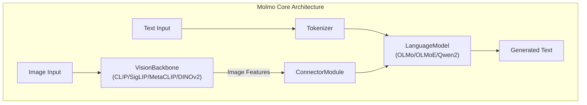
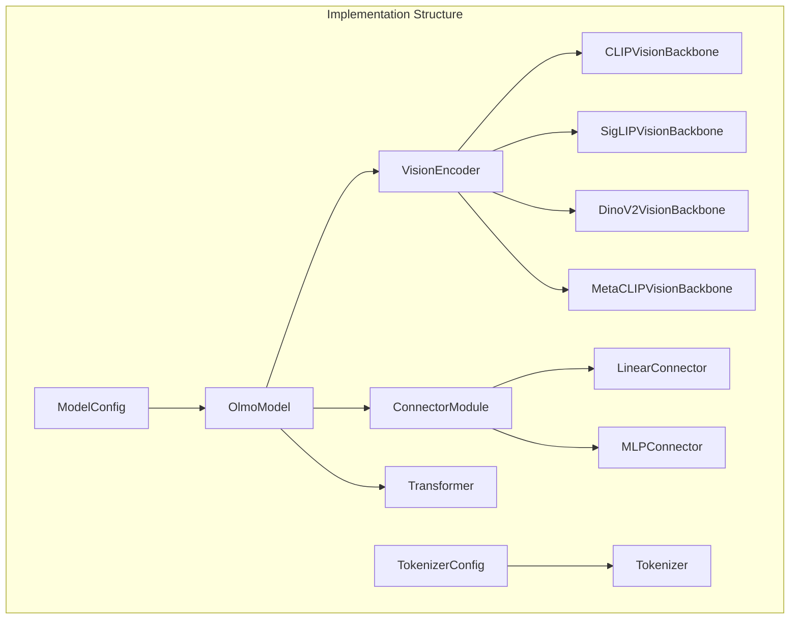
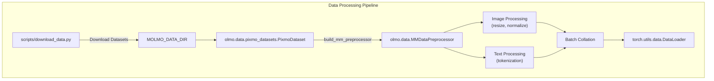
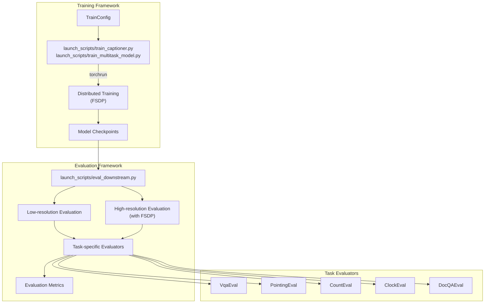
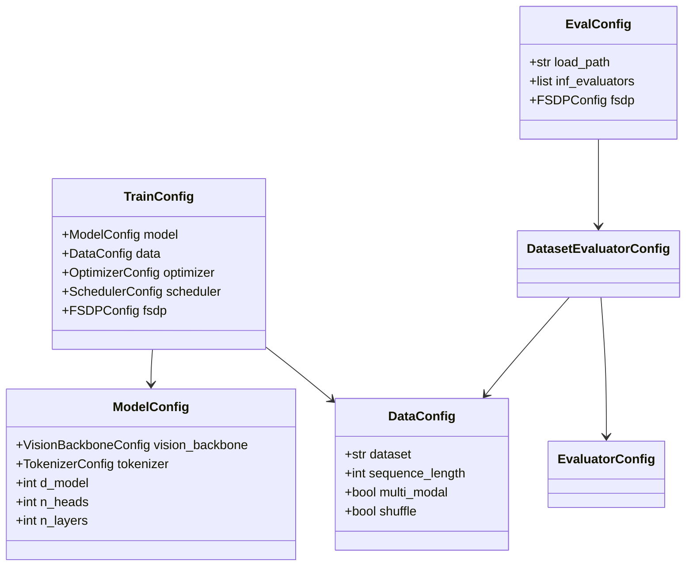

<!-- source: DeepWiki mcp.deepwiki.com · repo allenai/molmo · page 1 Overview · fetched 2026-10-26 -->

# Overview

Relevant source files

The following files were used as context for generating this wiki page:

- [README.md](README.md)

This document provides a technical introduction to Molmo (Multimodal Open Language Model), a framework for training and using state-of-the-art vision-language models developed by Allen AI. Molmo extends language models with visual understanding capabilities, enabling tasks such as image captioning, visual question answering, object localization, and document analysis.

For details about specific components, refer to [Key Components](#1.1), information about the dataset ecosystem in [Datasets](#2), and training procedures in [Training](#3).

## Core System Architecture

Molmo implements a multimodal architecture that processes both images and text to generate language-based outputs. The high-level architecture consists of three primary components:

Sources: [README.md:25-30]()

### Code Structure and Main Components

The architecture is implemented through several key components in the codebase:

1. **Vision Encoder**: Extracts features from images using pretrained vision models
2. **Connector Module**: Maps vision features to the language model's dimension space
3. **Language Model**: Processes both text tokens and visual features to generate responses

Sources: [README.md:29-30](), [README.md:92-112]()

## Molmo Model Family

The Molmo family includes several models with different parameter sizes and capabilities:

| Model | Parameters | Vision Encoder | Language Model | 11-benchmark avg |
|-------|------------|----------------|----------------|------------------|
| MolmoE-1B | 1B active (7B total) | OpenAI CLIP ViT-L/14@336 | OLMoE-1B-7B | 68.6% |
| Molmo-7B-O | 7B | OpenAI CLIP ViT-L/14@336 | OLMo-7B-1024 | 74.6% |
| Molmo-7B-D | 7B | OpenAI CLIP ViT-L/14@336 | Qwen2-7B | 77.3% |
| Molmo-72B | 72B | OpenAI CLIP ViT-L/14@336 | Qwen2-72B | 81.2% |

Sources: [README.md:84-112]()

## Data Processing Pipeline

Molmo utilizes the PixMo dataset collection for training and evaluation. The data processing pipeline involves downloading, processing, and loading dataset samples:

Sources: [README.md:116-152]()

### PixMo Dataset Collection

The PixMo dataset collection includes specialized datasets for different multimodal tasks:

| Dataset | Purpose | Content |
|---------|---------|---------|
| PixMo-Cap | Pre-training, Fine-tuning | Dense image captions (~200 words on average) |
| PixMo-AskModelAnything | Fine-tuning | Human-authored image-question-answer triplets |
| PixMo-CapQA | Fine-tuning | Synthetic QA pairs derived from captions |
| PixMo-Points | Fine-tuning | Images with referring expressions and annotated points |
| PixMo-Point-Explanations | Fine-tuning | Explanations with in-line points |
| PixMo-Docs | Fine-tuning | QA pairs about charts, tables, diagrams |
| PixMo-Clocks | Fine-tuning | Watch faces with time annotations |
| PixMo-Count | Fine-tuning | Images with counting QA pairs |

Sources: [README.md:36-47]()

## Training and Evaluation Framework

Molmo provides a comprehensive framework for model training and evaluation:

Sources: [README.md:202-237]()

### Training Pipeline

The training process typically involves two main phases:

1. **Pre-training (Captioner Training)**: Training on PixMo-Cap for vision-language alignment using `launch_scripts/train_captioner.py`
2. **Multitask Fine-tuning**: Training on multiple specialized tasks using `launch_scripts/train_multitask_model.py`

The training pipeline supports distributed training with Fully Sharded Data Parallel (FSDP) for efficient scaling across multiple GPUs.

Sources: [README.md:256-295]()

### Evaluation Pipeline

Evaluation is performed using `launch_scripts/eval_downstream.py`, which supports:

1. **Low-resolution evaluation**: Standard evaluation with lower image resolution
2. **High-resolution evaluation**: Evaluation with higher image resolution using FSDP for memory efficiency

Metrics and predictions are cached in the model's checkpoint directory for future reference.

Sources: [README.md:202-241]()

## Configuration System

Molmo uses a configuration-driven architecture where model, training, and evaluation parameters are specified through hierarchical configuration objects:

Sources: [README.md:256-295]()

This configuration system enables flexible experimentation with different model architectures, training regimes, and evaluation settings without changing code.

## Capabilities and Applications

Molmo models are designed to handle a variety of multimodal tasks, including:

1. **Image Captioning**: Generating detailed descriptions of images
2. **Visual Question Answering**: Answering questions about image content
3. **Object Localization**: Identifying and pointing to specific objects in images
4. **Document Understanding**: Analyzing and answering questions about charts, tables, and documents
5. **Visual Counting**: Counting objects or elements in images
6. **Time Reading**: Interpreting analog clocks and time displays

These capabilities are enabled through the combination of a powerful vision encoder, a connector module that bridges vision and language, and a large language model that generates contextually appropriate responses.

Sources: [README.md:36-47](), [README.md:56-62]()

---

