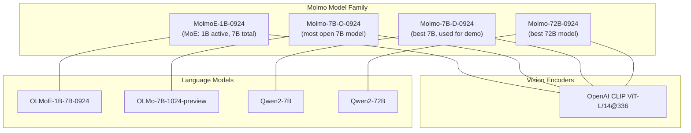
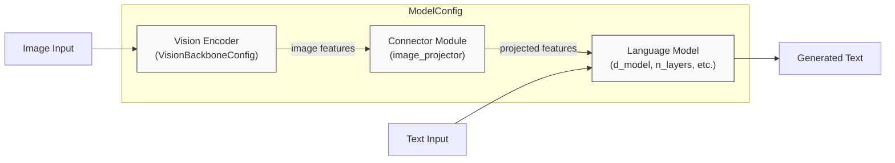
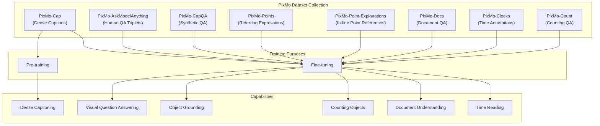
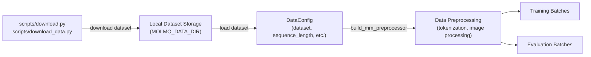
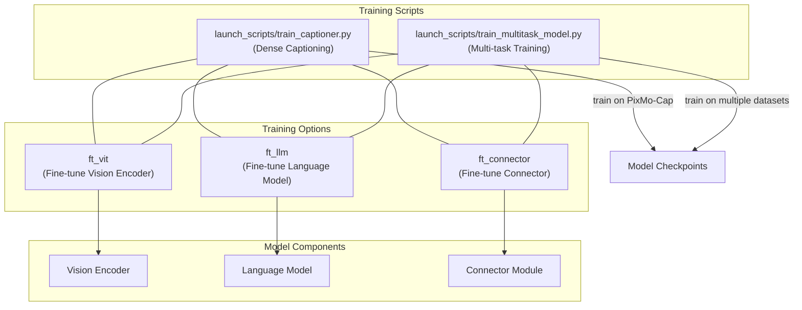
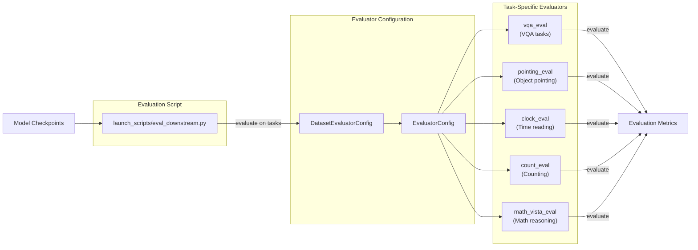

<!-- source: DeepWiki mcp.deepwiki.com · repo allenai/molmo · page 1.1 Key Components · fetched 2026-10-26 -->

# Key Components

Relevant source files

The following files were used as context for generating this wiki page:

- [README.md](README.md)
- [launch_scripts/utils.py](launch_scripts/utils.py)

This page provides an overview of the core components that make up the Molmo (Multimodal Open Language Model) system. It explains the main models, vision encoders, language models, datasets, and how they connect within the overall architecture. For more details on the system architecture, see [System Architecture](#1.2).

## Models Overview

Molmo consists of a family of multimodal models that integrate vision and language capabilities:

Sources:
- [README.md:56-61]()
- [launch_scripts/utils.py:394-403]()

### Model Architecture Components

Each Molmo model consists of three primary components that work together to process multimodal inputs:

Sources:
- [launch_scripts/utils.py:13-30]()
- [launch_scripts/utils.py:146-164]()

### Vision Encoders

Molmo supports multiple vision encoders that can be configured via `VisionBackboneConfig`:

| Vision Encoder | Default Resolution | Embedding Dimension | Layers | Configuration |
|----------------|-------------------|---------------------|--------|---------------|
| OpenAI CLIP    | 336 × 336        | 1024                | 23     | `DEFAULT_VISION_BACKBONE` |
| SigLIP         | 378 × 378        | 1152                | 27     | `SIGLIP_VISION_BACKBONE` |
| MetaCLIP       | 336 × 336        | 1024                | 24     | `METACLIP_L14_336_VISION_BACKBONE` |
| DINOv2         | 336 × 336        | 1024                | 24     | `DINOV2_LARGE_336_VISION_BACKBONE` |

Sources:
- [launch_scripts/utils.py:146-230]()
- [launch_scripts/utils.py:406-411]()

### Language Models

The language model components used in Molmo models:

| Model Name | Parameters | Hidden Size | Heads | Layers | Configuration |
|------------|------------|-------------|-------|--------|---------------|
| OLMoE      | 1B active (7B total) | 2048 | 16 | 16 | `OLMOE` |
| OLMo       | 7B | 4096 | 32 | 32 | `OLMO_1024_PREVIEW` |
| Qwen2-7B   | 7B | 3584 | 28 | 28 | `QWEN2_7B` |
| Qwen2-72B  | 72B | 8192 | 64 | 80 | `QWEN2_72B` |

Sources:
- [launch_scripts/utils.py:233-391]()
- [launch_scripts/utils.py:414-419]()
- [README.md:82-111]()

## Dataset Ecosystem

Molmo is trained on the PixMo collection of multimodal datasets, each serving different purposes:

Sources:
- [README.md:36-47]()
- [README.md:117-143]()

### Dataset Loading and Usage

Datasets are downloaded and processed using dedicated scripts, with configuration handled by `DataConfig`:

Sources:
- [README.md:116-143]()
- [launch_scripts/utils.py:130-143]()

## Training Pipeline

Molmo supports multiple training strategies through dedicated scripts:

Sources:
- [README.md:256-294]()

## Evaluation Framework

The evaluation framework provides task-specific evaluators for assessing model performance:

Sources:
- [README.md:202-237]()
- [launch_scripts/utils.py:33-74]()
- [launch_scripts/utils.py:77-143]()

The evaluation framework supports various tasks and metrics, with different configurations for each task type. Evaluators are selected based on the task name, and appropriate metrics are calculated for each task type (e.g., VQA score for visual question answering, pointing evaluation for object grounding tasks).

---

