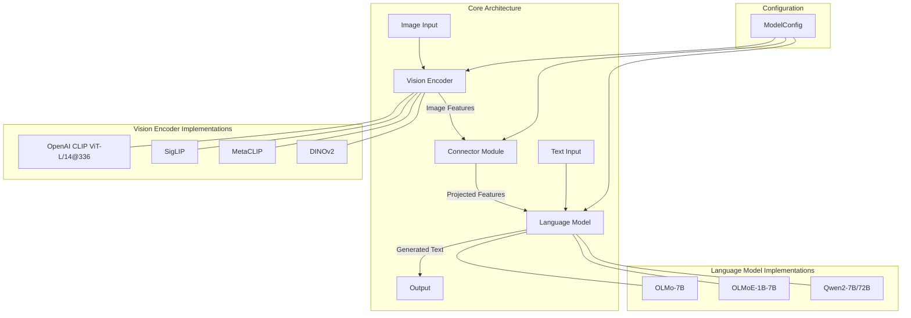
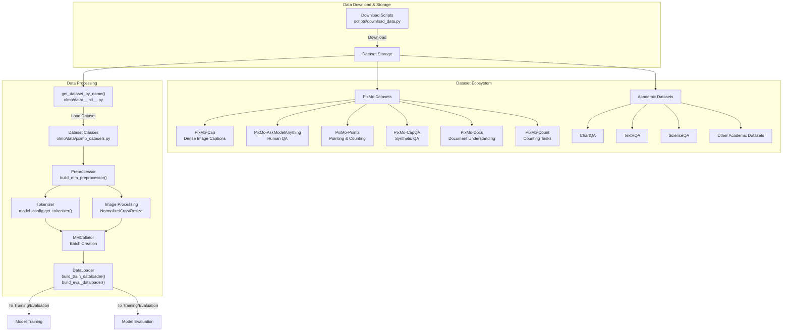
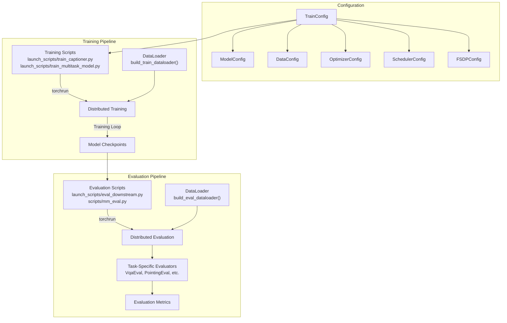
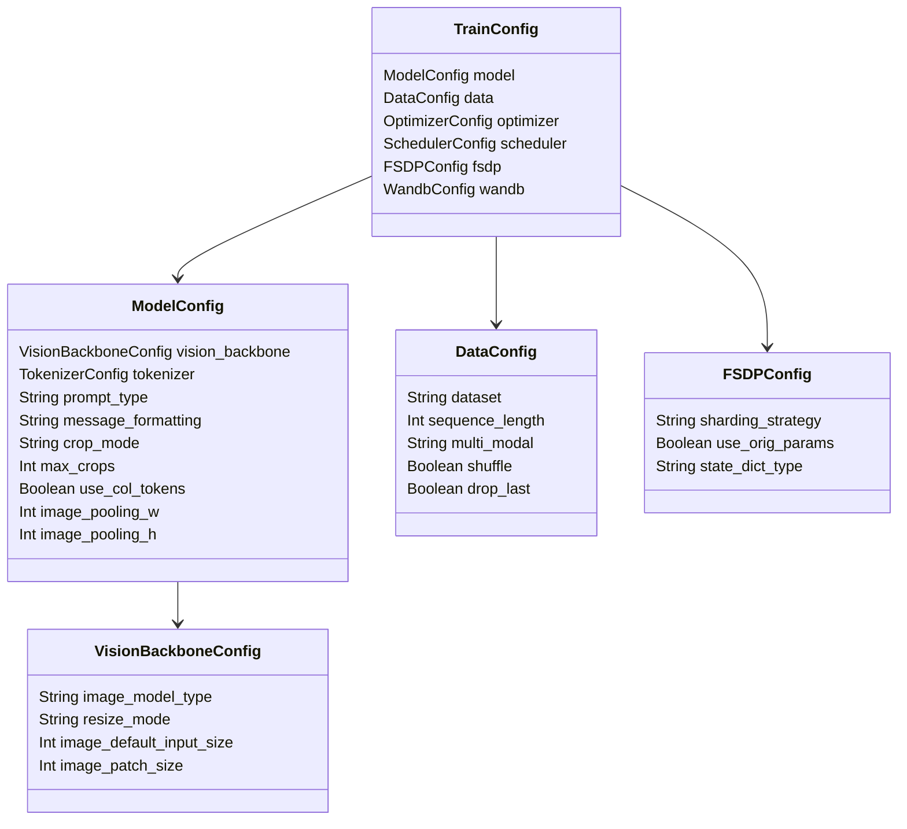
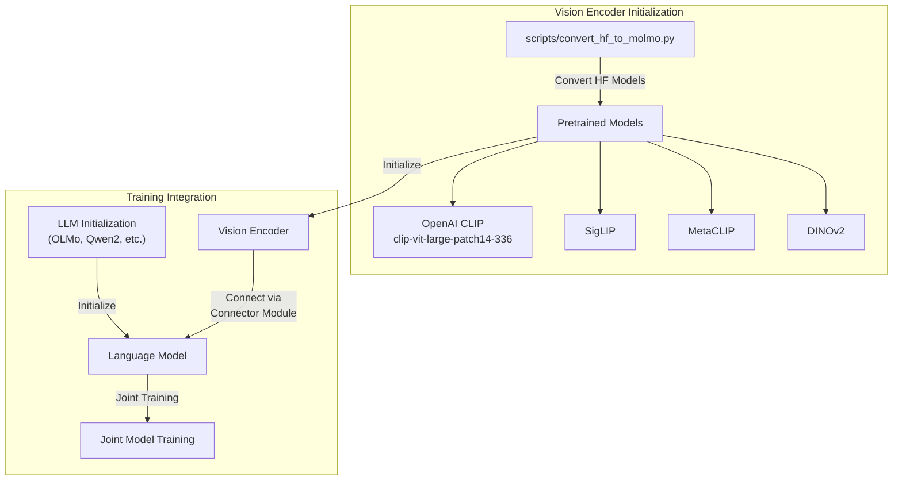
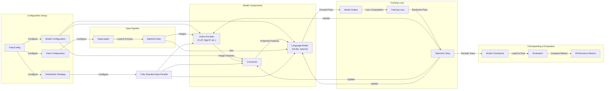

<!-- source: DeepWiki mcp.deepwiki.com · repo allenai/molmo · page 1.2 System Architecture · fetched 2026-10-26 -->

# System Architecture

<details>
<summary>Relevant source files</summary>

The following files were used as context for generating this wiki page:

- [README.md](README.md)
- [olmo/data/__init__.py](olmo/data/__init__.py)

</details>


This document explains the overall technical architecture of the Molmo (Multimodal Open Language Model) system, focusing on how the vision and language components interact, how data flows through the system, and how training and evaluation pipelines are structured. For information about specific model variants and their capabilities, see [Key Components](#1.1). For details on datasets used in training and evaluation, see [Datasets](#2).

## Core Multimodal Architecture

Molmo's fundamental architecture consists of three primary components that work together to process multimodal inputs and generate appropriate textual outputs.



Sources:
- [README.md:56-61]()
- [README.md:92-111]()

### Vision Encoder

The Vision Encoder transforms image inputs into feature representations that can be processed by the language model. Molmo supports multiple vision encoder architectures:

- **OpenAI CLIP ViT-L/14@336**: Default vision encoder used in all released Molmo models
- **SigLIP**: Alternative vision encoder
- **MetaCLIP**: Alternative vision encoder
- **DINOv2**: Alternative vision encoder

The vision encoder is configured through `vision_backbone` parameters in the model configuration.

Sources:
- [README.md:92-111]()
- [README.md:246-251]()

### Connector Module

The Connector Module serves as a bridge between the vision and language components, projecting image features into a representation that the language model can use. This enables the seamless integration of visual information with text processing.

Sources:
- [README.md:92-111]()

### Language Model

The Language Model component processes text inputs and image features (via the connector) to generate coherent text outputs. Molmo supports various language model backends:

- **OLMo-7B**: Used in Molmo-7B-O
- **OLMoE-1B-7B**: Used in MolmoE-1B (a mixture of experts model)
- **Qwen2-7B**: Used in Molmo-7B-D
- **Qwen2-72B**: Used in Molmo-72B

Sources:
- [README.md:92-111]()

## Data Flow Architecture

The data flow architecture describes how data moves through the system from download to training and evaluation.



Sources:
- [olmo/data/__init__.py:14-18]()
- [olmo/data/__init__.py:23-69]()
- [olmo/data/__init__.py:72-141]()
- [olmo/data/__init__.py:144-211]()
- [olmo/data/__init__.py:214-318]()
- [README.md:116-137]()

### Dataset Downloading and Storage

The data downloading process begins with the `download.py` script, which fetches datasets from various sources and stores them in the location specified by environment variables:

- `MOLMO_DATA_DIR`: Base directory for Molmo-specific data
- `HF_HOME`: Hugging Face cache directory

The system downloads both PixMo datasets (which may require downloading images from URLs) and academic datasets (some of which require manual downloading).

Sources:
- [README.md:116-148]()

### Dataset Preprocessing

Once datasets are downloaded, they are processed through several components:

1. **Dataset Selection**: The `get_dataset_by_name()` function in [olmo/data/__init__.py:214-318]() maps dataset names to their implementations.

2. **Preprocessor Creation**: The `build_mm_preprocessor()` function creates a preprocessing pipeline that handles:
   - Data formatting (system prompts, message formatting)
   - Tokenization
   - Image processing (normalization, cropping, resizing)

3. **Data Loading**: The `build_train_dataloader()` and `build_eval_dataloader()` functions construct data loaders for training and evaluation, respectively.

4. **Collation**: The `MMCollator` class combines examples into batches suitable for model training or evaluation.

Sources:
- [olmo/data/__init__.py:23-69]()
- [olmo/data/__init__.py:72-141]()
- [olmo/data/__init__.py:144-211]()

## Training and Evaluation Architecture

The training and evaluation architecture describes how models are trained and evaluated within the Molmo system.



Sources:
- [README.md:202-236]()
- [README.md:256-294]()
- [olmo/data/__init__.py:144-211]()

### Training Pipeline

The training pipeline starts with configuration setup and then launches distributed training:

1. **Configuration**: A `TrainConfig` object contains nested configurations for model architecture, data loading, optimization, and distributed training.

2. **Training Scripts**: High-level scripts like `train_captioner.py` and `train_multitask_model.py` generate the appropriate configurations and launch training.

3. **Distributed Training**: Training is executed using PyTorch's `torchrun` with Fully Sharded Data Parallel (FSDP) for efficient multi-GPU and multi-node training.

4. **Checkpointing**: Model checkpoints are saved periodically during training for later resumption or evaluation.

Molmo provides two main training workflows:

- **Captioner Training**: Focused on image captioning tasks, typically used for pre-training
- **Multitask Training**: Combines multiple tasks for comprehensive fine-tuning

Sources:
- [README.md:256-294]()

### Evaluation Pipeline

The evaluation pipeline loads trained models and evaluates them on various downstream tasks:

1. **Evaluation Scripts**: Scripts like `eval_downstream.py` and `mm_eval.py` handle the evaluation process.

2. **Task-Specific Evaluators**: Different evaluators are used for different tasks (VQA, pointing, counting, etc.).

3. **Distributed Evaluation**: Like training, evaluation can be distributed across multiple GPUs and nodes.

4. **Metrics Collection**: Results are collected and saved for analysis.

Sources:
- [README.md:202-236]()

## Model Configuration System

Molmo uses a hierarchical configuration system to control all aspects of model architecture, training, and evaluation.



Sources:
- [olmo/data/__init__.py:6]()
- [olmo/data/__init__.py:31-62]()

The configuration system allows for flexible customization of:

- **Model Architecture**: Vision encoder, connector, language model
- **Training Parameters**: Batch size, learning rate, optimization strategy
- **Data Processing**: Dataset selection, preprocessing, data loading
- **Distributed Execution**: FSDP configuration, multi-node setup
- **Evaluation**: Task selection, metrics, evaluation strategies

## Integration with Vision Backbone Models

Molmo supports multiple vision backbone models that can be initialized from pre-trained checkpoints.



Sources:
- [README.md:242-255]()
- [README.md:92-111]()

The vision encoder models can be downloaded and converted to a Molmo-compatible format using the `convert_hf_to_molmo.py` script:

```
python3 scripts/convert_hf_to_molmo.py openai  # For OpenAI CLIP
python3 scripts/convert_hf_to_molmo.py qwen2_7b  # For Qwen2 LLM
```

These converted models serve as initialization points for the training process, allowing the system to build upon pre-trained representations.

Sources:
- [README.md:242-255]()

## Training Flow and Configuration

This diagram illustrates the complete training flow from configuration to model output:



Sources:
- [README.md:256-294]()
- [olmo/data/__init__.py:144-211]()

The training process follows these steps:

1. **Configuration Setup**: Create configurations for model, data, and distribution strategy
2. **Model Initialization**: Initialize vision encoder, connector, and language model
3. **Data Loading**: Configure and create data loaders for training data
4. **Training Loop**: Execute forward and backward passes, update model parameters
5. **Checkpointing**: Periodically save model checkpoints
6. **Evaluation**: Evaluate model on downstream tasks to measure performance

Training can be executed using different strategies:

- **Pre-training with Captioning**: `launch_scripts/train_captioner.py`
- **Multi-task Fine-tuning**: `launch_scripts/train_multitask_model.py`

Sources:
- [README.md:256-294]()

---

