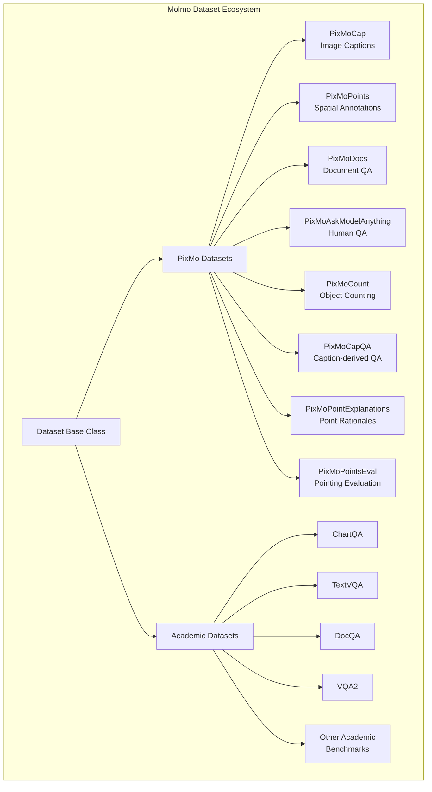
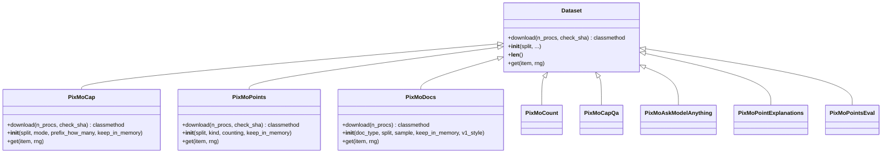
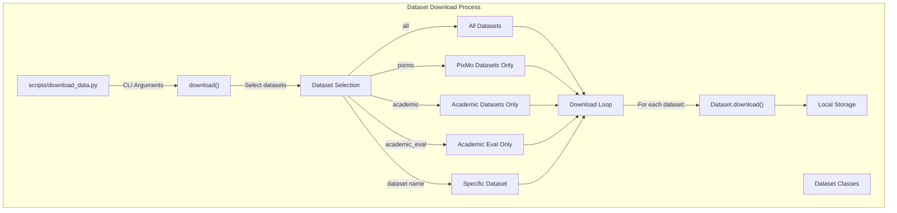

<!-- source: DeepWiki mcp.deepwiki.com · repo allenai/molmo · page 2 Datasets · fetched 2026-10-26 -->

# Datasets

<details>
<summary>Relevant source files</summary>

The following files were used as context for generating this wiki page:

- [olmo/data/pixmo_datasets.py](olmo/data/pixmo_datasets.py)
- [scripts/download_data.py](scripts/download_data.py)

</details>


This document provides a comprehensive overview of the dataset ecosystem used in the Molmo multimodal language model framework. It covers both the proprietary PixMo dataset collection and academic datasets used for training and evaluation. For information about how datasets are processed during training, see [Data Preprocessing and Loading](#2.3).

## Dataset Ecosystem Overview

The Molmo system relies on two primary categories of datasets:

1. **PixMo Datasets**: A collection of multimodal datasets developed specifically for training Molmo models
2. **Academic Datasets**: External benchmark datasets used primarily for evaluation



Sources: [olmo/data/pixmo_datasets.py:1-461](), [scripts/download_data.py:1-80]()

## Dataset Implementation

All datasets in the Molmo system follow a common interface pattern, inheriting from the `Dataset` base class. Each dataset class implements:

1. A `download()` class method for fetching and preparing the dataset
2. An `__init__()` method to load a specific split of the dataset
3. A `get()` method to format individual examples for model consumption



Sources: [olmo/data/pixmo_datasets.py:9-11](), [olmo/data/pixmo_datasets.py:73-459]()

## PixMo Dataset Collection

The PixMo dataset collection is a set of purpose-built multimodal datasets designed specifically for training and evaluating the Molmo system across various capabilities.

### PixMoCap

A dataset of image captions focused on training basic captioning capabilities.

- **Structure**: Contains image-caption pairs with additional image transcripts
- **Usage Modes**: Supports different training modes (`captions`, `transcripts`, `transcript_and_caption`, `transcript1_and_caption`)
- **Implementation**: [olmo/data/pixmo_datasets.py:322-373]()

### PixMoPoints

A dataset for training spatial localization abilities, containing point annotations for objects in images.

- **Structure**: Images with point coordinates and associated labels
- **Variations**: Two collection methods - `pointing` (basic) and `counting` (high-frequency)
- **Implementation**: [olmo/data/pixmo_datasets.py:156-218]()

### PixMoDocs

A document understanding dataset containing various document types with associated questions and answers.

- **Document Types**: `charts`, `diagrams`, `tables`, and `other`
- **Implementation**: [olmo/data/pixmo_datasets.py:113-152]()

### PixMoCount

A specialized dataset for training counting abilities.

- **Structure**: Images with count annotations and spatial locations of objects
- **Implementation**: [olmo/data/pixmo_datasets.py:73-111]()

### PixMoCapQa

Question-answer pairs derived from image captions.

- **Structure**: Images with synthetic QA pairs based on captions
- **Implementation**: [olmo/data/pixmo_datasets.py:278-320]()

### PixMoAskModelAnything

A dataset of human-generated questions and answers about images.

- **Structure**: Images with human-authored QA pairs
- **Implementation**: [olmo/data/pixmo_datasets.py:376-421]()

### PixMoPointExplanations

A dataset with explanations for point annotations in images.

- **Structure**: Images with points, inline text, and alt text explanations
- **Implementation**: [olmo/data/pixmo_datasets.py:221-275]()

### PixMoPointsEval

An evaluation dataset specifically for testing pointing capabilities.

- **Structure**: Images with point annotations and masks for evaluation
- **Implementation**: [olmo/data/pixmo_datasets.py:424-459]()

Sources: [olmo/data/pixmo_datasets.py:73-459]()

## Academic Datasets

Besides the PixMo collection, Molmo also uses a wide range of academic benchmark datasets primarily for evaluation purposes:

| Dataset | Purpose | Type |
|---------|---------|------|
| ChartQA | Chart understanding | Evaluation |
| TextVQA | Text in images | Evaluation |
| DocQA | Document understanding | Evaluation |
| ScienceQAImageOnly | Scientific reasoning | Training/Evaluation |
| OkVqa | Common sense reasoning | Training/Evaluation |
| InfoQa | Information extraction | Evaluation |
| Vqa2 | General visual question answering | Evaluation |
| MathVista | Mathematical reasoning | Evaluation |
| CountBenchQa | Counting ability | Evaluation |
| ClockBench | Time reading | Evaluation |

Sources: [scripts/download_data.py:5-24]()

## Dataset Downloading Process

Datasets are downloaded using the `scripts/download_data.py` script, which provides a command-line interface for fetching either individual datasets, all PixMo datasets, all academic datasets, or everything at once.



The download process works as follows:

1. The script takes a dataset identifier as input (specific dataset name or category like "all", "pixmo", "academic")
2. For each selected dataset, it calls the dataset class's `download()` method
3. The dataset's `download()` method:
   - Fetches the dataset from the original source
   - Downloads associated images 
   - Processes and prepares the data for local storage
   - Saves the dataset using the HuggingFace datasets library

Example usage:
```bash
python scripts/download_data.py pixmo --n_procs 8
```

Sources: [scripts/download_data.py:39-75]()

## Dataset Structure and Storage

All datasets are downloaded to a central location defined by the `DATA_HOME` environment variable. PixMo datasets specifically are stored in the `pixmo_datasets` subdirectory:

```
DATA_HOME/
└── pixmo_datasets/
    ├── cap/                   # PixMoCap
    ├── cap-qa/                # PixMoCapQa
    ├── count/                 # PixMoCount
    ├── ask-model-anything/    # PixMoAskModelAnything
    ├── point-explanations/    # PixMoPointExplanations
    ├── points-counting/       # PixMoPoints (counting variant)
    ├── points-pointing/       # PixMoPoints (pointing variant)
    └── pixmo-points-eval/     # PixMoPointsEval
```

Individual dataset files are stored using the HuggingFace datasets library's disk format, which includes:
- Dataset metadata
- Arrow format data files 
- Image files (stored as paths to local files)

Sources: [olmo/data/pixmo_datasets.py:9-15]()

## Common Dataset Interface

All dataset classes in the Molmo system implement a common interface, with the key method being `get()`, which returns a standardized dictionary structure used by the training pipeline:

```python
{
    "image": "/path/to/image.jpg",  # Path to image file
    "message_list": [               # List of messages for multi-turn datasets
        {
            "question": "...",      # User question (for QA datasets)
            "answer": "...",        # Model answer (for QA datasets)
            "text": "...",          # Text content (for caption datasets)
            "points": [[x1, y1], [x2, y2], ...],  # Point coordinates (for pointing)
            "style": "..."          # Dataset-specific style identifier
        }
    ],
    "metadata": {                   # Additional dataset-specific metadata
        "image_url": "...",
        "..."
    }
}
```

This standardized format allows the system to handle diverse dataset types through a unified interface, making it easier to combine multiple datasets during training.

Sources: [olmo/data/pixmo_datasets.py:96-110](), [olmo/data/pixmo_datasets.py:142-151](), [olmo/data/pixmo_datasets.py:202-218]()

---

