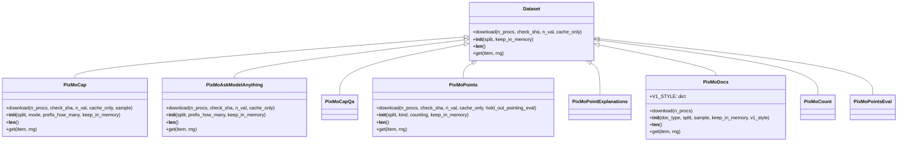
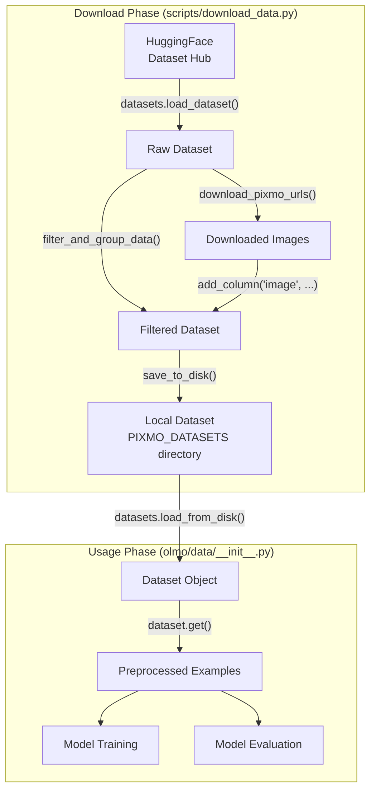

<!-- source: DeepWiki mcp.deepwiki.com · repo allenai/molmo · page 2.1 PixMo Dataset Collection · fetched 2026-10-26 -->

# PixMo Dataset Collection

<details>
<summary>Relevant source files</summary>

The following files were used as context for generating this wiki page:

- [README.md](README.md)
- [olmo/data/pixmo_datasets.py](olmo/data/pixmo_datasets.py)

</details>


## Purpose and Scope

This document provides a comprehensive overview of the PixMo dataset collection - a suite of multimodal datasets specifically designed for pre-training and fine-tuning vision-language models in the Molmo framework. We cover the structure, content, and technical implementation details of each dataset in the collection.

For information about downloading these datasets, see [Dataset Downloading](#2.2). For information about how data is processed and loaded during training and evaluation, see [Data Preprocessing and Loading](#2.3).

## PixMo Dataset Overview

PixMo is a collection of carefully curated multimodal datasets designed to train Molmo models on various vision-language tasks. A key distinction of the PixMo datasets is that they were constructed **without the use of VLMs** to avoid contamination and self-reinforcement issues.

```mermaid
graph TD
    subgraph "PixMo Dataset Collection"
        PixMoCap["PixMo-Cap<br>Dense captions for<br>pre-training & fine-tuning"]
        PixMoAMA["PixMo-AskModelAnything<br>Human-authored QA triplets"]
        PixMoCapQA["PixMo-CapQA<br>Synthetic QA from captions"]
        PixMoPoints["PixMo-Points<br>Referring expressions with points"]
        PixMoPE["PixMo-Point-Explanations<br>Explanations with inline points"]
        PixMoDocs["PixMo-Docs<br>Charts, tables, diagrams QA"]
        PixMoClocks["PixMo-Clocks<br>Watch faces & time annotations"]
        PixMoCount["PixMo-Count<br>Counting QA pairs"]
    end
    
    subgraph "Training Phases"
        Pretraining["Pre-training"]
        FineTuning["Fine-tuning"]
    end
    
    subgraph "Model Capabilities"
        DenseCaption["Dense image description"]
        QA["Visual question answering"]
        Pointing["Visual pointing & grounding"]
        Counting["Object counting"]
        DocQA["Document understanding"]
        TimeReading["Time reading"]
        InlinePointing["Inline pointing in text"]
    end
    
    PixMoCap --> Pretraining
    PixMoCap --> FineTuning
    PixMoAMA --> FineTuning
    PixMoCapQA --> FineTuning
    PixMoPoints --> FineTuning
    PixMoPE --> FineTuning
    PixMoDocs --> FineTuning
    PixMoClocks --> FineTuning
    PixMoCount --> FineTuning
    
    PixMoCap --> DenseCaption
    PixMoAMA --> QA
    PixMoCapQA --> QA
    PixMoPoints --> Pointing
    PixMoPoints --> Counting
    PixMoPE --> InlinePointing
    PixMoDocs --> DocQA
    PixMoClocks --> TimeReading
    PixMoCount --> Counting
```



Sources: [README.md:35-47](), [olmo/data/pixmo_datasets.py:1-460]()

## Dataset Implementation Architecture

All PixMo datasets share a common implementation structure in the codebase. Each dataset is implemented as a Python class that inherits from a base `Dataset` class, providing standardized methods for downloading, initializing, and retrieving data.



Sources: [olmo/data/pixmo_datasets.py:1-460]()

## Data Flow Pipeline

All PixMo datasets follow a consistent flow from download to usage in training or evaluation:



Sources: [olmo/data/pixmo_datasets.py:59-70](), [olmo/data/pixmo_datasets.py:73-86]()

## Detailed Dataset Descriptions

### PixMo-Cap

PixMo-Cap is a dense captioning dataset containing highly detailed image descriptions (approximately 200 words on average). It serves as the primary dataset for both pre-training and fine-tuning.

**Key Features:**
- Dense captions with an average of ~200 words per image
- Multiple transcripts per image describing different aspects
- Support for different usage modes: captions-only, transcripts-only, or combined

**Usage Modes:**
- `captions`: Only uses the main caption
- `transcripts`: Uses all available transcripts
- `transcript_and_caption`: Uses caption and a random transcript
- `transcript1_and_caption`: Uses caption and the first transcript

**Example Structure:**
```
{
    'image': '/path/to/local/image.jpg',
    'message_list': [
        {'text': 'Detailed caption text...', 'style': 'long_caption'},
        {'text': 'Transcript content...', 'style': 'transcript'}
    ],
    'metadata': {
        'image_url': 'https://original/image/url.jpg'
    }
}
```

Sources: [olmo/data/pixmo_datasets.py:322-373]()

### PixMo-AskModelAnything

PixMo-AskModelAnything contains human-authored image-question-answer triplets for instruction-tuning.

**Key Features:**
- Human-written questions and answers about images
- Special handling for "how many" questions with no-pointing prefixes
- `user_qa` style for direct question-answering

**Example Structure:**
```
{
    'image': '/path/to/local/image.jpg',
    'message_list': [
        {
            'question': 'What is shown in this image?',
            'answer': 'The image shows...',
            'style': 'user_qa'
        }
    ],
    'metadata': {
        'image_url': 'https://original/image/url.jpg'
    }
}
```

Sources: [olmo/data/pixmo_datasets.py:376-421]()

### PixMo-CapQA

PixMo-CapQA contains synthetic instruction-tuning data, using an LLM to build QA pairs from dense captions of images.

**Key Features:**
- Synthetic QA pairs derived from image captions
- Special handling for counting questions with no-pointing prefixes
- Conversation-style format with multiple turns

**Example Structure:**
```
{
    'image': '/path/to/local/image.jpg',
    'message_list': [
        {
            'messages': ['Question 1', 'Answer 1', 'Question 2', 'Answer 2'],
            'style': 'synthetic_qa'
        }
    ],
    'metadata': {
        'image_url': 'https://original/image/url.jpg'
    }
}
```

Sources: [olmo/data/pixmo_datasets.py:278-320]()

### PixMo-Points

PixMo-Points contains images paired with referring expressions and annotated points for training models on visual grounding tasks.

**Key Features:**
- Two collection methods: "pointing" and "counting"
- Points stored as (x, y) coordinates normalized to 100×100 scale
- Support for different kinds: "high_frequency", "basic", or "both"

**Example Structure:**
```
{
    'image': '/path/to/local/image.jpg',
    'message_list': [
        {
            'label': 'Point to the dog',
            'points': [[20, 30]],  # (x, y) coordinates
            'point_scale': 100,
            'style': 'pointing'
        }
    ],
    'metadata': {
        'image_url': 'https://original/image/url.jpg'
    }
}
```

Sources: [olmo/data/pixmo_datasets.py:155-218]()

### PixMo-Point-Explanations

This dataset contains instruction-tuning data with explanations that include inline points referring to specific parts of an image.

**Key Features:**
- Complex annotations with inline text and alternative text
- Points associated with specific text spans
- Option to split groups for better batch efficiency

**Example Structure:**
```
{
    'image': '/path/to/local/image.jpg',
    'message_list': [
        {
            'question': 'Describe this image with points',
            'answer': 'The image shows a dog [POINT] and a cat [POINT]',
            'answer_annotations': [
                {
                    'points': [[20, 30]],
                    'inline_text': '[POINT]',
                    'alt_text': 'dog'
                },
                {
                    'points': [[60, 40]],
                    'inline_text': '[POINT]',
                    'alt_text': 'cat'
                }
            ],
            'style': 'point_qa'
        }
    ],
    'metadata': {
        'image_url': 'https://original/image/url.jpg'
    }
}
```

Sources: [olmo/data/pixmo_datasets.py:221-275]()

### PixMo-Docs

PixMo-Docs contains synthetic image-question-answer triplets about various kinds of computer-generated visual documents.

**Key Features:**
- Four document types: "other", "charts", "diagrams", "tables"
- Different styling options with backward compatibility
- Multiple questions and answers per document

**Example Structure:**
```
{
    'image': '/path/to/local/image.jpg',
    'message_list': [
        {
            'question': 'What is the title of this chart?',
            'answer': 'Sales Growth 2020-2023',
            'style': 'pixmo_docs_charts'
        }
    ],
    'metadata': {
        'image_id': '12345'
    }
}
```

Sources: [olmo/data/pixmo_datasets.py:113-152]()

### PixMo-Count

PixMo-Count contains diverse images with counting QA pairs to train models on object counting tasks.

**Key Features:**
- Explicit count annotations
- Points coordinates for training (in train split)
- Different styles: "point_count" or "pointing"

**Example Structure:**
```
{
    'style': 'point_count',
    'image': '/path/to/local/image.jpg',
    'label': 'Count the number of dogs',
    'metadata': {
        'image_url': 'https://original/image/url.jpg',
        'count': 3
    },
    'points': [[20, 30], [40, 50], [60, 70]]  # (x, y) coordinates
}
```

Sources: [olmo/data/pixmo_datasets.py:73-110]()

## Common Implementation Patterns

All PixMo datasets share several common implementation patterns that make the codebase consistent:

### 1. Download Method

Each dataset class has a static `download` method that:
- Fetches the dataset from Hugging Face using `datasets.load_dataset()`
- Downloads images from URLs using `download_pixmo_urls()`
- Filters examples based on successfully downloaded images
- Creates train/validation splits
- Saves the processed dataset to local disk using `save_local_dataset()`

### 2. Initialization

Each dataset's `__init__` method:
- Loads the dataset from local disk using `datasets.load_from_disk()`
- Configures parameters like `split`, `mode`, etc.
- Sets up internal state for data retrieval

### 3. Data Retrieval

The `get` method in each dataset class:
- Retrieves a specific example by index
- Formats it according to the dataset's specific structure
- Returns a dictionary with standard keys: `image`, `message_list`, `metadata`
- May include task-specific fields like `points`, `label`, etc.

## Storage Configuration

PixMo datasets are stored in a directory structure defined by environment variables:

- `MOLMO_DATA_DIR`: Base directory for all Molmo data
- `HF_HOME`: Directory for Hugging Face cache
- `DATA_HOME`: Derived from `MOLMO_DATA_DIR`, base for dataset storage
- `PIXMO_DATASETS`: Specific directory for PixMo datasets (usually `DATA_HOME/pixmo_datasets`)

## Specialized Processing Features

### No-Point Prefixes

For counting questions, a special prefix is added to prevent the model from generating points:

```python
NO_POINT_PREFIX = [
    "No pointing: ",
    "No pointing:\n",
    "Refrain from pointing. ",
    # ... many more variations
]
```

These prefixes are randomly selected and prepended to counting questions to train the model to respond with text-only answers when appropriate.

Sources: [olmo/data/pixmo_datasets.py:22-55]()

### Evaluation Datasets

Special evaluation versions of datasets (like `PixMoPointsEval`) are provided for standardized testing, with fixed examples and ground truth annotations for consistent evaluation.

Sources: [olmo/data/pixmo_datasets.py:424-459]()

## Conclusion

The PixMo Dataset Collection provides a comprehensive suite of multimodal datasets specifically designed for training and evaluating vision-language models. Each dataset addresses specific capabilities ranging from dense captioning and visual question answering to pointing, counting, and document understanding. Together, they enable the training of robust, multimodal models capable of handling diverse vision-language tasks.

---

