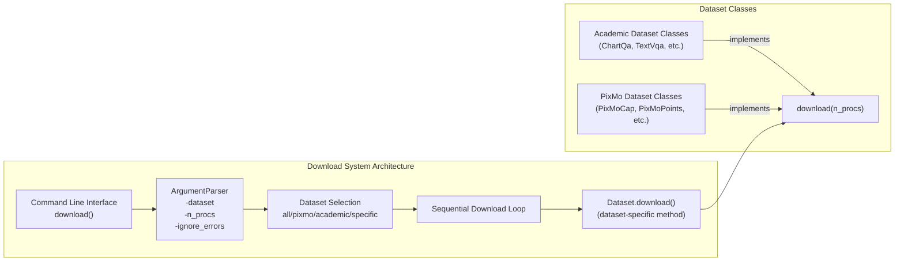

<!-- source: DeepWiki mcp.deepwiki.com · repo allenai/molmo · page 2.2 Dataset Downloading · fetched 2026-10-26 -->

# Dataset Downloading

<details>
<summary>Relevant source files</summary>

The following files were used as context for generating this wiki page:

- [README.md](README.md)
- [scripts/download_data.py](scripts/download_data.py)

</details>


This document provides instructions for downloading and setting up the datasets required for training and evaluating Molmo models. It covers the different types of datasets used in the Molmo ecosystem, how to download them, and special considerations for handling the download process. For information about data preprocessing and loading after downloading, see [Data Preprocessing and Loading](#2.3).

## Dataset Overview

Molmo uses two main categories of datasets: PixMo and Academic. The PixMo datasets were developed specifically for Molmo, while Academic datasets are from established benchmarks.

```mermaid
flowchart TD
    subgraph "Dataset Categories"
        DATASETS["DATASETS"] --> PIXMO["PIXMO_DATASETS"]
        DATASETS --> ACADEMIC["ACADEMIC_DATASETS"]
        ACADEMIC --> ACADEMIC_EVAL["ACADEMIC_EVAL<br>(Subset for evaluation)"]
    end

    subgraph "PixMo Datasets"
        PIXMO --> PixMoCap["PixMoCap<br>(Dense captions)"]
        PIXMO --> PixMoAMA["PixMoAskModelAnything<br>(Human QA pairs)"]
        PIXMO --> PixMoCapQA["PixMoCapQA<br>(Synthetic QA pairs)"]
        PIXMO --> PixMoPoints["PixMoPoints<br>(Referring points)"]
        PIXMO --> PixMoPE["PixMoPointExplanations<br>(Point explanations)"]
        PIXMO --> PixMoDocs["PixMoDocs<br>(Document QA)"]
        PIXMO --> PixMoCount["PixMoCount<br>(Counting)"]
        PIXMO --> PixMoClocks["PixMoClocks<br>(Time reading)"]
    end

    subgraph "Academic Datasets"
        ACADEMIC --> VQA["Visual QA<br>(VQA2, TextVQA, etc.)"]
        ACADEMIC --> Charts["Chart Understanding<br>(ChartQA, PlotQA, etc.)"]
        ACADEMIC --> Documents["Document Understanding<br>(DocQA, InfoQA, etc.)"]
        ACADEMIC --> Math["Math & Counting<br>(MathVista, TallyQA, etc.)"]
        ACADEMIC --> Other["Other Benchmarks<br>(MMMU, AI2D, etc.)"]
    end
```



Sources: [scripts/download_data.py:14-31]()

### PixMo Datasets

PixMo is a collection of datasets created specifically for pre-training and fine-tuning Molmo models:

| Dataset | Description | Purpose |
|---------|-------------|---------|
| PixMo-Cap | Dense captions (~200 words per image) | Pre-training, fine-tuning |
| PixMo-AskModelAnything | Human-authored image-question-answer triplets | Fine-tuning |
| PixMo-CapQA | Synthetic QA pairs derived from dense captions | Fine-tuning |
| PixMo-Points | Images with referring expressions and annotated points | Fine-tuning |
| PixMo-Point-Explanations | Explanations with in-line points referring to image parts | Fine-tuning |
| PixMo-Docs | Synthetic QA about charts, tables, diagrams, and documents | Fine-tuning |
| PixMo-Clocks | Virtual watch faces with time annotations | Fine-tuning |
| PixMo-Count | Diverse images with counting QA pairs | Fine-tuning |

Sources: [README.md:35-46](), [scripts/download_data.py:26-29]()

### Academic Datasets

Academic datasets include established benchmarks for multimodal understanding:

| Category | Datasets |
|----------|----------|
| Visual Question Answering | VQA2, TextVQA, OkVQA, AOkVQA |
| Chart Understanding | ChartQA, PlotQA, FigureQA, DvQA |
| Document Understanding | DocQA, InfoQA, SceneTextQA, TabWMPDirectAnswer |
| Math & Counting | MathVista, TallyQA, CountBenchQA |
| Other | MMMU, AI2D, RealWorldQA, ScienceQAImageOnly, AndroidControl |

Sources: [scripts/download_data.py:19-24]()

## Setting Up Environment Variables

Before downloading datasets, you need to set up environment variables to specify where the data should be stored:

```bash
export MOLMO_DATA_DIR=/path/to/data/directory
export HF_HOME=/path/to/data/directory/huggingface
```

- `MOLMO_DATA_DIR`: Specifies the directory where Molmo-specific data will be stored
- `HF_HOME`: Specifies the Huggingface cache directory where most datasets will be stored

Sources: [README.md:116-127]()

## Download Script Architecture

The download system is implemented in the `scripts/download_data.py` file, which manages downloading the various dataset types:



Sources: [scripts/download_data.py:39-76]()

## Downloading Datasets

### Basic Usage

The main script for downloading datasets is `scripts/download_data.py`. It supports downloading individual datasets or groups of datasets:

```bash
# Download all datasets
python3 scripts/download_data.py all --n_procs 12

# Download only PixMo datasets
python3 scripts/download_data.py pixmo --n_procs 12

# Download only academic datasets
python3 scripts/download_data.py academic --n_procs 12

# Download a specific dataset
python3 scripts/download_data.py ChartQa --n_procs 12
```

The `--n_procs` parameter specifies the number of processes to use for downloading, which can speed up the process but may increase the risk of being rate-limited.

Sources: [README.md:129-133](), [scripts/download_data.py:39-63]()

### Download Process

When you run the download script:

1. It parses command-line arguments to determine which datasets to download
2. For each dataset in the list:
   - It logs the start of the download process
   - Calls the dataset-specific download method with the specified number of processes
   - Logs completion time for the dataset
3. If an error occurs during download:
   - With `--ignore_errors`: The error is logged, and the script continues with the next dataset
   - Without `--ignore_errors`: The script stops with an error

Sources: [scripts/download_data.py:64-75]()

## Special Considerations

### Download Time and Resources

Downloading all datasets, especially PixMo datasets that involve fetching images from URLs, can take a significant amount of time (up to a day when downloading everything from scratch). More processes can make it faster but may increase the risk of being rate-limited.

Sources: [README.md:134-138]()

### Resuming Interrupted Downloads

If a download is canceled or encounters an error, it can be resumed by running the same command again. The download system will detect already downloaded files and continue from where it left off.

Sources: [README.md:139-140]()

### Manually Downloaded Datasets

Some datasets require manual downloading:

- InfoQa
- Scene-Text

The download scripts will throw an error if these files are not found in the expected location.

Sources: [README.md:142-143]()

### Additional Dependencies

The AndroidControl dataset requires additional dependencies since it involves parsing the original TFRecords format.

Sources: [README.md:145-147]()

### Multi-Node Setup

For multi-node setups, ensure data is downloaded before training and consider using `HF_DATASETS_OFFLINE=1` environment variable to prevent nodes from flooding Hugging Face with requests:

```bash
# Download first
python3 scripts/download_data.py all --n_procs 12

# Then for training across nodes
export HF_DATASETS_OFFLINE=1
```

Sources: [README.md:303-309]()

## Dataset Visualization

After downloading, you can visualize dataset samples using the `scripts/dataset_visualize.py` script:

```bash
python3 scripts/dataset_visualize.py chart_qa /path/to/viz/dir
```

This is helpful for inspecting the data quality and understanding the dataset characteristics.

Sources: [README.md:154-158]()

## Troubleshooting

### Common Issues

1. **Rate Limiting**: If you're getting rate-limited when downloading from external sources, try reducing the number of processes (`--n_procs`) or adding delays between requests.

2. **Missing Manual Datasets**: Ensure you've manually downloaded and placed the required files for InfoQa and Scene-Text datasets in the correct location.

3. **Storage Space**: Ensure you have sufficient storage space, especially for image-heavy datasets.

4. **Permission Issues**: Make sure the specified `MOLMO_DATA_DIR` and `HF_HOME` directories are writable by the current user.

### Error Handling

If you want to continue downloading even when some datasets fail, use the `--ignore_errors` flag:

```bash
python3 scripts/download_data.py all --n_procs 12 --ignore_errors
```

With this flag, errors will be logged, but the script will continue processing other datasets.

Sources: [scripts/download_data.py:44-46](), [scripts/download_data.py:69-74]()

---

