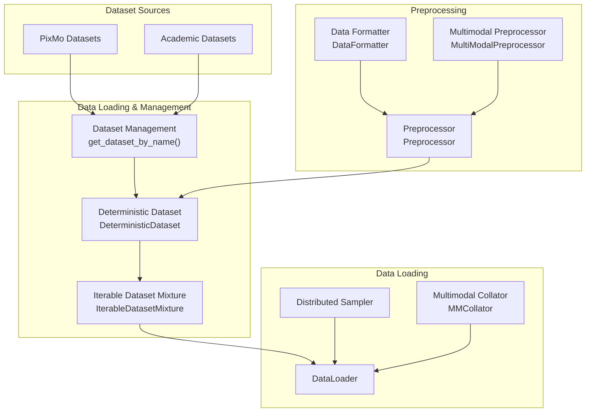
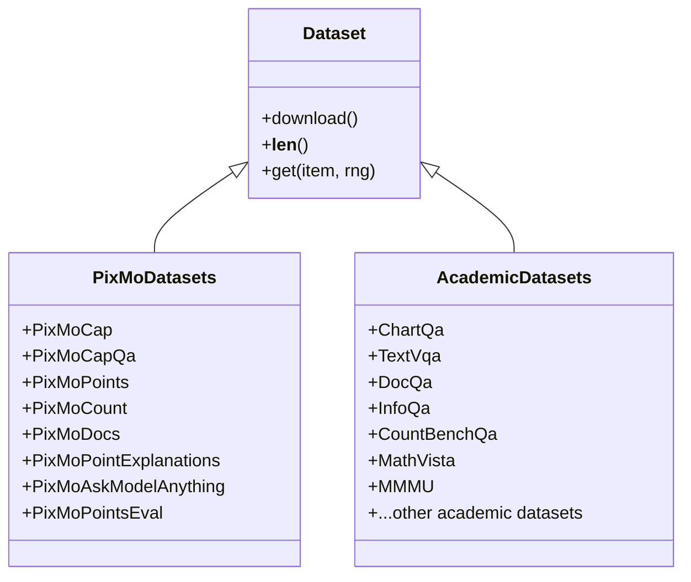
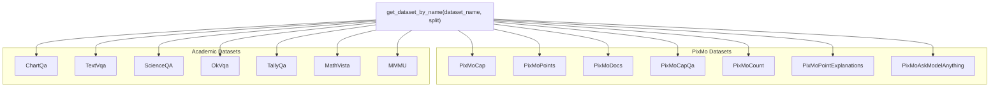
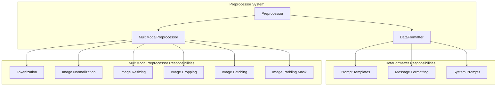
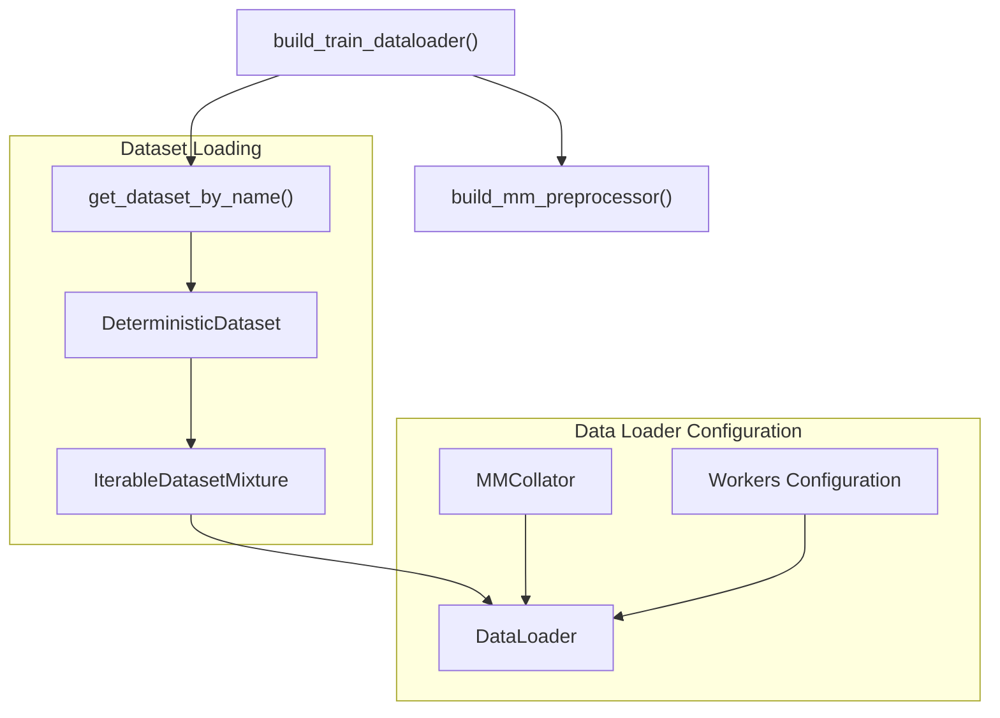

<!-- source: DeepWiki mcp.deepwiki.com · repo allenai/molmo · page 2.3 Data Preprocessing and Loading · fetched 2026-10-26 -->

# Data Preprocessing and Loading

Relevant source files

The following files were used as context for generating this wiki page:

- [olmo/data/__init__.py](olmo/data/__init__.py)
- [olmo/data/pixmo_datasets.py](olmo/data/pixmo_datasets.py)

This section documents the data preprocessing and loading components in the Molmo system. It covers how data is processed, formatted, and loaded for model training and evaluation. For information about dataset downloading, see [Dataset Downloading](#2.2).

## 1. Data Processing Pipeline Overview

The Molmo system implements a comprehensive data processing pipeline that handles various multimodal datasets, preprocesses them for model consumption, and loads them efficiently during training and evaluation.

Sources: [olmo/data/__init__.py:22-70](), [olmo/data/__init__.py:126-211]()

## 2. Dataset Ecosystem

The Molmo system uses a variety of datasets for training and evaluation, primarily categorized into PixMo datasets and academic datasets.

### 2.1 Dataset Class Structure

All dataset classes in the system extend a base `Dataset` class and implement consistent interfaces:

Sources: [olmo/data/pixmo_datasets.py:73-459](), [olmo/data/__init__.py:6-9]()

### 2.2 Dataset Retrieval System

Datasets are retrieved using the `get_dataset_by_name` function, which maps dataset names to their respective class instantiations:

Sources: [olmo/data/__init__.py:214-319]()

## 3. Data Preprocessing Components

### 3.1 Preprocessor Architecture

The data preprocessing pipeline consists of several components working together to transform raw data into the format expected by the model:

Sources: [olmo/data/__init__.py:23-69]()

### 3.2 Building the Preprocessor

The `build_mm_preprocessor` function constructs the preprocessing pipeline with the following key components:

1. **DataFormatter**: Handles text formatting, including:
   - Prompt templates
   - Message formatting
   - System prompts

2. **MultiModalPreprocessor**: Handles image processing and tokenization, with options for:
   - Normalization based on the vision model
   - Cropping mode (center, multiple, etc.)
   - Resizing strategy
   - Image patching
   - Padding masks

The preprocessor can be configured for either training or inference, with options to shuffle messages and enable/disable image feature extraction.

Sources: [olmo/data/__init__.py:23-69]()

## 4. Data Loading Mechanisms

### 4.1 Training Data Loading

The `build_train_dataloader` function handles loading data for training, which includes:

1. Building the multimodal preprocessor
2. Loading datasets based on configuration
3. Creating dataset mixtures for multi-dataset training
4. Setting up an iterable dataset with deterministic processing
5. Configuring the data loader with appropriate batch size, collation, and worker settings

For multi-dataset training, the system supports configuring sampling rates for different datasets, including using the square root of dataset sizes to balance sampling.

Sources: [olmo/data/__init__.py:144-211]()

### 4.2 Evaluation Data Loading

The `build_eval_dataloader` and `build_torch_mm_eval_dataloader` functions handle loading data for evaluation:

1. Building evaluation-specific preprocessor (typically with `for_inference=True`)
2. Loading the specified dataset
3. Optionally padding the dataset for distributed evaluation
4. Creating a distributed sampler
5. Configuring the data loader with appropriate settings for evaluation

For distributed evaluation, especially with FSDP (Fully Sharded Data Parallel), the system ensures all devices receive the same number of batches by padding the dataset when needed.

Sources: [olmo/data/__init__.py:72-141]()

## 5. Collation and Batch Formation

The `MMCollator` class handles collating individual examples into batches for model consumption, including:

1. Padding sequences to a specified length
2. Handling multiple image crops
3. Including metadata when required
4. Preparing tensors in the format expected by the model

The collator is configured with the maximum sequence length and maximum number of crops per image, ensuring consistent batch sizes and formats.

Sources: [olmo/data/__init__.py:109-123](), [olmo/data/__init__.py:198-204]()

## 6. Configuration Options

Key configuration parameters that affect data preprocessing and loading include:

| Parameter | Description | Location |
|-----------|-------------|----------|
| `sequence_length` | Maximum sequence length for tokenized inputs | DataConfig |
| `multi_modal` | Type of multimodal processing ("torch", "torch_hf") | DataConfig |
| `shuffle` | Whether to shuffle the data | DataConfig |
| `pad` | Whether to pad sequences | DataConfig |
| `drop_last` | Whether to drop the last incomplete batch | DataConfig |
| `num_workers` | Number of worker processes for data loading | DataConfig |
| `crop_mode` | How to crop images (center, multiple, etc.) | ModelConfig |
| `max_crops` | Maximum number of crops per image | ModelConfig |
| `image_pooling_w/h` | Width/height for image pooling | ModelConfig |
| `normalize` | Image normalization strategy | ModelConfig |
| `image_padding_mask` | Type of padding mask for images | ModelConfig |

Sources: [olmo/data/__init__.py:23-69](), [olmo/data/__init__.py:105-123]()

---

