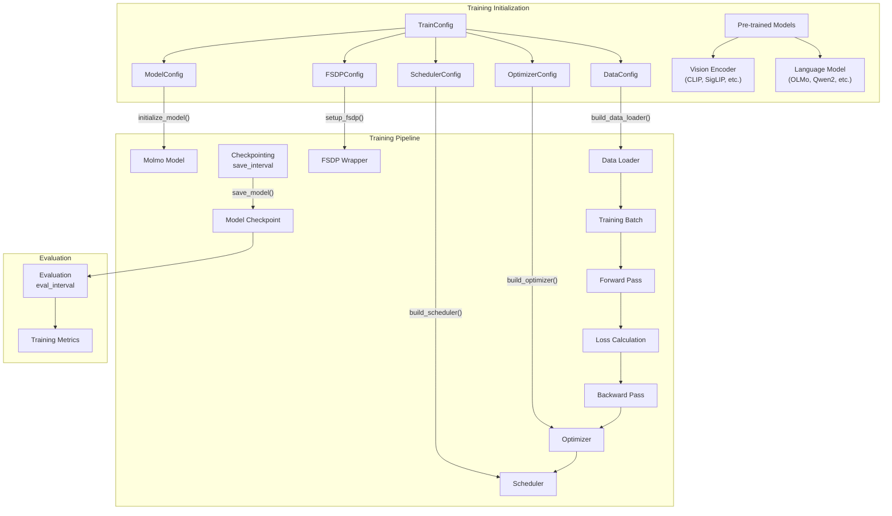
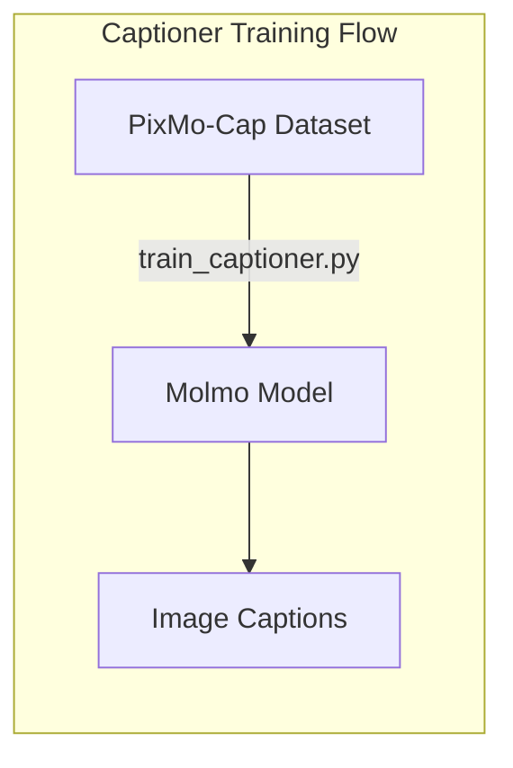
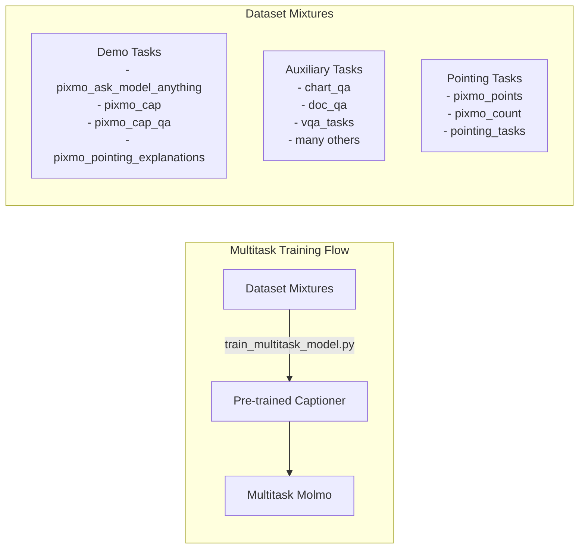
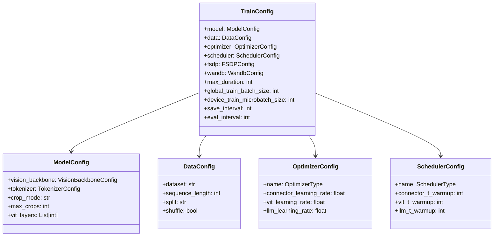
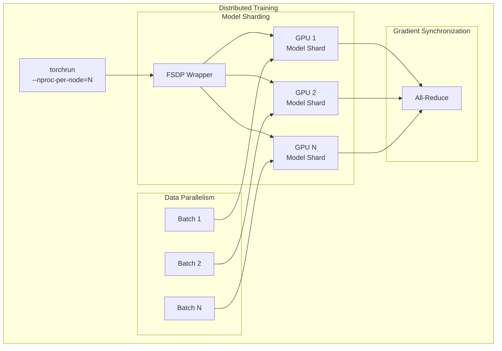
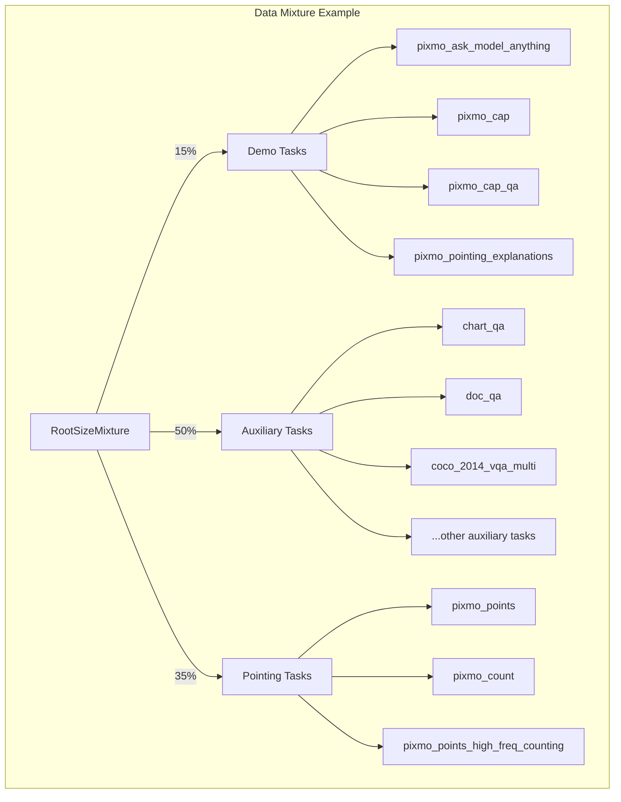

<!-- source: DeepWiki mcp.deepwiki.com · repo allenai/molmo · page 3 Training · fetched 2026-10-26 -->

# Training

<details>
<summary>Relevant source files</summary>

The following files were used as context for generating this wiki page:

- [README.md](README.md)
- [launch_scripts/train_captioner.py](launch_scripts/train_captioner.py)
- [launch_scripts/train_multitask_model.py](launch_scripts/train_multitask_model.py)

</details>


This page provides an overview of the training process for Molmo multimodal language models. It covers the general training architecture, workflow, and key components involved in training Molmo models. For detailed information about specific training approaches, see [Captioner Training](#3.1) and [Multitask Training](#3.2). For a comprehensive guide to training configuration options, see [Training Configuration](#3.3).

## Training Architecture

The Molmo training system is built to efficiently train multimodal models that integrate vision encoders with language models. The training architecture is designed to support both pre-training on captioning data and fine-tuning on multitask data.

### High-Level Training Architecture



Sources: [launch_scripts/train_captioner.py:110-203](), [launch_scripts/train_multitask_model.py:209-295]()

## Training Types

Molmo supports two primary training workflows:

### Captioner Training

Captioner training focuses on teaching the model to generate text descriptions for images. This is typically the first stage of training, where the model learns to understand and describe visual content.



Sources: [launch_scripts/train_captioner.py:1-212](), [README.md:258-276]()

### Multitask Training

Multitask training builds on top of captioner training by incorporating various multimodal tasks such as visual question answering, pointing, counting, and more. This is typically the second stage of training, where a previously trained captioner model is fine-tuned on multiple tasks.



Sources: [launch_scripts/train_multitask_model.py:1-304](), [README.md:278-295]()

## Key Components

### Configuration System

The Molmo training system uses a hierarchical configuration system to define all aspects of training. The `TrainConfig` class is the root configuration that contains nested configurations for model, data, optimizer, scheduler, and FSDP.



Sources: [launch_scripts/train_captioner.py:110-203](), [launch_scripts/train_multitask_model.py:209-295]()

### Model Components

During training, different components of the model can be selectively fine-tuned:

| Component       | Control Flag   | Learning Rate Parameter     | Description                                      |
|-----------------|----------------|----------------------------|--------------------------------------------------|
| Vision Encoder  | `ft_vit`       | `vit_learning_rate`        | The vision component (CLIP, SigLIP, etc.)        |
| Connector       | `ft_connector` | `connector_learning_rate`  | Module connecting vision and language components |
| Language Model  | `ft_llm`       | `llm_learning_rate`        | The text generation component (OLMo, Qwen2)      |

Sources: [launch_scripts/train_captioner.py:137-139](), [launch_scripts/train_multitask_model.py:239-241]()

## Distributed Training

Molmo uses PyTorch's Fully Sharded Data Parallel (FSDP) for efficient distributed training across multiple GPUs and potentially multiple nodes.



Sources: [README.md:303-310](), [launch_scripts/train_captioner.py:164-169](), [launch_scripts/train_multitask_model.py:266-270]()

## Training Workflow

The typical workflow for training a Molmo model involves:

1. **Initialization Phase**:
   - Download pre-trained models for initialization
   - Configure training parameters
   - Set up distributed training environment

2. **Captioner Training**:
   - Train on the PixMo-Cap dataset to learn basic image-text alignment
   - Example command:
     ```
     torchrun --nproc-per-node=8 launch_scripts/train_captioner.py qwen2_7b --save_folder=/path/to/save/folder
     ```

3. **Multitask Training**:
   - Fine-tune the captioner model on a mixture of tasks
   - Example command:
     ```
     torchrun --nproc-per-node=8 launch_scripts/train_multitask_model.py 3.2-synthetic /path/to/captioner/checkpoint --save_folder=/path/to/save/folder
     ```

4. **Evaluation**:
   - Periodic evaluation during training at intervals specified by `eval_interval`
   - Comprehensive evaluation after training

Sources: [README.md:242-295](), [launch_scripts/train_captioner.py:29-212](), [launch_scripts/train_multitask_model.py:72-304]()

## Common Training Parameters

Below are some important training parameters that can be configured:

| Parameter                    | Description                                                |
|------------------------------|------------------------------------------------------------|
| `global_batch_size`          | Total batch size across all GPUs                           |
| `device_train_microbatch_size` | Batch size per GPU                                       |
| `seq_len`                    | Maximum sequence length for training                       |
| `max_duration`               | Maximum number of training steps                           |
| `save_interval`              | Number of steps between checkpoints                        |
| `eval_interval`              | Number of steps between evaluations                        |
| `learning_rates`             | Separate learning rates for vision, connector, and LLM components |
| `warmup_steps`               | Steps for learning rate warmup                             |

For a complete list of configuration options, see [Training Configuration](#3.3).

Sources: [launch_scripts/train_captioner.py:110-203](), [launch_scripts/train_multitask_model.py:209-295]()

## Data Mixtures for Training

For multitask training, Molmo uses a mixture of datasets with configurable proportions:



Sources: [launch_scripts/train_multitask_model.py:28-143](), [launch_scripts/train_multitask_model.py:192-195]()

## Further Reading

For more detailed information about specific aspects of training, refer to:
- [Captioner Training](#3.1) for details on training image captioning models
- [Multitask Training](#3.2) for information on training models across various tasks
- [Training Configuration](#3.3) for comprehensive documentation on configuration options
- [Datasets](#2) for information about the data used for training
- [Evaluation](#4) for understanding how models are evaluated during and after training

---

