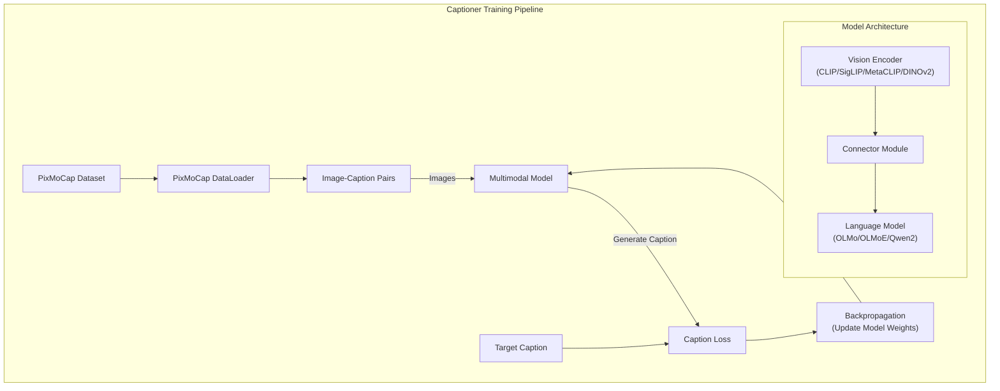
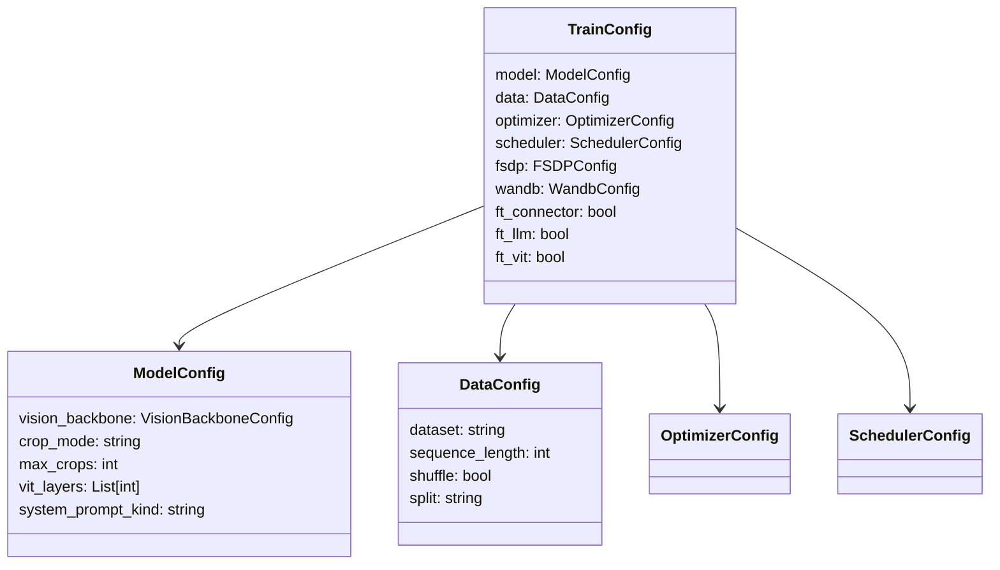
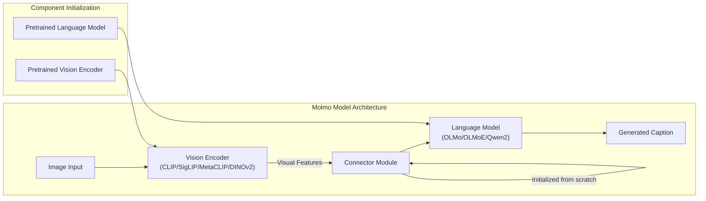
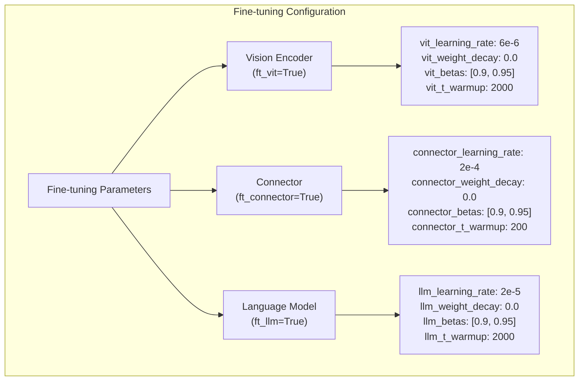
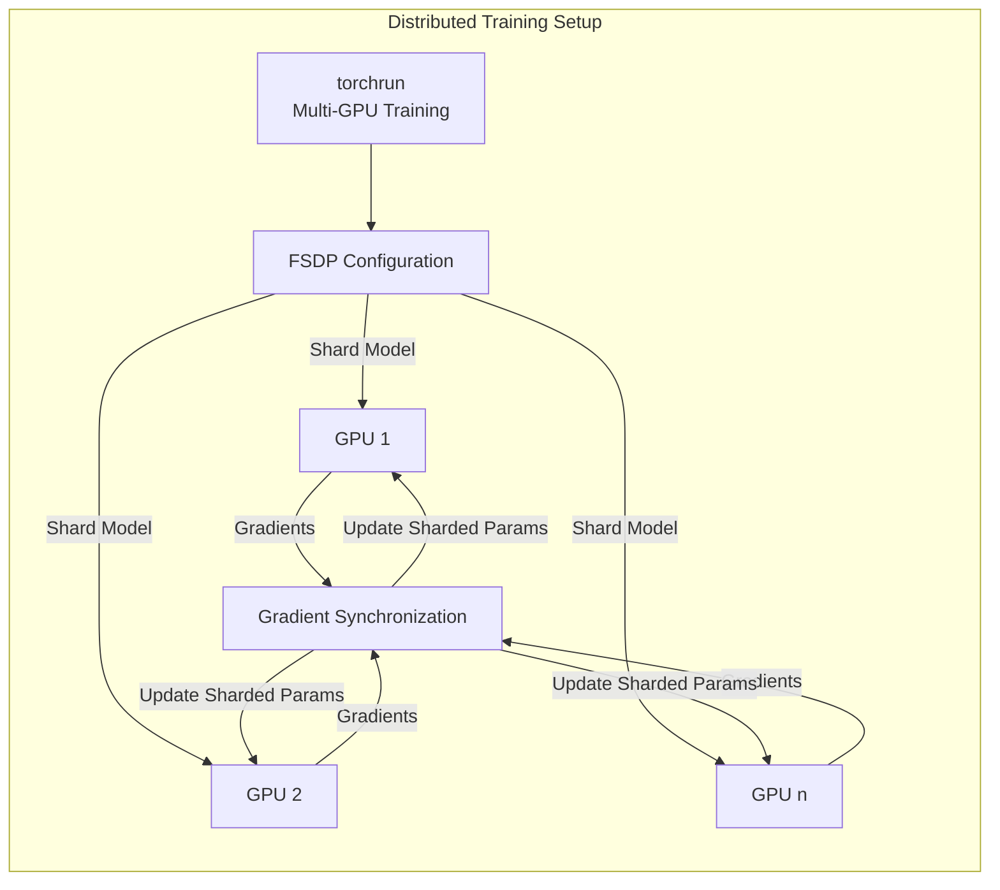
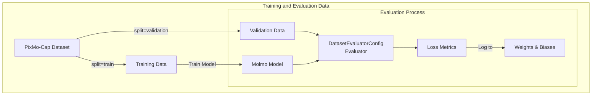

<!-- source: DeepWiki mcp.deepwiki.com · repo allenai/molmo · page 3.1 Captioner Training · fetched 2026-10-26 -->

# Captioner Training

<details>
<summary>Relevant source files</summary>

The following files were used as context for generating this wiki page:

- [README.md](README.md)
- [launch_scripts/train_captioner.py](launch_scripts/train_captioner.py)

</details>


This document covers the process of training the image captioning component of the Molmo multimodal language model. Captioner training focuses specifically on teaching the model to generate detailed textual descriptions of images, which serves as the foundation for more complex multimodal capabilities. For training models on multiple tasks simultaneously, see [Multitask Training](#3.2).

## Overview of Captioner Training

Captioner training is the initial stage of training a Molmo model, where the model learns to generate detailed descriptions (captions) for images. This training primarily uses the PixMo-Cap dataset, which contains images paired with highly detailed captions (averaging approximately 200 words per caption).



Sources: [launch_scripts/train_captioner.py:1-211](), [README.md:37-40]()

## Training Configuration and Setup

Captioner training is orchestrated by the `train_captioner.py` script which sets up the proper configuration and launches the training process. The training can be configured with various parameters for model architecture, optimization, and data processing.



Sources: [launch_scripts/train_captioner.py:110-203]()

### Key Training Parameters

The following table outlines important parameters that control the captioner training process:

| Parameter | Default Value | Description |
|-----------|---------------|-------------|
| `global_batch_size` | 128 | Total batch size across all GPUs |
| `seq_len` | 2304 | Maximum sequence length for captions |
| `dataset` | "pixmo_cap_with_transcripts" | Default dataset for training |
| `vision_backbone` | "openai" | Default vision encoder (CLIP) |
| `ft_connector` | True | Whether to fine-tune the connector module |
| `ft_llm` | True | Whether to fine-tune the language model |
| `ft_vit` | True | Whether to fine-tune the vision encoder |
| `connector_learning_rate` | 2e-4 | Learning rate for connector module |
| `vit_learning_rate` | 6e-6 | Learning rate for vision encoder |
| `llm_learning_rate` | 2e-5 | Learning rate for language model |
| `max_crops` | 12 | Maximum number of image crops |
| `crop_mode` | "overlap-and-resize-c2" | Image cropping strategy |
| `eval_interval` | 1000 | Steps between evaluations |
| `save_interval` | 4000 | Steps between saving checkpoints |

Sources: [launch_scripts/train_captioner.py:48-203]()

## Multimodal Model Architecture

The captioner training involves a multimodal architecture consisting of three main components:

1. **Vision Encoder**: Processes images to extract visual features
2. **Connector Module**: Bridges the vision and language components
3. **Language Model**: Generates textual captions based on visual features



Sources: [launch_scripts/train_captioner.py:77-91](), [README.md:83-111]()

## Component-Specific Training

One of the key aspects of captioner training is the ability to separately configure the fine-tuning of different components. Each component (vision encoder, connector, language model) has its own learning rate and optimization parameters.



Sources: [launch_scripts/train_captioner.py:137-163]()

## Distributed Training

Captioner training supports distributed training across multiple GPUs using PyTorch's Distributed Data Parallel (DDP) with Fully Sharded Data Parallel (FSDP) for memory efficiency.



Sources: [launch_scripts/train_captioner.py:29-38](), [launch_scripts/train_captioner.py:164-168]()

## Running Captioner Training

To launch captioner training, you use the `train_captioner.py` script with appropriate arguments. Here are the main ways to run training:

### Debug Mode

For quick testing and debugging:

```bash
torchrun --nproc-per-node=1 launch_scripts/train_captioner.py debug --save_folder=/path/to/save/folder
```

### Full Training

For training with Qwen2 7B LLM and CLIP vision encoder:

```bash
torchrun --nproc-per-node=8 launch_scripts/train_captioner.py qwen2_7b --wandb.name=run_name --wandb.entity=entity --wandb.project=project --save_folder=/path/to/save/folder
```

### Customizing Vision Encoder

To use a different vision encoder:

```bash
torchrun --nproc-per-node=8 launch_scripts/train_captioner.py qwen2_7b --vision_backbone=siglip --save_folder=/path/to/save/folder
```

Sources: [README.md:260-276](), [launch_scripts/train_captioner.py:46-53]()

## Training Data and Evaluation

The captioner is primarily trained on the PixMo-Cap dataset, which contains high-quality image-caption pairs with detailed descriptions. During training, the model is periodically evaluated on a validation set.



Sources: [launch_scripts/train_captioner.py:93-108](), [launch_scripts/train_captioner.py:190-202]()

## Next Steps After Captioner Training

Once captioner training is complete, the model can be further refined through [Multitask Training](#3.2) to handle more complex multimodal tasks such as visual question answering, pointing, counting, and more. The captioner provides a strong foundation for these advanced capabilities by teaching the model to understand and describe images thoroughly.

Sources: [README.md:278-288]()

---

